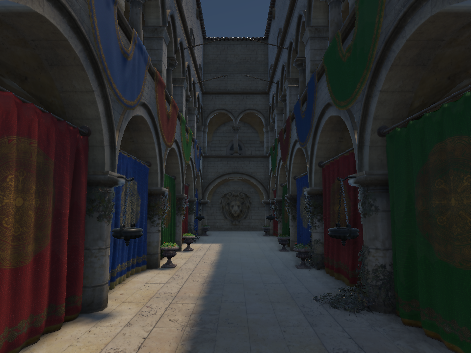
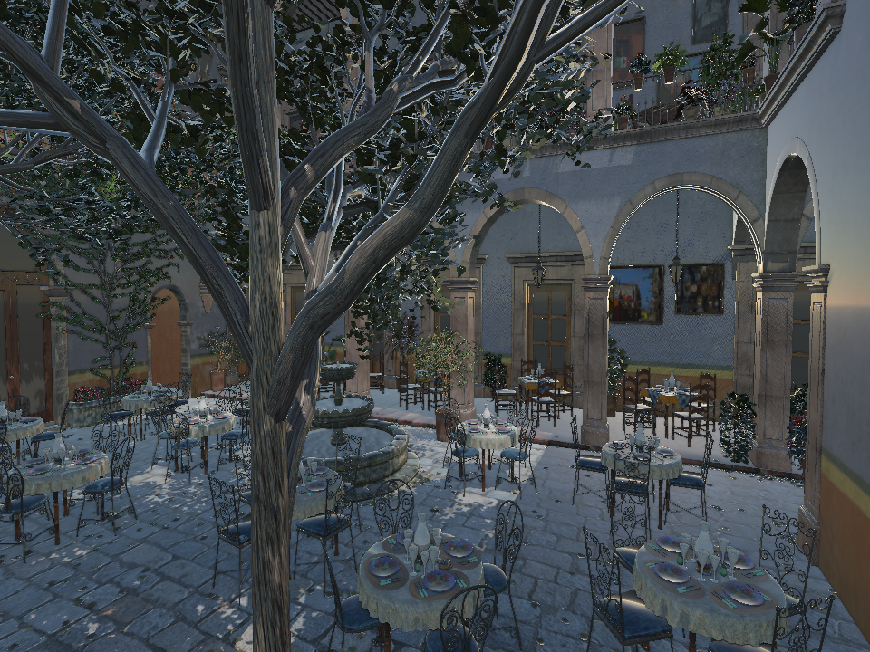

# Scene Renderer

**English** · [简体中文](README.zh-CN.md)

A **C++17 renderer** for learning and experimentation, originating from a computer graphics course project at Tongji University. A shared **RHI** supports native **Metal and Vulkan**, with an interactive editor, real-time effects and CPU/GPU path tracing.



[Quick start](#quick-start) · [Capabilities](#capabilities) · [Real-time rendering](#real-time-rendering) · [Cluster and dynamic LOD](#cluster-and-dynamic-lod) · [Path tracing](#path-tracing) · [Development status](#development-status) · [Documentation](#documentation)

## Quick start

On macOS, install Xcode with the Metal Toolchain, CMake, Python 3.9+ and these dependencies. Run from the repository root:

```sh
brew install glfw assimp yaml-cpp glslang spirv-cross
cmake -S . -B build -DSCENERENDERER_RHI_BACKEND=Metal -DCMAKE_BUILD_TYPE=Release
cmake --build build --target Scene-Renderer -j2
./build/Scene-Renderer --memory-info
./build/Scene-Renderer --classic cornell --size 1280x720
```

Cornell, sky, ocean and the diving scene are procedural and need no large asset downloads. Sponza and San Miguel require `python3 tools/fetch_gi_assets.py`; other downloads and Vulkan/MoltenVK builds are covered in [build and run](docs/getting-started.md). NumPy and Pillow are required by the cave generator and visualization tools.

Hold the right mouse button to look around; **W/A/S/D** moves, **Q/E** moves vertically and **Shift** increases speed. Editor panels control lighting, water, cluster LOD and post effects.

**Memory admission stays enabled:** process budget is the smaller of 20% of physical RAM and 3 GiB; GPU resources default to half, with one editor frame in flight. On a 16 GiB machine this is **3 GiB / 1.5 GiB**. System pressure rejects new heavy work and preserves an existing editor frame. `--memory-budget-mib`, `--gpu-resource-budget-mib` and `--memory-info` configure or inspect it. This is cooperative allocation protection; its scope is documented in [memory safety](docs/memory-safety.md).

## Capabilities

| Area | Implementation and references |
| --- | --- |
| Materials and lighting | PBR, CSM/PCSS shadows, GTAO/SSAO, filtered materials and improved TAA; [DDGI diffuse GI](docs/ddgi.md) and optional PT probe references. |
| Geometry and visibility | Object/triangle culling, hierarchical meshlets, GPU screen-error LOD, indexed indirect drawing and two-stage cluster Hi-Z. [Geometry pipeline](docs/hierarchical-cluster-geometry.md). |
| Natural environments | Atmospheric scattering, volumetric clouds, height/material virtual textures, terrain LOD, procedural vegetation and shared weather. [Environment specification](docs/mountain-lake-environment-spec.md). |
| Water | FFT wind waves and swell, reflection/refraction, absorption/scattering, shore waves, foam, seabed caustics and underwater sun shafts. [Water rendering](docs/ocean-fft-and-rendering-review.md). |
| Post processing | HDR Bloom, depth of field, camera motion blur, tone mapping/color grading, FXAA, sharpening, vignette, chromatic aberration and grain. [Controls and scope](docs/post-processing.md). |
| Path tracing | CPU/Metal/Vulkan integrators, textured materials, dielectric/volume transport, fiber/cloth materials, shared BLAS/TLAS, photon mapping and OIDN. [GPU PT](docs/path-tracing-gpu.md). |
| Runtime | Immutable world snapshots, a dedicated render thread, bounded preparation workers, resource budgets and RenderGraph pass culling. [System design](docs/system-design.md). |

## Real-time rendering

These selected captures use this project's native Metal renderer. [Expanded showcase](docs/rendering-showcase.md) retains all comparisons and intermediate results; the [full gallery](docs/rendering-gallery.md) records capture settings and reproduction.

### Architecture and diffuse GI

| San Miguel: RSM disabled | Sponza: DDGI enabled |
| --- | --- |
|  |  |

DDGI provides local sky visibility and diffuse color bounce through irradiance probes. The editor uses six-face raster capture; optional offline probe references reuse PT. This is the first GI stage, with remaining leakage, lighting and material differences against PT. [Probe layout and GPU visualization](docs/ddgi.md#原理与-sponza-探针布局) · [TAA comparison](docs/realtime-anti-aliasing.md). RSM is disabled by default and retained as a historical demo.

### Atmosphere, terrain and water

| Mountain Lake: aerial perspective and mountain shadows | Immersive 3D cloud volume |
| --- | --- |
|  |  |

Terrain paging, FFT lake water and vegetation share sun, wind and weather controls. [Mountain Lake](docs/mountain-lake.md) · [Aerial perspective](docs/atmospheric-aerial-perspective.md) · [Procedural trees](docs/procedural-trees.md).

| Underwater diving: sun shafts and caustics | Looking up: refracted sky, sun and floating marker |
| --- | --- |
|  |  |

Use `--classic underwater-dive` to explore the seabed. The Ocean panel independently controls fog, sun shafts, caustics and air refraction. [Diving scene and controls](docs/water-underwater-diving.md) · [Refraction and performance](docs/water-air-refraction.md) · [Shore waves and foam](docs/water-coastal-features.md).

### Post processing

| Default display | ACES and combined post effects |
| --- | --- |
|  |  |

The **Post processing** panel exposes each effect and a soft cinematic preset. Extra effects default to off; depth of field uses opaque depth and motion blur currently covers camera motion. [Pipeline and individual comparisons](docs/post-processing.md).

## Cluster and dynamic LOD

The dense limestone cave uses **9 shared meshes / 2.88 million unique triangles**, instanced into **76 draws / 24.84 million logical triangles**. Fractures and mineral relief move real vertices; the procedural package is **84.8 MB**, with a checked **10 GB disk cap**.


This animation uses **native captures recorded before the memory-admission defaults**. PBR, unique cluster IDs and parent levels show recorded camera poses; the bar charts count submitted triangles. At fixed 4 px, those captures reduce submissions by **25.57% near to 54.64% farther**, against each camera's own 0 px reference, with object/occlusion culling disabled. Playback speed and triangle reduction do not establish renderer FPS. [Enlarged cluster boundaries and triangle wireframe](img/diagnostics/cluster-cave/detail.png).

The latest implementation records **11 camera poses**, including two interior chambers and a same-camera **0 / 2 / 4 / 8 px** comparison. Reference and LOD reuse one renderer; diagnostics replay at most **65,536 triangles per batch**, with **24 MiB scratch reservations** at default budgets, and stream large membership lists to JSONL. A separate `cluster-cave-small` package preserves the dense source geometry. **Build and four memory/RHI tests pass; the new GPU replay, memory peaks and added poses remain pending validation.** [Procedure and validation scope](docs/cluster-cave.md) · [Implementation checks](img/diagnostics/cluster-cave/implementation-validation.json).

<details>
<summary>Prepare a separate smaller cave and capture it when memory pressure is normal</summary>

```sh
python3 tools/prepare_cluster_cave.py --level 6
./build/Scene-Renderer --memory-info
./build/Scene-Renderer --cluster-scene-flow cluster-cave-small build/cluster-cave-bounded-small --backend Metal
python3 tools/visualize_cluster_scene_compact.py build/cluster-cave-bounded-small img/diagnostics/cluster-cave-bounded-small
```

Small-package generation and protected captures are pending. The process/GPU limits and pressure checks remain enabled.

</details>

Other scene tests retain their own camera and build configurations:

| Scene | Geometry | Evidence |
| --- | --- | --- |
| Coastal Cliff | 9.43M logical triangles, ten shared original LOD0 instances | Recorded parent-builder change improves same-view 4 px reduction from 3.24% to 36.56%. [Quality and timing](docs/cluster-parent-lod-optimization.md). |
| Bistro exterior | 2.83M source triangles, 132 material meshes | Whole-street partition and camera-route LOD; recorded reductions are modest at 2.95–5.04%. [Animation, connectivity and measurements](docs/rendering-showcase.md#bistro-whole-scene-cluster-and-lod-demonstration). |
| Sponza and Stanford scans | Architecture and dense scanned surfaces | [Meshlet utilization](docs/cluster-partition-and-hierarchy.md), [two-stage Hi-Z](docs/cluster-two-stage-hiz.md) and [dynamic LOD](docs/cluster-hiz-optimization-and-lod.md). |

This is a **Nanite-inspired prototype**. Geometry streaming, visibility-buffer shading and hybrid rasterization remain future work. UE Nanite captures of the cliff are identified as [separate reference-engine results](docs/cluster-cliff-nanite-test.md).

## Path tracing

The architectural and natural scenes also have path-traced results. These are rendered by this project's CPU/Metal/Vulkan integrators; images below use **OIDN** and identify the integrator. [Raw results, sampling and reproduction](docs/rendering-gallery.md#路径追踪).

| Sponza: Metal PT, 64 spp | San Miguel: Metal PT, 64 spp |
| --- | --- |
|  |  |

| Terrain and grass: Metal PT, 128 spp | Mountain Lake: Metal PT, 128 spp |
| --- | --- |
|  |  |

| Lakeside beach: Metal PT, 1024 spp | Shallow-water refraction: Metal PT, 4096 spp |
| --- | --- |
|  |  |

Procedural terrain, vegetation and FFT water are frozen at a recorded simulation time. Beach textures use world-scale sampling; shallow-water solar paths use a BSDF/phase mixture proposal. [Capture details and fixes](docs/path-tracing-procedural.md) · [Real-time/PT ocean alignment](docs/ocean-reflection-integration.md).

| Glass Dragon: CPU BDPT | Jade Dragon: Metal PT, subsurface scattering |
| --- | --- |
|  |  |

[Photon mapping and pool caustics](docs/path-tracing-photon-mapping.md), [CPU SPPM](docs/path-tracing-sppm.md), [anisotropic GGX](docs/path-tracing-materials.md), and [hair/knitted-cloth examples](docs/path-tracing-grooms-sunlight.md) have dedicated comparisons. Current hair fixtures use static triangle ribbons; PBRT native-curve images are independent references.

| Blender Classroom: project Metal PT + OIDN | Barcelona Pavilion: project Metal PT + OIDN |
| --- | --- |
|  |  |

Blender assets are exported offline with shared instance geometry. Cycles reference images and matched-input error measurements are labeled separately; material conversion and appearance alignment remain incomplete. [Assets, conversion and Cycles comparisons](docs/blender-path-tracing.md).

## Development status

| Area | Current scope and remaining work |
| --- | --- |
| Cave capture | New bounded implementation builds and passes memory/RHI checks; protected GPU correctness, memory measurements, new poses and the small package are pending. |
| Diffuse GI | Stage-one DDGI is optional; leak control, probe response and shading agreement with PT still need work. |
| Cluster occlusion | Performance depends on scene complexity. A stable benefit on Sponza has not been established; general defaults disable occlusion, while scene presets may enable it. |
| Water and weather | Optical captures and scattering remain approximations; demanding presets still require performance work. Current captures do not establish a 60 fps target. |
| Reference agreement | Raster/PT materials, water transport and imported Blender closures retain documented differences. Hair curves and dynamics remain future work. |

Images and measurements belong to the settings recorded in their linked reports. The main thread owns the world, input and editor; immutable snapshots feed a dedicated render thread, with bounded resource preparation and a shared RHI. [Runtime and platform boundaries](docs/system-design.md).

## Documentation

| Guide | Contents |
| --- | --- |
| [Build and run](docs/getting-started.md) | Dependencies, Metal/Vulkan selection, downloads, controls and capture commands |
| [Expanded showcase](docs/rendering-showcase.md) | All former README images, algorithm explanations, comparisons and performance records |
| [Full gallery and settings](docs/rendering-gallery.md) | Sampling, effect settings, intermediate buffers and reproduction |
| [Cave cluster/LOD](docs/cluster-cave.md) | Scene specifications, memory-bounded capture and pending validation |
| [Memory safety](docs/memory-safety.md) | Budgets, pressure behavior, native allocation checks and cooperative-limit scope |
| [Technical documentation](docs/README.md) | System design, implementation reports, tests and follow-up plans |
| [Asset attribution and licenses](samples/README.md) | Model/texture sources, authors and usage conditions |

Detailed technical guides are primarily in Chinese. [Course contributors and historical images](docs/archive/historical-gallery.md).
