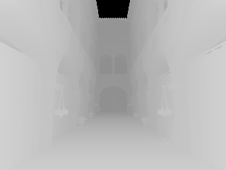
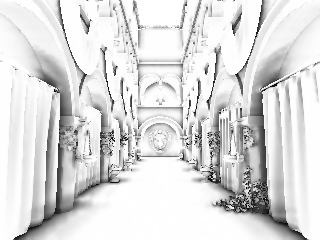

# AO 单通道纹理与深度层级优化

2026-10-05。接续 [射线参考与性能基准](ao-reference-benchmark.md)，完成 R16F／R32F RHI 格式、线性深度预处理、位置重建和保守深度金字塔。本阶段保持全分辨率 AO，没有加入独立时域历史。

## 默认行为与门控结果

**默认使用 R16F 的 raw／filtered AO，并继续从原 RGBA32F 世界位置缓冲取几何。** 单通道格式带来存储和滤波收益。线性深度／层级搜索已经实现并通过 GPU 验证，但计入预处理以后，线性深度在 Cornell／Sponza 上慢于单通道位置缓冲路径；金字塔额外查询和归约开销更高，因此两者保持实验选项，不能据此宣称“mip 必然加速”。

`FrameData::aoLinearDepth` 与 `aoDepthHierarchy` 默认均为 `false`，专供原生 RHI 调试／后续品质方案评估；没有新增编辑器默认选项。开启 hierarchy 时必须同时开启 linear depth。旧半球 SSAO、前向／延迟环境光合成，以及最终 `readRawAO()`／`readSSAO()` 的 RGBA 诊断接口继续兼容；后两者在 CPU 读回后展开单通道数据，GPU 上没有存储三份相同可见性。

## 实现与设计

- **格式支持**：Metal 的 R16Float／R32Float、Vulkan 的 R16_SFLOAT／R32_SFLOAT 与 OpenGL 的 R16F／R32F。统一每 texel 字节数用于预算、上传与异步读回；float 读回对 R 格式返回一个分量。片元反射校验按附件要求标量输出，storage image 反射识别 r16f／r32f。R32F 可用 float 上传；R16F 区域上传接收 half 编码字节。
- **深度预处理**：从高精度世界位置生成 R32F 的正视空间深度，背景用 0。高度精度敏感的原世界位置 G-buffer 保持 RGBA32F，供阴影、光照及其他效果使用。
- **位置重建**：常规透视／正交、非对称 frustum 和 TSAA 抖动使用投影系数直接计算；带 skew 等特殊投影使用逆投影的齐次解。矩阵求积的小量舍入误差使用有界容差判断快速路径，GPU 回归比较两种输入路径。
- **保守金字塔**：逐 mip 存储最近的有效正深度；忽略背景，全部为空时写 0。最后一个 texel 吸收奇数尺寸多出的行／列，从 7×5 到 3×2 再到 1×1，也能保留右下角的单像素遮挡物。
- **层级查询**：远处候选先访问合适 mip。仅当整个块为空，或最近深度仍在接收点半径之后，才丢弃候选；其余候选继续读全分辨率深度。没有把粗 mip 的最小深度直接当成一个遮挡点，也没有把它当作准确的低分辨率几何位置。该方案不能排除所有位于接收点前方的半径外块。
- **依赖与生命周期**：RenderGraph 添加 `gbuffer → ao-depth → ao-raw → ao-filter → lighting`。每级是独立 mip 视图，前级只读、后级写入；平台资源依赖跟踪覆盖这些子资源。resize 重建 mip 链与绑定。禁用 AO／零半径不执行预处理；实验选项加入 TSAA 历史 key。

Metal／Vulkan 支持完整 mip 子资源。现有 OpenGL RHI 未提供 mip 视图，保留单级线性深度和格式支持，关闭层级路径；没有为它加入隐式 `glGenerateMipmap`。

## 实测质量

以下三种路径均使用 R16F AO。对照沿用第一阶段的独立种子 1024 spp 射线参考及共同表面匹配 mask；当前 256 spp 参考与其差异、误差范围和运动指标均保存在 JSON／PFM。屏幕空间算法仍看不到屏幕外／被遮住的几何，本阶段优化不补齐这部分信息。

| 场景 | 默认单通道＋世界位置 RMSE | 线性深度 RMSE | 层级深度 RMSE | 线性／位置路径差异 RMSE |
| --- | --- | --- | --- | --- |
| 接触／薄墙 | 0.09167 | 0.09167 | 0.09167 | 0.000192 |
| Cornell | 0.13370 | 0.13370 | 0.13370 | 0.000286 |
| Sponza | 0.16790 | 0.16789 | 0.16789 | 0.000338 |

金字塔开启／关闭的首帧 AO 浮点文件逐值相同，三场景四帧的误差和重投影运动指标也一致。线性重建与原位置路径在少量阈值像素上仍可能出现较大单点差异；[路径对照数据](../img/ao/depth/path-comparison.json)同时记录 RMSE、最大差异及差异超过 0.005 的像素数，没有只报告均值。

| Sponza 线性深度中间结果 | 线性深度 AO（实验路径） |
| --- | --- |
|  |  |

深度预览使用 `1 − log(1+d)/log(1+far)`，近处更亮，背景为黑色；精确值见 `sponza-depth-mip*.pfm`。归约图与值来自实际 GPU 渲染附件。

## 实测成本与存储

Apple M4，960×720，16 个采样提交／4 个预热提交，每次提交重放 8 次相同 encoder。表格为独立 pass 的 GPU 耗时中位数（ms），含附件、命令和依赖开销，**不是正常帧内 timestamp，也不是 FPS**。旧 RGBA 数据来自第一阶段；本次默认与实验路径来自同一测量序列。没有把名义查询字节数当作 DRAM 带宽测量。

| 场景 | 原 RGBA raw | 原 RGBA filter | 默认 R16 raw | 默认 R16 filter | 线性预处理 | 线性 raw | 线性 filter |
| --- | --- | --- | --- | --- | --- | --- | --- |
| 接触／薄墙 | 1.419 | 0.759 | 1.066 | 0.589 | 0.143 | 0.904 | 0.595 |
| Cornell | 1.208 | 0.940 | 1.285 | 0.755 | 0.146 | 1.288 | 0.794 |
| Sponza | 1.588 | 1.180 | 1.524 | 0.931 | 0.141 | 1.492 | 0.941 |

本次默认路径 raw／filter 样本均未触发 `p95 > 1.5 × median` 的不稳定标记。部分实验预处理采样存在调度抖动；完整样本、p95、稳定标记和 fast reconstruction 是否开启见 [Metal 数据](../img/ao/depth/metal-summary.json)。不能把分 pass 中位数相加后直接转换成实际帧率。

raw／filtered 两张 AO 纹理由各 8 B/texel 改为各 2 B/texel，合计存储减少 **75%**。即使计入为实验路径预留的完整 R32F mip 链，960×720 的 AO 专用中间纹理从 11,059,200 字节变为 6,451,068 字节，减少 **41.7%**。这不是整个引擎 GPU 内存的下降比例，也不包含 native 分配对齐。默认关闭实验时仍保留该 mip 链分配，切换实验不需要重建其他场景目标。

线性实验路径中，32 个候选查询的 raw 名义上界为 158 B/像素，启用层级为 286 B/像素；5×5 filter 为 390 B/像素，关闭滤波为 8 B/像素。默认世界位置路径仍读取 16 B/texel 的位置，其 raw／filter 名义上界为 602／750 B/像素，不执行深度预处理。预处理仍需读取 16 B/像素世界位置并写 4 B/像素深度。重建算术、额外读取、归约和缓存命中共同决定性能，查询字节下降不会自动等价为耗时同比下降。

## 复现与数据

先按 [构建与运行](getting-started.md)准备原生后端及 Sponza 素材，从仓库根目录运行：

```bash
./build/Scene-Renderer --ao-benchmark build/ao-depth --backend Metal \
  --ao-scene all --ao-size 320x240 --ao-samples 256 --ao-threads 4 \
  --ao-motion-frames 4 --ao-timing-size 960x720 \
  --ao-warmup 4 --ao-timing-samples 16 --ao-timing-repeats 8

./build/Scene-Renderer --ao-benchmark build/ao-refined --backend Metal \
  --ao-scene all --ao-size 320x240 --ao-samples 1024 --ao-seed 2 \
  --ao-motion-frames 1 --ao-threads 4

python3 tools/compare_ao_references.py build/ao-depth build/ao-refined \
  --output build/ao-depth/quality.json
```

工具输出 `legacy`（旧半球）、`gtao-world`（阶段二默认）、`gtao-raw`（线性深度、关闭滤波）、`gtao`（线性深度＋滤波）、`gtao-hiz`（线性深度＋层级＋滤波）五种模式。计时明确记录 preprocess／raw／filter，背景与不匹配首表面从数值比较中排除。PFM 为 little-endian float32 标量，自底向上存行；AO 文件为 power 之后的最终可见性，depth 文件为视空间距离。

[结果目录](../img/ao/depth/)保留各模式浮点值、各级深度、匹配 mask、PNG、[误差参考对照](../img/ao/depth/quality.json)与 [Vulkan 烟雾测试](../img/ao/depth/vulkan-summary.json)。[来源哈希](../img/ao/depth/run-metadata.json)分开记录测量版及默认门控后的源码；测量程序逐模式显式指定开关，改变最终默认值不会改变这些对照模式。第一阶段记录保留在 `img/ao/benchmark/`。

## 验证范围与后续

回归覆盖单通道附件清理、odd half 行上传／读回、R32F float 上传、mip 读回、背景归约、右下角单像素跨两级奇数归约、子资源反馈隔离、线性／位置输入一致性、特殊投影 fallback、正交／倾斜／法线贴图孤立平面、层级开关一致性、65×49 mip 全链 CPU 对照、AO 关闭和 resize，以及预处理／raw／filter 计时保持输出不变。

最终默认配置验收：Metal **18/18**（API／Shader Validation 开启），Vulkan **19/19**（MoltenVK；本机未安装 Khronos validation layer），OpenGL 4.1 状态回归 **1/1**。当前工作区应用构建与开启 Metal 校验的小尺寸 contact 基准也通过。完整回归使用基于 `214f710` 加本次 AO 修改的隔离源码；并行的 PT 修改保持独立，仅通过工作区构建与基准检查集成。

下一阶段优先做半分辨率 AO 和深度／法线引导重建，再评估线性深度路径能否减少总耗时；细柱、植物、轮廓及镜头运动均须通过质量门槛。独立时域 AO、bent normal、镜面遮蔽和屏幕外遮挡仍未实现，不能作为本次已完成项。
