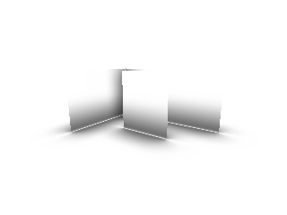
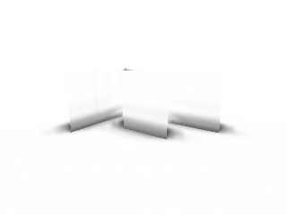
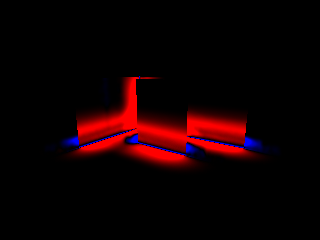
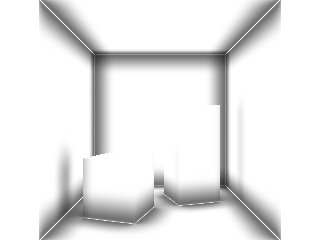
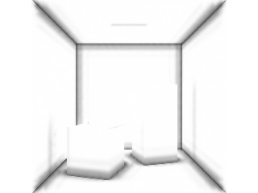
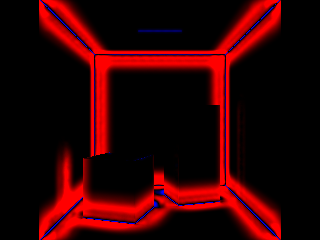
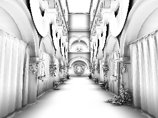
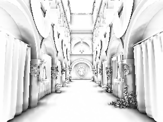
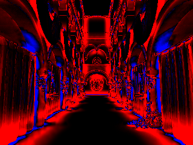

# AO 射线参考与性能基准

2026-10-05。接续 [AO 算法审查与改进](ambient-occlusion.md)，完成下一阶段的测量基础：把视觉上的条带减少与数值误差、空间滤波成本分开评估。实时算法仍为默认的 4 切片 × 每侧 4 步地平线搜索，以及 5×5 边缘保留滤波；本页数据来自加入 depth mip／R16F 之前的第一阶段快照；当前工具已扩展五种模式，后续实现与当前默认门控见 [单通道与深度优化](ao-depth-optimization.md)。半分辨率仍未实现。

## 参考的定义与边界

`AoReference.cpp` 复用已提交的 `pt::CpuScene` 三角形 BVH。参考从当前帧 **RGBA32F 位置 G-buffer** 的同一世界坐标发射余弦加权半球射线，使用精确三角形几何法线、相同世界半径／bias 和末段距离衰减。bias 排除法线方向高度过小的交点；衰减在 0.6R 到 R 使用 smoothstep，半径外开放。透明度截断材质的空洞会继续穿透搜索；本基准两侧使用同一静态不透明／alpha-cutout 几何子集。

参考先沿相机至该光栅位置的方向找首个有效表面，检查位置是否匹配。背景和不匹配表面从分母排除，单独记录数量及 mask；不把默认白色或错误法线计入“准确率”。射线遍历超过 128 层会保守返回遮挡并报告饱和，正式捕获要求饱和为零。

线性可见性为 `1 - mean(距离衰减后的射线遮挡)`，最后应用与实时 AO 相同的 power，再比较浮点值。这是可复现的有限半径参考。地平线算法把距离衰减用于 horizon 插值，两者的近似方式不同；参考也能看到被遮住或不在屏幕内的几何，所以差异包含屏幕空间方法的固有限制。

使用固定种子的 padded Sobol 二维采样，CPU 工作通过现有 `engine::JobSystem` 按行分块。每像素的采样顺序固定，单线程／多线程得到相同结果。256 spp 用于四帧序列，另以独立种子的 1024 spp 首帧参考检查采样收敛。这些数据不代表无误差的绝对 ground truth。

## 实际结果

| 场景 | 原 SSAO RMSE | 未滤波地平线 AO RMSE | 滤波后 RMSE | 相对旧 SSAO 降低 |
| --- | --- | --- | --- | --- |
| 接触／薄墙 | 0.11960 | 0.09546 | 0.09167 | 23.3% |
| Cornell | 0.13583 | 0.14411 | 0.13370 | 1.6% |
| Sponza | 0.19918 | 0.18112 | 0.16790 | 15.7% |

| 场景 | 256／1024 spp 两参考差异 RMSE | 共同匹配像素 |
| --- | --- | --- |
| 接触／薄墙 | 0.00218 | 43516 |
| Cornell | 0.00346 | 58063 |
| Sponza | 0.00839 | 75672 |

以上质量测试均为 **320×240**，半径 1、bias 0.025、power 1.5，关闭 RSM、阴影与 TSAA；方法之间保持几何和相机相同。场景为程序化接触／薄墙、Cornell 与原始 Sponza 导入。误差只在两次参考共同匹配的前景像素上计算；表格使用 1024 spp 参考，所有原始参数、每帧指标及排除数量见 JSON。

本次三个首帧中，滤波后的算法比原 SSAO 更接近参考；接触薄墙和 Sponza 的改善较明显，Cornell 只有约 1.6%，不宜推广为所有场景的大幅收益。未滤波地平线 AO 在 Cornell 的整体 RMSE 反而更高，说明空间滤波是质量的重要部分。两参考差异是采样收敛诊断，不是置信区间。

| 场景 | 1024 spp 射线参考 | 当前地平线 AO + 滤波 | 相对参考的误差 |
| --- | --- | --- | --- |
| 接触与薄墙 |  |  |  |
| Cornell |  |  |  |
| Sponza |  |  |  |

热图为同一帧相对 1024 spp 参考的浮点误差：**红色表示遮挡不足，蓝色表示遮挡过强**，幅值放大 4 倍，黑色为差异很小或未匹配的像素。灰度图是应用 power 后的可见性，白色无遮挡。PFM 保留原始 float32 数值，计算指标不使用 PNG 的 8 位量化值。仓库中的浮点数据带 `-256`／`-1024` 前缀；PNG 使用 1024 spp 首帧及对应实时输出。

## GPU 计时与访存

`ForwardPbrRenderer::measureAO()` 仅用于诊断。先等待已有提交结束，再从最近一次成功且开启 AO 的 Scene 帧，分别重放 raw／filter 两个 pass。每次独立提交内重复 8 个相同 encoder，GPU 提交时间除以 8；先排除 4 次热身，再记录 16 次样本。Metal 使用 command-buffer GPU start/end，Vulkan 使用现有提交 timestamp query。

这是 **热缓存、独立提交的诊断平均值**，含 attachment、屏障及摊薄后的提交开销，不含场景、显示拷贝或读回。它不是实际整帧内部的细粒度 timestamp，不能把两列简单相加解释成真实帧耗时，也不作为帧率承诺。JSON 保存所有样本、median、p95 和 p95/median；p95 超过 median 的 1.5 倍标记为高波动，保留原数据而不挑选低值。

| 场景 | 原 SSAO 搜索 median ms | 当前 AO 搜索 median ms | 当前空间滤波 median ms |
| --- | --- | --- | --- |
| 接触／薄墙 | 0.588 | 1.419 | 0.759 |
| Cornell | 0.675 | 1.208 | 0.940 |
| Sponza | 0.840 | 1.588 | 1.180 |

默认 AO 的搜索与滤波均比原 SSAO 的对应简化工作更重，滤波不是免费步骤。Sponza 的另一轮复测约为搜索 1.586 ms、滤波 1.177 ms，与表中结果接近；完整样本见报告。首轮单 encoder 计时曾出现很大波动，因此正式基准采用固定的批量重放，并保留 p95 标记。当前主要搜索／滤波样本未触发高波动标记，Cornell 的 legacy 对比度 pass 有高波动标记，不用于收益结论。

计时尺寸为 **960×720**，与 320×240 的质量测量分开。测试平台 Apple M4，性能捕获关闭 API／Shader Validation；正确性回归另行开启。Vulkan 为 MoltenVK，不代表独立显卡平台。该机器还有其他渲染工作，报告不把高波动项用于稳定性能结论。

当前输入／输出为 position RGBA32F、normal RGBA16F、raw AO RGBA16F、filtered AO RGBA16F，共 **40 字节／像素**，960×720 为约 **26.4 MiB**。默认 raw 搜索最多约 608 字节／像素的名义 point-query 与写入预算，启用滤波最多约 912 字节／像素；关闭滤波的对比度 pass 约 32 字节／像素。这些上界按 shader 查询与格式计算，分支、缓存和编译器优化会降低流量，不能当成实测 DRAM 带宽；legacy SSAO 的双线性 footprint 不混入该上界。

## 运动序列

256 spp 数据包含 4 帧，相机每帧沿世界 X 移动 0.025。输出各帧 RMSE、开放／遮挡区域误差，以及最近邻重投影后的 **参考误差变化 RMSE**：比较当前与上一帧 `AO - 射线参考`，并拒绝前后位置不一致的点。

该指标同时包含真实几何变化、屏幕采样变化、最近邻误差和参考采样噪声，用来建立后续时域 AO 的回归入口。本阶段没有 AO 历史或 TSAA，因此不能把它解释成已经验证的抗拖影效果。

- [256 spp 四帧与 GPU 样本](../img/ao/benchmark/metal-summary.json)
- [独立种子 1024 spp 首帧与复测](../img/ao/benchmark/metal-refined-summary.json)
- [两次参考收敛与统一 mask 下的误差](../img/ao/benchmark/convergence.json)
- [代码基线与文件哈希](../img/ao/benchmark/run-metadata.json)

## 复现

先按 [构建与运行](getting-started.md)准备依赖；Sponza 需要 `python3 tools/fetch_gi_assets.py --scene sponza`。从仓库根目录运行：

```sh
cmake --build build -j8
ctest --test-dir build -R '^ao-reference$' --output-on-failure

./build/Scene-Renderer --ao-benchmark build/ao-baseline --backend Metal \
  --ao-samples 256 --ao-motion-frames 4 --ao-timing-repeats 8
./build/Scene-Renderer --ao-benchmark build/ao-refined --backend Metal \
  --ao-samples 1024 --ao-seed 2 --ao-motion-frames 1 --ao-timing-repeats 8
python3 tools/compare_ao_references.py build/ao-baseline build/ao-refined \
  --output build/ao-convergence.json
```

Vulkan 用对应构建目录并传 `--backend Vulkan`。默认质量尺寸 320×240、计时尺寸 960×720、4 个 CPU workers、16 次计时样本、4 次热身。`--ao-scene contact|cornell|sponza|all` 可缩小范围；`--ao-size`、`--ao-timing-size`、`--ao-threads`、`--ao-warmup`、`--ao-timing-samples`、`--ao-timing-repeats` 可调整测量。`--ao-radius`、`--ao-bias`、`--ao-power`、`--ao-slices`、`--ao-steps` 可用于后续参数标定，均会同步记录到报告。

每个场景保存首帧三种方法的 PNG／float32 PFM、参考与匹配 mask、误差热图和完整 JSON。PFM 为 `Pf` 单通道、底行优先、little-endian IEEE float32；参考与 AO 均已应用 power。比较工具只使用共同匹配区域，拒绝尺寸、半径、bias、power 或搜索品质不一致的配置。

## 验证与下一步

新增 CPU 回归覆盖：孤立平面、近遮挡物、有限半径、法线 bias、alpha 镂空、256／4096 样本收敛、实际并行分块的确定性、错误表面拒绝及非法参数。GPU 回归验证两个 pass 的独立计时与重放后可见性保持一致。

隔离构建的 Metal 完整回归 **18/18** 通过（API／Shader Validation 开启），Vulkan 完整回归 **19/19** 通过；Vulkan／MoltenVK 未安装 Khronos validation layer。Vulkan 的两帧薄墙基准得到与 Metal 相同的 RMSE，计时两列可用。工作区应用重新构建通过，并补测 CPU 参考与 Metal 诊断入口。

根据当前数据，下一阶段仍按 **单通道格式／深度预处理／层级查询** 推进，同时用本基准评估滤波带宽；再实施半分辨率与引导上采样。验收同时检查整体和接触区域误差、开放区域黑边、薄片与运动指标，避免只改善截图或通过增加遮挡强度掩盖误差。
