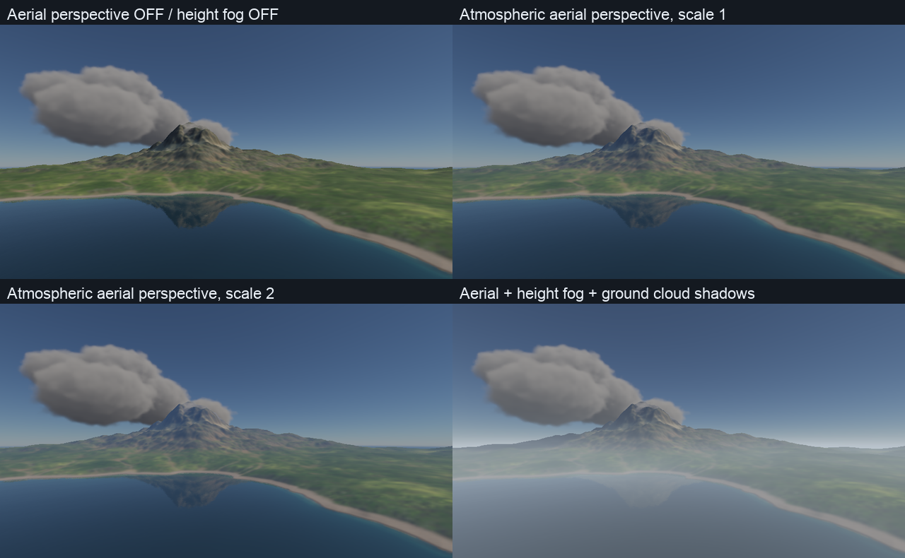
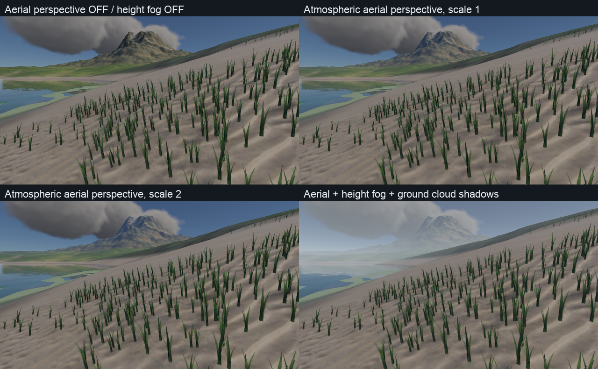
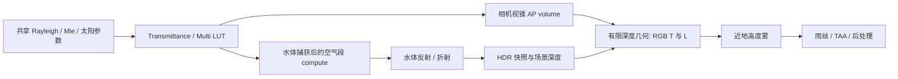

# 大气空中透视：远距离散射雾气

2026-10-09。新增基于共享大气参数的空中透视，可与现有高度雾独立开关。远处几何的 RGB 消光、散射颜色和前向 Mie 光晕随太阳方向、高度及大气参数变化。已通过 Metal／Vulkan 数值检查、山湖实景对照及云／水体回归。

## 参考与方案

Unreal 的 Sky Atmosphere 使用相机视锥 Aerial Perspective LUT 保存沿视线累积的散射辐亮度和透射率，复用太阳透射与多次散射 LUT；天空本身已有大气积分，需要避免重复贡献。[Epic Sky Atmosphere 文档](https://dev.epicgames.com/documentation/en-us/unreal-engine/sky-atmosphere-component-in-unreal-engine)

其参数提供起始距离、视距缩放和 LUT 深度范围。[Epic 属性说明](https://dev.epicgames.com/documentation/en-us/unreal-engine/sky-atmosphere-component-properties-in-unreal-engine) 本项目采用同类架构，并复用现有 Hillaire 多次散射近似；作者公开实现与论文入口见 [UnrealEngineSkyAtmosphere](https://github.com/sebh/UnrealEngineSkyAtmosphere)。本包是适配当前 RHI 的实现，不是 Unreal shader 的完整移植。

## 实景与操作

四组固定时间对照：左上关闭空中透视与高度雾，右上只开启空中透视，左下空中透视光学距离缩放为 2，右下空中透视＋高度雾＋地面云影。均保留主视图体积云，固定时间 8 秒、云量 .85、降雨率 50 mm/h，雨丝隐藏、RSM 关闭，曝光不变。





启用 Environment 后，面板新增：

| 控制项 | 默认值 | 作用 |
| --- | --- | --- |
| Atmospheric aerial perspective | 开启 | 独立于 Air extinction and ground fog |
| Aerial perspective distance scale | 2 | 对积分步长作光学缩放；0 关闭，增大可加强远景散射 |
| Atmospheric sun shadows / shafts | 开启 | 单次太阳散射查询场景 CSM 与云太阳透射场；多次散射保留各向同性近似 |
| Ground cloud shadow strength | .3 | 地面直射光的云影强度；不改变原始 Beer 太阳场或 PT 冻结输出 |
| Aerial perspective start (m) | 100 | 起始距离前不应用空中透视，保护近景对比度 |
| Aerial perspective range (m) | 32000 | LUT 最大积分距离；超过范围使用最后切片 |

常规非 Environment 场景保持原有表现；本功能需要原生 Scene 渲染路径与开启的程序化天空。它使用大气自身的 Rayleigh、Mie、臭氧吸收、太阳辐照度和 Multiple scattering 参数，独立于高度雾的固定源颜色、120／180 米雾高等旋钮。

```sh
./build/Scene-Renderer --classic mountain-lake --backend Metal \
  --environment-clouds --environment-cloud-coverage .85 --environment-ticks 180

# 只看大气空中透视，可追加 --environment-no-fog
# 关闭空中透视，可追加 --environment-no-aerial-perspective
./build/Scene-Renderer --render-gallery build/environment/aerial/gallery-metal aerial-gallery --backend Metal
./build/Scene-Renderer --render-gallery build/environment/aerial/gallery-vulkan aerial-gallery --backend Vulkan
```

重启应用加载新默认值。AP 视觉设置属于 RenderSettings，尚不写入 CPU 环境检查点；不会改变地表水量、固定 tick 收支或 PT 捕获的物理状态。

## 数据与积分

`GpuAirFog` 生成 **32×32×32** 相机视锥 volume，使用两张 **32×1024 RGBA16F** 2D atlas 表示 RGB 散射与透射各切片；另有一张同尺寸 atlas 保存被遮挡的局部单次太阳散射。深度平方分布将更多切片放在近处。每个 froxel 以 32 次中点采样积分至切片距离，采样共享的太阳 Transmittance LUT 和各向同性 MultipleScattering LUT。

累积量为 RGB 散射 `L` 与 RGB 透射 `T`，有限几何使用 `C = Cscene·T + L`；Rayleigh／Mie 相函数决定光照方向响应，Mie 消光和臭氧吸收参与 `T`。每步用解析 Beer 权重 `(1−exp(−σt·ds))/σt`，零系数时使用 `ds` 极限。主 pass 按深度重建视线长度，手动跨深度切片插值、限制切片内 UV，防止 atlas 串层。起始距离前显式跳过，避免低分辨率插值泄漏到近景。

大气参数与积分长度使用 km，场景使用 m，在边界转换。局部行星切平面以空气段起点海拔为基准，并限制到行星地面／大气顶边界。最大范围以外采用最后切片。本包面向地面场景，未验收行星外空间过渡。



相机、太阳或大气改变后每帧重建视锥 volume，当前不依赖历史累计或跨帧缓存，因此暂停输出稳定，移动／换光照不会复用旧相机 volume。设置进入图像历史 key。已有 Transmittance／Multi 参数缓存保持原策略；没有改为逐帧重建全部大气 LUT。

## 水体与高度雾

水体捕获材质的既有三个 binding group 已满，新增散射放在捕获后的 **独立 compute pass**。每个 invocation 在原 HDR texel 上独立读写，采样对应世界位置，并以相同的 32 步积分计算空气段，避免扩展材质 ABI 或复制整张捕获 atlas。反射列使用镜像相机位置，主／宽角空气列使用真实相机；水下原点在平均水位处裁剪，水下捕获列不参与。

主视图水下时跳过空气 pass；透过水面看到的空气几何由上述捕获处理。水上相机在主视图处理至水面界面的空气段。空中透视先合成，高度雾再合成；高度雾仍是独立可控的固定源颜色近地模型。水域范围／源 mask 和平均水位分类沿用 L4，位移波面穿越仍需运动序列验收。

天空深度像素不重复合成 AP 的 `T/L`，因为 SkyView 已有长路径大气积分。开启空气太阳遮蔽时，只减去局部路径上被遮挡的单次太阳散射；近地高度雾仍可作用于天空。水体天空 fallback 同样沿用已有大气天空，不额外叠加有限几何 AP；水面体积云倒影仍未接入。

## 数值与回归

独立参考使用 CPU 双精度 256 步大气积分和独立太阳透射积分，不读取 GPU AP／太阳 LUT；单次散射 fixture 关闭 Multi，以便误差可以归因。首次 AP 实现（16 步、无体积遮蔽）的固定构造场景得到以下数字；后续侧光实现的最新结果见下文：

| 检查项 | Metal／Vulkan |
| --- | --- |
| AP 散射与独立积分相对 L1 | .00028205（约 .028%） |
| RGB 透射率最大绝对误差 | .00046318 |
| 有明显 AP 变化的几何像素 | 36151 |
| AP 开关前后保持不变的天空像素 | 26414 |
| AP 与高度雾组合最大 RGB 绝对误差 | .00047067 |
| 水体空气捕获最大 RGB 绝对误差 | .00005263，522 个采样像素 |

暂停一致、光学缩放 0、起始距离前无贡献、太阳方向变化响应、零大气系数无 AP 雾、水下捕获不叠加空气介质均通过。原有云／水体回归两后端通过；Metal 天气、云、水体测试启用 API／shader validation。Vulkan 使用 MoltenVK，同一台 M4，Khronos validation layer 不可用。CPU／RHI 契约回归 **5/5**。

[Metal 数字](../img/diagnostics/environment/aerial/metal/validation.json)／[Vulkan 数字](../img/diagnostics/environment/aerial/vulkan/validation.json)／[Metal 日志](../img/diagnostics/environment/aerial/metal-validation.log)／[Vulkan 日志](../img/diagnostics/environment/aerial/vulkan-validation.log)／[CPU 回归](../img/diagnostics/environment/aerial/cpu-validation.log)。仍可用 `--weather-lighting-self-test --backend Metal|Vulkan` 复现本包与 L4 检查。

山湖／湖岸四组静态实景的跨后端平均 RGB 差为 **.005–.020 个 8-bit 色阶**，局部差异较大，未宣称逐位一致；见 [图像汇总](../img/diagnostics/environment/aerial/summary.json)。Vulkan 首次图集与构建过程重叠出现植被差异，归档使用构建完成后复测的结果。Metal 捕获与独立 GPU 回归同时进行，原始阶段样本只保留用于诊断，不作性能比较或帧率结论。[捕获参数、命令与源码／产物 hash](../img/diagnostics/environment/aerial/manifest.json)。

## 当前范围

三张 AP volume 合计 **768 KiB**，另有主视图 HDR 快照 `width×height×8 bytes`；720p 时快照约 7.03 MiB。水体 capture HDR 增加 storage usage，在原 texel 上计算，不新增整图副本。AP 参数块 160 bytes、主视图空气参数 128 bytes、水体空气参数 64 bytes；既有材质 binding group 上限和 WaterCapture 352-byte ABI 保持不变。

当前主 pass 根据最终不透明／水面深度处理合成色，透明物体仍使用背景深度代理，没有 Unreal 的逐透明片段 AP；体积云也没有单独按云散射位置采样相机 volume。单次太阳散射现在查询 CSM 与云太阳透射场，产生山体遮蔽的空气明暗和光束；局部光体积散射与新的空间介质求解仍待实现。Multi 仍是现有各向同性近似。完整动态天气、跨水面序列与整帧预算尚未验收。

PT P1 仍只捕获天空／云全景和太阳场，**未包含本包几何视线上的空气散射介质**；P2 仍待实现。既有高度雾说明与 L4 原始对照见 [天气光照报告](weather-lighting.md)。

## 山体侧光与空气阴影（2026-10-09）

地面云影默认强度降至 .3，aerial 光学距离缩放提高至 2；高度雾干空气／雨天消光系数降至 .000015／.00005 m⁻¹，雾高仍为 180 m。这里的“aerial 比例”通过增强物理散射、降低固定颜色高度雾实现，并不是两张雾图直接按比例混合。

每个空气积分中点重建世界位置，查询方向太阳的五级 CSM，使用四次深度比较的双线性可见率、级联重叠与远端淡出。体积采样没有表面法线，因此不套用表面 normal offset／receiver-plane derivative。太阳单次散射源项乘以山体可见率和原始云透射率；RGB 消光 `T` 不受阴影影响，多次散射仍是共享的各向同性近似。主视锥和水体空气捕获共用此路径。积分改为 32 步，以减少阴影过渡采样不足。阴影参数块从 16096 增至 16112 bytes，仍在既有 16 KiB 限制内；材质 binding 上限不变。

山湖场景阴影距离由 300 m 扩展到 8000 m，归一化 depth bias 从 .002 调为 .0005，避免远处山脉完全落在无阴影区。低高度太阳更易产生长山影；90° 侧视的 Mie 前向散射弱于朝太阳看，因此不会人为绘制极亮的屏幕射线。

```sh
./build/Scene-Renderer --render-gallery build/environment/aerial-side/gallery-metal aerial-side-light --backend Metal
```

侧光图集固定摄像机并计算一个在完整 3D 中垂直于视线的太阳向量（包括相机俯仰），记录实际夹角。对比只关闭／开启空气太阳遮蔽，最后一张再开启较弱的高度雾。云量 .55、固定时间 8 s、隐藏雨丝、RSM 关闭。

局限：CSM 覆盖外回到无几何遮挡的太阳散射；镜像／宽角捕获沿用主相机 CSM，超出其覆盖的样本无几何阴影。当前 terrain mesh 随主视锥生成，完全位于视锥外的山体不会自动获得独立全域阴影几何。32³ AP 和 32 步积分适合宽光束，窄束和运动序列仍可能出现采样不足；这次不做 60 fps 承诺。阴影科学 fixture 验证散射下降、透射率严格不变，实景图片与数值结果归档在 `img/diagnostics/environment/aerial-side/`。

天空处理单独累积 `D = ∫ Tphysical·σs·phase·SunT·(1−visibility)·Esolar ds`，并使用 `Csky = max(Csky−D,0)` 修正 SkyView 中原本无遮挡的太阳散射。`D` 使用物理步长，不套用艺术化 AP distance scale，从而不会因缩放 2 而对天空过量减光；不重复添加雾色或消光。体积云将 motion.w 标为 -1，天空 correction 跳过这些像素，避免再次遮蔽云自身已经积分的光照。SkyView 参数化与局部切平面积分仍是有限精度近似；起始距离前的近场遮蔽未纳入 correction。水体天空 fallback 暂时仍使用原有 SkyView，不带这项天空局部遮蔽修正。

### 90° 实景与最新验证


摄像机位于 `(-2600,800,2600)` m，方向 `(0.706138,0.052336,-0.706138)`；太阳方向 `(0.651806,0.341551,0.677120)`，实际高度约 19.97°，两方向夹角 **90.0°**。固定曝光 2.4，图集包含空气太阳遮蔽关闭、开启、开启后叠加较弱高度雾三组。在这个侧向角度，效果主要是较宽的空气阴影带；朝向太阳时 Mie 前向散射更强。三组截图参数见 [实景记录](../img/diagnostics/environment/aerial-side/mountain-lake-side-metrics.json)。

科学遮挡 fixture：**30720 个 froxel** 的单次散射减少，RGB 透射率开启／关闭遮挡时**逐位一致**；**26118 个天空像素**出现局部太阳遮蔽。没有遮蔽物／关闭体积遮蔽时，原来的 26414 个天空像素仍保持不变。30% 地面云影的 RGB 线性插值最大误差 **.000058**，强度 0 恢复无遮挡直射光，强度调节不重烘原始云场。32 步 AP 对独立 CPU 积分相对 L1 误差约 **.000326**，水体空气捕获最大 RGB 误差 **.000053**。Metal／Vulkan 天气检查以及 CPU 环境／渲染图／RHI 契约 **4/4** 通过。Metal 开启 API 验证；同一套最终 shader 在最后一轮默认系数微调之前已开启 shader validation 通过。Vulkan 的 Khronos layer 仍不可用。

[Metal 数值](../img/diagnostics/environment/aerial-side/metal/validation.json) · [Vulkan 数值](../img/diagnostics/environment/aerial-side/vulkan/validation.json) · [图像／参数汇总](../img/diagnostics/environment/aerial-side/summary.json) · [源码、产物 hash 与命令](../img/diagnostics/environment/aerial-side/manifest.json)。图集为静态视觉验收，不据阶段计时宣称帧率。窄光束、全域视锥外山体遮挡和移动序列仍需后续扩展。

验证记录补充：一次默认参数微调后的 Metal API-only 重复运行在已有 `pt::renderGpu → MetalDevice::createComputePipelineImpl → MTLCompiler XPC` 编译请求处等待超过 3 分钟，已停止；未将该运行计为通过。归档的 Metal 完整数值／API／shader 验证是在同一套最终 shader、默认值微调前执行的，科学 fixture 显式指定介质系数；默认值微调后的最终二进制完成 Metal 实景图集与 Vulkan 完整数值检查。
