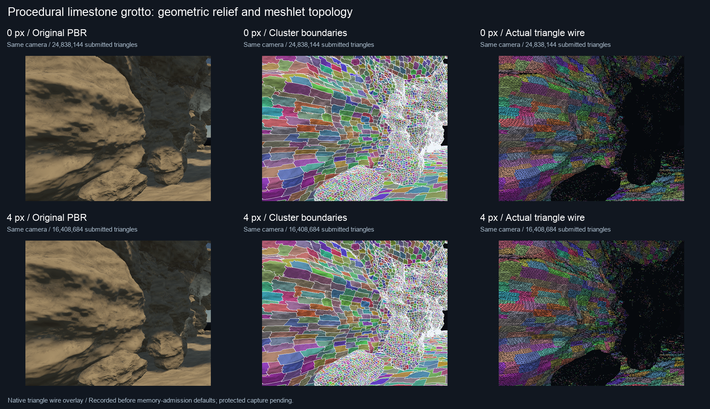

# 程序化岩洞：cluster 分块与动态 LOD

岩洞用于观察真实小三角形如何被划分为 meshlet，以及相机移动或像素误差预算改变时，GPU 如何选择父层级。场景由破碎岩壁、四段石拱、矿物岩柱、钟乳石和落石组成。岩石细节直接位移顶点，使用共享拓扑和连续投影 UV，不依赖下载资源。

## 场景规格

| 场景 | 岩石细分级别 | 唯一三角形 | 实例化逻辑三角形 | 资产目录 |
| --- | --- | ---: | ---: | --- |
| `cluster-cave` | 7 | 2,883,584 | 24,838,144 | `samples/assets/benchmarks/procedural-cave` |
| `cluster-cave-small` | 6 | 917,504 | 6,406,144 | `samples/assets/benchmarks/procedural-cave-small` |

两种规格均为 9 个共享网格、76 个绘制实例。小规格的数量由生成算法推导，当前尚未重新生成和原生捕获。高密度资产包约 **84.8 MB**；生成与加载均检查 **10,000,000,000 字节**磁盘上限。小规格有独立目录，生成时保留高密度资产。`--output` 可指定工作区内的独立目录；经典场景加载器使用上表的固定目录。

闭合岩石检查双面边共享、Euler 特征和非退化三角形；地面允许开放边界。场景实例共享源网格和构建好的层级。程序化 relief 移动真实顶点，岩石上的小三角形会参与简化和光栅化。

## 观察方式




彩色区域是实际 GPU 选中的 cluster；白线来自相邻像素的不同 R32 cluster ID，不是三角形线框。线框图则使用同一选中几何的原生 wireframe 光栅化。层级图的蓝色表示叶级 0，绿色表示父级 1，黄绿色表示父级 2；层级编号更高表示更粗的父组。

一个 cluster 包含多枚小三角形。近处保持较细的叶级，远处投影误差较小，可以用父组的简化几何替代子组。`4 px` 是几何误差投影到屏幕的阈值，不是固定四像素宽的色块，也不保证着色误差为四像素。

动画每帧是一个真实捕获视角，底部条形图统计该视角提交三角形的层级分布。它展示离散相机位置，不插值中间 GPU 切面，播放速度不代表引擎帧率。当前图片和动画均来自**内存保护默认值接入前**已验收的数据。

## 新捕获路线

生成器与当前高密度场景 manifest 都包含 11 个记录视角：

| 帧 | 视角 | 像素预算 |
| --- | --- | ---: |
| 0、1 | 入口同视角参考／LOD | 0、4 |
| 2 | 近处岩壁 relief | 4 |
| 3 | 第一大厅 | 4 |
| 4、5 | 入口后退、较远石拱 | 4 |
| 6 | 四段大厅总览 | 4 |
| 7、8 | 入口同视角较细／较粗切面 | 2、8 |
| 9、10 | 第二、第三大厅内部 | 4 |

帧 7—10 是本轮新增路线，尚未原生捕获。每个视角先保存同相机的 0 px 参考，再保存选中 LOD，避免把相机移动引起的变化算作 LOD 收益。物体与遮挡剔除关闭，单独观察 LOD；提交量不是最终可见三角形数量。

编辑器中按住鼠标右键转头，W/A/S/D 移动，Q/E 上下移动，Shift 加速。渲染设置中可调整 `Cluster LOD error (pixels)`，并开启 `Cluster triangle wireframe`。离屏捕获输出 cluster ID、层级图和三角形线框，全部隐藏 UI。

## 保持内存保护的捕获实现

默认预算保持进程 **3 GiB**、GPU **1.5 GiB**（16 GiB 机器），小内存机器自动取更低值；捕获限制为一帧在途。没有为岩洞提高预算或关闭压力检查。

新的捕获路径做了三处改动：

1. 0 px 参考与选中 LOD 复用一个 `ForwardPbrRenderer`，回读参考后再渲染选中切面，减少重复 render targets 与 cluster 输出索引缓冲。
2. 分块诊断每批最多 **65,536 个三角形**，预留 **24 MiB** CPU／GPU／上传临时工作空间。低预算下批量自动缩小；每批 submit 后等待完成，释放该批原生几何，再提交下一批。目标颜色、ID 和深度附件持续保留并以 Load 方式接续，避免同时持有完整场景副本。生产 vertex shader、源位置／UV 和材质 alpha 测试保持一致；线框在完整深度生成后按批回放。
3. 超过 10,000 条可见性记录时，完整选中成员写入每帧的 `*-membership.jsonl`。主报告保留统计和 sidecar 路径，不在内存中累计所有视角的大型 JSON 成员表。深度异常示例最多保存 128 个，完整异常数单独统计。

每个视角和每个诊断批次都检查内存压力。系统处于警告／严重压力时，拒绝新的重资源工作。生成器也使用相同的默认进程预算、物理内存保留规则及 macOS 压力检查，在大数组构建步骤前估算临时工作空间。

`flow.json` 的 `memory` 字段会记录配置预算、边界采样的进程 footprint／Metal 原生资源峰值、预留临时内存峰值和拒绝次数。它不是连续的进程生存期峰值；导入器内部瞬时峰值可能不在采样点上。分配准入是协作式保护，不是操作系统强制 RSS 上限。详见[内存保护](memory-safety.md)。诊断的同步小批次旨在降低峰值，不用于评估实时渲染吞吐性能。

## 运行与验收

系统内存压力恢复正常后，先生成独立的小规格场景进行新路径验收：

```sh
python3 tools/prepare_cluster_cave.py --level 6
./build/Scene-Renderer --memory-info
./build/Scene-Renderer --cluster-scene-flow cluster-cave-small build/cluster-cave-bounded-small --backend Metal
python3 tools/visualize_cluster_scene_compact.py build/cluster-cave-bounded-small img/diagnostics/cluster-cave-bounded-small
```

小规格通过后，再使用当前高密度包，不覆盖旧捕获：

```sh
./build/Scene-Renderer --cluster-scene-flow cluster-cave build/cluster-cave-bounded --backend Metal
python3 tools/visualize_cluster_scene_compact.py build/cluster-cave-bounded img/diagnostics/cluster-cave-bounded
```

捕获程序逐视角验证 GPU 输出索引与独立 CPU 切面一致、选中成员总数与间接绘制三角形计数一致、R32 raster ID 属于选中成员、cluster ID／层级图的深度与覆盖一致，并比较诊断深度与 PBR 深度。查看器逐行核对 JSONL 成员总数及三角形总数，也核对各 LOD 层级三角形总和。仅在这些条件通过后生成演示图。

旧版七个视角均通过 GPU／CPU 切面、ID 和逐值深度验收；固定 4 px 的三角形减少量分别为近景 **25.57%**、中景 **33.94%**、远景 **46.28%**、更远 **54.64%**，入口 HDR 相对 RMSE 为 **1.17%**。这些结果不能推导新版本的内存峰值或帧率。

本轮已完成 Scene-Renderer 构建、Python 语法检查、已有捕获的展示生成和四项 memory/RHI 单元测试。按用户要求，新的 GPU 捕获暂缓，**新批次光栅正确性、实际内存峰值、新增视角和小规格生成结果仍待运行验收**。
