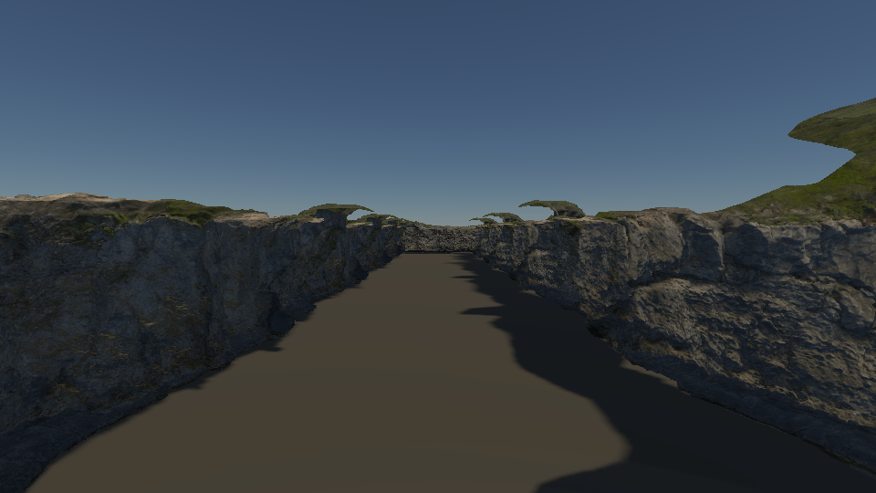
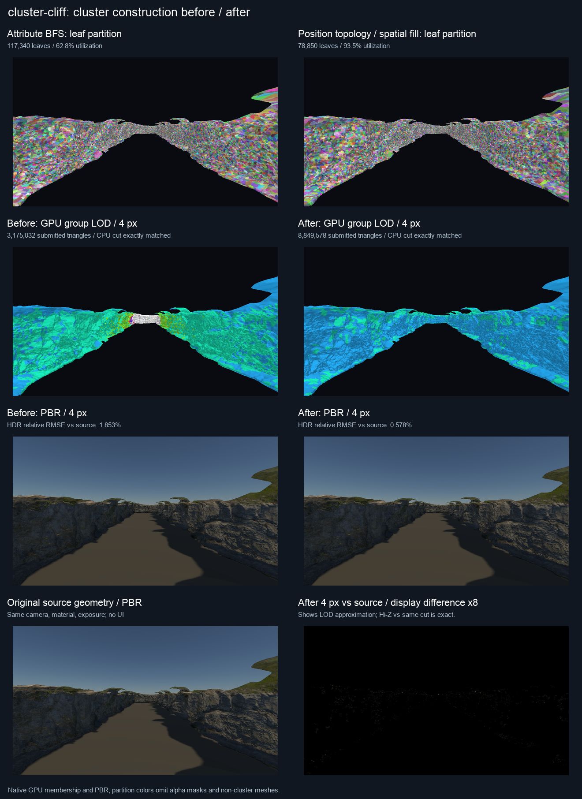
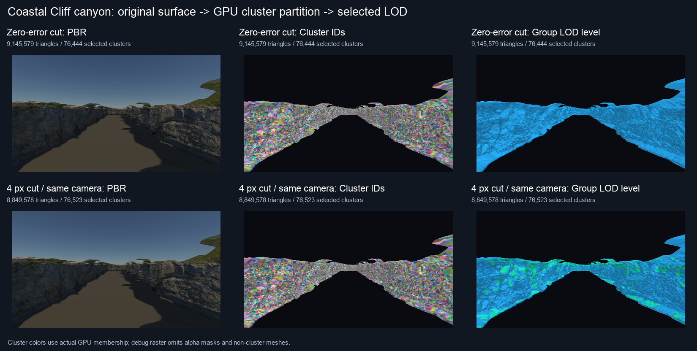
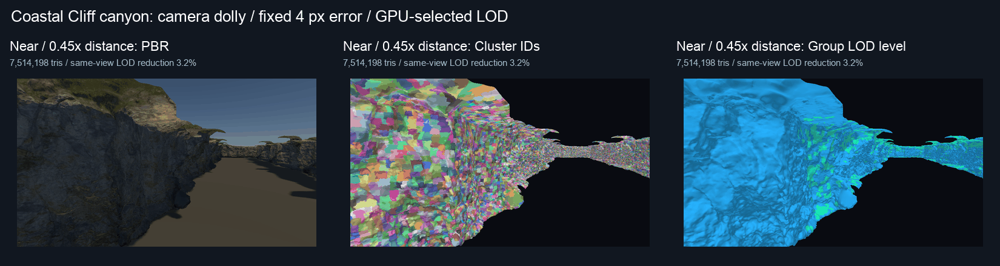
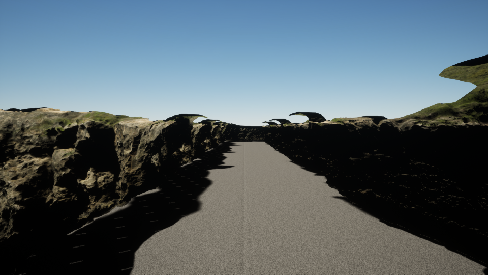
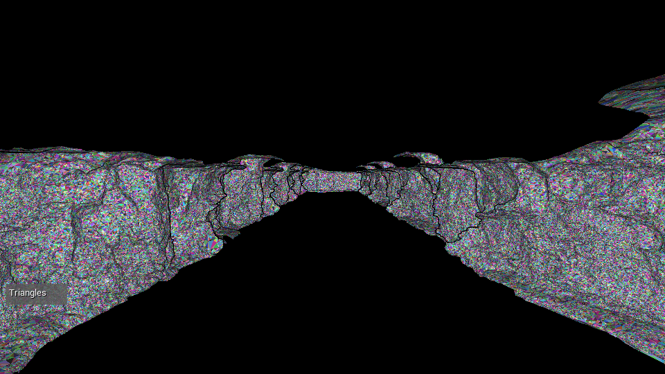
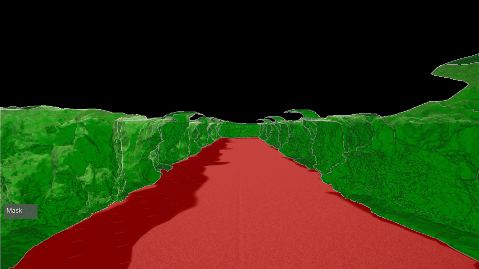

# Coastal Cliff: instanced high-density geometry test

SceneRenderer's Metal test and the UE 5.8 Nanite viewport counterpart are
complete. The UE scene uses an isolated local project; verification is below.
This is a newly assembled test scene, not Valley of the Ancient.

The native tables below retain the original pair-parent / 0.05-normal-ceiling
measurements. Current defaults use connected parent groups and localized error
bounds. The [parent LOD follow-up](cluster-parent-lod-optimization.md) raises
same-view LOD reduction from 3.24% to 36.56%, with the quality, memory and build
costs reported separately. The UE counterpart is unchanged.

## Source geometry and layout

[Poly Haven Coastal Cliff 02](https://polyhaven.com/a/coastal_cliff_02) is
[CC0](https://polyhaven.com/license). Powered by Poly Haven.
The original FBX has four overlapping traditional LODs: **943,284**, 471,642,
235,820 and 117,909 triangles. Only LOD0 is extracted; the site headline "2M"
does not describe the triangle count of this single source mesh. Published file
sizes and MD5 checksums are checked before conversion.

Ten instances form two canyon walls and a back wall. They share one original
mesh and one cluster hierarchy: **9,432,840 logical rock triangles**, plus two
floor triangles. The instance layout and camera are in
[cluster-cliff-scene.json](../samples/cluster-cliff-scene.json). The normalized
rock is 12 units high; UE uses centimeters and the corresponding axis transform.
The downloaded FBX, textures and extracted OBJ occupy about 435 MiB locally;
UE assets and generated caches add to this. No complete large sample download
is needed.

## Actual image and GPU membership









All native captures omit UI. Diagnostic colors are rendered from actual GPU
membership. The dolly focuses on the first rock; it is a different set of camera
poses from the fixed canyon performance view. LOD reduction always compares
0 px and 4 px in the same pose, separately from frustum savings.

## Construction and memory

| Metric, one unique mesh | Attribute BFS | Position topology / spatial fill |
|---|---:|---:|
| Leaf clusters | 11,734 | 7,885 |
| Leaf triangle utilization | 62.80% | 93.46% |
| All clusters | 66,571 | 9,307 |
| Hierarchy roots | 3,609 | 7,178 |
| Index / cluster / node residency | 44.88 MiB | 13.32 MiB |
| Same-thread construction wall time | 5.40 s | 2.84 s |

No mesh hit its 64 MiB hierarchy budget. Construction timings are a single
same-thread build per variant, not statistically repeated CPU measurements.
The comparator now reuses builds for shared MeshPayload objects and accounts
resident memory once per hierarchy; instance sums remain available separately
in the JSON. The residency figure excludes vertices, textures and transient
per-instance visibility/output buffers.

## GPU measurements

Apple M4 / Metal, 960 x 540, fixed camera and time. Seven modes are interleaved
in rotating order over three rounds, with 8 warm frames and 24 measured samples
per round (**72 samples per mode**). Rendering and shader compilation from UE
are not running during these measurements.

The measurement window includes the cluster / Hi-Z work through geometry,
including gaps between passes. Shadows, lighting, postprocessing, readback and
CPU work are excluded. These numbers are **not full-frame FPS**, and UE's
entire frame must not be compared directly against this window.

| Mode | Median window | Rock triangles submitted |
|---|---:|---:|
| Full source, cluster disabled | 9.454 ms | 9,432,840 |
| Attribute BFS, 0 px | 10.092 ms | 9,145,159 |
| Spatial partition, 0 px | 8.516 ms | 9,145,579 |
| Attribute BFS, 4 px | 5.194 ms | 3,175,032 |
| Spatial partition, 4 px | 8.319 ms | 8,849,578 |
| Attribute BFS, 4 px + two-stage Hi-Z | 5.350 ms | 2,597,622 |
| Spatial partition, 4 px + two-stage Hi-Z | 6.831 ms | 6,699,513 |

The JSON source mode count includes the two floor triangles; cluster count
readback includes only clustered rocks. Paired median changes compare adjacent
rotated-mode frames at the same round/sample and are descriptive, not confidence
intervals. Spatial 4 px + Hi-Z is **17.86% faster** than spatial 4 px without
occlusion, and **27.83% faster** than the full source window; all 72 pairs are
faster in each comparison. Hi-Z rejects 2,150,065 of the 8,849,578 selected
triangles. In the warmed static view, accepted geometry is all in the early
phase and late rescue is zero.

## Correctness and exposed limitation

Both builders at 0 / 4 / 16 px match an independently generated CPU group cut:
HDR, depth, display pixels and all six G-buffer attachments agree exactly.
Hi-Z versus the same unoccluded cut also agrees exactly in all those outputs.
Metal API / shader validation and the CPU hierarchy self-test pass. The static
canyon checks do not establish correctness for every possible camera movement;
the existing synthetic temporal/disocclusion fixtures cover those cases
separately.

Source-vs-LOD approximation is a different comparison:

| 4 px mode | Source HDR relative RMSE | Changed display pixels |
|---|---:|---:|
| Attribute BFS | 1.853% | 87,651 |
| Spatial partition | 0.578% | 9,106 |

The spatial builder is **60.20% slower** than the old 4 px cut in paired GPU
windows. It draws almost three times as many triangles while reducing image
error. This is an important regression in LOD effectiveness, despite better
packing and much lower hierarchy residency.

With cumulative normal deviation limited to .05 and parents required to save
12.5% of child triangles, 7,178 roots survive out of 7,885 leaves, and the
available optimized parents only reach level 1. In the fixed view, 4 px LOD
removes **3.24%** of the 0 px triangles. The near/far poses only remove about
3.17–3.32%, even at greater distance. This directly demonstrates a hierarchy
construction bottleneck; increasing the runtime pixel threshold alone cannot
recover levels which were never built. Parent grouping, seam/boundary constraints
and the normal error criterion need further investigation before relaxing
quality gates. Mesh complexity alone does not solve it.

0 px source rendering is not bit-exact: old/new HDR relative RMSE is
0.0129% / 0.0786%, affecting 12 / 15 display pixels. Index order differences at
surface edges/overlap are a possible explanation, not an established diagnosis.
The same-cut CPU and Hi-Z comparisons above remain exact.

## UE Nanite counterpart

Local project: `build/unreal-cliff/CliffNanite.uproject`.
The setup script checks the original import count and 1200 cm height, enables
Nanite with no input trimming, and sets fallback relative error to zero and
fallback triangle percentage to 100%. This permits checking that a Nanite-off
reference retains the original geometry rather than silently using a low-poly
fallback. The saved setup report must show nonzero Nanite triangles before
calling the counterpart complete. UE tangent generation, light/shadow settings
and tone mapping differ; its beauty image is not SceneRenderer's image GT.

The current native geometry pipeline uses `CullMode::None`; the UE material is
therefore explicitly two-sided to match visible surfaces. This does not imply
equal shading or equal GPU work. Material-dependent backface culling is another
native optimization opportunity. UE's `get_num_nanite_triangles()` reports the
Nanite asset's original input count, not the runtime visible triangle count.

**UE status: runtime rendering verified on Metal.** The saved asset has
943,284 original Nanite input triangles and exactly 943,284 fallback triangles;
all ten yaw-only instance transforms are checked. The green mask covers the
rocks, while the ordinary floor is red. Five native viewport captures completed
at 960 x 540 with editor UI hidden. This establishes active Nanite rendering
and a full-source reference, not an engine-to-engine performance comparison.
Nanite versus its UE full-source image has an LDR channel RMSE of 3.872 on the
0–255 display scale (1.519% of that range). This includes geometry, shadow and
shading differences; it is not an HDR/depth equivalence test or a pass threshold.








[UE full-source fallback image](../img/diagnostics/cluster-cliff/unreal/full-source-fallback.png),
[asset and transform checks](../img/diagnostics/cluster-cliff/unreal/setup-report.json),
[capture completion](../img/diagnostics/cluster-cliff/unreal/capture-report.json),
[image hashes and verification](../img/diagnostics/cluster-cliff/unreal/verification.json).

## Reproduce

```sh
python3 tools/prepare_cluster_cliff.py
cmake --build build --target Scene-Renderer -j6
./build/Scene-Renderer --classic cluster-cliff --backend Metal
```

For the native benchmark:

The command now uses the current builder defaults and will not recreate these
historical spatial-parent numbers. Use the parent follow-up's
`SCENERENDERER_CLUSTER_PARENT_COMPARE=1` run to compare the preserved previous
spatial builder against the current default in the same executable.

```sh
SCENERENDERER_GPU_PROFILE=1 SCENERENDERER_CLUSTER_BENCHMARK=1 \
SCENERENDERER_CLUSTER_BUILD_COMPARE=1 \
SCENERENDERER_CLUSTER_DENSE_SCENE=cluster-cliff \
SCENERENDERER_CLUSTER_CAPTURE_DIR=img/diagnostics/cluster-cliff/benchmark \
MTL_DEBUG_LAYER=0 MTL_SHADER_VALIDATION=0 \
./build/Scene-Renderer --cluster-rendering-self-test --backend Metal
```

Run the UE setup using the full editor's `-ExecutePythonScript` option, with
the absolute path to `tools/setup_unreal_cliff.py` and the generated project.
It uses the official map loading/saving API and needs the normal rendering
editor. The script converts the mesh to UE coordinates, reverses corner order
for the reflected axis mapping, checks yaw-only instance rotations, and converts
the 58-degree vertical camera FOV to 89.1596 degrees horizontal at 16:9.

For automatic UE captures, temporarily append this section to the generated
`build/unreal-cliff/Config/DefaultEngine.ini`, replacing `<checkout>` with the
absolute repository path:

```ini
[/Script/PythonScriptPlugin.PythonScriptPluginSettings]
+StartupScripts=<checkout>/tools/capture_unreal_cliff.py
```

Launch the generated project in the normal editor without
`-ExecutePythonScript`. The startup script waits through Slate ticks, warms each
mode, captures five 960 x 540 viewport images with game view, and quits after
the asynchronous tasks complete. **Remove that temporary section afterward**
to allow opening the project interactively. Check `setup-report.json` and
`capture-report.json` for successful completion; process exit code alone is
insufficient for these editor scripting runs.

Evidence: [raw comparison](../img/diagnostics/cluster-cliff/benchmark/comparison.json),
[source file checksums](../img/diagnostics/cluster-cliff/benchmark/asset-provenance.json),
[summary](../img/diagnostics/cluster-cliff/benchmark/summary.json),
[validation capture](../img/diagnostics/cluster-cliff/validation/comparison.json),
[optimized flow membership](../img/diagnostics/cluster-cliff/benchmark/optimized/flow/flow.json.gz).
