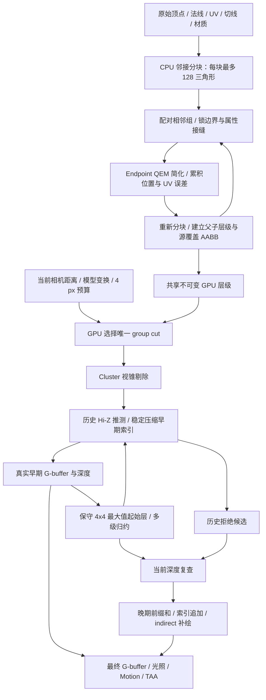
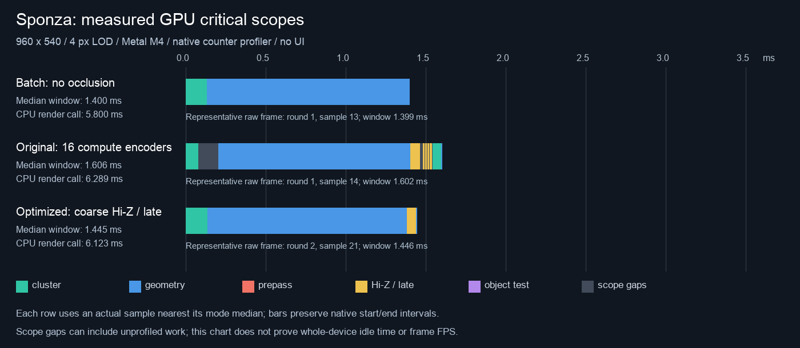
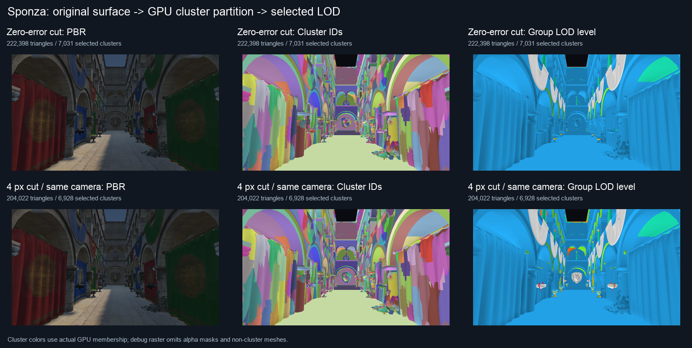
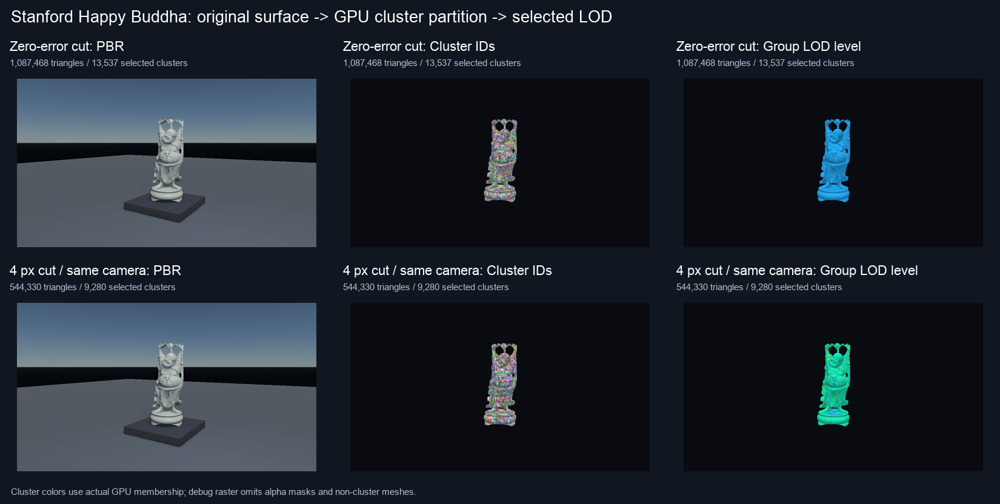
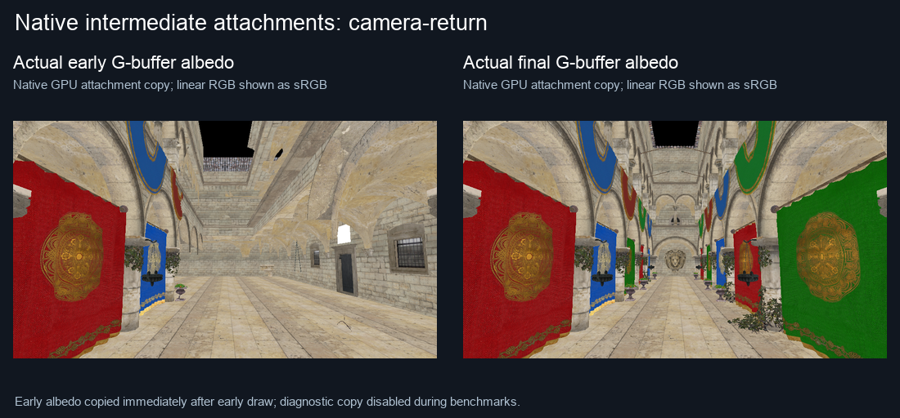
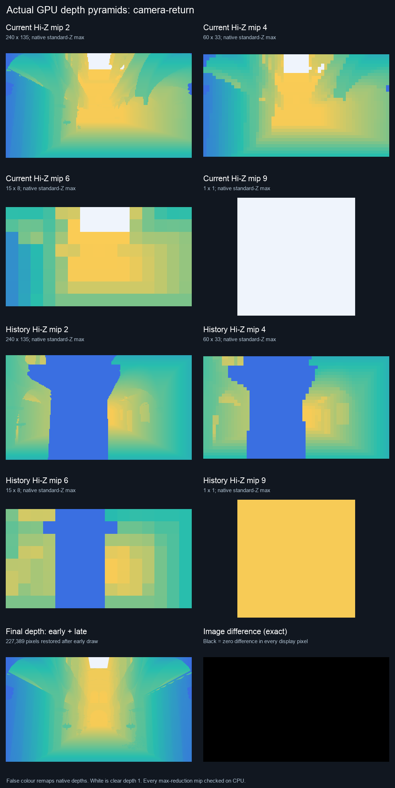

# Cluster Hi-Z 优化与高密度模型 LOD 流程

本页记录上一轮 GPU 调度优化的构建器和数据。后续位置拓扑分块、空间补齐、父表示收益门槛与累计法线约束，及三个场景的同构建 A/B 数据见 [Cluster 分块与层级构建](cluster-partition-and-hierarchy.md)；下文旧叶块／根数量和耗时保留为历史基线。

本轮优化将 Hi-Z 的有效起始层改为屏幕分辨率的四分之一，并融合后续多级归约、晚期前缀和与索引追加。在 Metal 上，相邻 cluster／Hi-Z dispatch 共用 compute encoder。功能仍可关闭；原始算法、独立 encoder 和实验投影界均保留用于同构建对照。

## 金字塔和晚期 dispatch

960×540 的原始金字塔有 10 层、10 次 dispatch。新路径直接读取实际早期 G-buffer 深度，对每个 4×4 区域取 **最大** 深度，形成 240×135 起始层，再以共享内存 tile 每次生成最多三层。共 8 个有效 mip、4 次 dispatch。没有复制完整分辨率深度，也没有丢弃天空、alpha 孔洞或奇数尺寸的尾部像素。

测试仍使用原屏幕像素坐标。查询根据实际纹理的起始分辨率调整 mip 和覆盖 texel；小矩形也查询覆盖它的较粗区域，因此只会更保守。历史金字塔与当前金字塔可具有不同的起始层。深度拒绝阈值仍为 `nearest > farthest + 1e-4`，近裁面、眼平面和不确定投影仍放行。

晚期保留并行的候选测试与每 64 个 cluster 的局部前缀。随后每个 mesh 的工作组合并全局前缀和与索引追加，跳过空组，避免为全部 meshlet 再启动独立 scatter 工作组。恢复数量为零时省略前缀写回与索引加载；有恢复时，128 个线程协作复制每个 cluster 的连续索引，避免前缀线程各自串行复制造成不连续访存和长尾。晚期由 3 次 dispatch 降为 2 次；冷启动没有历史拒绝候选时，直接省略晚期 dispatch 和 render pass。大量晚期恢复时，每 mesh 的追加并行度仍有限，可通过 A/B 开关回到分离 scatter。

Metal 将相邻计算阶段放进同一个串行 compute encoder，在 dispatch 之间使用缓冲和纹理 memory barrier。早期计算和“当前金字塔＋晚期计算”由 G-buffer render pass 分隔，分别形成一个 encoder。原两阶段为 **16 次 dispatch／16 个 compute encoder**；新算法为 **9 次 dispatch／2 个 compute encoder**。同样的后端合并也适用于旧算法和无遮挡基准，公平对照时无遮挡是 **3 次 dispatch／1 个 encoder**。这遵循 [Apple 的 compute encoder 与资源屏障接口](https://developer.apple.com/documentation/metal/mtlcomputecommandencoder/)。

合并后的硬件 timestamp 是整个 encoder 的实际区间，不能拆成虚构的逐 kernel 时间。原始逐 kernel 对照使用独立 encoder；两者均保存原始时间戳。

## 复杂模型暴露的扩展性问题

初版 scatter 为每个常驻 meshlet 启动一维工作组。Buddha 单模型和 Dragon 三副本超过 native X 维的 65,535 工作组限制，会回退到其他绘制路径。现在 scatter 使用二维 dispatch，并在 shader 中展平工作组 ID、检查末尾 padding。测试专门使用 **65,537 个 cluster** 跨过这一边界，逐值检查全部 GPU 索引。

重复模型共享批次中的不可变 nodes 与层级索引；各 draw 仍有独立的 cluster owner、变换、选择标记、输出索引区间和 indirect 参数。既有共享网格、重复 ID、重排、隐藏／恢复与来源修改测试继续验证这些语义。

如果批次因资源限制或不兼容 packet 回退，会取消未使用的 Hi-Z 与晚期流程。捕获工具对高密度场景要求实际进入批处理／两阶段路径，发生回退就报错，避免把源几何结果误记为 cluster 测试。

## 为什么 Sponza 的 LOD 看起来不明显

Sponza 的兼容源几何为 262,195 个非退化三角形。原视角的零误差切面为 222,398 个三角形，4 px 切面为 204,022，**同镜头 LOD 只减少 8.26%**。之后遮挡再减少约 7.65%。平面建筑、已较稀疏的网格和当前走廊视角，都限制了可节省的工作。

算法也有明显限制：8,940 个叶 meshlet 平均只有 29.3 个三角形，相对 128 容量约 22.9%；有 7,071 个根。当前严格按完整顶点属性建立邻接，UV／法线接缝及断开的组件会切碎层级，BFS 分块也会留下小块。不能把这些根全部视为真正独立的物体；它们表示当前构建器里的拓扑分片。34,908 个源三角形还受 alpha／双面／发光等材质的叶层保护，占兼容源几何约 13.3%。

因此原因包含场景复杂度与构建策略，而非仅仅像素预算不够激进。增大预算只能选择已经存在的父层表示，无法弥补缺失的合并层级。下一步更有价值的是位置拓扑邻接与属性索引分离、空间局部性填充／重分区、提高叶块利用率，以及 GPU 只遍历候选子树；直接放松孔洞、深度或接缝约束会破坏图像正确性。

## 从源模型到动态 LOD、遮挡与最终画面



屏幕误差估计为 `累计位置误差 × 模型尺度界 × 焦距像素 / 最近视空间深度`。本组满足预算且父组不满足时，选择整个组表示；同一物体可以同时包含多个层级。相机变远时，相同的几何位移占据更少像素，允许选择更高层级。父误差单调，父包围盒覆盖源子树，切面不同时选择父子。

这里参考 [Epic 的 Nanite 分组、简化与两阶段遮挡流程](https://advances.realtimerendering.com/s2021/Karis_Nanite_SIGGRAPH_Advances_2021_final.pdf)。当前仍是常驻层级、CPU 构建和按材质 indexed indirect 绘制，没有 Nanite 的分页流送、GPU 持久遍历、visibility buffer、材质分箱或混合光栅。

截图来自实际 native 渲染，全部没有 UI。cluster 颜色由真实 GPU membership 赋给对应源三角形；分块图是独立诊断 pass，不应用 alpha mask，并省略没有 cluster 的小网格，因此不能拿它当作最终材质／透明度画面。LOD 颜色表示 group 层级，0 为叶层。动态序列固定 4 px，只移动相机；每个镜头另外渲染零误差切面，剔除视锥变化对 LOD 减少率的干扰。

## 性能、图像验证与图集

### Sponza：静态视角与移动镜头分开看

Apple M4／Metal，960×540，固定 4 px、同相机／材质／曝光，TAA、AO、DDGI、RSM 关闭。关闭 API／Shader Validation 测性能；开启原生 GPU counter profiler。每模式 3 轮，每轮 8 帧预热＋24 帧测量，共 **72 样本**；逐帧轮换模式和执行顺序。不同模式拥有独立历史，读回和参考渲染在计时范围外。

GPU 窗口是第一个 cluster scope 到 geometry 结束，包括 scope 间隙；仅覆盖 cluster、Hi-Z 和早期／晚期 geometry，不包含阴影、光照、后处理与 CPU 层级构建，不能换算整帧 FPS。CPU render 是调用墙钟时间，也不是显示延迟。

| 静态模式 | Compute dispatch／encoder | GPU pass 之和 ms | GPU 窗口 ms | CPU render ms |
| --- | ---: | ---: | ---: | ---: |
| 无遮挡，独立 encoder | 3／3 | 1.426 | 1.429 | 5.796 |
| 原两阶段，独立 encoder | 16／16 | 1.518 | 1.606 | 6.289 |
| 无遮挡，合并 encoder | 3／1 | 1.400 | 1.400 | 5.800 |
| 原两阶段，合并 encoder | 16／2 | 1.507 | 1.509 | 6.095 |
| 只改粗起始层／融合归约 | 10／2 | 1.468 | 1.469 | 6.047 |
| 粗起始层＋融合晚期追加 | **9／2** | **1.444** | **1.445** | 6.123 |
| 再启用实验 XY 区间界 | 9／2 | 1.445 | 1.445 | 6.090 |

优化路径比原两阶段／独立 encoder 的 GPU 窗口降低 **10.0%**，比同样合并 encoder 的原算法降低 **4.2%**，但比无遮挡仍慢 **3.2%**。默认镜头从 204,022 降到 188,422 个三角形，只省约 7.65%。`当前金字塔＋晚期计算` 合并 scope 的中位数从 **0.137 → 0.063 ms**，已降低约 54%；节省的 geometry 时间仍不足以抵消这部分工作。阶段独立中位数不能直接相加为总中位数。

静态 P10–P90：无遮挡 1.369–2.274 ms，优化遮挡 1.401–2.295 ms。相邻同 round／sample 的配对窗口变化中位数为 +2.13%，只有 17／72 对更快，因此**不能声称默认静态镜头已经稳定快于无遮挡**。早期试跑曾有小幅反向结果，复测未确立稳定收益。遮挡继续默认关闭，保留 A/B 开关。

| 相同移动镜头序列 | GPU 窗口 ms | CPU render ms | 每模式逐帧验证 |
| --- | ---: | ---: | ---: |
| 无遮挡批处理 | 2.203 | 7.902 | 72 帧一致 |
| 原两阶段／合并 encoder | 2.224 | 8.350 | 72 帧一致 |
| 优化两阶段 | **1.839** | **7.625** | 72 帧一致 |

移动序列的汇总窗口中位数相对无遮挡低 **16.5%**，相对原两阶段低 17.3%，但**这个汇总值不能证明更快**。按相同 round／sample 配对后，优化只在 11／72 对中更快，配对耗时变化中位数为 **+10.01%**。三轮各自的窗口中位数，无遮挡为 1.412／1.552／2.254 ms，优化为 1.556／1.576／2.475 ms，均更慢。多峰耗时分布的汇总中位数隐藏了这个差异，所以结论是：**本轮 Sponza 仍未确立稳定超过无遮挡的收益**。

每帧 HDR 最大误差为 0，显示像素与深度精确一致。这个结果覆盖指定的 ±0.75 m 相机序列；GPU 频率、缓存和参考读回的扰动仍影响分布，静态与移动表不能彼此相减，也不能外推到任意镜头。后续性能决策应同时观察逐帧配对与各轮分布，不能只取一个总体中位数。



原始数据：[静态七模式](../img/diagnostics/cluster-hiz-optimized/metal/benchmark.json)、[移动三模式与逐帧图像验证](../img/diagnostics/cluster-hiz-optimized/metal/moving-benchmark.json)、[阶段／配对统计](../img/diagnostics/cluster-hiz-optimized/metal/summary.json)、[图中的实际时间戳帧](../img/diagnostics/cluster-hiz-optimized/metal/timing-frames.json)。晚期串行复制版本的前一轮结果保存在 [历史记录](../img/diagnostics/cluster-hiz-optimized/metal/late-serial-baseline.json)，跨运行绝对耗时不作为优化增益。

### 百万三角形扫描模型

Dragon 导入 871,414 个三角形，排除退化面后层级包含 871,306；Buddha 导入 1,087,716，层级包含 1,087,468。没有触发 hierarchy budget 截断。每个 scan 的 near／middle／far 都另外生成同视角零误差参考，LODs 的减少率独立于视锥变化。

| 模型 | 叶 meshlet／所有层 meshlet | 层级根数 | 中距离 4 px 三角形 | 同视角 LOD 减少 | 层级常驻内存 |
| --- | ---: | ---: | ---: | ---: | ---: |
| Sponza | 8,940／23,567 | 7,071 | 204,022 | 8.26% | 16.66 MiB |
| Dragon | 10,655／61,932 | 3,656 | 436,042 | 49.96% | 42.64 MiB |
| Buddha | 13,537／79,537 | 4,806 | 544,330 | 49.95% | 53.42 MiB |

扫描模型的叶块平均约 81 个三角形，明显高于 Sponza 的 29.3。Dragon 近／中／远视角为 604,472 → 436,042 → 217,592，同视角 LOD 减少约 30.6% → 50.0% → 75.0%；Buddha 为 725,876 → 544,074 → 273,512，减少 33.3% → 50.0% → 74.8%。两模型所有六个切面的 GPU 索引都与独立 CPU 选择结果**逐值一致**。

下面计时也采用同构建、相同 4 px 切面、三轮逐帧轮换，每模式 72 个样本。三副本沿镜头方向重叠，是另行标记的遮挡压力场景。所有测量都实际进入 cluster 批处理；没有资源限制回退。各遮挡模式与无遮挡参考的 HDR 最大误差为 0，深度／显示精确一致。

| 场景 | 源层级三角形 | 4 px 切面 | 遮挡后早期三角形 | 无遮挡窗口 ms | 原两阶段 ms | 优化两阶段 ms | 优化相对无遮挡 |
| --- | ---: | ---: | ---: | ---: | ---: | ---: | ---: |
| Dragon 单模型 | 871,306 | 436,042 | 367,167 | 1.161 | 1.262 | 1.144 | −1.5% |
| Dragon 三副本 | 2,613,918 | 1,271,588 | 643,932 | 2.118 | 1.950 | 1.677 | **−20.8%** |
| Buddha 单模型 | 1,087,468 | 544,330 | 458,117 | 1.371 | 1.603 | 1.358 | −1.0% |
| Buddha 三副本 | 3,262,404 | 1,561,654 | 787,912 | 2.413 | 2.279 | 1.897 | **−21.4%** |

单模型约 1% 的收益仍很小；复杂度高且遮挡密集时，省掉的绘制更容易覆盖固定计算成本。不要把 LOD 的 50–75% 三角形减少直接解释为等比例 FPS 提升：当前仍按全部常驻 meshlet 测试，材质／像素工作和辅助视角源几何也仍在。

复杂场景也核对逐帧配对：Dragon 三副本的配对窗口变化中位数为 **−21.07%**，Buddha 为 **−20.96%**，两者都是 **72／72 对更快**，与汇总统计一致。Dragon 单模型为 −4.73%、56／72 对更快；Buddha 为 −0.68%、38／72，单模型收益仍应谨慎看待。配对／分轮数据：[Dragon](../img/diagnostics/cluster-hiz-optimized/dragon/performance-summary.json)、[Buddha](../img/diagnostics/cluster-hiz-optimized/buddha/performance-summary.json)。

共享不可变几何后，Dragon 三副本的 batch 缓冲为 81.09 MiB，而复制三份单模型 batch 会约 160.70 MiB。这里仅比较 batch nodes、层级索引、每 draw 的 cluster／scratch／输出与参数，不包含引擎原始 mesh、材质或纹理，也不代表总显存减少一半。

原始结果与每帧 timestamp：[Dragon](../img/diagnostics/cluster-hiz-optimized/dragon/dense.json)、[Buddha](../img/diagnostics/cluster-hiz-optimized/buddha/dense.json)。[Sponza flow](../img/diagnostics/cluster-hiz-optimized/metal/flow/flow.json) 保存分块数量、保护材质、实际 GPU membership 和每级三角形数。






[Dragon 完整静态图](../img/diagnostics/cluster-hiz-optimized/dragon/flow/dynamic-lod.png)、[Buddha 完整动态 LOD](../img/diagnostics/cluster-hiz-optimized/buddha/flow/dynamic-lod.png)、[LOD 颜色图例](../img/diagnostics/cluster-hiz-optimized/dragon/flow/level-legend.png)。

### 图像正确性与实际中间结果

Metal 开启 API＋Shader Validation 通过；Vulkan 经同机 MoltenVK 功能验证通过，未把它当成独立 Vulkan 硬件或 Khronos validation layer 测试。两后端各覆盖 31 个两阶段用例，包括移动遮挡物、alpha 孔洞变化、同深度、镜像／剪切、LOD 改变、材质变化、共享 mesh、多 draw ID、源版本变化、reset／resize、TAA jitter 和不兼容 packet 回退。旧单阶段 cluster Hi-Z 的 11 组回归也通过。

金字塔 oracle 使用 8 种尺寸，含 1×1、2×1、奇数宽高和 960×540；全分辨率／四分之一起始层 × 单级／融合 builder 共 32 组，独立 CPU 检查 **1,569,260 个 texel**，全部最大深度精确一致。二维 scatter 的 65,537 cluster 测试逐值验证索引。

Sponza 两后端各 7 个场景逐值比较 HDR、显示、最终深度和六张 G-buffer，误差全部为 0。保存 cold、warm、横移、返回镜头四组实际历史／当前金字塔，以及独立复制的**全分辨率真实早期深度**。Python 从早期深度归约证明粗起始层与所有后续 mip，并用原分辨率覆盖区域逐个证明最终拒绝 cluster 的遮挡关系；每后端证明了 3,762 个拒绝 cluster。

返回镜头时，早期只有 38,782 个三角形，晚期恢复 **161,050** 个，补回 **227,389 个深度像素**，最终画面仍与无遮挡参考一致。这也验证大量晚期恢复不会丢表面；相机瞬间大幅改变时，仍可能有较高补绘成本。





验证与独立证明：[Metal validation](../img/diagnostics/cluster-hiz-optimized/metal/validation.json)、[Vulkan validation](../img/diagnostics/cluster-hiz-optimized/vulkan/validation.json)、[Metal depth proof](../img/diagnostics/cluster-hiz-optimized/metal/two-stage/proof.json)、[Vulkan depth proof](../img/diagnostics/cluster-hiz-optimized/vulkan/two-stage/proof.json)。原始浮点读回保存在各 case 的 `readbacks.npz`，可无损重放检查。

最终 CTest 六项全部通过：`cluster-hierarchy`、`pt-clustered-world-lod`、`cluster-rendering-native`、`cluster-rendering-vulkan`、`geometry-culling-native`、`hiz-culling-native`。

## 开关与复现

UI：开启 `Hierarchical cluster geometry`、`Cluster Hi-Z occlusion` 和 `Two-stage cluster occlusion`。`Cluster occlusion A/B` 下可单独关闭粗起始层／融合归约和晚期前缀追加；实验 XY 区间投影默认关闭，其保守矩形可能降低有效剔除率。`SCENERENDERER_DISABLE_CLUSTER_ENCODER_BATCH=1` 可关闭 Metal 的 encoder 合并。

```sh
cmake --build build --target Scene-Renderer -j6
MTL_DEBUG_LAYER=1 MTL_SHADER_VALIDATION=1 ./build/Scene-Renderer --cluster-rendering-self-test --backend Metal
./build/Scene-Renderer --cluster-rendering-self-test --backend Vulkan

SCENERENDERER_GPU_PROFILE=1 SCENERENDERER_CLUSTER_BENCHMARK=1 \
SCENERENDERER_CLUSTER_FLOW=1 \
SCENERENDERER_CLUSTER_CAPTURE_DIR=img/diagnostics/cluster-hiz-optimized/metal \
./build/Scene-Renderer --cluster-rendering-self-test --backend Metal

SCENERENDERER_GPU_PROFILE=1 SCENERENDERER_CLUSTER_DENSE_SCENE=dragon \
SCENERENDERER_CLUSTER_CAPTURE_DIR=img/diagnostics/cluster-hiz-optimized/dragon \
./build/Scene-Renderer --cluster-rendering-self-test --backend Metal
# 将 dragon 换成 buddha，输出目录也换成 buddha。
```

扫描模型来自 [Stanford 3D Scanning Repository](https://www-graphics.stanford.edu/data/3Dscanrep/)，使用仓库已经下载且记录哈希与来源的 Dragon 和 Happy Buddha；不是 Epic 官方 Nanite 素材。缺失时使用 `tools/fetch_benchmark_assets.py --scene dragon`／`buddha`。同一模型的三副本重叠场景单独标记为遮挡压力测试。

可视化脚本：`tools/visualize_cluster_flow.py` 生成分块／动态 LOD 图和 GIF；`tools/visualize_cluster_two_stage.py` 检查实际早期深度、粗起始层、后续 mip、每个最终拒绝 cluster 的原分辨率深度证据；`tools/analyze_cluster_performance.py` 汇总原始 timestamp；`tools/visualize_cluster_timing.py` 展示最接近中位数的一帧实际区间。
