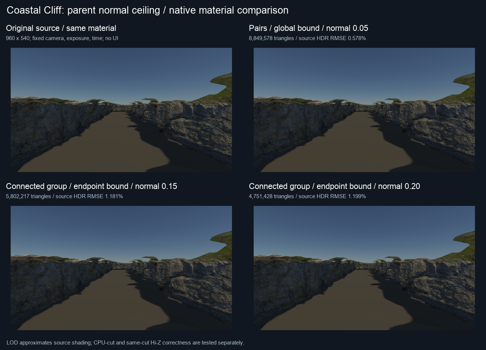
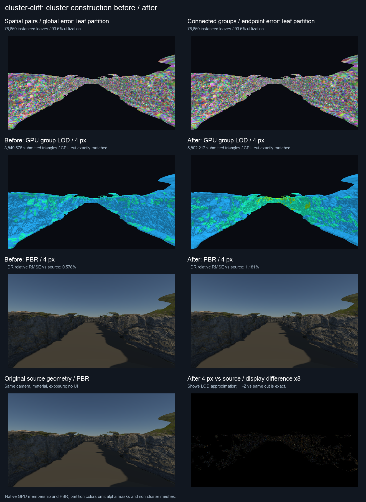
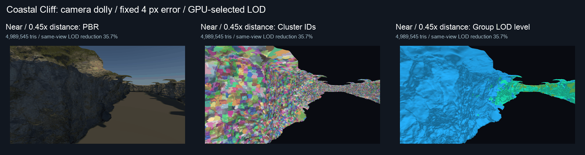

# Coastal Cliff：父层级与 LOD 简化改进

本轮针对上一轮 Coastal Cliff 的 LOD 减量不足：保留相同叶分块、原始顶点／材质和运行时 4 px 误差预算，改进父组构建与累计误差继承。默认父组容量为 8，累计单位法线偏差上限为 0.15。固定峡谷视角的提交三角形从 8,849,578 降至 5,802,217，相对同视角 0 px 的减量从 **3.24% 提升到 36.56%**。

测试素材与 UE Nanite 对照见 [Coastal Cliff 场景报告](cluster-cliff-nanite-test.md)。本轮的旧基线是**上一版空间分块 + 两子组父层级 + 全组累计误差 + 法线上限 0.05**，不是最初 Attribute BFS。十实例共享一个 943,284 三角形原始网格；叶 meshlet 仍为 7,885 个、利用率 93.46%。

## 瓶颈与消融

原实现每次仅合并两个组，锁定组外边界和属性接缝后，可简化的内部区域小。更重要的是，全组最坏误差被复制到下一级每一个顶点：局部已经发生的误差限制了未改变的区域。法线上限 0.05（约 2.9°）又让扫描岩石的大量候选收缩失败，最终父表示不满足最低 12.5% 减量而被丢弃。

消融直接构建最大唯一网格并验证每个 cut 的完整叶覆盖。以下 4 px 数值是**单个网格、原相机和实例变换、不做视锥／遮挡剔除**，不能和十实例峡谷的绘制统计混用。CPU 墙钟每项只测一次，表中差别不是统计置信结论。

| 父组容量／误差继承 | 法线上限 | 根 | 4 px 三角形 | 64 px 三角形 | 常驻 MiB | 构建秒 |
|---|---:|---:|---:|---:|---:|---:|
| 2／全组 | 0.05 | 7,178 | 918,928 | 912,012 | 13.32 | 2.911 |
| 2／逐顶点 | 0.05 | 7,176 | 918,884 | 911,926 | 13.33 | 4.737 |
| 4／逐顶点 | 0.05 | 6,589 | 915,324 | 905,452 | 13.74 | 5.435 |
| 8／全组 | 0.05 | 6,008 | 911,830 | 897,370 | 14.29 | 8.456 |
| 8／逐顶点 | 0.05 | 6,008 | 911,830 | 897,370 | 14.29 | 10.503 |
| 8／逐顶点 | 0.10 | 1,498 | 783,356 | 706,096 | 20.10 | 9.978 |
| **8／逐顶点** | **0.15** | **1,244** | **731,400** | **571,166** | **19.95** | **8.293** |
| 8／逐顶点 | 0.20 | 834 | 656,210 | 454,358 | 21.32 | 6.340 |

在 0.05 下，八组逐顶点方案仍有约 1,316 万次法线预算拒绝、0 次 UV 预算拒绝、135 次位置预算拒绝。计数是优先队列候选的尝试次数，同一边可能重复入队，不是唯一边数量。仅扩大分组无法解决这个素材的主要瓶颈。

## 实现与安全边界

1. 依据精确位置拓扑共享边的权重，贪心扩展最多 8 个连通子组；不跨不相连的组强行合并。沿用叶分块和全部原始属性地址。
2. 每个存活 endpoint 保存位置、UV、单位法线的保守偏差半径。收缩 `drop -> keep` 后，每个通道更新为 `max(keepRadius, dropRadius + endpointDistance)`；下一层只继承该顶点的半径，合并相同顶点的多份半径时取最大值。节点仍保存最大位置误差，且至少为子节点误差，保证单调。
3. 合并后执行 endpoint QEM，目标为一半三角形。继续锁定组外边界、UV／法线／切线接缝，检查 manifold link condition 和面翻转。未减少至少 12.5% 的父副本不进入层级。
4. N 个子组通过 N−2 个**无几何的二叉路由节点**连接到一个真正的父表示。路由节点与该父表示拥有完全相同的源覆盖 AABB、位置误差和 UV 误差，因此任意相机和实例变换下，投影误差也相同。路由不会被单独选中：选择整个父表示，或者回到原有子 cut。保留现有 48 B 节点和 GPU immediate-parent cut ABI，不新增 dispatch。
5. 沿用每网格 64 MiB 层级预算、2% 网格包围盒对角线的位置误差上限、0.03 UV 上限和运行时屏幕误差。0.15 是累计单位法线弦长半径（约 8.6°），不等于最终着色误差保证。

法线预算属于本轮明确放宽的质量参数。0.20 虽然在 4 px 下更省三角形，但 16 px 下源图 HDR 相对 RMSE 为 2.092%，0.15 为 1.846%；因此默认保留 0.15，0.20 仅作为诊断对照。高光材质、其他素材和更大的屏幕预算需要独立检查。



## GPU 性能

| 模式 | 几何 GPU 窗口中位数 | 岩石提交三角形 |
|---|---:|---:|
| 原始几何，关闭 cluster | 9.478 ms | 9,432,840 |
| 旧层级，0 px | 8.499 ms | 9,145,579 |
| 新层级，0 px | 8.854 ms | 9,145,579 |
| 旧层级，4 px | 8.312 ms | 8,849,578 |
| 新层级，4 px | 6.216 ms | 5,802,217 |
| 旧层级，4 px + Hi-Z | 6.859 ms | 6,699,513 |
| 新层级，4 px + Hi-Z | 5.308 ms | 4,516,290 |

新／旧配对中位变化：4 px **−24.58%**，4 px + Hi-Z **−22.21%**，两者均 72／72 对更快。新 Hi-Z 相对新无遮挡 **−14.53%**（71／72 对更快），相对原始几何 **−43.98%**（72／72 对更快）。但新 0 px 相对旧 0 px **+3.76%**，仅 8／72 对更快：更多父 meshlet／路由节点带来扫描开销，本轮没有使所有模式都加速。

静态预热后的新 Hi-Z 保留 4,516,290 三角形，拒绝当前 4 px cut 中的 1,285,927 三角形，全部接受几何在早期绘制，晚期恢复为零。移动测试则确实有晚期恢复，单独验证正确性。源模式原始 JSON 包含两个 floor 三角形；cluster 读回只计岩石。

Apple M4／Metal，960×540，固定峡谷相机、时间、曝光和原始材质，关闭 TAA、AO、DDGI、RSM。同一可执行程序比较旧／新层级和原始几何，七模式轮换三轮，每轮 8 帧预热和 24 个计时样本，每模式 **72 样本**。计时关闭 Metal API／Shader Validation，开启原生 GPU counter。UE 未同时运行。

窗口覆盖 cluster／Hi-Z／geometry 到几何结束，包含 pass 间空隙；排除阴影、光照、后处理、CPU 构建、读回。这里**不是整帧 FPS**。配对变化是相同 round／sample 轮换模式的比值中位数，是描述性数据。

| 唯一网格层级 | 旧方案 | 新方案 |
|---|---:|---:|
| 叶 meshlet | 7,885 | 7,885 |
| 全部 meshlet | 9,307 | 14,025 |
| 节点（含路由） | 8,592 | 14,526 |
| 根 | 7,178 | 1,244 |
| 常驻层级 | 13.32 MiB | 19.95 MiB |
| 同线程构建墙钟 | 2.878 s | 8.195 s |
| 无几何路由节点 | 0 | 5,614 |

没有触发 64 MiB 截断。新层级不仅形成 level 1，还形成含 106,498 三角形的 level 2 父表示；这不是同时选中全部层的绘制量。

常驻内存仅计算唯一层级的索引、meshlet 和节点，排除原始顶点、纹理、GPU 实例可见性／索引输出和构建 scratch。更有效的父表示增加了常驻副本和 CPU 建设成本；本轮优化的是运行时 LOD 可用性，CPU 加载速度仍有改进空间。

## 图像正确性与近似误差

CPU 层级自测通过：唯一 cut 覆盖、单调误差、二叉路由投影一致、128 三角形容量、最低父减量、内存预算、非连通组件、原始 UV／切线接缝和 mixed-LOD 边界保持，以及法线预算为零时禁止不同法线 endpoint 收缩。

Metal API／Shader Validation 开启的原生回归通过，包括 Hi-Z 精确 max-reduction oracle、批次／间接索引、镜像／剪切／非均匀缩放、正交相机、材质接缝、遮挡者移动、相机移动和可见性恢复。

峡谷旧／新层级在 **0／4／16 px** 都与独立 CPU group cut 的渲染一致：HDR、深度、显示图和全部六个 G-buffer 最大误差均为零；静态两阶段 Hi-Z 相对同 cut 无遮挡结果也全部为零。这个结论是同 cut 实现正确性，不是 LOD 与原始高模完全相同。

| 固定视角 | 原图 HDR 相对 RMSE | 改变的显示像素 |
|---|---:|---:|
| 旧层级 4 px，法线 0.05 | 0.578% | 9,106 |
| **新层级 4 px，法线 0.15** | **1.181%** | **39,064** |
| 新层级 4 px，法线 0.20 | 1.199% | 46,495 |
| 新层级 16 px，法线 0.15 | 1.846% | 104,362 |
| 新层级 16 px，法线 0.20 | 2.092% | 123,150 |

两种层级的 0 px 原图误差相同：HDR 相对 RMSE 0.0786%，15 个显示像素不同。叶分块和地址未改变；这个历史源图与重排索引的差异仍保留，不能声称与原始索引顺序逐像素一致。

新增五个连续峡谷视角（原位置、侧移前进、反向、近侧壁、返回）。每帧 CPU cut 渲染完全一致，Hi-Z 深度均完全一致，晚期恢复非零。反向 pose 2 有旧层级 **1 像素**、新层级 **2 像素**不同，其余视角显示完全一致。新层级最大显示通道差为 29/255、HDR 相对 RMSE 0.0444%。独立 CPU 按实际 GPU early-then-late membership 和包顺序重放后，HDR、深度、显示图和六个 G-buffer 全部误差为零，证明这些差异来自深度相同表面的绘制顺序竞争。本轮没有消除这个已有的两阶段排序限制，也没有将移动检查伪报为 bit-exact。

测试遇到非有限值、CPU cut 不符、静态 Hi-Z 差异、移动前景深度变化或无法由独立顺序重放解释的附件差异都会失败。相同顺序的重放不能替代原图比较，因此上述像素差异单独公开。





诊断 dolly 每个姿态单独比较 0 px／4 px，排除视锥变化的贡献：旧方案近／中／远／最远仅减少 **3.17／3.22／3.30／3.32%**，新方案为 **35.70／36.79／38.74／39.43%**。固定峡谷 4 px cut 的 level 0／1／2 三角形分别为 **593,100／4,509,082／700,035**，与实际间接绘制总量相等。

## 复现与证据

```sh
python3 tools/prepare_cluster_cliff.py
cmake --build build --target Scene-Renderer -j6
./build/Scene-Renderer --cluster-hierarchy-self-test
./build/Scene-Renderer --cluster-parent-sweep cluster-cliff build/cliff-parents/sweep.json
SCENERENDERER_CLUSTER_NORMAL_SWEEP=1 \
./build/Scene-Renderer --cluster-parent-sweep cluster-cliff build/cliff-parents/normal-sweep.json
```

```sh
SCENERENDERER_GPU_PROFILE=1 SCENERENDERER_CLUSTER_BENCHMARK=1 \
SCENERENDERER_CLUSTER_BUILD_COMPARE=1 SCENERENDERER_CLUSTER_PARENT_COMPARE=1 \
SCENERENDERER_CLUSTER_DENSE_SCENE=cluster-cliff \
SCENERENDERER_CLUSTER_CAPTURE_DIR=img/diagnostics/cluster-parents/cliff/benchmark \
MTL_DEBUG_LAYER=0 MTL_SHADER_VALIDATION=0 \
./build/Scene-Renderer --cluster-rendering-self-test --backend Metal
python3 tools/analyze_cluster_partition.py img/diagnostics/cluster-parents/cliff/benchmark
python3 tools/visualize_cluster_flow.py img/diagnostics/cluster-parents/cliff/benchmark/optimized --scene 'Coastal Cliff'
```

正确性会话移除 `SCENERENDERER_CLUSTER_BENCHMARK`，将 capture 改到 validation，设置 `MTL_DEBUG_LAYER=1 MTL_SHADER_VALIDATION=1`。法线 0.20 对照设置 `SCENERENDERER_CLUSTER_PARENT_NORMAL_ERROR=.2`，其他参数保持相同。质量图与消融汇总由 `tools/analyze_cluster_parents.py` 读取两次 comparison 和两份 CPU sweep 生成。

- [全部逐 pass 原生时间与图像误差](../img/diagnostics/cluster-parents/cliff/benchmark/comparison.json)、[配对摘要与移动检查](../img/diagnostics/cluster-parents/cliff/benchmark/summary.json)。
- [CPU 消融与法线预算质量对照](../img/diagnostics/cluster-parents/cliff/benchmark/parent-ablation.json)。
- [API／Shader Validation 会话的原生检查](../img/diagnostics/cluster-parents/cliff/validation/comparison.json)、[验收记录](../img/diagnostics/cluster-parents/cliff/validation/verification.json)。
- [旧实际 GPU membership](../img/diagnostics/cluster-parents/cliff/benchmark/legacy/flow/flow.json.gz)、[新实际 GPU membership](../img/diagnostics/cluster-parents/cliff/benchmark/optimized/flow/flow.json.gz)、[动态 cut 摘要](../img/diagnostics/cluster-parents/cliff/benchmark/optimized/flow/summary.json)。压缩仅用于发布，解压后可复算全部成员计数。

尚未覆盖所有场景、材质和相机轨迹；CPU 串行 QEM／重分块成本、深度相同面稳定排序，以及 GPU 子树队列、几何分页／流送仍是后续方向。
