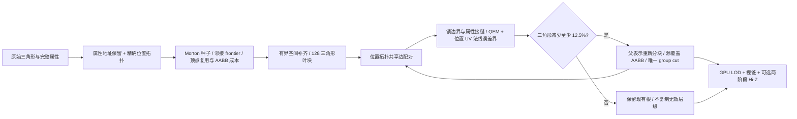
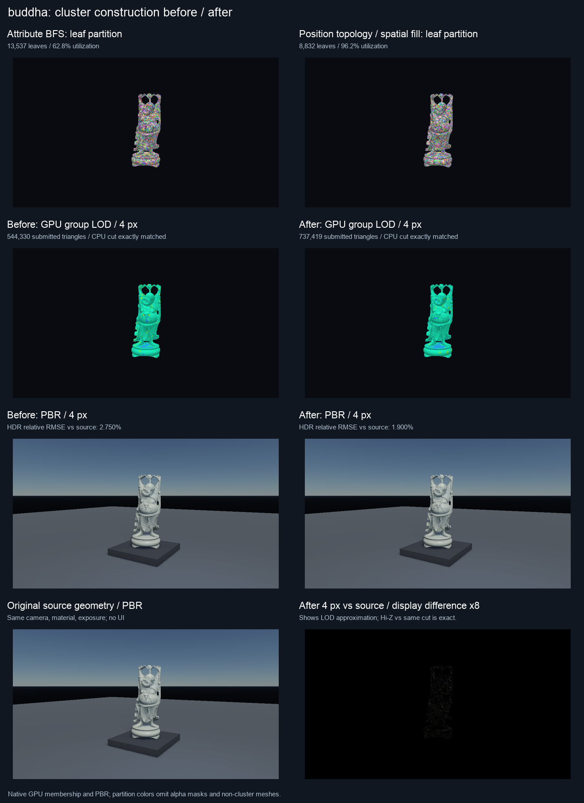
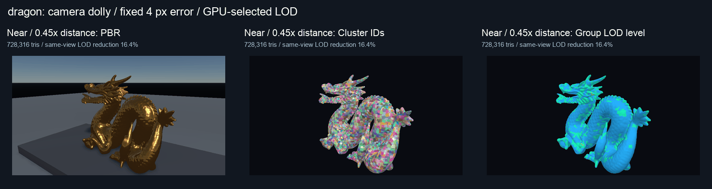

# Cluster 分块与层级构建：位置拓扑、空间填充与属性保护

本页保留上一轮配对父组、法线上限 0.05 的历史测量。当前默认已改为连通父组和逐顶点累计误差，法线上限为 0.15；新参数、Coastal Cliff 消融、图像取舍与实测结果见 [父层级与 LOD 简化改进](cluster-parent-lod-optimization.md)。下面的旧数据不代表当前默认构建。

本轮改进叶 meshlet 利用率与层级构建，不改变原始材质、顶点、UV、法线或切线缓冲。GPU 绘制和两阶段 Hi-Z 使用前一轮的批处理／融合路径。旧构建器保留为 `ClusterBuildSettings::spatialPartition=false`，新构建器默认开启；整体 cluster 与遮挡功能仍由运行时开关控制。

## 构建方法

旧路径按完整顶点属性建立邻接，再进行 BFS。UV、法线或切线接缝即使位置连续，也可能形成多个图分片；BFS 满块后丢掉 frontier，随后从源顺序中取 seed，会留下很多小块。

新路径为每个输入顶点保留两种索引：

1. **属性地址**：规范化 ±0 后，只对位级相同的完整属性做 canonical 映射；所有最终索引仍指向原始顶点／切线数据。
2. **位置拓扑地址**：同样规范化 ±0，只合并精确相同的位置，用于寻找几何边邻居；没有 epsilon 焊接，不修改实际顶点。三角形在同一几何边上恰好有两张面时才建立 manifold 邻接。

种子按三角形质心 Morton 顺序排序。每块从 frontier 中优先选复用属性／位置顶点最多、包围盒扩张较小的三角形。当 frontier 暂时断开时，最多检查附近 256 个 Morton 项、32 个未访问候选，在有界半径内继续填充，容量仍为 128 个三角形。远离的小组件不会被无限范围拼进一个巨大 AABB；共享 meshlet 只表示存储／提交分组，不会在断开的表面之间生成边或面。叶块直接复用首次分块结果，父表示才重新分块。

父组配对也使用位置拓扑的共享边计数，因此属性接缝不再直接阻断 group 邻接。简化继续使用 endpoint QEM、manifold link condition、面翻转检查，以及组外边界和全部属性接缝锁定。父表示至少要比两个子表示合计减少 **12.5%** 三角形才进入常驻层级（`minParentReduction`），避免重复存储只减少少量面的近似副本。未达到门槛时保留更详细的子根，不通过放松接缝／法线约束强行合并。

加入**累计法线偏差界**：每个 endpoint 保存其被合并样本到当前单位法线的最大偏差，合并时取 `max(keepRadius, dropRadius + length(normalKeep - normalDrop))`，再将 child 最大界带到父层。该轮上限为 0.05，约对应 2.9° 的单位法线夹角。位置和 UV 误差界继续累积，源覆盖 AABB 包含子树，相机屏幕误差仍控制运行时 cut。这个约束降低高光材质的着色变化，但不是对最终光照误差的保证；纹理、遮挡和高光对形状都可能敏感。



仍未实现 Nanite 的 GPU 子树工作队列、几何分页／流送、visibility buffer、材质分箱或混合光栅。这里只改进常驻层级构建和现有 indexed indirect 流程，参考背景见 [分层 Cluster 几何](hierarchical-cluster-geometry.md) 和 [上一轮 Hi-Z 优化](cluster-hiz-optimization-and-lod.md)。

## 同构建性能与图像比较

Apple M4／Metal，960×540，固定相机、时间、曝光与原始材质；TAA、AO、DDGI、RSM 关闭。旧／新构建器在同一可执行程序中比较。CPU 每个网格各构建一次，在同一线程执行，按网格交替先后顺序；表中是构建墙钟之和，不是后台加载延迟或 CPU cycles。GPU 每模式三轮，每轮 8 帧预热、24 帧计时，共 72 样本，逐帧轮换六个模式；计时关闭 API／Shader Validation，开启原生 counter profiler。

### 分块、层级与 CPU 建设

源三角形数剔除完全退化面；利用率为 `源三角形 / (叶 meshlet 数 × 128)`。常驻内存只计算层级索引、48 B meshlet 和 48 B group node，不包含原始几何、GPU 批次副本、压缩 scratch 或 AS。

| 场景／兼容源三角形 | 叶 meshlet：旧→新 | 利用率：旧→新 | 全部 meshlet：旧→新 | 根：旧→新 | 层级 MiB：旧→新 | CPU 构建秒：旧→新 |
| --- | ---: | ---: | ---: | ---: | ---: | ---: |
| Sponza／262,195 | 8,940→2,252 | 22.9%→91.0% | 23,567→2,398 | 7,071→2,182 | 16.66→3.39 | 1.576→0.547 |
| Dragon／871,306 | 10,655→7,116 | 63.9%→95.7% | 61,932→13,459 | 3,656→3,747 | 42.64→17.34 | 5.488→3.342 |
| Buddha／1,087,468 | 13,537→8,832 | 62.8%→96.2% | 79,537→16,720 | 4,806→4,616 | 53.42→21.96 | 6.814→4.193 |

三个场景都没有触发预算截断；新路径的累计法线偏差均不超过 0.05。原始完整属性、位置拓扑和接缝顶点统计保持一致。Sponza 的属性分片显著减少；扫描模型的根数量并不都减少，因为收益门槛会拒绝低收益父表示。这是减少常驻副本与保留细节的取舍，不能将更少的 meshlet 等同于更激进的 LOD。

### GPU 关键窗口

窗口从第一个 cluster scope 到 geometry 完成，包含 scope 间隙，只覆盖 cluster／Hi-Z／geometry；不包含阴影、光照、后处理、CPU 构建或读回，不能换算整帧 FPS。不同场景在独立会话采集，只比较同场景的旧／新值。逐帧配对变化是相同 round／sample 的相邻轮换模式比值中位数，与汇总窗口中位数的比值不同；属于描述性数据，不是置信区间。

| 场景／模式，固定 4 px | 旧窗口 ms | 新窗口 ms | 配对变化中位数 | 新路径更快的配对 |
| --- | ---: | ---: | ---: | ---: |
| Sponza／无遮挡 | 2.316 | 2.240 | −3.43% | 66／72 |
| Sponza／两阶段 Hi-Z | 2.342 | 2.270 | −3.18% | 63／72 |
| Dragon／无遮挡 | 1.692 | 1.652 | −2.64% | 64／72 |
| Dragon／两阶段 Hi-Z | 1.552 | 1.417 | −9.04% | 65／72 |
| Buddha／无遮挡 | 1.329 | 1.300 | −3.37% | 49／72 |
| Buddha／两阶段 Hi-Z | 1.360 | 1.220 | −10.94% | 67／72 |

零误差切面对应的配对窗口变化分别为 **−4.95%、−12.07%、−15.68%**，可单独观察打包与常驻层级扫描收益。4 px 模式同时包含新法线约束和父表示门槛：新路径画的三角形更多，仍取得上述窗口变化。Buddha 的无遮挡配对 P10–P90 为 −13.26%～+5.13%，收益较弱且有波动，不声称每帧都更快。

新构建器内，启用 Hi-Z 相对其无遮挡路径的配对变化为 Sponza **+1.50%**、Dragon **−13.57%**、Buddha **−5.76%**。Sponza 仍未快于自身无遮挡基准，遮挡默认关闭；不能用复杂模型的收益替代 Sponza 的结论。所有模式实际进入 batched 路径，Hi-Z 模式实际进入 two-phase；捕获遇到回退会失败。

### 图像正确性与近似误差

旧／新构建器分别在 0／4／16 px 进行验证：GPU 结果与独立 CPU group cut 的显示图、深度、HDR 及六张 G-buffer 全部相同；相同 cut 下，两阶段 Hi-Z 与无遮挡的这些结果也全部相同。这里证明的是选面、索引和遮挡正确性。相对完整源模型的 LOD 近似差异单独如下：

| 场景，4 px | 实际提交三角形：旧→新 | 线性 HDR RGB 相对 RMSE：旧→新 | 变化的显示像素：旧→新 |
| --- | ---: | ---: | ---: |
| Sponza | 204,022→223,651 | 1.236%→0.441% | 2,880→193 |
| Dragon | 436,042→567,743 | 23.049%→21.191% | 7,239→5,747 |
| Buddha | 544,330→737,419 | 2.750%→1.900% | 10,408→7,565 |

Sponza 新路径 0 px 为 224,887 个可见三角形，比旧路径 222,398 多：较满的叶 AABB 更保守，视锥剔除可能保留更多面；新路径从 0 到 4 px 只再减少约 **0.55%**，旧路径为 8.26%。因此本轮主要改善碎片化、扫描与常驻成本，同时限制着色退化，并没有让 Sponza 的 LOD 更激进。

Dragon 的金属高光仍对形状非常敏感，4 px 的 21.19% HDR 差异不适合作为最终画质验收。法线约束只限制端点属性偏差，不能保证高光积分、轮廓、遮挡或曲率误差；需要进一步引入材质／曲率感知误差，或对这类材质降低像素预算。Buddha 16 px 的 HDR 相对 RMSE 为旧 4.726%／新 1.910%，Dragon 则为旧 42.834%／新 21.192%。

Dragon、Buddha 的 0 px 与完整源模型逐像素一致。Sponza 的新 0 px 在 518,400 个显示像素中有 **6 个不同**，最大差 70／255，深度完全一致，HDR 相对 RMSE 为 0.152%；旧路径为 1 个显示像素不同，最大差 5／255。重排后的边缘／重合表面排序是待排查因素，当前未独立证明具体原因。CPU 覆盖／接缝用例与同 cut 对照均通过，但**不声称 Sponza 源画面位级一致**。






原始统计、每个 mesh 的 bounds／属性统计、六模式逐帧 GPU 时间戳、全部 0／4／16 px 比较：

- Sponza：[完整数据](../img/diagnostics/cluster-partition/sponza/comparison.json)／[配对与逐轮摘要](../img/diagnostics/cluster-partition/sponza/summary.json)／[GPU membership](../img/diagnostics/cluster-partition/sponza/optimized/flow/flow.json)。
- Dragon：[完整数据](../img/diagnostics/cluster-partition/dragon/comparison.json)／[摘要](../img/diagnostics/cluster-partition/dragon/summary.json)／[GPU membership](../img/diagnostics/cluster-partition/dragon/optimized/flow/flow.json)。
- Buddha：[完整数据](../img/diagnostics/cluster-partition/buddha/comparison.json)／[摘要](../img/diagnostics/cluster-partition/buddha/summary.json)／[GPU membership](../img/diagnostics/cluster-partition/buddha/optimized/flow/flow.json)。

CPU／Metal 回归与版本记录见 [验收清单](../img/diagnostics/cluster-partition/validation.json)。

## 回归与复现

CPU 回归覆盖确定性、容量、单调误差和嵌套 bounds、切面完整性、原边界／UV chart／切线 handedness 保留、远离组件和内存预算。将网格拆成每面独立属性顶点后，叶块从 4,608 个降到约 38 个，0／4／64 px 切面保持原始有向三角形和属性地址。原生纹理接缝用例的源画面、深度、HDR 和全部六张 G-buffer 精确一致。

完整 CMake 构建通过，包括独立 Vulkan 验证目标；补齐了该目标的 PT probe 链接源与 PNG 实现。Metal 开启 API＋Shader Validation 通过，Vulkan 在同机 MoltenVK 上通过功能验证，不能替代独立 Vulkan GPU 验收。完整 CTest 初轮 45／48 通过：两个扩展 PT 用例超过旧冷编译时限，FFT 恢复用例的旧预算未包含当前固定水体资源。增加时限并更新测试预算后，保留全部断言，三个用例补跑全部通过；48 项现均有通过结果。最后另跑 cluster／Hi-Z／geometry culling／PT world LOD 六项回归，全部通过。初轮与补跑情况保存在验收清单中。

所有实际场景的 0／4／16 px GPU 画面与独立 CPU group cut 参考比较；参考保留原始顶点、切线、材质和阴影几何，把 CPU cut 作为强制叶表示送入渲染。另将各 cut 的 Hi-Z 结果与相同 cut 的无遮挡结果比较，避免把 LOD 近似误差误当成遮挡错误。LOD 相对完整源模型的差异单独报告，不声称 4 px 近似是路径追踪 GT 或位级一致。

```sh
python3 tools/fetch_gi_assets.py --scene sponza
python3 tools/fetch_benchmark_assets.py --scene dragon
python3 tools/fetch_benchmark_assets.py --scene buddha
cmake --build build --target Scene-Renderer -j6
MTL_DEBUG_LAYER=1 MTL_SHADER_VALIDATION=1 \
  ./build/Scene-Renderer --cluster-rendering-self-test --backend Metal
./build/Scene-Renderer --cluster-rendering-self-test --backend Vulkan

SCENERENDERER_GPU_PROFILE=1 SCENERENDERER_CLUSTER_BENCHMARK=1 \
SCENERENDERER_CLUSTER_BUILD_COMPARE=1 \
SCENERENDERER_CLUSTER_CAPTURE_DIR=img/diagnostics/cluster-partition/sponza \
  ./build/Scene-Renderer --cluster-rendering-self-test --backend Metal
# Dragon / Buddha: 另设 SCENERENDERER_CLUSTER_DENSE_SCENE=dragon 或 buddha，
# 并把输出目录改成对应场景。性能测量关闭 API / Shader Validation。

python3 tools/analyze_cluster_partition.py img/diagnostics/cluster-partition/sponza
```

扫描资源使用已有来源／哈希清单中的 Stanford Dragon 与 Happy Buddha，来源与条件见 [经典测试场景](classic-benchmarks.md)；不包含 Epic 官方 Nanite 素材。比较图使用原生 GPU membership，诊断分块颜色不应用 alpha mask，也省略非 cluster 小网格；PBR 与源差异图来自实际渲染，截图收起 UI。
