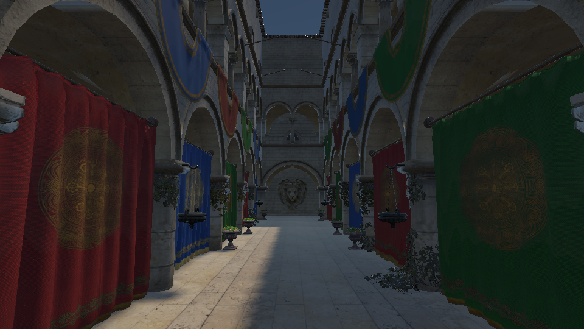

# Cluster 性能优化：批处理与当帧 meshlet Hi-Z

后续已实现复用 G-buffer 的两阶段遮挡，移除专用 cluster depth prepass；见 [两阶段 Hi-Z 的新同构建测量、中间结果与正确性证明](cluster-two-stage-hiz.md)。下文保留此前批处理／单阶段的历史测量。

已将兼容网格的 cluster 选择／索引压缩合并成一个批次。Sponza 的 4 px 路径由 **66 次 compute dispatch／encoder 降为 3 次**；同构建测量的连续 GPU 窗口由 **2.453 ms 降到 1.405 ms**，降低 42.7%。可见几何和显示图像保持一致。

cluster 级 Hi-Z 已实现并保留独立开关；当前 Sponza 视角中预绘制成本超过收益，默认关闭。整个 cluster 功能仍默认关闭；启用 cluster 后，跨网格批处理默认开启。

## 测量范围

2026-10-11，Apple M4，Metal，960×540，同一相机／材质／曝光；TAA、AO、DDGI、RSM 关闭。兼容的 22 个网格源几何有 262,195 个非退化三角形，另有 71 个小网格三角形沿原路径渲染，不计入下表的 cluster 数量，但计入 geometry 时间。

旧路径、新批处理、Hi-Z 及四档遮挡预绘制预算均在**同一二进制**中切换。三轮轮换顺序，每模式每轮 5 帧预热＋8 帧测量，共 24 个样本；API／Shader Validation 关闭，GPU counter profiler 开启。数据是阶段对照，不是整帧 FPS，也不是鼠标 input-to-photon 延迟。

两个 GPU 指标分别报告：

- **pass 之和**：geometry、全部 cluster compute 和 Hi-Z depth／pyramid／object tests 的时间之和，包含遮挡预绘制成本，忽略 encoder 间隙。
- **连续 GPU 窗口**：首次剔除开始至 geometry 结束；原网格没有剔除，直接使用 geometry 起止。该窗口包含 encoder 之间的间隙，不包含之前的阴影／环境更新及之后的光照／后处理。它不能直接当成单一 kernel 的加速比。

CPU 指标是完整 `render()` 调用的墙钟，包含 CPU 录制／资源准备／提交；不包含随后诊断读回和显示等待。

| 模式 | Compute dispatch／encoder¹ | cluster 三角形 | GPU pass 之和 ms | 连续 GPU 窗口 ms | CPU render ms |
| --- | ---: | ---: | ---: | ---: | ---: |
| 原网格 | 0 | — | 1.358 | 1.358 | 5.581 |
| 旧 cluster，4 px | 66 | 204,022 | 1.623 | 2.453 | 7.335 |
| 批处理，4 px | 3 | 204,022 | 1.402 | 1.405 | 5.682 |
| 批处理＋cluster Hi-Z，4 px | 17 | 190,984 | 1.955 | 2.009 | 6.748 |

¹ Hi-Z 模式共有 17 次 compute：首次切面 3、第二次遮挡压缩 3、金字塔 10、物体测试 1；另外有遮挡 depth 和 geometry 两个 render encoder。关闭 Hi-Z 的批处理仅 3 次 compute＋1 次 geometry render。这里没有把不同 draw commands 当成不同 encoder。

4 px 批处理的 pass 之和降低 **13.6%**，连续窗口降低 **42.7%**，CPU render 调用降低 **22.5%**。旧／新 geometry 本身中位数分别约 1.267／1.266 ms，收益主要来自 cluster 阶段和 encoder 间隙减少。按原始时间区间并集计算的中间空隙中位数，旧路径约 0.881 ms，批处理约 0.001 ms；这是被采样 scope 之间的空隙，不声称全部来自一种硬件 bubble。

连续 GPU 窗口的 P10–P90：旧路径 2.372–2.787 ms，批处理 1.384–1.493 ms。前几轮独立采集的 pass 之和收益约 13–17%，绝对时间存在波动。最初实现时的 2.705 ms 历史测量不能直接与本轮绝对时间相减；改动前另保存了 [基线采集](../img/diagnostics/cluster-performance/before/benchmark.json)，正式结论使用同构建轮换对照。

原网格连续窗口仍较批处理略短（1.358 对 1.405 ms），因此不宣称 cluster 已全面快于传统绘制。

## 减少 dispatch 与 encoder 的方法

`GpuClusterBatch.cpp` 将 nodes、meshlet 描述和所有层级索引打包到共享 GPU buffer；每个网格在 208 B 参数表中保留独立 VP、尺度、误差、舍入余量和范围。meshlet 分区按 64 个条目对齐，避免 mark 的同一个 workgroup 混入两份网格前缀。

1. 一次 mark dispatch 同时选择所有网格，计算每 64 个 meshlet 的局部前缀。
2. 一次 scan dispatch，每个网格一个 128-thread workgroup，扫描自己的组区间，写间接参数和真实 cluster 数。
3. 一次 scatter dispatch，将可见索引复制到该网格的输出区间。`firstIndex` 指向共享索引 buffer 的区间，索引值仍指向各自的原顶点 buffer。

Metal 后端保持现有 tracked-resource encoder 边界，因此 66 → 3 dispatch 同时意味着 66 → 3 compute encoder；没有修改全局 RHI 同步策略或删除必要屏障。batch／draw slot 对重复 ID、可见列表缩小和恢复、不同变换、来源版本更新都有回归。超过 native storage／dispatch／资源限制时回退原逐网格路径。

批次是常驻缓存，相机可见列表缩小时可以复用；新来源或更多 draw 会重建打包缓冲，暂未建设增量 GPU 页分配。预算统计为逻辑 payload：旧压缩 scratch 约 3.18 MiB，新批次几何＋scratch 约 19.87 MiB；原始层级仍保留约 16.66 MiB，因此换取批处理的额外副本约 16.69 MiB。未计驱动 padding、纹理和其余 renderer buffer。

## cluster 级 Hi-Z 与成本

RDG 顺序为 `cluster-visibility → cluster-occluder-depth → cluster-occlusion → hiz-visibility → geometry`。

先生成当前帧真实 LOD 的索引；选中的遮挡物使用这份索引绘制 alpha-aware depth。最大深度金字塔保留 clear=1、透明孔洞和奇数边缘。第二次 mark 复用初次切面标记，投影每个 meshlet 的 8 个 AABB 角，扩张两个像素和矩阵舍入余量；只有最近深度严格落在覆盖格子的最远深度之后，才剔除。near／eye 相交、非有限投影和相等深度均保留。

这允许剔除**同一网格内部**的遮挡部分，而不仅将整个物体 count 清零。没有使用上一帧深度；移动物体与遮挡物直接使用当帧 VP／model，辅助阴影／DDGI／水体仍使用源几何。

Sponza 的 4 px 三角形由 **204,022 → 190,984**，再少 6.4%；但 250k 源三角形预算选择了实际 **191,378** 个预绘制三角形。主 geometry 只从约 1.266 ms 缩到 1.226 ms，额外 depth 约 0.447 ms、pyramid 约 0.083 ms，收益不足以覆盖新工作。pass 之和约 1.955 ms，连续窗口约 2.009 ms，比只批处理更慢。

进一步降低预绘制预算也未在此视角获得净收益：

| 遮挡物源三角形预算 | 实际预绘制三角形 | 主 cluster 三角形 | GPU pass 之和 ms | 连续 GPU 窗口 ms |
| --- | ---: | ---: | ---: | ---: |
| 16,000 | 8,003 | 202,420 | 1.726 | 1.774 |
| 32,000 | 15,559 | 201,832 | 1.786 | 1.867 |
| 64,000 | 32,790 | 195,980 | 1.777 | 1.812 |
| 250,000 | 191,378 | 190,984 | 1.955 | 2.009 |

预算用量是源网格数量的上限，不等于实际当前切面的预绘制数量；上表的实际量根据同机位未遮挡切面的 GPU 计数与选中遮挡物集合计算，诊断读回发生在计时区间之外。四档预算都检查了显示图像／HDR 一致。

目前建议开启 cluster 时先使用批处理，cluster Hi-Z 按场景测量后选择。后续优化方向是更便宜的遮挡代理／meshlet 选择，以及历史深度早期剔除＋当帧深度晚期补绘；不能直接使用过期深度删掉移动后可见的几何。

## 图像与验证

改动前二进制与新批处理的 Sponza 4 px 显示图像逐像素相同。相同 LOD 下开启／关闭 cluster Hi-Z，Metal 和本机 Vulkan/MoltenVK 的 HDR 最大差均为 **0**，显示像素差 **0**。

| 批处理、无 cluster Hi-Z | 同 LOD、开启 cluster Hi-Z |
| --- | --- |
|  |  |

CPU、Metal、Vulkan cluster 及原 geometry／Hi-Z 回归 **6/6 通过**。Metal 开启 API＋Shader Validation；Vulkan 是 Apple M4 上的 MoltenVK 功能对照，不等于独立 Vulkan 硬件或 Khronos 验证层覆盖。11 组 cluster Hi-Z 图像对照覆盖部分网格遮挡、移动恢复、alpha 孔洞、equal／near／eye 深度、镜像／剪切、正交／透视、resize 和粗 LOD；专用场景从同一个网格删去 512 个隐藏三角形并保留露出部分。

[Metal 验证](../img/diagnostics/cluster-performance/metal/validation.json)、[Vulkan 验证](../img/diagnostics/cluster-performance/vulkan/validation.json)、[原始采样](../img/diagnostics/cluster-performance/metal/benchmark.json)、[统计摘要](../img/diagnostics/cluster-performance/metal/summary.json)、[回归记录](../img/diagnostics/cluster-performance/regressions.json)。

## 开关与复现

```cpp
frame.clusters.enabled = true;
frame.clusters.pixelError = 4;
frame.clusters.batched = true;    // 默认；false 为旧逐网格对照。
frame.clusters.occlusion = true; // 可选；自动请求当帧 Hi-Z。
frame.hizOccluderTriangleBudget = 32000; // 根据目标场景实验选择。
```

GUI 为 `Cluster Hi-Z occlusion`。wireframe 不执行 cluster 遮挡，便于查看原切面；`SCENERENDERER_DISABLE_HIZ_CULLING=1` 强制关闭深度设施。正常绘制不读回可见性。

```sh
cmake --build build --target Scene-Renderer -j6
MTL_DEBUG_LAYER=1 MTL_SHADER_VALIDATION=1 \
  ./build/Scene-Renderer --cluster-rendering-self-test --backend Metal
./build/Scene-Renderer --cluster-rendering-self-test --backend Vulkan
SCENERENDERER_CLUSTER_CAPTURE_DIR=build/cluster-performance \
  SCENERENDERER_CLUSTER_BENCHMARK=1 SCENERENDERER_GPU_PROFILE=1 \
  ./build/Scene-Renderer --cluster-rendering-self-test --backend Metal
python3 tools/analyze_cluster_performance.py build/cluster-performance
```

性能采集应关闭 Validation；捕获器对所有 4 px Hi-Z 预算检查与未遮挡切面的可见图像等价。完整原理见 [分层 Cluster 几何](hierarchical-cluster-geometry.md)。
