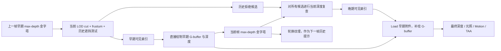
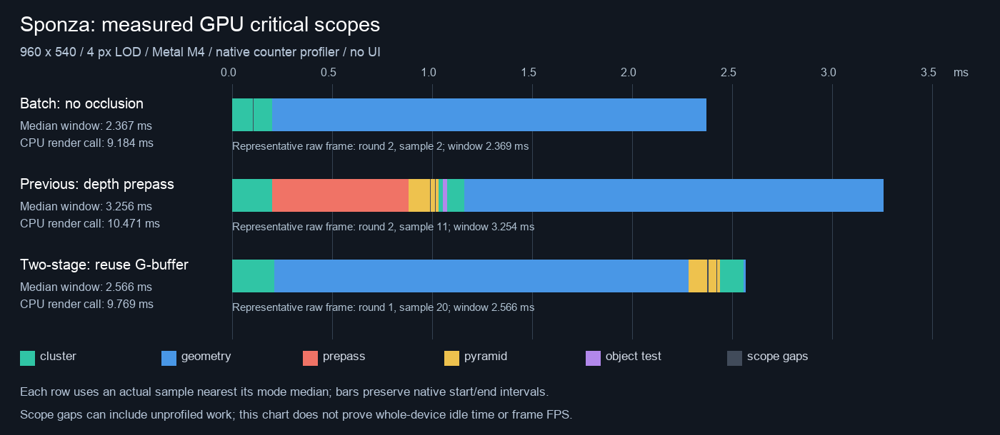
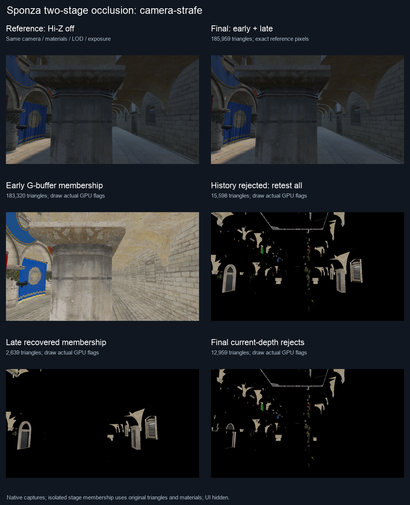
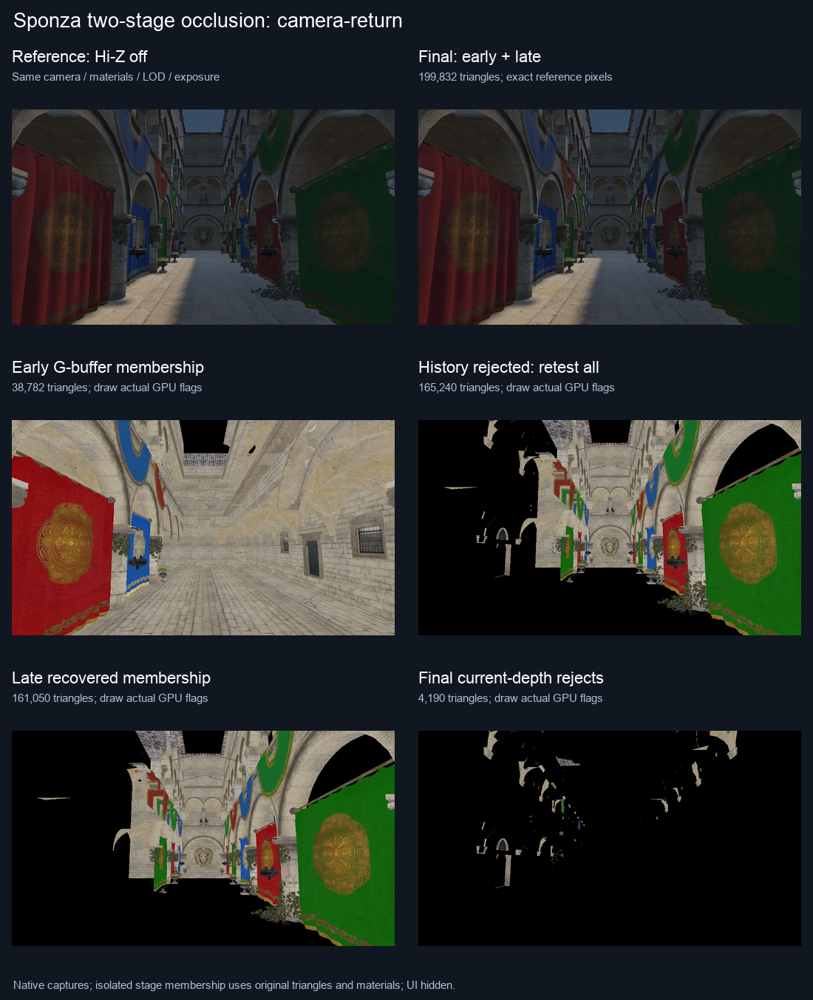
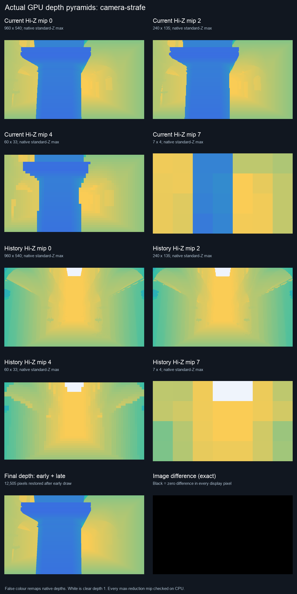

# Cluster 两阶段 Hi-Z：复用 G-buffer，晚期恢复可见表面

本文记录取消专用 depth prepass 时的历史实现与测量。当前多级融合归约、晚期协作追加、encoder 合并及高密度模型验证见 [Hi-Z 优化与动态 LOD 流程](cluster-hiz-optimization-and-lod.md)。下方 16 encoder 与性能数值保留作为当时结果。

已实现“历史深度早期筛选 → 早期 G-buffer → 当帧 Hi-Z 复查 → 晚期补绘”。专用 cluster depth prepass 已移除。该流程参考了 Epic 的 [Nanite SIGGRAPH 2021 slides 中的 Two pass occlusion culling](https://advances.realtimerendering.com/s2021/Karis_Nanite_SIGGRAPH_Advances_2021_final.pdf)；当前仍采用按材质的 indexed indirect draw，没有 Nanite 的软件光栅、visibility buffer、GPU 材质分箱或几何流送。

整个 cluster 与遮挡功能仍默认关闭。启用 **Cluster Hi-Z occlusion** 后，Scene 路径默认使用 **Two-stage cluster occlusion**；取消后可比较原当帧 depth prepass。Forward 路径、wireframe、批处理不支持或资源不足时保留原路径／源几何回退。

## 数据流与预绘制优化



1. **早期阶段**：按当前相机、当前变换和当前误差预算选择唯一的 hierarchy cut。再将这些 cluster 的当前包围盒投影到上一帧相机，用历史 Hi-Z 做推测性筛选。冷启动、resize、显式 reset、关闭功能或切换到其他路径时不使用历史，全部当前可见 cut 进入早期绘制。
2. **早期 G-buffer**：直接绘制早期可见 cluster，同时保留普通物体的原绘制。与旧路径相比，不再先画一次 depth-only 再重复画 G-buffer。
3. **当前 Hi-Z**：从实际早期 G-buffer 深度复制 mip 0，逐级做 standard-Z 的 **max** reduction。960×540 有 10 级。奇数尺寸的尾部 texel 合并到最后一个目标 texel，保留天空和 alpha 孔洞的 clear depth 1。
4. **晚期阶段**：复用早期保留的当前 cut，复查**所有**历史拒绝候选。只有当前深度证明完全被遮挡，才最终拒绝；其余候选进入晚期补绘。
5. **补绘与索引追加**：晚期 render pass 对深度与六张 G-buffer 使用 `Load`。早期与晚期索引写入同一物体输出区间，晚期接在早期后；独立晚期 indirect arguments 只绘制追加部分。最终 union arguments 供 Motion 和后续几何重放使用。无需第三次 union compaction，也没有 CPU 可见性读回。
6. **历史轮换**：两套金字塔 ping-pong；下一帧使用本帧早期深度，省掉从最终深度重建另一套金字塔的 10 次 dispatch。历史不含本帧晚期新恢复的表面，可能降低下一帧早期剔除效率。它仅是提示，不能直接决定最终不可见，因此不会因这一省略丢失可见表面。

新路径仍有 6 次跨网格 cluster dispatch（early 与 late 各 mark/scan/scatter），加 10 次 pyramid dispatch，共 **16 个 compute encoder**。旧路径为 6 + 10 + 1 object test，共 17 个；主要收益是取消重复的 depth prepass，而非仅少一个 encoder。两阶段对未进入 cluster 批次的物体保留原绘制，不执行额外 object Hi-Z。

外部深度模式只分配 R32 金字塔，不再分配独立 depth attachment。两套 960×540 金字塔共约 5.27 MiB；cluster 状态每项 16 bytes，保存局部前缀、当前阶段索引数、当前 cut 标记和早期索引数。每物体 48 bytes 的 indirect 存储包含 final union 与 late 两份参数及 cluster 计数。

## 正确性约束

历史可能因相机移动、遮挡物移走、网格替换或 alpha 变化而过时。晚期只根据**本帧已实际绘制的早期深度**做最终拒绝；不确定的投影直接放行。所有 AABB 角点包含源覆盖范围，clip 范围考虑两次 float 矩阵乘法误差，屏幕矩形扩展 2 pixels；近裁面／眼平面交叉、非有限值、clear depth 与同深度表面均放行。深度拒绝要求最近 cluster 深度大于覆盖区域最远深度加 `1e-4`。

这样形成三个互斥集合：早期可见、晚期恢复、最终拒绝，恰好覆盖当前选中的 cut。最终拒绝只能引用当帧的有效遮挡几何。原始几何继续用于阴影、反射与折射等辅助视角。

成功提交后才发布新历史及诊断数据；失败的提交不会发布部分历史。CPU 对象剔除改变 packet 顺序时，公开的 cluster 诊断映射回输入 packet 索引。

## Sponza 测量

性能数字与原始数据见下方结果表；相机／材质／曝光／4 px LOD 相同，960×540，Apple M4 / Metal，TAA、AO、DDGI、RSM 关闭，GPU counter profiler 开启，性能测量关闭 API／Shader Validation。截图没有 UI。

静态测量：3 轮轮换模式，每轮 8 帧预热＋24 帧采样，每模式共 **72 个样本**。

| 模式 | Compute encoder | cluster 三角形 | 专用 prepass 三角形 | GPU pass 之和 ms | GPU 窗口 ms | CPU render ms |
| --- | ---: | ---: | ---: | ---: | ---: | ---: |
| 批处理，无遮挡 | 3 | 204,022 | 0 | 2.356 | 2.367 | 9.184 |
| 旧单阶段 Hi-Z | 17 | 190,984 | 191,378 | 3.252 | 3.256 | 10.471 |
| 两阶段 Hi-Z | 16 | 188,422 | 0 | 2.531 | 2.566 | 9.769 |

两阶段相对旧 Hi-Z 的 GPU 窗口降低 **21.2%**，pass 之和降低 22.1%，CPU render 降低 6.7%。相对无遮挡批处理，GPU 窗口仍增加 **8.4%**。

旧路径 prepass 中位数 **0.693 ms**；两阶段为 0。主 geometry 旧路径约 2.081 ms，两阶段 early 约 2.077 ms、空 late 约 0.008 ms。cluster compute 约 0.267 → 0.320 ms，pyramid 约 0.138 → 0.125 ms。各阶段独立中位数不严格相加成总中位数。收益主要来自消除预绘制。

| 模式 | GPU 窗口 P10–P90 ms | encoder scope 间隙中位数 ms |
| --- | ---: | ---: |
| 批处理，无遮挡 | 2.310–2.746 | 0.001 |
| 旧单阶段 Hi-Z | 3.202–3.513 | 0.026 |
| 两阶段 Hi-Z | 2.514–3.000 | 0.029 |

间隙通过逐帧 interval union 计算，不把重叠时间当作 bubble。两阶段约 0.029 ms，旧 Hi-Z 约 0.026 ms，未显示大幅减少这部分 bubble；改进的是实际多余绘制。这些是所采集 scope 的间隙，可能包含未采集的 GPU 工作，不能据此证明整块 GPU 空闲。

下图为各模式最接近中位数的一帧实际 GPU interval，而非把独立中位数拼成时间轴：




**连续 GPU 窗口**从首次 cluster compute 开始，到最后涉及的 geometry／Hi-Z 阶段结束，包含 encoder 间隙。**pass 之和**只相加这些阶段的计时。CPU 是完整 `render()` 调用，不含随后读回和显示等待。阴影、光照、后处理及场景构建不在上述 GPU 指标内；这些数据不是整帧 FPS。

移动相机测量：在原视角附近沿 Z 方向以振幅 0.75 m 的固定正弦序列横移。每模式 3 轮，每轮 8 帧移动预热＋24 个测量帧，共 **72 帧／模式，216 帧合计**。使用独立 reference renderer，在计时外逐帧比较 HDR、显示和主深度。采样结束通过显式读回等待 GPU，属于串行诊断提交，不等同于交互运行时多帧在途的吞吐。

| 模式 | GPU pass 之和 ms | GPU 窗口 ms | CPU render ms |
| --- | ---: | ---: | ---: |
| 批处理，无遮挡 | 2.318 | 2.330 | 9.094 |
| 旧单阶段 Hi-Z | 3.205 | 3.212 | 10.342 |
| 两阶段 Hi-Z | 2.564 | 2.595 | 9.482 |

移动序列 GPU 窗口比旧 Hi-Z 低 **19.2%**，比无遮挡高 **11.4%**。单帧最多恢复 4,724 个三角形。全部 216 个参考对照显示／深度精确一致，HDR 最大误差为 0。


不同轮次的设备负载影响绝对时间；只比较本报告同构建、同轮换顺序的模式，不能把上一份报告的旧毫秒数拼入当前加速比。原批处理无遮挡仍更快，因此遮挡开关保持默认关闭。G-buffer 光栅仍占主要时间；晚期 kernel、10 次 mip dispatch 与第二次附件 load/store 有成本。该实现没有保证所有视角都更快。

## 中间结果与逐项验证

| 场景 | 当前 cut 三角形 | 早期 | 晚期恢复 | 最终拒绝 | 最终显示 / 深度 / 六张 G-buffer |
| --- | ---: | ---: | ---: | ---: | --- |
| 冷启动 | 204,022 | 204,022 | 0 | 0 | 完全一致 |
| 静止预热 | 204,022 | 188,422 | 0 | 15,600 | 完全一致 |
| 相机横移 2 m | 198,918 | 183,320 | 2,639 | 12,959 | 完全一致 |
| 返回原视角 | 204,022 | 38,782 | 161,050 | 4,190 | 完全一致 |

返回原视角会触发大量晚期恢复，专门用于证明历史不能直接当作最终可见性。横移恢复 12,505 个深度像素；返回恢复 227,389 个深度像素。七个 Sponza 对照视角中 HDR 最大误差 0、显示变化像素 0、最终深度误差 0、六张 G-buffer 各误差 0。误差参照相同 LOD、关闭遮挡的实时路径；不以完整源几何或 PT 的材质差异混淆遮挡正确性。

**实际早期与最终 G-buffer albedo**：早期附件在 early draw 结束后通过 GPU texture copy 保存，展示时将线性 RGB 转成 sRGB。诊断 copy 只在指定捕获帧启用，性能 benchmark 不启用。


**GPU membership 诊断**：参考与最终图像使用真实实时管线；其余四格读取实际 GPU cluster flags，再用源顶点／索引、原材质隔离重绘对应集合。为看清几何，隔离图关闭太阳／阴影、环境光为 1；它们不是早期 HDR 截图，也不是重新估计的剔除结果。





**实际深度金字塔**：history 是上一帧早期深度，current 是当帧早期深度，final 是补绘后主深度。颜色仅用于显示 native standard-Z 深度；白色是 clear depth 1。每一级均与独立 CPU max reduction 精确比较。



除最终图像对照外，离线检查对每个最终拒绝 cluster 用 double 投影计算屏幕矩形，检查矩形覆盖的**全部 mip 0 像素**，证明最近 cluster 深度确实大于当前最远深度加阈值；不复用 shader 的 mip 选择或 compact 算法。静止、横移、返回三个视角分别证明 1,651、1,341、770 个最终拒绝 cluster。对应最小遮挡深度间隔分别约 `1.540e-4`、`1.197e-4`、`1.516e-4`，均大于 `1e-4`。

原生 Metal 开启 API／Shader Validation 的 **30 项两阶段动态对照**通过，涵盖 cold/warm、遮挡物移动／返回／删除、alpha 孔洞、同深度／near/eye、镜像／剪切、LOD、相机切换、重复 ID、网格 revision、奇数 resize、reset、功能切换、层级就绪和 6 个 TAA jitter 帧；每项检查 HDR、显示、六张 G-buffer、集合分区与实际 GPU indirect index stream。另保留此前 11 项单阶段对照。Vulkan / MoltenVK 执行同一套算法／Sponza 对照并通过；它仍运行在同一 Apple GPU 上，不代表独立厂商 GPU，未启用 Khronos validation layer。

最终 CTest 回归涵盖 hierarchy、PT clustered world LOD、Metal/Vulkan cluster rendering、geometry culling 和原 Hi-Z。结果保存在 [regressions.json](../img/diagnostics/cluster-two-stage/regressions.json)。

## 复现与数据

```sh
cmake --build build --target Scene-Renderer -j6
SCENERENDERER_CLUSTER_CAPTURE_DIR=img/diagnostics/cluster-two-stage/metal \
SCENERENDERER_CLUSTER_BENCHMARK=1 SCENERENDERER_GPU_PROFILE=1 \
./build/Scene-Renderer --cluster-rendering-self-test --backend Metal
python3 tools/analyze_cluster_performance.py img/diagnostics/cluster-two-stage/metal
python3 tools/visualize_cluster_two_stage.py img/diagnostics/cluster-two-stage/metal
python3 tools/visualize_cluster_timing.py img/diagnostics/cluster-two-stage/metal
```

分析与可视化需要 NumPy / Pillow。每个 `two-stage/<case>/` 中保存原始 GPU depth／albedo 读回的无损 `readbacks.npz`、cluster membership 与变换 `metadata.json`、离线证明 `proof.json`、阶段图与 mip 图。重新运行脚本也支持压缩后的存档。

- [静态 benchmark 原始逐阶段数据](../img/diagnostics/cluster-two-stage/metal/benchmark.json) 与 [汇总](../img/diagnostics/cluster-two-stage/metal/summary.json)
- [移动序列 benchmark](../img/diagnostics/cluster-two-stage/metal/moving-benchmark.json)
- [原生 Metal 正确性记录](../img/diagnostics/cluster-two-stage/metal/validation.json)
- [逐个 cluster 的当帧遮挡证明](../img/diagnostics/cluster-two-stage/metal/two-stage/proof.json)
- [Vulkan / MoltenVK 正确性记录](../img/diagnostics/cluster-two-stage/vulkan/validation.json)
- [原单阶段 Hi-Z 与批处理报告](cluster-performance.md)

主要实现位于 `GpuClusterBatch.cpp`、`cluster-batch-{mark,scan,scatter}.comp`、`GpuHiZCuller.cpp` 和 `ForwardPbrRenderer.cpp`；验证／捕获位于 `ClusterValidation.cpp`、`ClusterSceneCapture.cpp` 与 `tools/visualize_cluster_two_stage.py`。
