# DDGI：实时 GI 第一阶段

实现动态、可见性感知的低频漫反射探针场：几何遮挡、天空入射、材质染色和逐帧多次反弹。编辑器在 **DDGI diffuse global illumination** 面板启用，默认关闭；RSM 仍默认关闭并作为独立历史演示保留。

本阶段使用 **GPU 六面光栅捕获**作为采样后端。没有接入 RTXGI SDK 或硬件 RT API，不将六面捕获的性能等同于光追 DDGI。缓存、查询和预算调度独立封装，后续可替换采样后端。

## 原理与 Sponza 探针布局

Probe 是空间中的光照测量点。DDGI 在稀疏位置记录来自周围的光及遮挡距离，再供可见表面查询；不会为每个像素重新追踪完整间接光路径。[原始 DDGI 论文](https://jcgt.org/published/0008/02/01/)采用光追采样、方向性辐照度缓存以及距离矩辅助的可见性感知插值。本项目保留这一类缓存／查询结构，当前采样后端采用光栅六面捕获。

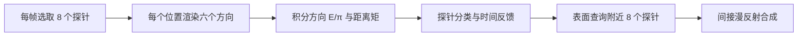

1. **采集。** 从探针向 ±X、±Y、±Z 渲染 6 个 12×12 视图。命中表面记录其 Lambert 出射光和径向距离；未命中采集天空。表面出射包含直接光／阴影／发光，以及上一帧探针场提供的反弹反馈。每探针有 864 个方向样本，六面是临时目标，不为全部探针保存 cubemap。
2. **积分与存储。** 依余弦和立体角积分得到各法线方向的 `E/π`，压入 8×8 八面体方向缓存。另用 16×16 方向缓存存储 `mean(d)` 和 `mean(d²)`，由二者计算方差。辐照度用 hysteresis 平滑；距离矩使用最新值。背面命中的立体角比例达到 25% 时停用该探针，之后仍轮转重采样以便恢复。
3. **查询。** 表面位置添加 normal/view bias 后，取所在网格单元的 8 个角点。权重组合三线性位置、法线朝向和距离矩可见性；再读取沿表面法线方向的 `E/π`，加权归一化。当前距离权重近似为 `[variance / (variance + max(distance-mean,0)²)]³`。这个统计近似无法提供精确的表面到探针可见性，所以薄墙／狭窄拱廊可能漏光。Lambert 表面的间接出射为 `albedo × E/π`，本项目还按材质漫反射比例和 AO 合成。

当前位置由固定规则 `P = origin + spacing × (ix, iy, iz)` 生成，采用 X 最快的索引 `ix + Nx × (iy + Ny × iz)`；不是手工逐点摆放，也没有自动移出实体的 relocation。改变原点、网格或间距会重建缓存，相机移动不会滚动该体积。

| Sponza 设置 | 当前值 |
| --- | --- |
| 原点 | (-15, -1, -9) m |
| 网格／数量 | 16×8×10／1,280 |
| 间距／端点 | 2 m／(15, 13, 9) m |
| 覆盖尺寸 | 30×14×18 m，按 `(counts−1)×spacing` |
| Y 层 | -1、1、3、5、7、9、11、13 m |
| 捕获分辨率／最大距离 | 每面 12×12／45 m |
| normal／view bias | 0.08／0.02 m |
| hysteresis／bounce gain／visibility power | 0.85／0.85／3 |
| 每帧预算／访问一轮 | 8 个／160 帧 |
| 双缓存 | 12.539 MiB |

2 m 规则网格覆盖了模型的整体范围，但不足以精确表达小于网格尺度的薄墙和拱门遮挡。提高密度会增加三轴乘积的内存和完整访问周期，不能仅靠增加数量保证精度；停用探针也不等于把它移动到了合适位置。

### Sponza 原生 GPU 探针可视化

原生编辑器的 **DDGI diffuse global illumination → Show probes** 可选 **Directional irradiance** 或 **Probe classification**。绿色表示活动、红色表示背面比例分类拒绝、黄色表示尚未访问。辐照度模式在活动点的球形标记上显示实际方向 `E/π`；停用／未访问的点仍显示状态色，白色细边用于区分非常暗的有效缓存。标记是 billboard 诊断图元，其半径仅控制显示，不是探针影响半径。

**Probe X-ray** 显示被建筑挡住的标记，降低其透明度；**Probe Y layer** 选择单层，-1 显示全部。默认遵守场景遮挡。可视化读取当前 GPU 场，不执行 CPU 每帧读回；在后处理之后叠加到最终 LDR，不进入 TAA 历史、GI 反馈或场景 HDR，默认关闭。


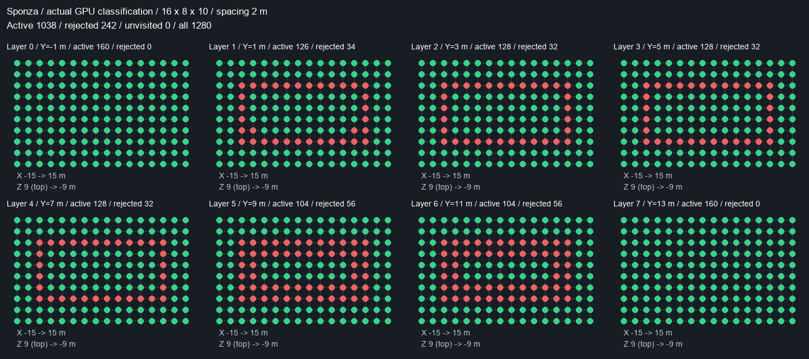

四种模式见[遮挡／X-ray／单层／方向辐照度对照](../img/diagnostics/ddgi/probes/metal/sponza-probes-comparison.png)。层图颜色来自 GPU 缓存的分类状态，不是另行执行精确 point-in-solid 测试，不能把每个红点都解释为已严格证明处于封闭实体内。

本次读回共 **1,038 个活动、242 个拒绝、0 个未访问**。Y=-1 m 的底层和 Y=13 m 的顶层各 160 个点全部活动；中间层出现沿建筑结构分布的拒绝点。底层活动不能证明地板下的 GI 正确：背面比例阈值只是采样启发式，开放／单面模型和视野内天空都会影响分类。是否影响拱门漏光，需要继续检查实际查询的邻居和距离权重。

```sh
./build/Scene-Renderer --classic sponza --ddgi-probes state
./build/Scene-Renderer --classic sponza --ddgi-probes irradiance
./build/Scene-Renderer --classic sponza --ddgi-probes state --ddgi-probe-xray --ddgi-probe-layer 1
```

960×540 诊断捕获在 Metal API／shader validation 下先更新 960 帧，之后冻结同一份缓存再切换显示；截图不包含 UI。完整缓存与世界坐标保存为无损 [NPZ](../img/diagnostics/ddgi/probes/metal/sponza-probe-field.npz)，[逐层统计／来源 SHA-256](../img/diagnostics/ddgi/probes/metal/sponza-probe-summary.json)。入口随后输出的 1 spp PT 仅为 CLI smoke，不作为本节光照参考。复算截图与层图：

```sh
python3 tools/visualize_ddgi_probes.py img/diagnostics/ddgi/probes/metal/sponza
```

重新捕获可用 `--path-trace-gpu sponza --pt-size 960x540 --pt-samples 1 --pt-fixed --pt-bounces 16 --pt-seed 1 --pt-traversal native --pt-compare-ddgi --pt-ddgi-frames 960 --pt-output img/diagnostics/ddgi/probes/metal/sponza`。图像处理只转为无损 PNG／NPZ、加标签和画分类网格，场景图元由原生 GPU 渲染。

受控验证覆盖分类／方向辐照度／分层、实体遮挡与 X-ray，并检查显示前后 HDR 和冻结探针缓存不变：[Metal API／shader validation](../img/diagnostics/ddgi/probes/metal/validation.json)、[Vulkan／MoltenVK](../img/diagnostics/ddgi/probes/vulkan/validation.json)。实际 Sponza 截图来自 Metal；未将其声明为 Vulkan 场景捕获。

真实多线程编辑器另运行 160 帧，开启 state／X-ray／Y layer 1，在 Metal API／shader validation 下正常退出，0 拒绝发布、0 fallback；[运行日志](../img/diagnostics/ddgi/probes/metal/editor-validation.log)。这次带验证的运行不作为性能测量。

## 数据与查询

每个探针存储 8×8 八面体方向辐照度（E/π）、16×16 方向距离一阶／二阶矩及状态，使用两个 GPU SSBO 保留上一帧场。六面临时捕获共享同一组颜色／深度目标，每次仅为选中的探针复用；不保存全部探针 cubemap。

捕获沿方向记录最近不透明／alpha-cutout 材质的线性漫反射出射光、发光和径向距离。未命中读取当前大气天空；无天空时以 ambient 参数作为恒定环境源。直接光使用现有 CSM／点光／聚光阴影。镜面高光不进入漫反射反馈。

GPU 对立方体像素按立体角积分。辐照度使用余弦卷积，距离矩使用更窄的 cos¹²⁸ lobe。距离缓存使用更高的方向分辨率，减少狭窄遮挡方向被天空的远距离样本污染。八面体边界查询采用折叠寻址和双线性插值。

表面查询八个相邻探针，组合三线性、法线朝向、距离矩的 Chebyshev 可见性以及低权重抑制。normal/view bias 减少表面自遮挡；`Visibility power` 默认 3、可调 1–8，增大值加强漏光抑制但可能造成偏暗；背面命中占比超过阈值的探针停用，并仍按预算重新采样以便物体移开后恢复。双面薄片不按封闭实体的背面命中分类。

合成位于不透明物体光照后、云／水体／透明物体及后处理前：在有效覆盖区域替换原来的未遮挡天空漫反射和常数 ambient，保留直接光、发光和天空镜面反射。尚未初始化的邻居按覆盖权重渐进替换；已分类停用的探针不发光，且不会重新引入未遮挡 ambient；体积之外保持原有环境光。Scene 的 deferred 与 forward shading 共用这个合成查询。

### Sponza 中间结果

以下由原生 Metal GPU 实际读回生成，640×360、固定场景与 time=8、960 帧／六轮探针访问。AO、RSM、TAA 关闭；显示统一曝光 1.1／gamma 2.2，无按探针或图片单独归一化。低分辨率缓存仅做最近邻放大。六面采样在最后一轮访问中读回，缓存和表面查询取第 960 帧，因此两者保留真实时间反馈关系，并非把单次捕获当作全部历史。

| 代表 probe | 世界位置 | 作用 |
| --- | --- | --- |
| 423 | (-1, 3, -3) m | 拱廊附近的有效探针 |
| 663 | (-1, 1, 1) m | 庭院地面上方的有效探针 |
| 295 | (-1, 3, -5) m | 被背面比例分类拒绝的探针 |

**1. 六面光栅捕获。** 每个探针从上到下显示原始 RGB 出射辐亮度、命中径向距离、命中分类；列依次为 +X／-X／+Y／-Y／+Z／-Z。灰色为正面命中、红色为背面、蓝色为未命中。距离采用共享的 `log(1+d)`、0–45 m 色标；未命中另标为深灰。背面距离在原始 alpha 中为负，绝对值仍是距离，后续积分拒绝背面辐亮度。未命中 RGBA 为零，天空光在积分时采样天空 LUT，因此不能把原始 RGB 的黑色全部解释为无光。

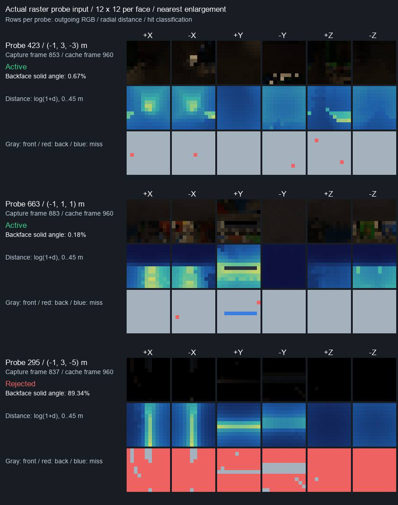

**2. 方向缓存。** 三列依次为 8×8 八面体 `E/π`、16×16 平均距离、距离标准差 `sqrt(max(mean(d²)−mean(d)²,0))`。距离仍使用 0–45 m 共享对数色标，标准差使用 0–22.5 m；它是距离分布的离散程度，不是光照噪声，也不是完整的可见性权重。拒绝点可能保留非零方向缓存，但 surface query 会依据状态跳过它，非零缓存不能证明其参与了合成。

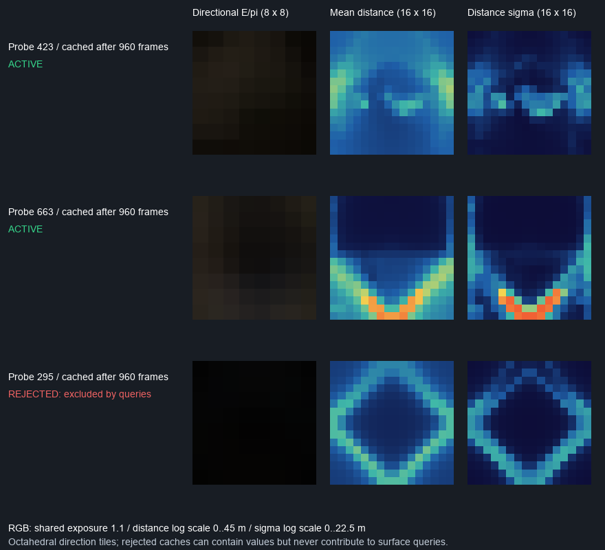

**3. 表面查询与合成。** 左图是每个可见不透明表面调用原生 GPU `ddgiQuery` 得到的 incident `E/π`，不乘该表面材质；中图由实际 GPU GBuffer／查询读回按 `gi × diffuse × materialAO × coverage × intensity` 推导出的正向间接漫反射贡献；右图是实际原生 GPU 最终着色，包含直接光、GI、发光和天空镜面。中图是明确标注的 CPU 数据推导，不是另一个 GPU 渲染模式，也不等于 DDGI pass 的加性增量：实际 pass 还减去原来被替换的 ambient／天空漫反射。天空没有表面查询，左／中图为黑色。

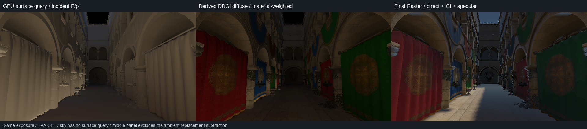

本次新增显式诊断读回，不进入交互 frame loop。冻结缓存在后续诊断前后逐值一致；Metal API／shader validation 下捕获完成。1 spp PT 仅作为命令行 smoke，未用于上述图或精度比较。原始 float32 与 RGB8 保存为[无损 NPZ](../img/diagnostics/ddgi/intermediates/metal/sponza-intermediates.npz)，[范围／逐点状态／SHA-256](../img/diagnostics/ddgi/intermediates/metal/sponza-intermediate-summary.json)，[运行日志](../img/diagnostics/ddgi/intermediates/metal/runtime.log)。复算：

密集查询覆盖 **227,914 像素**，与原有 **46 个**对齐诊断点的 GPU 查询 RGB 最大差异为 **0**。六面读取尺寸均为 12×72×4，径向距离绝对值不超过 45 m，未命中 payload 为零。Probe 295 的背面立体角比例约 **89.34%**，超过 25% 阈值；这说明当前启发式为何停用它，不是精确几何包含测试。压缩归档保留所有原始浮点数，SHA-256 可复核。

```sh
python3 tools/visualize_ddgi_intermediates.py img/diagnostics/ddgi/intermediates/metal/sponza
```

重新捕获沿用前文 `--pt-compare-ddgi` 入口，把 `--pt-size` 改为 `640x360`，输出前缀改为 `img/diagnostics/ddgi/intermediates/metal/sponza`，保持 `--pt-ddgi-frames 960`。目前六面代表点导出针对 Sponza 的 295／423／663 索引；完整表面查询与缓存导出也用于其他离线比较场景。

## 动态更新和延迟

`probesPerFrame` 控制每帧采样的探针数量，游标轮转，整轮访问帧数为 `ceil(probeCount / probesPerFrame)`。首次访问或从停用状态恢复时直接写入；之后使用 hysteresis 混合辐照度。相对辐照度变化超过 50% 时将历史权重降至最多 0.25，以加快开灯／关灯响应。可见性距离矩立即采用本次捕获结果，不保留已消失遮挡的距离历史。

多反弹读取整帧之前的探针场，乘以受限的 bounce gain；新探针不会在同一帧互相读取半写入的数据。一次大范围光照变化至少需要一轮访问，稳定反弹还需要额外轮次，不能保证一帧全局响应。hysteresis 必须小于 1；默认 0.85，bounce gain 默认 0.85、上限 0.95。

场景身份、体积原点／间距／网格、捕获分辨率／最大距离以及手动 reset 会重建缓存。相机移动、灯光和物体变化通过预算传播，不用 TAA 的光照历史键清空 GI。当前固定体积不会跟随相机滚动。

## 内存与预算

每个方向条目是 vec4；单场每探针 `(1 + 64 + 256) × 16 = 5,136 B`，双缓存 **10,272 B／探针**。默认 8×5×8=320 个探针，双缓存 **3.135 MiB**，12×12 六面捕获颜色＋深度另需 16.875 KiB。表面查询复用现有 GBuffer，不增加全分辨率 HDR 复制。

体积双缓存硬限制 **64 MiB**，每轴 2–32 个探针，同时按总体积检查。GUI 限制每轴最多 18，18³=57.13 MiB；超限配置在分配前拒绝。32³ 需要 321 MiB，不允许直接分配。体积采用稠密布局，内存随三个轴数量的乘积增长。

默认每帧 2 个探针：320 个探针完整访问需要 160 帧，在 30 fps 下是 5.33 秒、在 60 fps 下是 2.67 秒，之后还有时间滤波与反弹收敛。这里只是更新帧数的换算，**没有承诺这些帧率**。增加更新预算改善响应，也会增加六面 draw encoding 和 GPU 工作量。

## 运行与验证

```sh
cmake --build build --target Scene-Renderer rhi-vulkan-validation -j6
./build/Scene-Renderer --classic cornell --ddgi
./build/Scene-Renderer --classic sponza --ddgi

# 带 GPU API／shader 验证；输出目录可选
MTL_DEBUG_LAYER=1 MTL_SHADER_VALIDATION=1 \
SCENERENDERER_DDGI_CAPTURE_DIR=img/diagnostics/ddgi/metal \
./build/Scene-Renderer --ddgi-self-test

SCENERENDERER_DDGI_CAPTURE_DIR=img/diagnostics/ddgi/vulkan \
./build/rhi-vulkan-validation --ddgi-self-test
```

Cornell 启动参数选用 8³、1 m 间距、每帧 16 个探针，32 帧访问一轮。Sponza 选用原点 (-15,-1,-9)、16×8×10、2 m 间距、每帧 8 个探针，覆盖到 (15,13,9)，160 帧访问一轮；模型归一化到 12 m 高。GUI 可调整位置、范围、采样预算、可见性和时间滤波。其他场景默认采用本地 28×16×28 m 范围，需要在 GUI 调整至需要展示的区域。

受控 GPU 验证检查：恒定环境的 E/π、解析半球遮挡／坐标朝向、alpha-cutout 和实例遮挡、封闭房间无天空漏光、红墙反弹染色、forward／deferred GI 合成增量一致性、相机列表之外的辅助几何、薄墙可见性开关、分批访问与关灯响应、实体内探针分类及物体移开恢复、实际大气天空、关闭后 HDR 稳定与缓存释放。诊断读取仅用于自测，不进入实时 frame loop。

## 验收结果（2026-10-10，Apple M4）

Metal 开启 API 与 shader validation；Vulkan 使用 MoltenVK。两端上述受控测试均通过，数值最大差异为 **8.94×10⁻⁸**（排除运行时长）。RHI／graphics dependency、RenderGraph 和 Environment 四项 CPU 合约测试通过。只读 fragment SSBO 与 compute→fragment 依赖已加入 RHI 合约。

| 检查 | 实际结果 |
| --- | --- |
| 恒定环境源 0.5，六个方向 E/π | 0.500945–0.501236 |
| 黑色无限地板，上／下半球 | 0.501201／0.002195；有限 trace distance 留下微量地平线来源 |
| 封闭房间与封闭地板 | RGB=0，覆盖=1；停用地下探针不会混回 ambient |
| 红墙附近地板的 GI | RGB=(0.23181, 0.11844, 0.11772)，出现红色反弹 |
| 薄墙暗侧：可见性关闭／开启 | 红通道 0.15274／0.08123，漏光降低 **46.82%**；并非完全消除 |
| 关灯，48 探针、每帧 4 个、12 帧访问一轮 | 红通道 0.40484→0.10121，即原值的 25%；hysteresis=0.95 |
| 实体内探针停用／移走实体恢复 | RGB=0→0.501236；恢复直接写入新采样 |
| forward／deferred 的 GI 增量 | HDR 最大差异 6.10×10⁻⁵；单独比较 GI 增量，未将基础直接光阴影边缘差异纳入 |

原始证据：[Metal 验证](../img/diagnostics/ddgi/metal/validation.json)、[Vulkan 验证](../img/diagnostics/ddgi/vulkan/validation.json)、[跨后端差异](../img/diagnostics/ddgi/backend-comparison.json)。自测保存 PPM，使用 `tools/visualize_ddgi.py` 转为 PNG 并展示真实 GPU 缓存；[薄墙场的压缩原始数据](../img/diagnostics/ddgi/metal/thin-wall-field.npz)保留所有 vec4。

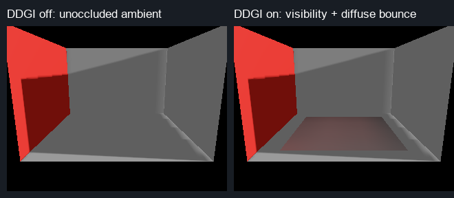

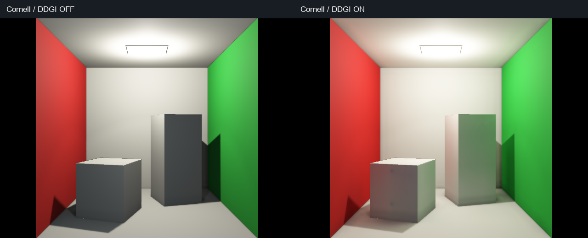

编辑器对照保持 640×480、固定 time=8、96 个渲染帧、相同相机与光源，RSM 关闭。DDGI 采用 512 探针、每帧 16 个、12×12 六面采样，缓存 5.016 MiB。开启后，盒子的暗面得到墙面的红／绿色反弹。截图帧自动隐藏 UI，保存完整场景画面。

### Sponza 场景测试

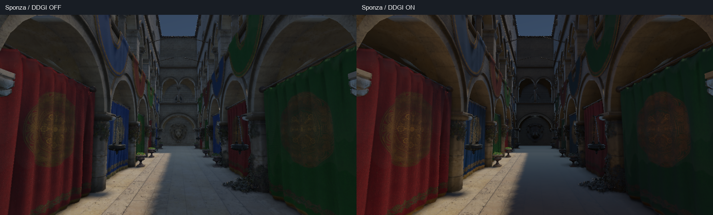

2026-10-10，Apple M4 / Metal，Crytek Sponza 包含 25 个 mesh、262,267 个三角形，归一化后约 28.70×12×17.65 m。通用 4 m 网格未完全覆盖 X 轴负方向边缘，因此 `--classic sponza --ddgi` 使用上面的 2 m 预设：1,280 探针、双缓存 **12.539 MiB**、每帧 8 个、160 帧访问一轮。捕获分辨率为每面 12×12，最大距离 45 m，normal/view bias 为 0.08/0.02 m，hysteresis=0.85、visibility power=3、bounce gain=0.85。

开关截图均为 960×540、固定 time=8、480 帧、相同相机／光源／曝光，RSM 关闭、截图隐藏 UI。开启后，拱廊、背墙和阴影地板减少未遮挡环境光的泛亮。当前柱体／薄装饰仍有噪点；下节增加独立 PT 参考，不能仅凭开关对照宣称漏光或反弹已达到物理准确。480 帧仅完成三轮访问，也不能视为完整时间收敛。

追加运行至 960 帧、六轮访问后，与 480 帧截图相比，RGB 平均绝对变化为 **0.162 / 255**，95% 通道变化不超过 1 / 255，变化超过 2 / 255 的像素占 **0.00424%**。当前固定视角的 LDR 画面已基本稳定；这不证明 HDR 探针场全部收敛，也不代表灯光变化后的响应。[960 帧画面](../img/diagnostics/ddgi/metal/sponza-on-960.png)、[原始运行日志](../img/diagnostics/ddgi/metal/sponza-convergence-runtime.log)。

Metal API／Shader Validation 下，deferred 开关各运行 480 帧；forward 开启运行 160 帧、640×360，均正常退出，无校验错误、publication 拒绝或 fallback。[测试设置与结果](../img/diagnostics/ddgi/metal/sponza-validation.json)、[deferred 开启日志](../img/diagnostics/ddgi/metal/sponza-on-validation.log)、[关闭日志](../img/diagnostics/ddgi/metal/sponza-off-validation.log)、[forward 日志](../img/diagnostics/ddgi/metal/sponza-forward-validation.log)。

另行关闭 API／shader validation，两组均开启 GPU counters、运行 480 帧。以下 command buffer 统计取最后 160 个完整渲染提交，覆盖第 321–480 帧：

| Sponza 960×540 | DDGI 关闭 | DDGI 开启 |
| --- | --- | --- |
| GPU command buffer median / p95（ms） | 17.369 / 20.322 | 25.462 / 28.532 |
| 全程 render CPU p95 / p99（ms，含启动） | 12.137 / 17.514 | 27.635 / 35.488 |
| RHI 资源峰值估计（MiB） | 364.529 | 377.105 |

开启 DDGI 的阶段区间并集 median / p95：六面捕获 **13.181 / 16.824 ms**、探针积分 **3.755 / 6.377 ms**、表面查询 **8.750 / 11.264 ms**、场复制 **0.274 / 0.459 ms**。阶段有重叠，不能相加；command buffer 时长也包含阶段等待／交错执行的影响，不等于独占执行时间或交互帧率。Metal telemetry 有滚动容量限制，本次开启日志保留末尾 170 个完整 DDGI 帧，丢弃其中前 10 个进行阶段统计，并非整次运行只渲染了 170 帧。[性能统计](../img/diagnostics/ddgi/metal/sponza-performance-summary.json)、[开启 counters](../img/diagnostics/ddgi/metal/sponza-on-profile.json.gz)、[关闭 counters](../img/diagnostics/ddgi/metal/sponza-off-profile.json.gz)。

复现截图：

```sh
./build/Scene-Renderer --classic sponza --hidden --size 960x540 --frames 480 --time 8 \
  --screenshot img/diagnostics/ddgi/metal/sponza-off.ppm
./build/Scene-Renderer --classic sponza --ddgi --hidden --size 960x540 --frames 480 --time 8 \
  --screenshot img/diagnostics/ddgi/metal/sponza-on.ppm
python3 tools/visualize_ddgi.py img/diagnostics/ddgi/metal
```

### Sponza 路径追踪参考对照

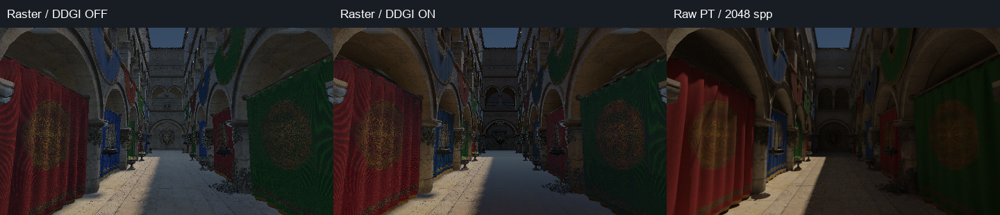

2026-10-10，Apple M4。新增离线参数 `--pt-compare-ddgi`，从 **同一份冻结快照**生成 realtime HDR 和 PT：同一 OBJ、材质、相机矩阵、time=8、实时大气烘焙及透射后的太阳光。DDGI 与编辑器共用场景预设，960 帧完成六轮访问，1,280 探针全部初始化，1,038 个保持活动。双方曝光 **1.1**，比较图统一 `pow(1-exp(-max(HDR,0)*exposure),1/2.2)`，不拟合曝光或亮度。

本次比较为 **480×270**。Raster 保留直接光阴影，关闭 AO、TAA、RSM 和额外后处理；保存后处理前的线性 PFM。PT 使用 Metal 原生 triangle ray query、固定 **2,048 spp / seed 1 / 16 bounces**，不降噪、不启用 guiding、radiance cache 或 photon mapping，nonfinite=0。另以 **1,024 spp / seed 2**检查剩余采样噪声。这里的 GT 是有限采样／深度的项目 PT 参考，尚非独立渲染器交叉验证。

指标使用线性 RGB：`normalized L1 = sum(abs(actual-reference)) / sum(abs(reference))`。AOV 对齐内区仅保留不透明表面、法线 dot>0.98、albedo 平均绝对差<0.05，再做 3×3 腐蚀排除边缘；选区不读取 beauty 误差，保留 **120,872 像素，占表面 94.28%**。

| 相对 raw PT 的整图误差（对齐内区） | DDGI 关闭 | DDGI 开启 |
| --- | --- | --- |
| Linear RGB MAE | 0.015486 | 0.009569 |
| Linear RGB RMSE | 0.026096 | 0.019551 |
| Normalized L1 | **80.46%** | **49.72%** |
| 平均 RGB 能量偏差 | +59.50% | +30.68% |

开启 DDGI 将此处 normalized L1 降低 **38.20%**，但误差仍很大。独立 PT 种子间 normalized L1 为 **3.58%**，远低于 Raster 差异；这只是残余采样噪声检查，不是 GT 误差界或收敛证明。整图误差包含直接光阴影、BSDF、镜面环境近似和纹理采样差异，**不可全部归因于 DDGI**。关闭 TAA 后的 Raster 噪点也进入该项指标。

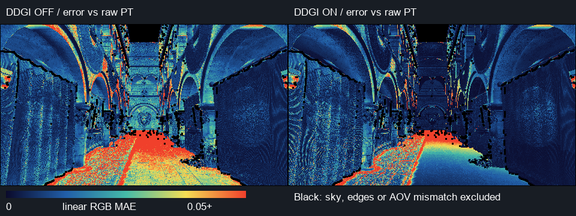

为单独检查 DDGI，从同一 GBuffer 中选取 **47 个**与 CPU 首次交点对齐、shading/geometric normal dot>0.9 的表面点，每点用 **2,048 条余弦半球路径、16 bounces**估计 `E/π`。第一段未命中只读天空，不计已经由表面直接光处理的解析太阳；命中其他表面后的路径保留太阳 NEE、环境、镜面／漫反射和多反弹。不乘当前表面的 albedo，不经过 Raster shadow 或 beauty 合成；PT 从几何 epsilon 偏移起射，DDGI 保留自身 normal/view bias。GPU 诊断查询补偿 view-bias 方向，匹配实际表面查询的偏移位置。

| 独立漫反射辐照度参考 | 结果 |
| --- | --- |
| DDGI `E/π` normalized L1 | **34.76%** |
| 平均辐照度能量偏差 | **+19.48%** |
| PT 平均 `E/π` RGB | (0.04148, 0.02893, 0.01991) |
| DDGI 平均 `E/π` RGB | (0.05096, 0.03534, 0.02161) |
| 单点 PT 标准误差的 RGB 平均值 | (0.00271, 0.00201, 0.00139) |
| 查询覆盖范围 | 0.99999988–1.0 |

该误差仍包含捕获使用 Lambert 出射近似、有限捕获方向和实际表面点之间的位置插值偏差。47 点是固定网格采样，不代表整个场景的最大误差；采样标准误差也不是系统偏差。

背墙和阴影地板虽然明显改善，仍偏亮；红色帘布选区反而略变差（normalized L1 49.03%→53.01%）。因此不能用统一调暗 GI intensity 来替代定位误差。后续优先对探针捕获遮挡、距离矩可见性和跨拱廊插值做消融；直接光／镜面差异另行定位。**本阶段功能闭环已完成，精度尚未达到 PT 参考。**

原始资料：[完整误差与选区统计](../img/diagnostics/ddgi/metal/gt/sponza-comparison.json)、[逐点参考与标准误差](../img/diagnostics/ddgi/metal/gt/sponza-ddgi-reference.json)、[PT 参考报告](../img/diagnostics/ddgi/metal/gt/sponza.json)、[独立种子报告](../img/diagnostics/ddgi/metal/gt/sponza-seed2.json)、[误差场与掩码](../img/diagnostics/ddgi/metal/gt/sponza-errors.npz)。raw PFM 以无损 `.pfm.gz` 保存，PNG 位于同目录，分析脚本自动读取普通／压缩 PFM；压缩前后的指标逐值相同，未以 OIDN 图片替代数值参考。[来源与原始数据 SHA-256](../img/diagnostics/ddgi/metal/gt/provenance.json)确认两个随机种子的天空 HDR 逐字节相同。

复现（Metal，关闭 validation 的正式测量）：

```sh
./build/Scene-Renderer --path-trace-gpu sponza --pt-size 480x270 --pt-fixed \
  --pt-samples 2048 --pt-bounces 16 --pt-seed 1 --pt-traversal native \
  --pt-compare-ddgi --pt-ddgi-frames 960 --pt-checkpoint-samples 512 \
  --pt-output img/diagnostics/ddgi/metal/gt/sponza
./build/Scene-Renderer --path-trace-gpu sponza --pt-size 480x270 --pt-fixed \
  --pt-samples 1024 --pt-bounces 16 --pt-seed 2 --pt-traversal native \
  --pt-output img/diagnostics/ddgi/metal/gt/sponza-seed2
python3 tools/compare_ddgi_gt.py img/diagnostics/ddgi/metal/gt/sponza \
  --second-reference img/diagnostics/ddgi/metal/gt/sponza-seed2
```

构建和四项 CPU 合约回归通过；Cornell 48×32、8 spp、32 DDGI 帧的离线捕获 smoke 在 Metal API／Shader Validation 下通过。比较入口仅支持原生 Sponza／Cornell GPU PT、`--pt-fixed` 和原生天空，不支持自定义 scene package、HDR、clouds 或有偏估计器；未将这次实际 Sponza GT 比较声明为 Vulkan 验证。

### 抗锯齿、材质一致性与拱门偏亮

以下为 AA 升级前的诊断捕获。后续已补全普通材质 mip／8× 各向异性过滤、法线方差过滤，并修正 TAA 的固定网格输出；见[新实现和受控对照](realtime-anti-aliasing.md)。这里保留原始数据用于追溯，拱门的 GI／镜面遮挡问题仍待修复。

上一组 GT 数值捕获关闭了 TAA，**不代表编辑器的抗锯齿画质**；线性 HDR 也可以在 TAA 之后、色调映射之前读取。新增同快照对照保留 960 帧后的探针场，冻结更新，分别重置颜色历史并累计 64 帧原生 TAA。冻结前后的探针数据逐值一致；曝光、相机、太阳、材质和 PT 2048 spp 参考不变，截图没有 UI。所有消融的 AO 仍关闭。


**颗粒确实包含纹理混叠。** `GpuImageCache.cpp` 的普通材质纹理目前只创建 mip 0，材质使用双线性采样，没有 mip 链或各向异性缩小过滤。基础颜色 AOV 本身就有颗粒，并不是全部由 DDGI 产生。PT 在像素内累计多次采样，而实时关闭 TAA 时只有单个像素采样。帘布选区的四邻域 Laplacian 残差 MAE 从 0.032679 降到 0.014384（**下降 55.98%**）；该量衡量相对 PT 的高频误差，不是 MTF 或纯噪声估计。TAA 已改善画面，但仍需材质 mip 链、法线预过滤和透明裁切抗锯齿。

**两者使用同一份材质资源，但不是完全相同的材质求值。** 冻结快照共用导入的 albedo／normal／metallic／roughness、材质参数和几何，没有给 PT 换成另一套 Sponza 材质。两条路径都对基础颜色作 `pow(..., 2.2)` 解码。但 Sponza 的 legacy PBR 在实时端使用 Schlick-GGX 几何项，PT 使用精确 Smith；切线求值及背向／几何半球的法线保护也有差异。已有 matched GGX 分支不能替代检查默认导入材质的路径。

**抗锯齿不能修复拱门的光照偏差。** 原来的左拱门选区 normalized L1 为 90.60%，开启 TAA 后仍为 90.09%。逐点半球积分进一步排除了直接光／最终镜面合成：在像素 (30,22) 和 (90,67)，DDGI `E/π` 的 RGB 总能量分别是 PT 的 **9.26／11.82 倍**，相应 PT 标准误差远小于差值。这是两个固定遮阴点的结果，不是整个拱门的平均值。探针捕获、距离矩遮挡、跨拱廊插值及 Lambert 反馈仍需定位；不能归因于像素 AA，也不能用统一 GI 调暗掩盖。

还有独立的**天空镜面遮挡缺口**：`environment.glsl` 以 8 个方向采样天空并乘 Fresnel，没有检查这些方向是否被建筑挡住。DDGI surface 只替换天空漫反射和常量 ambient，保留该镜面项。因此即使漫反射探针感知到了屋顶，最终像素仍可能收到未遮挡的天空镜面光。

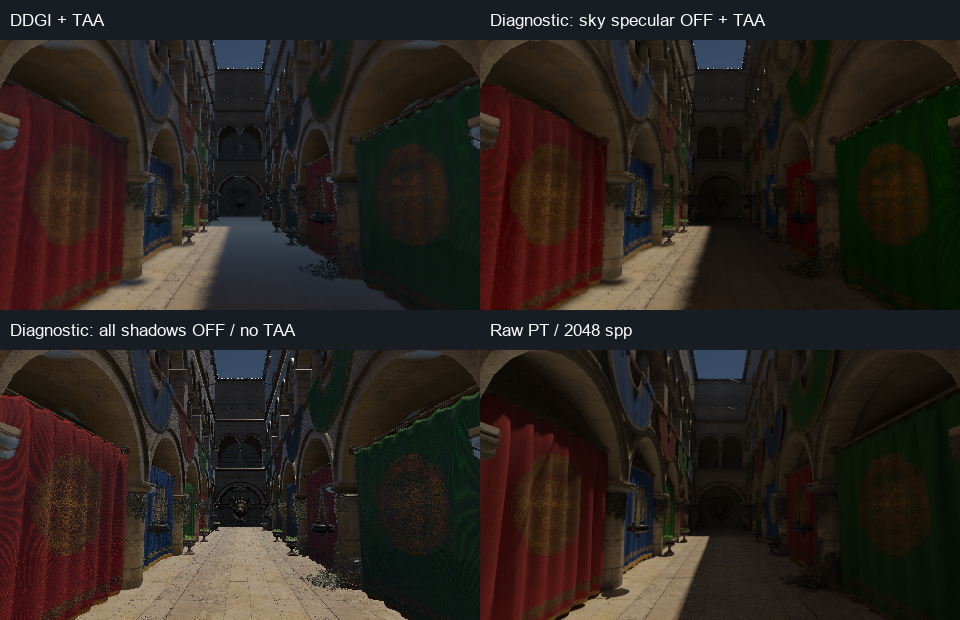

| 相对原始 PT，normalized L1 | TAA 关闭 | TAA 开启 | TAA 开启、诊断性关闭天空镜面 |
| --- | ---: | ---: | ---: |
| 对齐内区 | 49.72% | 44.55% | 28.73% |
| 左拱门 | 90.60% | 90.09% | 79.70% |
| 背墙 | 137.94% | 139.84% | 40.58% |
| 阴影地板 | 215.71% | 213.78% | 51.92% |
| 红色帘布 | 53.01% | 32.37% | 27.76% |

选区沿用上一组的 AOV 对齐内区掩码，TAA 的亚像素重建也会影响数值。暗区 PT 能量小，normalized L1 可以超过 100%。关闭全部直接阴影后，原始对齐内区误差反而升到 168.75%；帘布高频残差也未消失，不能把所有颗粒解释为 shadow acne。**关闭天空镜面仅用于确认误差来源，不是正确的最终修复**：开放区域仍需要镜面反射，应补充合理 BRDF 积分及场景可见性。产品默认镜面强度保持 1。

后续质量优先级：普通材质 mip／法线过滤 → 导入材质 BSDF 与法线求值一致性 → 拱门遮阴点的探针捕获／可见性消融 → 受场景遮挡的镜面环境照明。原始 TAA-off 指标保留；不能把开启 AA 的图片标成原来的未过滤数值实验。

[完整选区、逐点与高频统计](../img/diagnostics/ddgi/metal/gt/aa/sponza-surface-analysis.json) · [原生 GPU Validation 运行日志](../img/diagnostics/ddgi/metal/gt/aa/sponza-runtime.log) · [原始 SHA-256 与天空精度复核](../img/diagnostics/ddgi/metal/gt/aa/provenance.json)。构建通过，实际 Sponza 消融在 Metal API／Shader Validation 下完成，探针冻结一致性检查通过；未声明本次已修复全部光照误差或验证 Vulkan。相对上一组关闭 validation 的捕获，太阳参数完全一致；天空 RGBE 有 131,072 像素中的 1 个量化差异，解码 normalized L1 为 3.25×10⁻⁸，实时对齐内区最大 RGB 差异为 6.10×10⁻⁵。未把两次原始图片声明为逐字节相同；天空和太阳边缘不进入表面指标。PFM 无损压缩前后分析指标逐值相同。

```sh
./build/Scene-Renderer --path-trace-gpu sponza --pt-size 480x270 --pt-fixed \
  --pt-samples 1 --pt-bounces 16 --pt-seed 1 --pt-traversal native \
  --pt-compare-ddgi --pt-ddgi-frames 960 \
  --pt-output img/diagnostics/ddgi/metal/gt/aa/sponza
python3 tools/analyze_ddgi_surface.py img/diagnostics/ddgi/metal/gt/sponza \
  img/diagnostics/ddgi/metal/gt/aa/sponza
```

此命令只重新捕获实时消融；入口随后输出的 1 spp PT 是 smoke，**不参与比较**。分析脚本明确复用上一组 2048 spp 原始 PT；1 spp 输出保留在 `build/path-tracing/ddgi-aa-smoke/`。

### AA 改进后的 DDGI／PT 复核（2026-10-10）

复用刚完成 AA 验证的**最新原生 Metal GPU 捕获**（`img/diagnostics/aa/metal/sponza`），重新分析同一份 raw PT 2048 spp / 16 bounces / seed 1。这里没有重新生成或替换 PT，也没有改动 GI 强度。实时材质已有 mip、8× 各向异性请求和法线方差过滤，开启高质量 TAA 并累计 64 帧；DDGI 更新 960 帧后冻结，消融前后探针场逐值相同。相机、时间、太阳、曝光 1.1 保持一致；AO／RSM 关闭，所有场景图不含 UI。数据来自后处理前的线性 HDR，比较图使用相同色调映射，无降噪或曝光拟合。

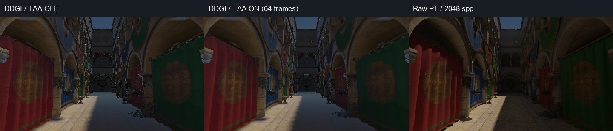

沿用原始 AOV 对齐／腐蚀掩码的 120,872 个像素。下面是**整条实时着色管线**相对 PT 的 normalized L1，包含直接光、材质求值和天空镜面误差，不是单独的 DDGI 误差。暗区参考能量小，因此百分比可能超过 100%。

| 选区 | 升级前 TAA | 当前高质量 TAA | 当前 TAA，诊断性关闭天空镜面 |
| --- | ---: | ---: | ---: |
| 对齐内区 | 44.55% | **41.93%** | **25.45%** |
| 左拱门 | 90.09% | **92.36%** | 82.34% |
| 背墙 | 139.84% | **131.56%** | 36.71% |
| 阴影地板 | 213.78% | **214.08%** | 52.04% |
| 红色帘布 | 32.37% | **27.54%** | 21.87% |

全局平均 RGB 能量偏差仍为 **+31.34%**；诊断性关闭天空镜面后为 +1.73%。旧／新比较同时包含材质预过滤和它对探针捕获的影响，不能当作单独 TAA 的消融。AA 对帘布高频误差的改善见[受控 AA 报告](realtime-anti-aliasing.md)。

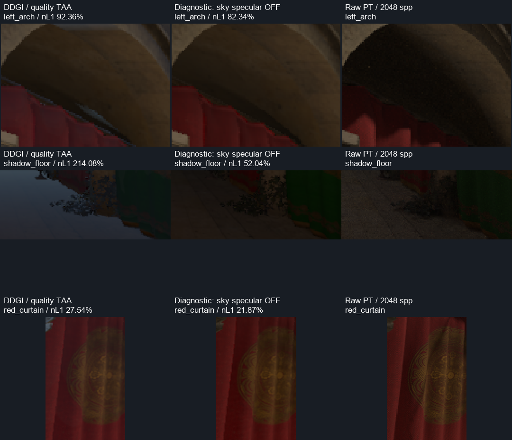

局部图使用原图选区和相同曝光，最近邻放大，不额外锐化。拱门暗面仍被明显抬亮；阴影地板仍有偏蓝的环境光泛亮。天空镜面消融使背墙／地板明显接近参考，但拱门改善有限。`environment.glsl` 的天空镜面采样没有建筑可见性，DDGI 只替换漫反射，因此该误差独立于漫反射探针。**关闭天空镜面只是定位手段，产品默认强度仍为 1。** 开放区域需要保留正确的反射，应补上遮挡和合理的 BRDF 积分。

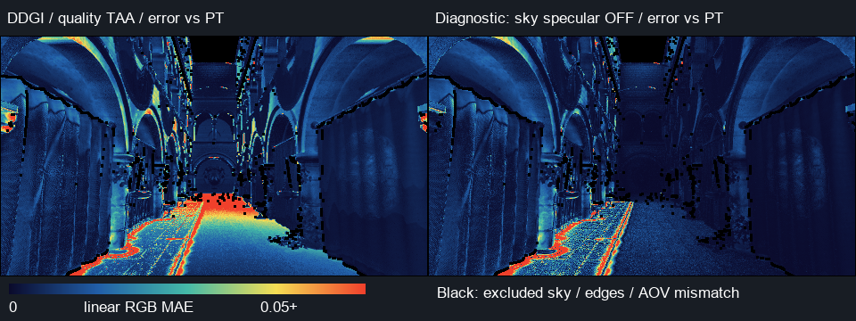

独立比较最新捕获的 **47 个表面点**：每点 2048 条余弦半球路径，直接估计 incident `E/π`，不乘当前表面 albedo，也不经过直接光阴影、最终镜面或 TAA。

| 独立探针精度检查 | 当前结果 |
| --- | ---: |
| `E/π` normalized L1 | **37.25%** |
| 平均辐照度能量偏差 | **+22.43%** |
| PT 平均 `E/π` RGB | (0.04143, 0.02892, 0.01991) |
| DDGI 平均 `E/π` RGB | (0.05230, 0.03612, 0.02208) |
| 逐点 RGB 总能量比，中位数／90 分位 | 1.17／1.93 |
| 像素 (30,22) 的 DDGI／PT 总能量比 | **9.67×** |
| 像素 (90,67) 的 DDGI／PT 总能量比 | **12.34×** |

两处遮阴点 PT `E/π` RGB 分别为 (0.00383, 0.00228, 0.00113) 和 (0.00332, 0.00190, 0.00092)，对应标准误差分别约 (0.00071, 0.00048, 0.00028) 和 (0.00061, 0.00036, 0.00018)，远小于 DDGI 的差值。覆盖接近 1 只说明查询获得了插值结果，不保证可见性正确。47 点是固定网格采样，不代表全场最大误差或严格收敛界。

前一版独立 `E/π` 误差为 34.76%、能量偏差 +19.48%；当前没有随 AA 改进而降低，反而为 37.25%／+22.43%。材质预过滤也改变了探针捕获和部分查询法线，所以这不是一次纯 GI 算法回归对照，但足以说明**像素稳定性改善没有修复间接光遮挡问题**。

下一轮优先检查两条路径：天空镜面的建筑可见性；拱门下方 8 邻探针的捕获方向、距离矩可见性与插值权重，之后再检查 Lambert 多反弹反馈。不能只调低全局 GI intensity：误差在不同区域差异很大，部分查询还低于 PT。

原始证据：[最新选区／独立辐照度统计](../img/diagnostics/aa/metal/sponza-surface-analysis.json)、[逐点 PT 值和标准误差](../img/diagnostics/aa/metal/sponza-ddgi-reference.json)、[无损 HDR SHA-256](../img/diagnostics/aa/metal/provenance.json)。本次为数据分析和可视化，不宣称已修复上述 GI 误差。复算：

```sh
python3 tools/analyze_ddgi_surface.py img/diagnostics/ddgi/metal/gt/sponza \
  img/diagnostics/aa/metal/sponza
```

### 当前开销与后续优化方向

以下性能数据来自此前保留 GUI 的独立测量。关闭／开启的 96 帧运行时长分别 1.022／1.459 s，包含冷启动；render CPU p99 为 73／312 ms，因此这些时长不是稳定帧率基准。相应 RHI 资源估计为 163.326／168.388 MiB，运行没有内存压力事件和失败发布。原始日志：[关闭](../img/diagnostics/ddgi/metal/cornell-off-runtime.log)、[开启](../img/diagnostics/ddgi/metal/cornell-on-runtime.log)。

Apple GPU counter，开启 DDGI、丢弃前 10 帧，剩余 86 帧：

| DDGI 部分 | GPU 阶段区间并集 median / p95（ms） |
| --- | --- |
| 六面捕获（96 render passes／帧） | 7.608 / 9.843 |
| 16 个探针积分 | 3.459 / 3.687 |
| 640×480 表面查询 | 2.495 / 3.964 |
| 保留未更新探针的缓存复制 | 0.054 / 0.237 |

**这些 GPU 阶段有重叠，不可把数值相加作为完整帧耗时。** 同一帧同阶段先取 timestamp 区间并集，避免累加重叠的 vertex→fragment 区间；仍包含该阶段的等待时间，不等同于纯 ALU 时间。[统计结果](../img/diagnostics/ddgi/metal/performance-summary.json)、[完整 counter 数据](../img/diagnostics/ddgi/metal/cornell-on-profile.json.gz)，可用 `tools/analyze_ddgi_profile.py` 复算。

首阶段的主要成本是六面图形捕获和方向积分，其次是逐像素 SSBO 查询。后续应优先替换采样后端／减少 render pass 与 CPU draw encoding、共享积分样本读取、研究半分辨率 GI 查询与边缘保留重建，再引入事件优先更新和滚动级联。当前只提供预算控制，未承诺 60 fps。

## 阶段边界

- 单一本地体积和不透明 Scene 表面查询；水面、透明物体以及专用水下捕获尚未使用 DDGI。
- 低频漫反射，不提供镜面 GI、像素级接触细节、焦散或路径追踪参考的一致性保证。AO 仍承担细节遮蔽。
- 距离矩与有限方向采样减少漏光，不能消除任意薄缝／小物体问题。偏移过大可能越过薄壁；减少偏移、减小间距、增加捕获分辨率需一起检查。
- 使用未按主相机裁剪的辅助物体列表，但 GPU 地形／植被捕获仍受当前已生成、已驻留的几何范围限制，不能把尚未生成的地形当作有效遮挡。直接光阴影也受当前阴影映射覆盖范围限制。
- 本阶段有停用分类，没有探针 relocation、稀疏分配、滚动体积、级联、大世界坐标支持或事件优先级更新。大范围世界下一阶段应采用级联／滚动和采样后端优化，不能仅增加网格数量。

## 方法参考

方向辐照度、距离矩与可见性插值参考 [Majercik 等，DDGI，JCGT 2019](https://jcgt.org/published/0008/02/01/paper-lowres.pdf)；该论文使用射线追踪，而本项目当前采用光栅采样。进一步的工程扩展见 [Scaling Probe-Based Real-Time Dynamic Global Illumination for Production](https://research.nvidia.com/publication/2020-09_scaling-probe-based-real-time-dynamic-global-illumination-production-technical) 和 [RTXGI irradiance query](https://github.com/NVIDIAGameWorks/RTXGI-DDGI/blob/main/rtxgi-sdk/shaders/ddgi/Irradiance.hlsl)。本项目着色器为独立实现。

## 共享 PT 捕获与简化 PT 世界

新增离线参考后端 `--pt-ddgi-capture pt`，在固定网格、方向和查询算法下复用 GPU PT 的材质／多反弹积分；可组合 `--pt-world-lod` 测量简化探针世界。编辑器仍使用原光栅后端。[接口、复现命令、自动 LOD 算法与限制](pt-probes-and-world-lod.md)。PT 捕获修正采样阶段的光照近似，距离矩插值和最终天空镜面遮挡需要分别验证。
