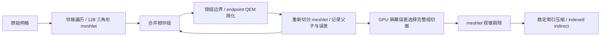
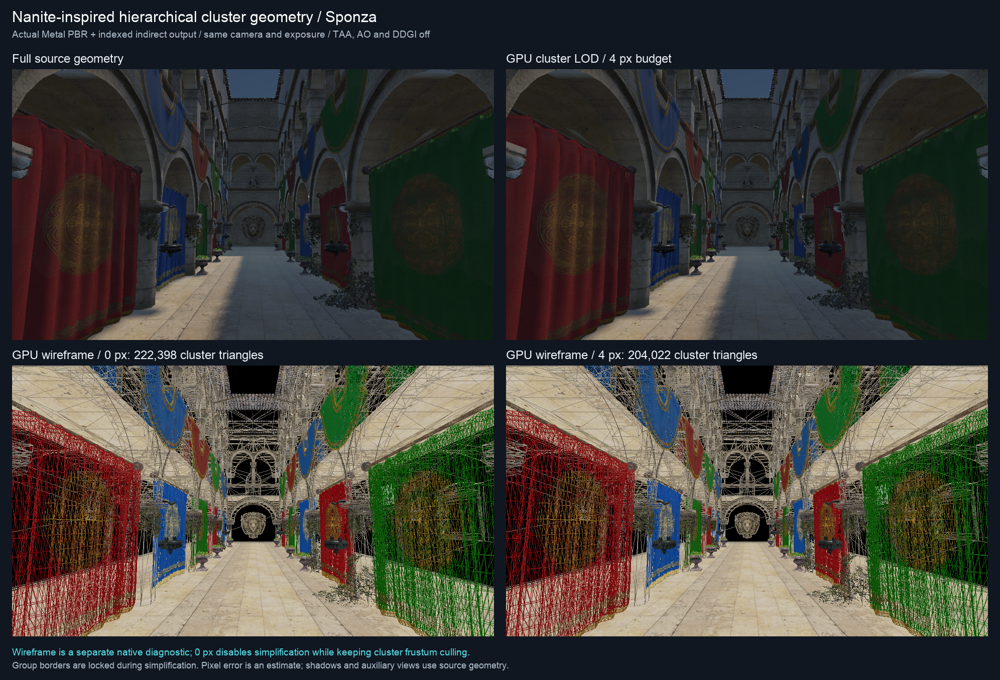

# 分层 Cluster 几何：Nanite 核心路径原型

当前实现是可开关的分层几何与 GPU 驱动 LOD 原型，接入已有 Metal / Vulkan 实时 PBR 管线。默认关闭；可以在实时渲染设置中开启 `Hierarchical cluster geometry`，调整 `Cluster LOD error (pixels)`，可另行开启 `Cluster Hi-Z occlusion`；或开启 `Cluster triangle wireframe` 查看实际提交的三角形。

## 从顶点 clustering 到三角形 cluster

原 [PT world LOD](pt-probes-and-world-lod.md) 使用拓扑约束的空间顶点聚类：相邻且属性相容的顶点被收缩，整个网格选择一份简化结果。它适合在捕获时冻结低精度 PT 世界，但不能在同一物体上按距离选择不同细节。

新的 cluster 是三角形组。参考 [Karis / Stubbe / Wihlidal 的 Nanite 演讲](https://advances.realtimerendering.com/s2021/Karis_Nanite_SIGGRAPH_Advances_2021_final.pdf) 的分组、合并简化、重新切分思路，以及 [Epic 的 Nanite 概览](https://dev.epicgames.com/documentation/en-us/unreal-engine/nanite-virtualized-geometry-in-unreal-engine)，本项目采用二叉组层级，每个组可以拥有多个 meshlet。运行时整体替换组的表示，不独立选择组中的某一个父 meshlet，避免父子同时绘制或只替换一部分子表面。



## 构建算法与接缝

`ClusterGeometry.cpp` 的构建是纯 CPU 工作：

1. 只合并位置、法线、UV、切线完全一致的重复顶点；所有层级的索引仍指向原始顶点／切线 buffer。
2. 用精确位置拓扑建立几何边邻接，采用 Morton 种子、顶点复用优先的 frontier 和有界空间补齐，切出最多 128 个三角形的叶 meshlet。位置拓扑只用于分组，绘制仍保留完整属性地址；邻近断开表面可以共享存储块，但不会生成连接面。
3. 按位置拓扑共享边数量配对相邻组。未配对组保留为根，不焊接实际几何。
4. 汇总两组的三角形，锁住外边界、非流形边顶点和属性接缝。用面积加权的平面 Quadric Error Metric 排序边收缩候选。
5. 收缩只能选择已有端点，检查 manifold link condition、法线相容、面退化／翻转，以及累积位置、UV 和单位法线偏差。保留端点属性，避免新建跨接缝的插值属性。目标为父组约一半三角形，约束不允许时保留更详细表示；父表示至少减少 12.5% 三角形才进入常驻层级。
6. 将简化组重新切成 meshlet；每个组记录父子关系、覆盖整个源子树的 AABB、单调累积几何误差和 UV 误差。父 AABB 必须包含子 AABB，不能只包住简化后的顶点。

边界锁定发生在**组**上。子组之间的边界在两组合并后可以成为内部边，允许后续简化；组与外界相接的边保持原有端点和边连接。因此不同深度的组可以拼接，不需要用裙边遮缝。

独立构建 API 的默认预算：128 三角形／meshlet，最多 12 层，局部位置位移 0.25、UV 位移 0.03、累计单位法线偏差 0.05、每个网格 64 MiB 的打包层级预算。实时 SceneAdapter 使用源 AABB 对角线的 2% 作为构建位移上限，避免厘米／米等导入单位导致候选简化过少；实际采用哪个候选仍由像素误差决定。位移是累积代表点位移的保守估计，不是双向 Hausdorff 或光输运误差证明。QEM 用于排列候选，**不把 QEM 数值直接当成像素误差**。端点限制比最优位置 QEM 更保守，也不等同于 Epic 的简化器。

旧属性邻接 BFS 可用 `ClusterBuildSettings::spatialPartition=false` 对照。新分块、接缝保护、累计法线约束与三个模型的同构建 A/B 数据见 [Cluster 分块与层级构建报告](cluster-partition-and-hierarchy.md)。

## 运行时选择与绘制

每个组的屏幕误差估计为：

`pixels = accumulatedError × modelScaleBound × focalPixels / max(nearestViewDepth, nearPlane)`

正交相机不除深度；模型尺度使用 `sqrt(norm1(M) × normInf(M))`，包含镜像、旋转、剪切和非均匀缩放。深度取源覆盖 AABB 最近的视空间深度。像素值是常用的投影误差估计，并非任意视角下每个屏幕像素偏移的严格上界。

GPU 对每个 meshlet 检查所属组：本组满足误差预算（叶组总是可用），且父组不满足预算，才选中；根组没有父条件。父误差单调、覆盖边界嵌套，使同一叶表面在根到叶的链上恰好被覆盖一次。多个 meshlet 的组使用完全一致的组选择条件，然后再对每个 meshlet 单独做保守的 AABB 视锥测试。

三个 compute 阶段 `mark → scan → scatter` 生成稳定的可见索引顺序和 `DrawIndexedIndirectArguments`。当前默认将兼容网格打包为共享常驻几何、288 B／网格的当前参数表和独立输出范围，整个批次只需三次 dispatch；Metal 将相邻 dispatch 合并为一个 compute encoder。每个网格用间接参数的 `firstIndex` 指向自身压缩区间，索引值仍是其原顶点 buffer 的局部地址。可用 `frame.clusters.batched=false` 对照旧的逐网格路径；超过 storage／dispatch／资源预算时回退旧路径。每个材质网格仍只提交一次 indirect draw，geometry、forward replay 和 motion 共用结果；正常渲染没有可见性读回。RDG 记录独立 `cluster-visibility` 节点。

alpha cutout、双面薄片和发光材质使用叶层保护；透明、SSS、生成网格、实例批次和光学／程序化表面继续使用原路径。没有改变全局双面渲染策略，因此没有擅自开启 normal-cone 背面剔除。

cluster 遮挡仍默认关闭。启用 `frame.clusters.occlusion` 后，Scene 路径默认采用两阶段：历史 Hi-Z 推测早期可见 cluster，直接画入 G-buffer，从实际当帧深度建立最大深度金字塔，再复查全部历史拒绝候选并补绘恢复部分。两套早期深度金字塔轮换，晚期索引追加到早期输出；最终 union 供 Motion／几何重放使用。取消 `frame.clusters.twoPhase` 可对照旧的当帧 depth prepass。历史只作提示，最终拒绝必须由当前深度证明。近裁面／眼平面相交、非有限投影、同深度、clear／alpha 孔洞均保守保留。阴影、RSM、DDGI 光栅捕获和水体辅助视角仍使用源几何。[两阶段算法、实际中间结果、逐像素验证与性能报告](cluster-two-stage-hiz.md)。

## 线程与资源

SceneAdapter 用专用的有界 CPU JobSystem（2 workers、16 个排队任务）构建不可变层级，渲染线程只轮询已完成 future，再创建 GPU buffer。未完成或失败时继续显示原网格；CPU worker 不调用 GPU。来源变更会重新构建，旧任务持有自己的不可变来源；GPU 缓存随原有 publication commit／rollback 管理。

同一 hierarchy 的重复 draw 共享批次中的不可变 nodes 与层级索引，选择／输出区间和变换仍独立。批次拥有一份打包 GPU 几何副本和压缩 scratch；原网格层级／辅助几何仍保留，因此会增加常驻内存。相机可见列表缩小时复用原批次并清零缺席网格的参数；新来源、更多 draw 或来源版本变化重建批次；关闭 cluster 释放 culler 资源。重复 draw ID 也按出现次数分配独立槽，不能让共享网格的多个变换覆盖同一个参数。

构建期只准备常驻数据，本版没有磁盘页流送。每帧 GPU 并行检查全部常驻 meshlet 的组谓词，尚未采用只访问可见子树的持久队列遍历。这能验证切面和剔除语义，不能将性能扩展性等同于完整 Nanite。

## 验证与复现

```sh
cmake --build build --target Scene-Renderer -j6
./build/Scene-Renderer --cluster-hierarchy-self-test
SCENERENDERER_CLUSTER_CAPTURE_DIR=img/diagnostics/cluster-geometry/metal \
  MTL_DEBUG_LAYER=1 MTL_SHADER_VALIDATION=1 \
  ./build/Scene-Renderer --cluster-rendering-self-test --backend Metal
./build/Scene-Renderer --cluster-rendering-self-test --backend Vulkan
SCENERENDERER_ENABLE_CLUSTER_GEOMETRY=1 ./build/Scene-Renderer --demo
```

`SCENERENDERER_DISABLE_CLUSTER_GEOMETRY=1` 优先于开启变量和 FrameData。CPU 测试检查来源不变、确定性、meshlet 容量、单调误差、子树覆盖、不同预算的混合 LOD 边界、受保护叶层、预算回退和独立组件。GPU 测试将实际压缩索引逐值比较独立 CPU 选择，另外检查零误差图像、alpha 保护、视锥剔除、可见性恢复、镜像／剪切／缩放。

## 初始原型实测（优化前）

以下是初始逐网格路径的历史测量；最新粗起始层／融合归约与高密度模型对照见 [Hi-Z 优化与动态 LOD 流程](cluster-hiz-optimization-and-lod.md)，初版批处理见 [性能优化报告](cluster-performance.md)。



Apple M4，Metal，960×540，同一相机／材质／曝光，关闭 TAA、AO、DDGI。22 个兼容网格包含 262,195 个非退化源三角形；另有 71 个小网格三角形沿用原路径，不计入下表。层级常驻数据共 16.66 MiB，不含原网格、临时压缩 buffer 和纹理。实际异步构建／GPU 发布墙钟约 0.22 秒；这不是逐帧开销。

| 像素误差预算 | 实际 cluster 三角形 | 可见 meshlet |
| --- | ---: | ---: |
| 0 px：只做视锥剔除 | 222,398 | 7,031 |
| 1 px | 218,050 | 6,992 |
| 4 px | 204,022 | 6,928 |
| 16 px | 195,607 | 6,898 |

4 px 相对源几何减少 22.2%，其中包含视锥剔除；单独相对 0 px 的 LOD 减面为 8.3%。接缝、薄片保护和保守误差限制了简化幅度。当前分区只沿邻接扩展，碎片化组件形成很多小 meshlet，容量 128 是上限而非填充保证。

零预算合成网格的图像逐像素一致。Sponza 零预算与原路径在 518,400 个显示像素中有 1 个不同，最大码值差 5/255；因此不声称 Sponza 位级一致。4 px 有 2,880 个显示像素变化；这仅是 8-bit 显示比较，不能解释为线性 HDR 或光输运误差。详见 [显示差异数据](../img/diagnostics/cluster-geometry/metal/display-comparison.json)。

### GPU 开销

关闭 API／Shader Validation，3 帧预热、8 帧测量，取 `geometry` 加全部 cluster 阶段的 GPU 时间中位数；包含 profiler 开销，排除阴影、光照、后处理和 CPU 建设。这是一次有限样本的阶段测量，不是整帧 FPS：

| 模式 | geometry＋cluster 中位数 | compute dispatch |
| --- | ---: | ---: |
| 原网格 | 2.256 ms | 0 |
| 1 px cluster | 2.730 ms | 66 |
| 4 px cluster | 2.705 ms | 66 |

**初始原型在此场景没有加速**，4 px 阶段反而约慢 20%，所以默认关闭。按阶段录制之前 4 px 为 2.706 ms，调整顺序没有产生可信加速；基线也有波动。扫描所有层级 meshlet、索引写回和独立 encoder 成本超过减面收益。优化优先级为跨网格批处理／减少 encoder、GPU 可见子树遍历、meshlet 级 Hi-Z，再评估可见性缓冲着色和更紧凑的几何驻留。

原始计时：[阶段集中录制](../img/diagnostics/cluster-geometry/metal/benchmark.json)、[调整前](../img/diagnostics/cluster-geometry/metal/benchmark-before-batching.json)。复测可以设置 `SCENERENDERER_CLUSTER_BENCHMARK=1 SCENERENDERER_GPU_PROFILE=1`，再执行上述 capture 命令；性能采集不要同时开启 Validation。

CPU 层级与原 PT LOD 回归通过。Metal 开启 API＋Shader Validation 验证；Vulkan 经同机 MoltenVK 功能验证，不能替代独立 Vulkan GPU 或 Khronos 验证层。两后端实际索引均与独立 CPU 选择一致，包含透视／正交、镜像／剪切／缩放、alpha 保护、视锥剔除和恢复。Metal 原 geometry culling、Hi-Z 回归也通过。验证数据：[Metal](../img/diagnostics/cluster-geometry/metal/validation.json)、[Vulkan](../img/diagnostics/cluster-geometry/vulkan/validation.json)。CTest 对应 `cluster-hierarchy`、`cluster-rendering-native`、`cluster-rendering-vulkan`。

## 与完整 Nanite 的边界

已实现：局部三角形 cluster、合并简化并重新切分、组层级、GPU 屏幕误差选择、cluster 视锥剔除、跨网格批次的 GPU 索引压缩／间接绘制、可切换的当帧 cluster Hi-Z、后台构建和实际三角形线框。

未实现：几何压缩／磁盘分页、按需求驻留与反馈、GPU 子树工作队列、可见性 buffer 后着色、软／硬件混合微三角形光栅、cluster 实例批次、normal cone、LOD 迟滞／渐变、专用虚拟阴影和光追 AS。现有 PT 仍使用原来的冻结式 world LOD；实时 cluster 切面不能直接删去 PT 阴影／反射所需的屏外几何。

减小实际主视角三角形数量会同时增加常驻层级内存和三个 compute 阶段／材质网格的成本。性能需要把选择、压缩和 geometry 全部计入，不能用减面比例直接推导 FPS。
