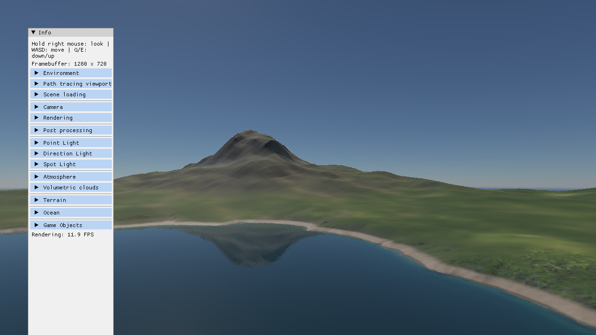
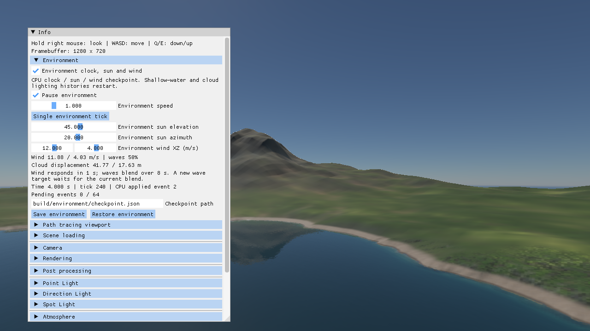
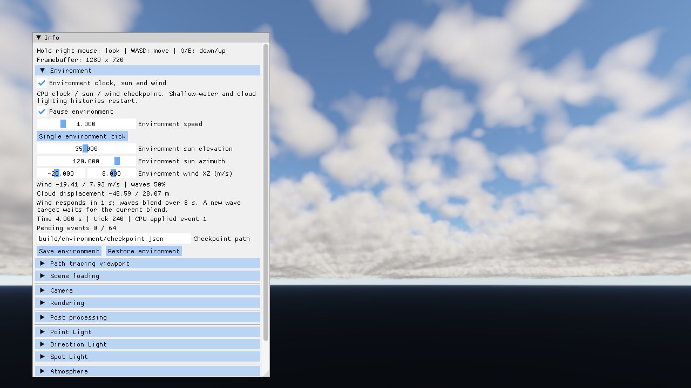
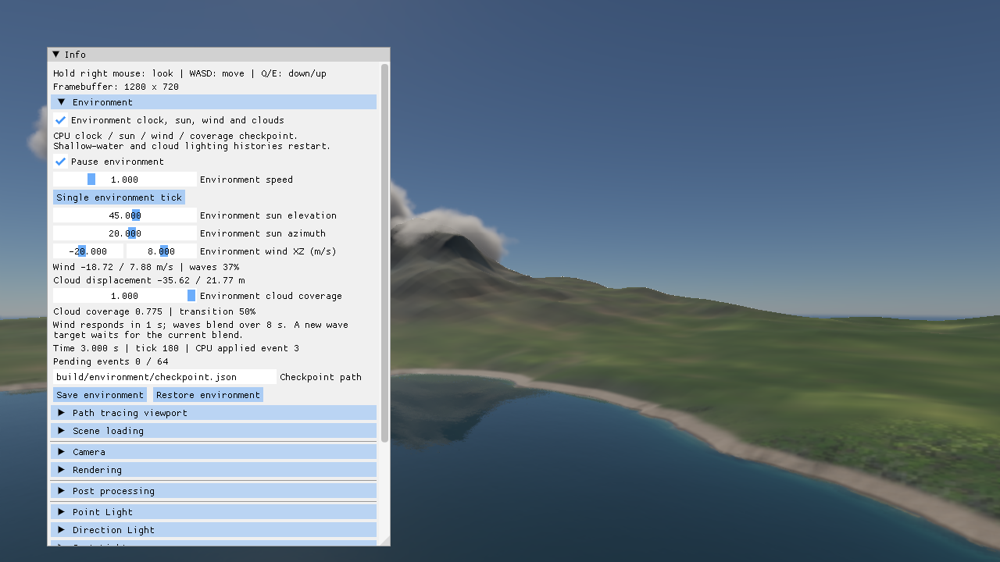
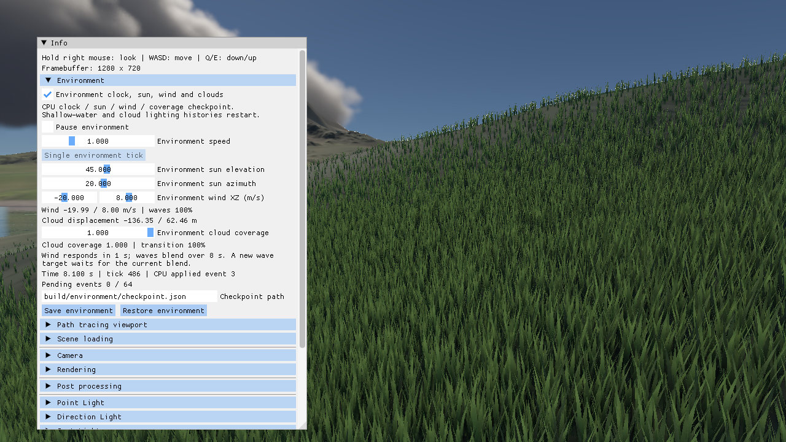
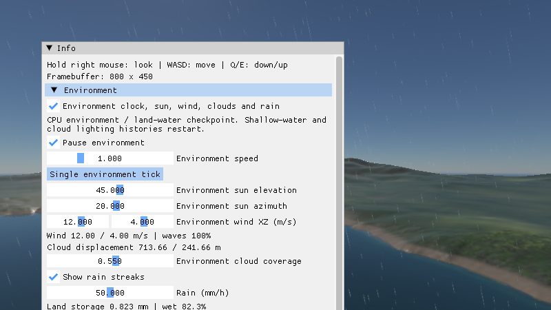
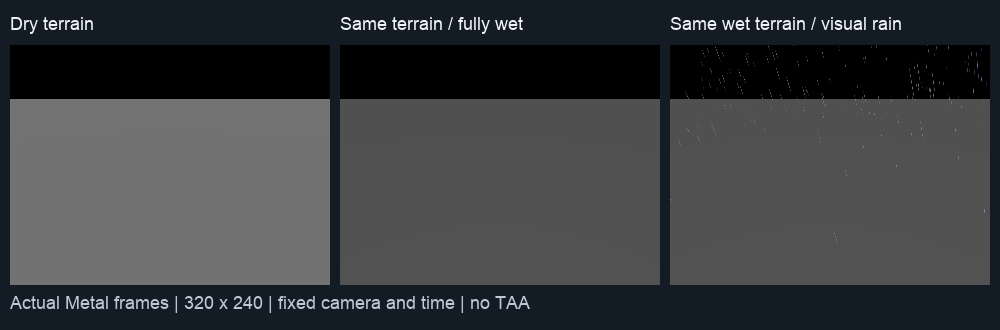
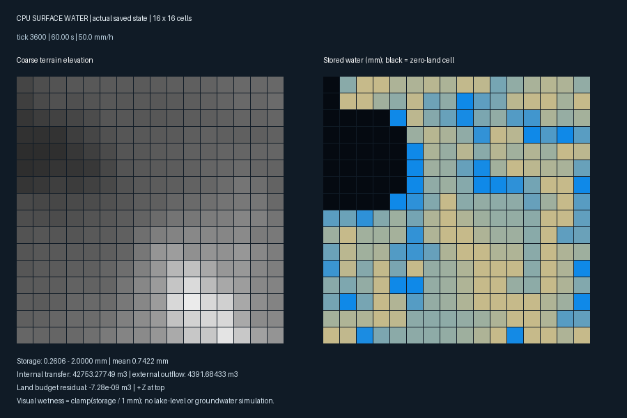

# 山湖天气实验室：首版交付规格

2026-10-09。**L1 主干及 L2 的共享风／云位移／草／波谱联动已实施；连续云量已接入，联合预算／风暴过渡仍待验收，L3 的基础降雨／16×16 地表收支／空间干湿材质已接入，落雨反馈与联合验收仍待完成；L4 云影／空气雾／近似 P1 PT 功能基础已实施，联合序列与预算仍待验收；L5 为计划。** 本文将 [自然环境应用路线](natural-environment-roadmap.md) 的 E0–E2 收敛为首个可交付范围，并列出数据契约和验收条件。L0 已开始采集静态基线，完整预算尚未冻结。共享材质仍按 [材质路线](shared-material-roadmap.md) 推进。

RSM 默认关闭，仅保留手动 demo；本规格的后续天气／材质／光照联动及联合验收不包含 RSM 开发。

## 首版范围与操作流程

复用现有 Mountain Lake 资产与远景／湖岸视角，完成一条“晴天 → 起风／增云 → 下雨／地面变湿 → 停雨／放晴”的可重复演示。用户可以调整天气、暂停／单步、查看环境读数、保存／恢复，并在支持的状态下导出固定时刻 PT 参考。

首版只处理固定场景范围、统一基础风与低频阵风、导演式太阳轨迹、云量过渡、基础雨和地表湿度。地理日期驱动太阳、雪冰、树林、河网、侵蚀、船体耦合和科学气象计算留给后续阶段。导演式太阳轨迹需要明确标注，它不等同于某地实际日出日落。

计划的应用流程是：选择山湖 → 选择质量档和天气预设 → 开始时间线 → 暂停检查风／雨／湿度 → 保存检查点 → 恢复或回放 → 导出图像和状态报告。已有的独立效果面板保留，环境驱动启用时由统一面板控制受管字段；低层面板显示来源，切换到手动覆盖才允许修改，避免多个入口互相覆盖。

建议演示脚本长 180 秒，分为稳定晴天、风云过渡、降雨、停雨与干燥四段。时间点、过渡曲线和初始状态保存在场景配置，属于艺术演示参数；模拟秒与显示日历时间分别记录。停雨不要求湿度立即归零，最后画面按收支模型得到的状态展示。

## 接入点与已发现的约束

| 当前入口 | 实施时的职责 | 约束与需要改变的行为 |
| --- | --- | --- |
| [主循环](../src/main.cpp)、[FixedStepClock](../include/engine/FixedStepClock.h) | 固定 tick 推进环境状态，处理事件／暂停，发布封存数据 | L1 已接入 CPU 环境 step；GPU 有状态效果仍依靠快照目标时间，完整事件分段推进待后续 |
| [WorldCommand](../include/engine/WorldCommand.h) | 参考现有纯值命令方式设计环境操作 | 当前 variant 没有环境命令；新控制需校验、序列号与可靠确认，不把任意 callback 或活组件传给 worker |
| [SceneSnapshot](../include/renderer/rhi/SceneSnapshot.h)、[构建器](../src/renderer/rhi/SceneSnapshot.cpp) | 发布环境视图、版本和单位明确的渲染输入 | 构建器仍接收 float 时间；L1 通过封存快照桥统一时间和太阳，渲染快照增加环境元数据 |
| [RenderRuntime](../include/engine/RenderRuntime.h) | GPU 状态 owner、完成确认、恢复／捕获事务 | 普通 `trySubmitFrame` 满队列会跳快照；捕获／加载已有可靠提交路径，但不能把频繁环境 tick 都改为阻塞提交 |
| [GpuClouds](../src/renderer/rhi/GpuClouds.cpp) | 云场演化、太阳缓存、历史重投影 | 风速不再单独清空云／TAA 历史；环境云量采用固定潜势／距离／光照分档缓存，逐帧变化不重建；手动 coverage 与 storm 等结构修改仍重建 |
| [云密度](../src/rhi/shaders/cloud-density.glsl)、[体素采样](../src/rhi/shaders/cloud-volume-sampling.glsl) | 使用累计平移和当前／前次位移做空间采样 | 已接累计位移与实际前后位移差；环境关闭时按已提交帧积分旧风速，时间回退或首次创建才采用原初始公式 |
| [GpuOcean](../src/renderer/rhi/GpuOcean.cpp)、[OceanSurface](../src/renderer/rhi/OceanSurface.cpp) | 低频风驱动、相位连续的波谱过渡，保留水体光学 | 环境驱动已在同一 Gaussian／相位上平滑混合谱振幅，保持原 FFT 次数；grid／domain 变化仍要求重建 |
| [草生成](../src/rhi/shaders/grass-generate.comp) | 使用统一风场更新弯曲，根部和分布保持稳定 | 环境启用时使用共享风向与累计相位，快照／PT 冻结共用输入；关闭后保留独立旧动画 |
| [湿岸 shader](../src/rhi/shaders/water-wet.glsl)、[地表求值](../src/rhi/shaders/shoreline-material.glsl) | 扩展为明确的降雨润湿与岸线状态组合 | 已有近岸湿度／泡沫改变颜色和 roughness；不能再乘一次相同暗化，也不能把 patch 历史当整个地形的湿度 |
| [PT 程序化捕获](../src/PT/ProceduralCapture.cpp)、[大气烘焙](../src/renderer/rhi/AtmosphereBake.cpp) | 冻结一致环境状态并报告捕获范围 | 当前天空只有大气／独立太阳；水面重新求值 FFT，未导出运行中的近岸浅水；草捕获有容量、LOD／视域限制 |

## 状态契约：先明确来源和单位

时钟、太阳、基础风及事件已落实为 `engine::Environment`；下表中天气／地表／完整 GPU 完成状态仍为后续契约。

| 数据 | 首版内容 | 规则 |
| --- | --- | --- |
| 配置 | schemaVersion、场景／资产标识、随机种子、世界范围、风／天气曲线、地表参数、质量档 | 资产 hash 与配置 hash 分开；加载先整体校验再发布 |
| 时钟 | uint64 tick、double simulatedSeconds、固定 dt、倍速、暂停、丢时累计 | 模拟秒是演化权威；展示日历只映射太阳／标签，不同时加速雨量与流体 |
| 风 | 世界 XZ 平面速度 m/s、阵风参数、累计云平移 m、波谱驱动状态 | 风方向在零速时有确定性规则；云平移累积积分，禁止重新用当前风乘启动以来总时间 |
| 天气 | coverage／storm 等外观参数、降雨率 m/s、可控温湿参数 | UI 可显示 mm/h，边界转换为 m/s；覆盖率不是湿度或降雨率，映射规则写入配置 |
| 地表 | 润湿存水深度 m、容量 m、溢出／渗入／蒸发累计 m；求值湿度 [0,1] | 每个地表 cell 有明确面积 m²；水深 × 面积得到体积 m³；首版不含完整地下水模型 |
| 发布信息 | worldEpoch、stateRevision、最后应用 eventSequence、目标 tick、GPU 完成 tick | CPU 已推进与 GPU 已完成分开，捕获不把两个不同 tick 的数据混成一个状态 |

逻辑侧拥有配置、时间线和首版地表收支的 CPU 权威状态，渲染侧接收封存版本并更新 GPU 缓存；现有 GPU 浅水求解仍由设备线程拥有。这是首版选择，后续只有在测到地表规模瓶颈后才迁移其权威状态到 GPU。

风积分首版为统一基础风的累计平移；空间阵风用于草／雨表现，尚不代表完整三维空气流场。长时间平移采用 double 累计，上传为局部偏移；周期化时前后位移与重投影采用同一周期规则，体素云的有限世界盒位置不能随意取模。

首版地表收支为：雨量进入薄层存水，渗入与蒸发从存水扣除，超过容量的部分记为溢出；没有河网时溢出记入外排账户。所有实际扣减以可用水量为上限，存水不得为负。可视湿度由存水映射，但材质响应允许不同资产各自定义，不能把一个颜色乘数称为物理含水率。

地表预算记录初始存水、累计雨量、当前存水、累计渗入、蒸发与外排。第一版雨直接落入湖面的部分记入水体降雨账户，不增加陆地存水；湖水位暂保持外部指定，账户未消费部分明确报告。只有接入水位／排水后才宣称完整湖盆水量闭合。

## 事件、检查点和帧队列

- 环境操作是带目标 tick、顺序号和 worldEpoch 的纯值事件；同一 tick 以顺序号确定顺序，所有参数先验证。过时世界事件拒绝并返回原因。
- 普通帧只携带当前封存状态、目标 tick 和确认游标。画面队列丢快照时，尚未应用的事件仍保留在有界事件日志；不靠普通 RenderPacket 的成功入队来判断事件是否生效。
- GPU owner 按时间区间消费事件并推进有状态效果。事件队列满时明确拒绝新操作／进入有记录的背压，不能无界保存，也不能静默丢弃；UI 收到确认后显示“已应用”。首版逐项定义合并规则，未定义的事件禁止合并。
- Seek／恢复为事务：暂停推进 → 找最近完整检查点 → 重演事件 → 等待目标状态完成 → 原子发布新 epoch → 重置相关图像历史。失败保留原状态；旧 epoch 的异步任务与读回不能发布到新状态。
- 检查点包括 CPU 地表收支、时钟／事件游标、累计风偏移及波谱过渡状态；如果启用有状态近岸求解，还需完整 GPU 状态与 patch 信息。首版未保存该部分时，禁止承诺浅水精确恢复，给出降级说明。
- 严格回放按固定 tick 执行，不丢模拟时间；交互模式允许减慢模拟进度并记录 wall-time 差距。首版不支持对任意历史状态“倒着积分”。

同后端确定性测试使用明确容差；跨 Metal／Vulkan 不要求浮点或 GPU 原子实例顺序逐位相同。比较稳定 cell／实例 ID、有效集合和数值，不直接比较未排序 buffer hash。

## 连续外观与更新预算

**太阳只有一个权威。** 环境轨迹生成方向光和大气太阳角度，手动编辑先切换太阳控制模式。继承已有方向约定和米／公里转换，不能让 snapshot 同步逻辑反向覆盖环境结果。首版使用轨迹关键帧，地理天文入口以后单独实现。

**原计划：云先用球壳模式交付连续天气。** 山湖远景默认不要求穿云；现有 `voxel=false` 球壳模式可作为首版候选，避免每次 coverage 小改都重建完整 XYZ 密度和 32 次距离迭代。仍需改进受控参数变化时的历史权重与位移重投影。体素云保留独立体验，需有可测的后台／限频构建和事务切换后再纳入持续天气。

**改变风与改变波谱分开。** 草／雨可快速响应阵风，波浪由低频风驱动。固定 seed、domain、分辨率；在现有随机样本与相位上过渡波谱，单独测波高／法线与能量变化。双频谱方案是否采用由 E0 测得的额外 FFT 成本决定，尚未选定。首次版本不能靠频繁改 seed 制造天气变化。

**地表状态与材质分开。** 环境状态用于求值 base／roughness／水膜输入；材料参数连续改变不重建 mesh／VT 源。岸线湿沙与降雨湿度合并前明确两者含义和收支，避免双重暗化。首版可限定高度场表面；普通网格、树干和室内遮雨不自动享有正确的空间湿度，需要后续接收面／遮雨测试。

**历史按效果管理。** 配置突变、seed／世界代际变化和 seek 清空相关历史；连续变化使用当前／前次状态、位移与局部拒绝。不能将所有天气数值放入全局 historyKey，导致 TAA、云与水每帧同时失效。云影、空中透视和水体捕获的限频更新都需过渡验收，不能只测固定参数静帧。

## 基线测量与通过标准

E0 实施时先锁定 Apple M4／720p 及具体系统／构建版本，分别测 Metal 和本机 Vulkan／MoltenVK。它们覆盖两个 API 后端，但不代表两种独立硬件。质量档、资源 hash、相机、曝光、天气时间、seed、TAA 和在途帧数写入 manifest，记录工作副本源码指纹，不能将同时进行的其他改动归因为天气优化。

| 基准 | 方法 | 报告 |
| --- | --- | --- |
| 静态远景／湖岸 | 固定时间、锁曝光；天空／草／水／阴影／AO 等单项及联合开关（RSM 保持关闭） | 图像、线性 HDR、热 GPU 窗口、CPU 工作／等待和内存；单项差值不等于独立 pass 时间 |
| 连续天气 | 固定相机与 180 秒脚本、三次复测；独立记录初始预热和每次重建尖峰 | 热帧 p50／p95／最大值、历史拒绝率、云／波谱重建次数、跳快照和模拟丢时 |
| 连续导航 | 统一相机路径，包括湖岸近景与水上下穿越；脚本与静态测量分开 | 捕获／体积／TAA 关键路径、输入到消费年龄、GPU 完成确认；不称为输入到显示延迟 |
| 恢复与长期运行 | 运行、保存、换天气、恢复，重复相同事件；定长区块往返／加载循环 | 状态差异、收支残差、资源数／内存趋势、取消与恢复失败记录 |

现有 [runtime 分析脚本](../tools/analyze_runtime_trace.py) 与 [水体分析脚本](../tools/analyze_water_critical_path.py) 作为入口；它们的测量窗口与已有字段需要核对后扩展，不直接声称覆盖全环境。长脚本按阶段分段采集，拒绝截断 trace；CPU／GPU 时钟未经校准不拼成一条时间轴。

首个展示档目标是联合场景热态 GPU 完整帧与 CPU 帧工作 p95 各不超过 33.3 ms，另测实际呈现节奏、队列年龄和输入响应；不能把二者相加或仅用平均 FPS 验收。60 Hz 导航档后续再定。内存上限、事件／检查点容量与跨帧状态容差由 E0 实测冻结，当前不填写无依据数值；在冻结前不得宣称 E0 性能验收完成。

## PT 参考分级

| 级别 | 可比较范围 | 需要的导出能力 |
| --- | --- | --- |
| P0：清空天气的参考 | 几何／共享材质、太阳／大气、固定 FFT 水面；暴露草容量／视域限制 | 复用现有捕获并记录配置；关闭未捕获效果，不能拿它对照完整雨天图 |
| P1：天气环境参考 | 固定云场及太阳遮蔽、地表湿度、统一草形变 | 扩展全景天空捕获与地面云影／湿度导出；环境贴图表示天空外观不等于表示空间云阴影 |
| P2：完整局部环境参考 | 雾、降水介质、近岸浅水状态等 | 需要空间介质／接收范围与运行态捕获，另行规划；不得用单张环境贴图代替全部体积 |

捕获先锁定同一 epoch／tick 并等待所需 GPU 状态完成，输出“支持／近似／遗漏”清单。同一太阳能量不能同时完整写入环境贴图与独立太阳 emitter。实时显示与 PT 的曝光／tone mapping 另存，线性 HDR 对照优先。

## 可交付任务顺序

| 包 | 计划工作 | 完成门槛 |
| --- | --- | --- |
| L0：基线与契约 | 配置／单位表、能力与捕获清单、固定相机与静态／运动基准、预算冻结 | 有实际测量 manifest；现有回归基线可复现；此文档本身不算 L0 已完成 |
| L1：状态主干 | CPU 环境状态、tick 事件、太阳权威、暂停／单步、基础保存恢复；无新雨雾效果 | 不同渲染帧率下固定 tick 状态一致；跳快照不丢事件；失败恢复保留旧世界 |
| L2：风云与湖面 | 累计云位移、受控云历史、统一草风、连续波谱驱动 | 无风切换位置跳变，草根稳定，无逐帧重建风暴；联合预算与运动回归通过 |
| L3：降雨与湿度 | 基础雨表现、地表收支、干湿材质；共享材质 R1／R2 按独立闭包交付 | 雨量与视口无关、存水非负、账户闭合；RT 主视图／捕获／PT 支持范围有报告 |
| L4：光照与参考 | 地面云影、空气段消光／近地雾、限频策略与 P1 PT 导出 | 晴雨过渡、逆光、远景／湖岸和水上下序列一致；介质无重复叠加，误差可归因 |
| L5：应用验收 | 时间线、预设、探针、检查点 UI、联合性能、长期运行与操作说明 | 完整用户流程和双后端报告，未支持功能明确展示；符合冻结的首版质量档 |

L1 先以恒定天气交付；L2 再做风云连续变化，避免一次同时引入求解、材质和显示问题。每包先完成对应状态／数值验证，再扩展展示场景。遇到预算超标先优化已测关键路径或缩小功能组合，并保留差异报告。

## L1 实施：CPU 时钟与太阳（2026-10-09）

[Environment](../include/engine/Environment.h) 由逻辑线程持有：60 Hz 固定 tick、双精度秒数、启用／关闭、64 条有界未来事件，同 tick 按提交顺序处理。事件目标 tick 必须按非递减顺序提交；满队列、非法值或过期 tick 会拒绝，拒绝不消耗序号或修改状态。普通画面快照是否入队不影响已接受的 CPU 事件。

[EnvironmentBridge](../src/renderer/rhi/EnvironmentBridge.cpp) 在封存快照上统一设置环境时间、太阳高度／方位和首个方向光，保留原辐照度。未启用时不修改场景输入；初始化优先读取当前方向光。环境 epoch 在恢复／重新启用时改变历史键，普通 tick 和 revision 不进入全局键；现有 renderer 的太阳变更历史保护仍然保留，尚未改造连续太阳／云的时域策略。

原生双线程编辑器新增 **Environment** 面板，可启用环境、暂停、调速、单步、排队修改太阳以及保存／恢复检查点。CPU 已应用序号与 pending 数量可见，暂停时太阳事件在单步或恢复推进后应用。启用会从已保存的环境时间继续，关闭回到原场景逻辑时间；开启 GPU PT 时沿用原有冻结策略，环境操作面板暂禁用。加载新场景会重建 CPU 环境并取消旧待处理事件。

L1 初版检查点 scope 为 `cpu-clock-and-solar`（L2 已升级，见下节），包含逻辑场景键、初始状态、当前 tick／太阳、确认序号和所有待处理事件。恢复先完整检查 schema、范围、顺序和场景键，再替换 CPU 状态并递增 epoch；失败保留原状态。保存先写同目录临时文件，再 rename 发布。本机验证覆盖替换已有文件；其他平台文件替换语义尚未实机验收。

该检查点**不包含**近岸浅水、泡沫、云缓存、FFT 风谱过渡、地表湿度、相机与资产数据。运行中的 GPU 历史会重新初始化，不承诺水体精确回放。场景键是经典预设名或文件绝对路径，不是完整资产内容指纹；跨资产版本的兼容检查仍待完善。新环境支持一年 tick 范围，但现有 shader 时间仍使用 float，长时间光学／波浪精度尚未验收。

```sh
# 原生 Metal 或 Vulkan 双线程编辑器；不使用 --time。
./build/Scene-Renderer --classic mountain-lake --environment

# 从 0 秒起推进 120 tick 后暂停，太阳事件在第 1 tick 应用。
./build/Scene-Renderer --classic mountain-lake --environment-ticks 120 \
  --environment-sun 45 20 --environment-save build/environment/lake.json

# 恢复后再推进 1 tick 并暂停。恢复需使用同一场景键。
./build/Scene-Renderer --classic mountain-lake \
  --environment-load build/environment/lake.json --environment-ticks 1

ctest --test-dir build -R '^engine-environment$' --output-on-failure
python3 tools/validate_environment_editor.py --backend Metal
MTL_DEBUG_LAYER=0 MTL_SHADER_VALIDATION=0 \
  python3 tools/validate_environment_editor.py --backend Vulkan
```

`--environment-ticks` 为启动时 CPU 预推进，支持 1–3600；不是 GPU 历史重演。环境 CLI 不支持 `--single-thread`、OpenGL 或同时使用 `--time`。`--environment-sun` 使用角度，范围为高度 [-90,90]、方位 [-360,360]，未指定 ticks 时在首帧前推进一个 tick 应用太阳事件。保存参数会在正常退出时写 CPU 状态；交互环境的配置时间由首次场景捕获初始化，CLI 启用从 0 秒开始。

验证包括不同帧率下相同固定 tick 状态、跳画面不丢事件、暂停／单步、同 tick 顺序、满队列无副作用、检查点恢复及继续运行、损坏／跨场景检查点拒绝、设备线程边界及太阳与 PT identity 更新。原生编辑器脚本检查保存到 tick 120、恢复到 121、错误检查点不导出结果，以及非法 CLI 拒绝；Metal／Vulkan 的相同太阳状态已对照。[验证记录](../img/diagnostics/environment/l1-validation.json) 保存源码与产物指纹和执行报告。



最终构建的静态山湖采样为 Apple M4／Metal Release／720p，40 帧、剔除前 8 帧，固定环境时间 2 秒、太阳 45／20 度。其余样本的水面完成间隔 p50／p95 **85.44／221.77 ms**，native submission duration **103.73／127.76 ms**，render/record 时间 **4.40／192.86 ms**；完整 CPU 帧周期平均 **112.05 ms**。record 范围存在明显尖峰，仅剔除 8 帧不足以证明已进入稳定热态；先前工作副本的水面 p95 约 67 ms，不能据此归因环境模块的增减成本。

提交窗口可能重叠，不能相加当作 GPU 总工作，也不能把 record 范围当整帧 CPU 或纯活跃 CPU 时间。该短样本保留了性能问题，没有证明优化收益，也没有达到 33.3 ms 目标。[原始统计](../img/diagnostics/environment/l1-mountain-lake-summary.json)／[完整时间线](../img/diagnostics/environment/l1-mountain-lake-trace.json.gz)。后续 L0 需在固定构建、资源稳定且负载可控的条件下做重复测量，并解释 CPU 录制尖峰。

L0 的多视角／重复运行及预算冻结、L2 的风暴过渡／联合性能验收、L3–L5 的雨湿度／光照／完整应用仍待交付。


## L2 实施：共享风与连续运动（2026-10-09）

Environment 面板增加世界 XZ 风速（m/s），显示实际风、累计云位移及波谱进度。启用时云和海洋的独立风控件显示状态来源；它们的其它参数继续通过原面板编辑。风与太阳共用有界、按 tick 排序的事件队列，暂停时只记录意图，推进或单步才应用。首个水面的初始风作为统一基准；无水场景采用云风。CLI 从 0 秒开始，交互初始化保留当前时间；控制器范围为每轴 ±100 m/s。

CPU 基础风采用时间常数 1 秒的一阶响应，每个 60 Hz tick 对速度和云位移做解析积分；改风不会重新乘总运行时间。草使用相同实际风与连续累计相位，零风无弯曲，根部／分布不变。该模型是均匀艺术风驱动，尚不包含空间阵风或空气流体求解。

云层与有限体素盒都读取累计平移；历史重投影减去实际提交帧间位移，丢帧也不会错误使用当前风乘间隔。单独改变风不进入全局 history key，不触发密度／距离／光缓存重建。本包当时的体素 coverage、storm、seed 等结构变化仍按旧路径重建；连续 coverage 已在下面的 L2 后续包接入，storm／seed 仍为结构重建。无 temporal 的云层步进也改为固定采样位置，暂停时可做确定性回归。关闭环境后的手动云风在已提交帧之间积分；关闭云效果并重新创建实例仍以当前手动风／时间初始化，环境驱动则始终保留 CPU 位移。

湖面保持固定 Gaussian seed 与色散相位，在 **8 秒**内以 smoothstep 混合旧／新 Phillips **振幅**，然后执行原有三路 IFFT；没有双套 FFT，也没有随机重播。过渡中来的新风目标只影响草／云响应，湖面先完成当前混合，再过渡到最新目标；面板明确提示这项延迟。短波纹的 RMS 归一化分别缓存两个固定端点，混合权重变化不会重新做逐帧 CPU 频谱积分。这是波谱外观过渡，不是完整风浪能量输运模型；中途 RMS 不承诺恒定。

检查点升级为 schema **2**／`cpu-clock-solar-wind`，额外保存实际风／目标、double 云平移、草相位、波谱端点／进度与带类型的待处理事件。仍接受 L1 schema 1：由于旧文件没有风，升级时采用当前场景的风基准，不能恢复未保存的旧风轨迹。加载完全校验后再发布，失败不改旧状态；GPU 云光照／近岸求解历史会重启。CPU 双精度累计不等于 GPU 长时间精度已经通过验收：上传位置／shader 时间仍为 float，长时间大位移与远离场景的有限云盒另需验证。

RT 与 PT 固定捕获共用草风与 FFT 波谱快照；PT procedural identity 已计入这些字段，恢复会使旧画面重新捕获。短波纹带宽／RMS 参数也同步到了 PT detail FFT。**PT 天空目前仍只烘焙大气与独立太阳，未包含体积云；运行中的近岸浅水／泡沫不在此检查点与捕获范围。**

```sh
# 第 1 tick 施加风目标，推进到 4 秒暂停，观察云／草／波谱联动。
./build/Scene-Renderer --classic mountain-lake --environment-ticks 240 \
  --environment-sun 45 20 --environment-wind 12 4 \
  --environment-save build/environment/lake-wind.json
# 观察云运动可用现有 clouds 预设，或在山湖 Cloud 面板启用云。
./build/Scene-Renderer --classic clouds --environment --environment-wind -20 8
```





验收入口为 `engine-environment`、`tools/validate_environment_editor.py` 以及原生 RHI self-test 的 cloud／grass／ocean 回归。数值验证覆盖解析风积分、不同渲染帧率、混合太阳／风事件、过渡中恢复和新目标延迟；GPU 验证覆盖暂停改风时层云／体素位置不变、累计位移生效且密度缓存不变、草根稳定／Z 向风／零风，以及同一时间波谱起点、中点、终点的位移对照。编辑器比较“直接推进 240 tick”与“120 tick 保存后续进 120 tick”的完整 CPU JSON，必须逐字段完全一致。当前证据见 [L2 manifest](../img/diagnostics/environment/l2-validation.json)，其中包含最终构建／源码／产物 hash、两后端日志、重放报告和性能采样命令。

本包最终构建的单次固定山湖样本为 Metal Release／1280×720，60 帧剔除前 20 帧、环境时间 4 秒、太阳 45／20 度、风目标 12／4 m/s；云关闭。GPU 水面完成间隔 p50／p95 **75.07／98.18 ms**，native submission duration **89.47／119.72 ms**，CPU render/record **0.87／1.13 ms**，完整 CPU 帧周期平均 **81.21 ms**。它测量提交／完成吞吐，不能当显示延迟，也不能与 L1 的不同配置／构建／warmup 直接比较。33.3 ms 目标仍未达到；单次、暂停且没有云的样本未证明联合天气稳定热态。[统计](../img/diagnostics/environment/l2-lake-summary.json)／[时间线](../img/diagnostics/environment/l2-lake-trace.json.gz)。

共享风包完成连续运动主干；当时联合云／草／湖面的预算、长时精度及连续云量／风暴过渡尚未过完整门槛。下面的后续包接入连续云量并开始联合测量，仍不能把 L1 的旧帧时作为 L2 性能结果。


## L2 后续：连续云量与联合场景（2026-10-09）

Environment 增加云覆盖率目标，按 **6 秒 smoothstep** 在 CPU 60 Hz tick 中推进，精确到达 0／1。过渡中修改目标从当前值开始，位置连续；新曲线会重置斜率，尚不保证一阶导数连续。暂停只排队，单步才推进；Cloud 面板显示统一控制来源。覆盖率是外观控制，不是天空实际遮挡面积的百分比，也不会自动产生雨。

环境驱动启用时，球壳云直接采样当前覆盖率；体素云切换为缓存潜势的动态模式。RGBA8 蓝通道储存范围 [0,.425] 的形状潜势，运行时先空间插值再阈值化；红通道覆盖所有正潜势，绿通道只标记饱和潜势核心，分别用于保守空域／核心距离。覆盖率 0–.05 另乘 smoothstep 淡出，保证接近晴空时连续归零。动态模型的阈值操作顺序与静态密度缓存不同，外观不承诺逐像素一致；潜势量化导致密度最大半格误差约 .0067。

太阳光学厚度在一张 RGBA16F 纹理的四个 atlas 面板中缓存 16 个等间隔覆盖率节点，运行时线性插值并施加同样淡出。每个面板同时累计四档光学厚度；动态光缓存从 528×528 增为 2112×528，约由 2.13 MiB 增为 8.51 MiB，结构变化时烘焙工作增多，FFT 次数不变。中间覆盖率的太阳衰减是有限节点近似，不等同于重新积分；测得误差随路径和密度变化，后续可用非均匀节点或更丰富光照模型改进。此次还修正光缓存烘焙密度用最近邻、主步进用线性采样的不一致，两者现在使用同一重建方法。

只改动态 coverage 时，密度、32 轮距离迭代和太阳缓存均不重建，包括从／到 coverage=0；成功提交后的累计构建计数用于验证。改变 seed／storm／体积位置大小／分辨率仍会重建，太阳方向或 extinction 改变也会更新光缓存。启用／关闭动态模式会重新建立缓存。连续 coverage 不进入全局 history key，云历史权重随提交帧间覆盖率差减小；晴空端点清理零工作输出。手动模式沿用原静态 coverage 路径。

检查点为 schema **3**／`cpu-clock-solar-wind-coverage`，保存云量、过渡起点／目标／进度和 coverage 事件。仍兼容 schema 1／2：旧文件没有覆盖率，使用当前加载场景的初始值；schema 2 保留原风状态。加载校验当前云量与曲线进度一致后再发布，失败保持原状态。GPU 历史仍从头建立。

```sh
# 从当前场景云量向 1 过渡，推进 3 秒后暂停观察中间态。
./build/Scene-Renderer --classic mountain-lake --environment-clouds \
  --environment-cloud-coverage 1 --environment-wind -20 8 \
  --environment-sun 45 20 --environment-ticks 180 \
  --environment-save build/environment/cloud-transition.json
# 恢复并推进到过渡终点；GPU 缓存是重新建立，不重放此前帧。
./build/Scene-Renderer --classic mountain-lake --environment-clouds \
  --environment-load build/environment/cloud-transition.json --environment-ticks 180
```

`--environment-cloud-coverage` 接受有限数 [0,1]，只设置目标；`--environment-clouds` 在启动时开启场景已有 Cloud 组件，之后仍可用面板开关云。两者使用原生双线程 Metal／Vulkan 编辑器。不要把 CLI CPU 预推进视为 GPU 浅水历史重演。

联合场景包含云、草组件与 FFT 湖面；远景草不一定处于可见距离内，另用地面视角观察。**湖面场景反射目前未绘制体积云，PT 天空仍未捕获体积云**，所以这里只验证主视图的共用驱动，云影和水中云倒影属于后续光照整合。


构建、6 个 CPU 回归、两后端完整 RHI 回归及每后端 10 个原生编辑器用例均通过。固定 tick 的风／云量恢复与直接运行逐字段一致，coverage=0 精确到达。GPU 回归验证单调增长、晴空清理、暂停稳定、保守跳过／核心积分及 structural edit 重新烘焙。16 节点在 5×5×5 光缓存中心与独立 CPU 积分对照：最大节点 tau 误差 **0.00903**；每档中点抽样的最大透射率绝对近似误差 **0.05354**，这是样本统计，不是全场景误差上界。[最终验证 manifest](../img/diagnostics/environment/l2-coverage-validation.json)／[两后端编辑器重放](../img/diagnostics/environment/l2-coverage-editor-validation.json)。

联合脚本 `python3 tools/benchmark_environment.py --backend Metal --output build/environment/joint` 默认 720p、90 帧／30 warmup，包括固定 3 秒中间态、两次远景动态与一次地面动态。每组时间线只有 1 次密度 dispatch、33 次距离 dispatch（初始化＋32 轮）及 1 次光缓存 dispatch，90 帧分类均存在；动态云量没有隐藏的逐帧烘焙。两次动态运行的最终 CPU tick 为 415／427，近草为 486，云量已到 1；时间由实际交互主循环推进，不强求不同运行结束于同一 tick。

| Metal 联合样本 | 水面完成间隔 p50／p95 (ms) | CPU render/record p50／p95 (ms) | CPU 帧周期均值 (ms) |
| --- | --- | --- | --- |
| 固定 3 秒，云量 .775 | 76.46／101.74 | 1.03／2.15 | 81.26 |
| 远景动态 1 | 79.79／99.52 | 1.11／6.47 | 82.94 |
| 远景动态 2 | 78.50／99.20 | 1.18／5.60 | 84.00 |
| 地面近草动态 | 92.85／120.88 | 1.42／8.77 | 97.77 |

Vulkan 另跑固定／远景／近草各 60 帧、剔除 20 帧，主视图均成功，CPU 帧周期均值分别为 **111.51／109.02／125.38 ms**。当前 Vulkan trace 没有 GPU 分通道时间戳，不能据此给出 GPU 帧时或直接对比 Metal GPU 性能；工具明确报告该能力缺失。[联合统计与命令](../img/diagnostics/environment/l2-coverage-joint-validation.json) 保存检查点、GPU 标签、完整 CPU／GPU trace 和原生画面。





联合负载仍未达到 **33.3 ms**，因此不宣称 L2 整体性能验收完成。远景动态 1 的云步进 GPU p50／p95 仅 **.60／.86 ms**，水面 fragment 为 **8.79／11.95 ms**；这些单个通道区间不能相加当总帧时，剩余时间需要拆解地形、阴影、多视图和 native 提交链路。先保持同一负载缩小关键路径、核查启动／资源尖峰与 GPU 时间覆盖，再冻结质量／内存预算；风暴形态过渡、长时精度与 L3 降雨／地表湿度继续分包交付。云影、水中云倒影与 PT 云天空进入后续统一光照阶段。


## L3 首包：基础降雨与均匀地表水量（2026-10-09）

CPU Environment 新增按 tick 排队的降雨事件，输入统一为 **m/s 水深速率**，UI／CLI 的 **mm/h** 只在边界除以 3,600,000。范围 0–1000 mm/h；云量和降雨保持独立，增云不会自行产生雨。暂停只排队，单步才应用。未来事件、丢渲染快照、保存／恢复使用与太阳／风相同的可靠 CPU 队列。

本包先交付一个均匀地表单元。面积为高度场模型 XZ 平面的水平投影面积；现有湖区遮罩按红通道 ≥128 分类、用源像素覆盖比例划分陆地与湖面，独立于屏幕分辨率和 terrain LOD。这是离散遮罩的面积估计，不是实际地形曲面面积或河流流域。没有高度场的场景不建立陆地账户；未覆盖的独立水面不虚构流域面积。

每个 60 Hz tick 先加入降水，再按实际可用存水扣除入渗、蒸发，最后把超容量部分记为域外外流。默认容量 **2 mm**、入渗 **0.5 mm/h**、蒸发 **0.1 mm/h**，均为可保存的单元配置；不驱动地下水。存水与累计各项使用 double 米，体积为深度 × 单元面积。检查点加载验证有限／非负值、容量、雨量上界和账户闭合，失败不改变旧世界：

`initial_storage + rain = storage + infiltration + evaporation + outflow`

直接落入湖面的降水单独累计 m³，尚未消费或提高湖位；陆地外流也不自动注入湖面。因此报告的是陆地账户和直接湖面输入，**不宣称山湖流域闭合**。均匀单元没有沿坡汇流、局部土壤差异、遮雨或空间湿度贴图；停止降雨后按实际出流慢慢干燥，不强制立刻归零。

地表湿度由 `clamp(storage / 1 mm, 0, 1)` 映射，使用 UNORM16 随封存材质传递。RT 主视图及水面捕获共用材质；底色在线性空间最多暗化到 45%，粗糙度最多乘 0.5。这是现有 PBR 的艺术湿化近似，不是新的共享材质水膜／双层闭包。雨湿度与已有岸边湿度取 **max**，地表与沙滩各自只湿化一次；沙滩遮罩之外的地表也会变湿。雨湿度在冻结 terrain 后保留，CPU PT／GPU PT 使用同一标量与合并公式；PT identity 会感知湿度变化。运行中的岸边湿度历史仍没有进入 PT 检查点。

[GpuRain](../src/renderer/rhi/GpuRain.cpp) 使用最多 4096 条解析轨迹的世界空间雨丝，没有逐帧 GPU 粒子模拟、读回或依赖画面采样的水量统计。雨丝受统一风影响，采样当前场景深度，拒绝挡在地形／物体／水面之后的片元；暂停轨迹确定。面板 **Show rain streaks** 或 `--environment-hide-rain` 只关闭画面表现，降水账户和湿化继续推进；环境中的潜水视角关闭雨丝。雨量超过 50 mm/h 后视觉粒子数量封顶，物理降水仍继续按真实输入累计。

当前雨丝只在 RT 主视图合成，未进入反射／折射捕获或 PT，没有雨滴碰撞涟漪、落地飞溅、室内遮雨、透明物体的独立遮挡，也没有雨丝专用 motion vectors。与 TAA 合用的运动质量仍待序列验收；空气消光／近地雾属于 L4，不在本包重复添加。湿地表已经进入共享捕获材质，但这不等于水面看到的天空和 PT 已包含降雨介质。

检查点升级为 schema **4**／`cpu-environment-surface-water`，保存降雨、地表单元配置／各项累计、直接湖面输入以及未来 rain 事件。兼容 schema 1–3：保留它们已有的状态，采用当前场景面积／初始存水，雨量默认为零；不追算旧文件未保存的历史降水。雨丝显示开关、相机和 GPU 历史不是水量检查点的一部分。

```sh
# 从 0 秒施加 50 mm/h，推进 60 秒后暂停；存水约 0.823 mm。
./build/Scene-Renderer --classic mountain-lake --environment-ticks 3600 \
  --environment-sun 45 20 --environment-wind 12 4 --environment-rain 50 \
  --environment-save build/environment/lake-rain.json

# 恢复，并在下一个 tick 停雨；保存保留实际湿度，不立即清空。
./build/Scene-Renderer --classic mountain-lake \
  --environment-load build/environment/lake-rain.json --environment-rain 0 \
  --environment-ticks 120 --environment-save build/environment/lake-after-rain.json

ctest --test-dir build -R '^(engine-environment|pt-procedural|environment-rain-native|environment-rain-vulkan)$' --output-on-failure
python3 tools/validate_environment_editor.py --backend Metal
python3 tools/validate_environment_editor.py --backend Vulkan
```





Apple M4／Metal Release／800×450，固定时间 60 秒、50 mm/h，两次独立 60 帧采样剔除前 20 帧。雨丝 vertex 阶段 p50／p95 **0.0137／0.0285 ms**，fragment 阶段 **0.0331／0.2231 ms**；阶段可能重叠，不能相加当总 GPU 成本。关闭雨丝后没有 rain encoder，两次物理检查点逐字段相同。该短样本存在尖峰，未证明联合天气达到 33.3 ms。原始阶段数据见 [performance.json](../img/diagnostics/environment/l3-rain/performance.json)，完整时间线见 [雨丝开启](../img/diagnostics/environment/l3-rain/rain-on-trace.json.gz)／[雨丝关闭](../img/diagnostics/environment/l3-rain/rain-off-trace.json.gz)。

固定山湖账户残差约 **−1.82×10⁻⁹ m³**（double 累积舍入）；存水 **0.823333 mm**，直接湖面降水输入 **8208.91 m³** 仍未消费。新增雨湿／岸湿最大值对照的 CPU／Metal GPU PT 相对 L1 为 **6.595×10⁻⁸**；GPU PT 对照只在 Metal 实测，Vulkan 本轮覆盖雨丝／湿材质和编辑器流程。

验证与实际 GPU 图像见 [L3 manifest](../img/diagnostics/environment/l3-rain/validation.json)。数值测试覆盖雨量单位／面积、视口无关、不同帧率同 tick、过量降雨外流、无水时实际出流、账户闭合、非法恢复事务、schema 3 升级及中途保存后逐字段完全重放。Metal／Vulkan 回归验证雨丝深度遮挡、暂停画面相同、关闭显示不改变湿地表和有限 HDR；原生编辑器验证 rain CLI 与检查点重放。PT 回归另检查冻存湿度、GPU 打包和雨湿／岸湿无重复暗化；具体 CPU/GPU 光照对照结果见 manifest。

L3 首包不替代 L0 的预算冻结和 L2 的联合验收；空间地表湿度／落雨反馈、共享材质 R1/R2 独立闭包、完整天气时间线和长期联合运行仍待后续包。


## L3 后续：空间存水与沿坡转移（2026-10-09）

山湖新启动的环境控制器使用 **16×16 固定 CPU 网格**。从已准备的 64×64 高度根页双线性采样世界高度，不在逻辑线程做磁盘读取或 GPU 读回。水体遮罩的每个源 texel 按高度 UV 分配陆地面积，合计保持首包的水平投影陆地／湖面面积；高度 UV 与材质／遮罩 V 方向相反，湿度传递时明确翻转。8 km 域的单元约 500 m，因此它表现低频区域湿化，不解析岸边小水沟。没有有效高度根页、垂直方向不满足高度场假设、过小遮罩或无陆地时保留均匀账户。

每个 60 Hz tick 先逐单元加入陆地降雨，扣除实际入渗／蒸发，再按更新前的水头计算四邻域转移，最后扣除超容量外排。所有转移同时应用，供水单元最多输出可用水量；内部转移只换位置，不进入外排项。艺术薄膜流速为 `0.05 / s × clamp(downhillSlope / 0.1, 0, 1)`，并按 dt 限制转移比例；它不是浅水方程求解。沿坡目标为零陆地面积单元时作为明确出口，水量计入陆地外排；域边界无额外出口，超容量仍外排。部分湖岸单元只计算其陆地份额，尚无亚单元岸线汇流。

所有水量计算仍用 double；总陆地存水、实际入渗／蒸发／外排按单元面积加权。面板展示存水最小／最大值和累计内部转移量。直接湖面降雨维持独立未消费账户，陆地外排没有自动进入湖面；仍不宣称湖盆水量闭合。默认土壤参数在各单元相同，没有遮雨、空间土壤差异或地下水。

RT 主视图、水面几何捕获与保留的 RSM demo 使用 **16×16、UNORM8、单元中心双线性**湿度，映射仍是 `clamp(storage / 1 mm, 0, 1)`，与岸湿取 max 后每个材质只暗化一次。量化最大半格误差约 0.00196。256 字节湿度值打包进材质 UBO，`MaterialExtension` 从 96 增至 352 字节，未增加 RT 纹理槽／采样器或 VT 更新。CPU PT 使用同一打包值和插值，GPU PT 冻结为一张 16×16 clamped 线性数据图，保留现有 PackedMaterial 尺寸；PT identity 包含湿度场。仅冻存雨湿场，GPU 动态岸湿历史仍不在 PT 检查点中。

同时修复地形参数编辑时重新创建材质会丢掉沙滩贴图的问题：新参数材质保留沙滩图和湿度扩展，复用地形／VT 与图片缓存；参数缓冲仍独立，保持发布失败时的回滚隔离。

检查点为 schema **5**／`cpu-environment-spatial-water`，保存不可变网格配置、各单元存水、累计内部转移和原有完整环境事件／账户。恢复会验证维度、面积合计、非负与容量、总存水一致及账户闭合，失败不改变旧世界。兼容 schema 1–4，并保留旧文件的均匀账户语义；不由均匀历史推造空间分布或过去流动。

```sh
# 新启动默认空间模式；固定 60 秒后暂停，保存实际状态。
./build/Scene-Renderer --backend Metal --classic mountain-lake \
  --environment-rain 50 --environment-ticks 3600 \
  --environment-save build/environment/spatial.json

# 新启动可以选择首包的均匀模式；load 的检查点配置具有权威性。
./build/Scene-Renderer --classic mountain-lake --environment-uniform-ground \
  --environment-rain 50 --environment-ticks 3600

# 由保存的 CPU 数据生成湿度图与水量残差，不读取屏幕。
python3 tools/visualize_surface_water.py build/environment/spatial.json \
  --output build/environment/spatial-grid

# 完整原生编辑器重放包括真实山湖和均匀模式开关。
python3 tools/validate_environment_editor.py --backend Metal --spatial-terrain
```




50 mm/h、3600 tick 的实际山湖存水范围 **0.260580–2.000000 mm**，面积加权平均 **0.742230 mm**，内部累计转移 **42753.28 m³**，陆地外排 **4391.68 m³**；陆地预算残差约 **−7.28×10⁻⁹ m³**，直接湖面降水 **8208.91 m³** 仍未消费。Metal 编辑器“直接推进 60 秒”与“30 秒存档后再推进 30 秒”的完整 JSON 逐字段相同。原始数据见 [山湖检查点](../img/diagnostics/environment/l3-spatial/editor-metal/spatial-direct.json)／[预算统计](../img/diagnostics/environment/l3-spatial/mountain-lake-grid/summary.json)。

空间存水并未增加可见积水几何、水膜闭包、雨滴碰撞涟漪、落地飞溅或对浅水求解器的强迫输入；这些是下一包落雨反馈／共享材质工作的范围。联合云草湖面预算、长时精度与 L4 光照／PT 天气参考仍待验收。


CPU 单独成本测量使用 Apple M4／Release、600 tick 预热后采样 36000 tick，包含共同的 Environment 时钟／风／云量推进。空间模式 p50／p95 为 **1.542／1.625 µs/tick**、最大 **30.292 µs**，均匀模式接近单次计时器分辨率（p95 **0.042 µs**）；短调用的零读数不表示没有工作。该样本检查点大小分别 13239／3865 字节，低于 256 KiB 限制。命令为 `cmake --build build --target environment-water-benchmark` 后执行 `./build/environment-water-benchmark`；见 [原始 CPU 测量](../img/diagnostics/environment/l3-spatial/cpu-performance.json)。它没有测量渲染完整帧或证明天气场景达到 33.3 ms。


最终验证为 CPU／RHI 契约 **5/5**，Metal／Vulkan 各 **18 个编辑器用例**且山湖 CPU 检查点跨后端完全相同。两后端雨湿回归各保留 17714 个干区域和 17631 个湿区域像素，独立水面捕获分别保留 17702／17636 个对应像素。完整 PT 回归的四条 Raster 路径共比较 1728 个直射通道，最大相对误差 **0.00216102**；空间雨湿／岸湿 CPU／GPU PT 相对 L1 在两后端均为 **7.02763×10⁻⁸**。Metal 雨湿／水体回归启用 API 与 shader validation；Vulkan 的 Khronos layer 不可用，原生测试通过。复现命令、原始日志与 hash 见 [空间包 manifest](../img/diagnostics/environment/l3-spatial/validation.json)。

地形材质参数编辑的贴图／空间湿度保留、几何复用与发布回滚可通过 `./build/Scene-Renderer --engine-self-test --backend Metal`（或 `Vulkan`）单独验证。


## L4 实施包：天气光照与参考（2026-10-09）

本包已接入地面太阳云影、解析空气段消光／近地雾、默认 .1 秒云影缓存更新，以及固定云天空与独立太阳透射场的 **P1 approximate** PT 导出／导入。Environment 面板可独立关闭云影和空气雾；普通非 Environment 场景不自动附加它们，RSM 仍默认关闭。详见 [实现、操作与验证报告](weather-lighting.md)。


主视图、水体空气几何捕获与水下视图按空气／水的线段分工合成；山湖雾基准使用实际湖位。两后端天气数值测试和原有云／水体回归通过；CPU／RHI 契约 5/5，PT 太阳场导入／导出逐值一致。[验证与产物 manifest](../img/diagnostics/environment/l4/manifest.json)。

前文 L2／L3 实施记录中的“云影／PT 云天空未接入”描述为当时状态，现由本包更新；水面云倒影和 RT IBL 天气调制仍未接入。P1 当前是相机中心全景与完整云柱 2.5D 太阳场近似，不是空间云／空气散射介质；PT 未包含空气雾、降雨介质或运行时浅水／浪花历史。视觉雾参数不属于 CPU schema 5 检查点。

960×540 静态实景的 Metal 主渲染提交联合 p50／p95 为远景 37.80／39.92 ms、湖岸 33.95／35.64 ms；它不含单独大气／阴影／FFT 提交、CPU collect 和呈现，不能充当整帧预算。连续晴雨、逆光、跨水面移动序列、长时间资源稳定性与完整 720p／33.3 ms 门槛仍未验收，因此不宣称 L4 全部交付条件或 L5 应用验收已完成。


### L4 大气远景雾补充（2026-10-09）

已增加与高度雾独立的 Rayleigh／Mie 大气空中透视，使用相机视锥 LUT 和共享太阳／Multi 状态，接入不透明几何与水体空气捕获。两后端独立积分及云／水体回归通过。[效果与支持范围](atmospheric-aerial-perspective.md)。P2 空间 PT 介质与联合运动／预算验收仍待后续。
