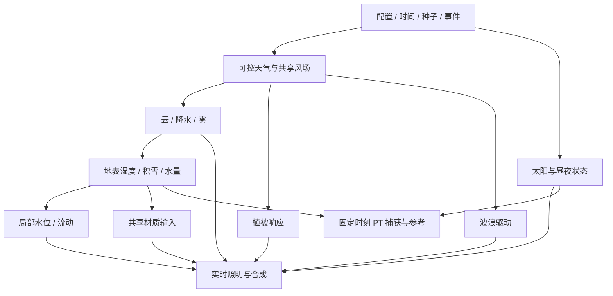

# 自然环境模拟应用：实时管线评估与计划

2026-10-09。**本文为整体路线，CPU 环境时钟／太阳主干已开始落地，其余按阶段推进。** 默认目标是 Metal／Vulkan 上可交互、可重复的自然环境视觉模拟应用，包含可检查的局部物理过程；气象预测、完整流域计算或科学级生态模拟需要另行定义数据、误差和验证范围。

目前已经能展示天空、云、地形、草、水面与水下。主要缺口是共享环境状态、跨系统联动与持续运行能力，以及在实际场景下达到交互预算。增加更多孤立效果难以解决这些问题。共享材质的细化路线见 [PT 与实时共享材质计划](shared-material-roadmap.md)，沿用现有 PT／实时整合基础，不替代 [PT 整合路线](path-tracing-improvement-plan.md)。

首个 E0–E2 闭环已细化为 [山湖天气实验室交付规格](mountain-lake-environment-spec.md)：当前代码接入点、权威状态与单位、事件／检查点、云与波谱连续更新、性能测量和 PT 捕获分级。L1 主干及 L2 共享风、累计云位移、草风和相位连续波谱已实施；连续云量、L3 空间地表湿度及 [L4 云影／空气雾／近似 P1 PT](weather-lighting.md) 已接入；风暴过渡、联合预算与完整 GPU 检查点仍待后续。

## 代码基础与差距

以下评估针对当前工作副本；旧专题文档中的边界可能已被后续实现扩展，优先参考当前代码和较新的验收记录。

| 系统 | 已有能力与证据 | 面向应用仍缺什么 |
| --- | --- | --- |
| 时间与运行时 | [FixedStepClock](../include/engine/FixedStepClock.h) 有固定逻辑步长、暂停／倍速、最大追赶步数；[运行时设计](engine-runtime-completion.md) 有不可变快照、资源事务、预算与回退 | 日历／地理时间、事件时间线、重放／检查点；逻辑丢时、渲染跳快照和 GPU 模拟追赶的统一策略 |
| 大气与太阳 | [GpuAtmosphere](../include/renderer/rhi/GpuAtmosphere.h) 有大气 LUT 和太阳透射；[FrameData](../include/renderer/rhi/ForwardPbrRenderer.h) 提供太阳高度／方位 | 日期、纬度与太阳联动；月亮／星空／夜间照明；地表到相机的空中透视与局部近地雾 |
| 云与天气 | [CloudSettings](../include/component/CloudSettings.h) 与 [体素云](immersive-voxel-clouds.md) 有程序化天气图、独立风速、风暴闪光及可穿越体积 | 连续晴雨与风暴联合验收、降雪、湿度／温度；现有 `weatherScale` 与云 `erosion` 是程序化外观参数，不能视为气象／地形侵蚀模拟 |
| 海洋与近岸 | [OceanSurface](../include/renderer/rhi/OceanSurface.h) 已有 FFT、真实镜像场景反射、折射、光束／焦散和水下散射；[近岸水体](water-coastal-features.md) 有局部浅水波、泡沫和湿沙 | 通用湖泊／河流／海洋连接、水位与流速、风变化响应、降雨汇流、潮汐、对象扰动；离开 patch 后局部湿沙等状态的持续保存 |
| 地形与地表 | [地形 VT](terrain-virtual-texture.md)、[ShorelineSettings](../include/component/ShorelineSettings.h) 与 [沙滩材质](beach-and-grass-density.md) 已有流式高度／材质、岸线混合 | 岩石／土壤／树皮等近景分层和持续湿度／积雪；坡度／高度／地貌驱动的生物群系；侵蚀和沉积需要独立模拟 |
| 植被 | [草地](vegetation-and-lake-water.md) 有 GPU 放置、过滤、风弯曲、根部附着与容量控制 | 树／灌木的专门 LOD 与区块流送；统一风场和阵风响应；薄叶背光、稳定 alpha 阴影；持久分布和物种配置 |
| 光照与外观 | 共享 GGX、CSM／PCSS、AO、天空与透明路径已有实现；RSM 仅保留默认关闭的 demo | 云倒影／天气 IBL 及所有系统的光照一致性；森林遮蔽与背光；有限预算内更稳定的间接光和反射；共享 coat／薄叶／粗糙漫反射 |
| 相机与显示 | [后处理](post-processing.md) 已有手动曝光、tone mapping、bloom、景深、运动模糊等 | 日夜／水上下切换的自动曝光与适应速度；可锁定曝光的对照模式；线性 HDR 数据与显示效果分别保存 |
| 交互与工程 | ImGui 参数面板、经典预设、画廊、诊断、加载与任务池已存在 | 场景级环境面板、时间线、保存／恢复模拟状态、地表探针、操作回放；持续运行的空间状态与质量预算 |

实时侧的通用近地雾／降水、共享气象状态和完整昼夜系统没有在当前审阅的原生路径中找到。这里指端到端能力缺口；天空散射、云体积和水下雾已有实现，后续不能重复叠加消光。

## 第一优先级：统一环境状态和时间

建议引入版本化的环境配置与运行状态，保持现有逻辑／设备线程边界。以下字段是设计提案，不是已存在的 API。

| 状态 | 最小内容 | 消费者 |
| --- | --- | --- |
| EnvironmentConfig | 场景种子、米制坐标、世界原点、地理位置、日期、质量档与边界条件 | 时间、天气、流体、渲染及场景保存 |
| EnvironmentTime | 双精度累计时间、tick ID、日历映射、暂停／倍速、事件序列 | 太阳、环境演化、FFT 相位、重放 |
| WeatherState／WindField | 基础风、阵风空间场、云量、降水率、温度／湿度的可控参数 | 云、草／树、水面、降水 |
| SurfaceState | 世界区块上的湿度、积雪、局部水量；每项有单位与 revision | 地形／物体材质、蒸发／融雪、PT 固定捕获 |
| WaterBodyState | 水体范围／连接、水位、近景高度与流速、泡沫／湿岸历史 | 近岸求解、水面渲染、交互查询 |

初期采用导演式天气预设与连续过渡，先实现单向因果链，不声称求解了空气温湿度动力学。湿度／温度在初期是外部驱动量；模型需要单位、有效范围和可视化，而不是直接塞进 FrameData 的无定义浮点数。

GPU 模拟状态继续归设备线程管理，逻辑侧发布目标时间／事件与配置。模拟推进和画面消费必须分别记录：跳过渲染快照不能静默丢掉雨量或水量。现有逻辑时钟达到追赶上限会计入 `droppedSeconds`；应用需要选择“交互慢模拟”或“严格离线追赶”，并在面板显示差值，不能同时宣称实时速度与完整守恒。

现有 [GpuShoreWater](../src/renderer/rhi/GpuShoreWater.cpp) 已按局部步长追赶目标时间，也会在时间倒退或跨度超过两秒时重启。它的步长界限针对当前近岸预设，不能直接扩展到任意洪水／溃坝工况。时间线 seek 必须恢复检查点并重演有状态过程；FFT 的解析时间求值不能替代浅水、湿度或生态状态重建。

## 第二优先级：自然光照、风雨和材质

**光照链**先补云对地形、植被与水面的阴影，再加入不透明表面的空中透视与局部地面雾。统一太阳辐照度和天气消光输入；主视图、水体反射／折射、透明物体和 PT 天空捕获使用同一状态。不同介质合成采用明确的视线路径与段次序，防止空气、云和水雾重复计入。夜景先做可控的太阳／天空过渡和曝光，再决定月亮／星空是否进入首版。

**共享风场**先统一云平移、草弯曲、降水倾斜和水体风向。L2 已统一基础风、草相位和累计云位移，FFT 在固定随机样本／相位上混合波谱；独立手动模式继续保留。海浪需要对驱动变化平滑响应：参数切换时保持相位／能量连续，并逐步改变波能，不能把频谱瞬间重新随机化。树林后续加入空间阵风和分级枝叶响应。

**降水与地表**首版采用有界粒子／屏幕表现配合空间降雨率，分别处理天空雨线、近景落水与物理入水量。湿度至少有降雨、渗入和干燥项；雨水进入地表与水体时计入同一收支，不能重复累加。雨线不承担水量模拟。先做湿土／湿岩，再加入浅积水的真实范围与水面；积雪／融雪延后到温度状态与保存机制稳定后。

**自然材质**优先粗糙漫反射、双面薄叶、岩石／土壤／树皮及干湿变化。coat 是水膜表达的基础之一，但不能把孔隙润湿、积水和雪都简化成 coat。叶片的透射、coverage mip、法线和阴影必须共同验收；只做更绿的 base color 不能解决逆光森林的外观。具体阶段和能量／PDF 要求见 [共享材质计划](shared-material-roadmap.md)。

**间接光**先用 PT 固定参考定位现有天空光与局部遮蔽的缺失和误差，再选择局部探针或其他有限预算方案；RSM 仅保留 demo，不再作为后续开发方向；动态天气和森林需要更新策略、遮蔽与泄光验证。实时 PT、硬件 RT 或 ReSTIR 都不是第一阶段的前置条件，不能靠简单抬高 ambient 掩盖光照与材质问题。

## 第三优先级：连续地形、植被和水系统

地形先完善多尺度材质、坡度／高度混合和 VT 正确过滤，再考虑动态高度更新。树／灌木建立专门的实例区块、稳定种子、近远 LOD／impostor、主视图与辅助捕获剔除；通用网格实例支持不等于森林资产系统。草地目前受容量和视距影响的随机保留集合不能作为永久生态状态。

水系统采用远景频谱波与近景局部浅水各负其责的设计，定义水体连接、波浪／水位边界、状态转移与收支。先交付湖岸／小河的局部流水、雨量与水位变化，再做潮汐和对象排水扰动。船只／漂浮物需要碰撞、浸没查询和外力耦合的额外契约；不要求首版实现完整三维流体或翻卷海浪。

世界区块离开相机后，湿度、水量、泡沫等需区分“可重建外观缓存”和“不可直接丢弃的模拟状态”。先建立固定范围的保存／恢复，再扩展滚动 patch 与流送。大范围场景还需检查坐标精度、原点移动、VT／植被／水场共同坐标及长时间 FFT 相位精度；现有大地形显示不代表已有无限世界。

侵蚀／沉积、季节生长、生态竞争和科学气候模拟放入远期。动态地形将影响 VT、植被根部、水深、碰撞、BLAS 和 PT 参考，成本明显高于增加一个 shader 参数，应独立立项。

## 实时性能与系统条件

先把自然场景做成可测量的联合负载。现有 [水体运行时测量](water-runtime-optimization.md) 在 Apple M4／720p 的同步整帧海床视角 p50 为 96.27 ms，抬头为 69.70 ms；这些是包含完成等待的特定场景延迟，不能当作任意编辑器 FPS。但它们说明完整水下路径已经需要优化，追加天气／森林不能忽略这部分预算。

| 工作 | 计划内容 | 判定方式 |
| --- | --- | --- |
| 预算与质量档 | 先选 30 Hz 展示档作为首个目标（33.3 ms），60 Hz 导航档为后续目标；固定设备、分辨率、场景与功能组合 | 热态 CPU／GPU p50／p95、输入到消费年龄、内存、读回和管线冷启动分别记录；当前尚未达标 |
| 图资源与调度 | 将 FFT、云、水体、焦散、历史资源完整表达于 RenderGraph；建立输出／副作用／持久状态声明后再裁剪死 pass | 有依赖证据，关闭功能确实减少工作且不破坏模拟／历史 |
| 更新频率 | 按变化率和屏幕贡献更新 LUT、阴影、捕获、云和反射；状态推进与渲染刷新分开 | 固定条件误差及运动序列；天气过渡和相机跨水面不留下旧状态 |
| 质量控制 | 基于耗时和内存预算调整降采样、步数、捕获频率、可见距离；使用滞回，显示当前档 | 质量变化平滑且可锁定；不偷偷改变降雨量／物理时间步长 |
| 数据规模 | 复用已有 JobSystem／IO，批处理可见性、资产准备与上传；森林／多水体共享资产 | 队列有界、可取消、版本发布正确；不要在 GPU 长片元链上盲目增加录制线程 |
| 长期运行 | 时间精度、区块状态、资源退役、重放恢复、错误回退 | 定长运行／重复加载／往返区块，内存无持续增长，状态与已提交画面一致 |

33.3 ms 是计划目标，不是已测成果。E0 先取得联合场景的实际瓶颈，再冻结每个系统的 GPU、CPU、内存和状态精度预算。async compute／并行 command recording 仅在测到可重叠窗口或 CPU 录制瓶颈后考虑。

## 分阶段交付与验收场景

| 阶段 | 交付范围 | 验收与依赖 |
| --- | --- | --- |
| E0：应用基线 | 统一配置／状态／单位设计、现有状态捕获清单、三场景预算与缺口报告；共享材质 R0 | 固定时间／种子可复现；分别报告加载、编译、热帧与状态差异；不把截图画廊当交互性能 |
| E1：时间与联动 | 环境时钟／天气过渡、共享风场、太阳联动、暂停／单步和状态保存最小闭环 | 同种子事件重放；暂停稳定；更换渲染帧率不改变约定的模拟收支；旧预设保持可运行 |
| E2：风雨下的山湖 | 地面云影／空中透视／近地雾、基础降雨与地表湿度、共享材质 R1／R2；已有水体关键路径优化 | **Mountain Lake：清晨 → 阴雨 → 放晴**；湿度与干燥可观察；阴影、反射与材质状态一致；曝光可锁定，达到选定质量档预算 |
| E3：植被和局部水文 | 树／灌木区块与薄叶；局部流水／水位、岸线状态持续化 | **森林：顺光／逆光／阵风／干湿**；**近岸：涨落水位＋空气／水下往返**；守恒测试区分封闭和受迫边界 |
| E4：完整应用工作流 | 场景／天气预设、时间线／检查点、区域探针、保存恢复、长期运行、RT／PT 对照导出 | 用户能从启动到编辑、回放、保存与导出完成一条流程；状态版本错误明确提示；双后端一致性与预算报告 |
| E5：按需求扩展 | 夜空、雪冰／融雪、潮汐／船体扰动、更大世界、侵蚀／生态或科学校准 | 每项先定义数据／单位／性能与参考，不阻塞 E1–E4 |

E2 的优化可与自然效果交替交付，性能不达标时先缩减效果组合再扩展场景。森林是后续新增场景，需要资源来源与许可；山湖和近岸优先复用已有资产。

## PT 的角色与应用边界

PT 保留三种用途：固定时间的材质／照明参考、最终离线出图、特定通道的混合验证。捕获协议需列出太阳、天空／云、水面、植被形变、地表状态和材质版本的支持范围。未导出的动态浅水或天气状态明确报告，不能只因已有 FFT 捕获就宣称整个环境状态已对齐。

验收分开测材质差异、光照近似、状态捕获缺失和采样噪声；自动曝光关闭的线性 HDR 作为数值入口，显示图作为体验入口。只在参考确认存在缺光后选择改进实时光传输方案，避免同时改材质、ambient 和曝光导致无法归因。

建议首个产品闭环是“**山湖天气实验室**”：一个场景中连续控制时间、风、云和雨，观察草、湖面与地面如何响应，能暂停、恢复并导出 PT 参考。完成这个闭环后扩展森林与海岸，优先级高于一次性加入所有自然现象。

实施状态：E0 已采集首轮静态山湖基线，预算未冻结；E1 已完成 CPU 时钟／太阳及共享风联动，连续云量已接入，风暴过渡与联合预算仍待验收；E2–E5 仍为计划。科学级模拟与交互视觉应用的范围需要在进入对应扩展前分别确认。
