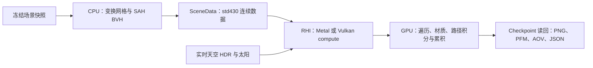

# CPU 采样优化与 Metal/Vulkan GPU Path Tracing

2026-10-10：Metal PT 已接入原生 BLAS／TLAS 和 intersection query，离线与渐进视口自动按能力选择；Vulkan 继续软件 BVH。详见 [P3-A](#metal-原生-rtp3-a2026-10-10)。

本轮实现 scrambled Sobol、GGX VNDF、自适应采样，并增加 `--path-trace-gpu`。GPU 执行射线生成、BVH 遍历、材质求值、NEE/MIS、多次反弹、Russian roulette 和逐像素累积；天空继续复用实时大气生成的 HDR。CPU 与 GPU 使用同一冻结场景和基础 PBR 定义。

## 使用

沿用项目的 Metal/Vulkan CMake 构建。大型模型先运行 `python3 tools/fetch_gi_assets.py`。

```sh
# CPU 默认 Sobol + VNDF + 自适应采样。
./build/Scene-Renderer --path-trace sponza --pt-size 640x480 --pt-samples 256 --pt-bounces 16

# 原生 Metal 构建：GPU tracing，首次同时烘焙实时天空。
./build/Scene-Renderer --path-trace-gpu sponza --pt-size 640x480 --pt-samples 256 --pt-bounces 16 --pt-exposure 3 --pt-output build/path-tracing/gpu/sponza
./build/Scene-Renderer --path-trace-gpu san-miguel --pt-size 640x480 --pt-samples 256 --pt-bounces 16 --pt-exposure 3 --pt-output build/path-tracing/gpu/san-miguel

# 已保存的天空及太阳 sidecar 可直接复用；GPU tracing 仍需设备。
./build/Scene-Renderer --path-trace-gpu sponza --pt-environment build/path-tracing/sponza-environment.hdr --pt-size 320x240 --pt-samples 256 --pt-fixed

# Vulkan 主后端的构建使用同一入口。
./build/vulkan/Scene-Renderer --path-trace-gpu sponza --pt-size 320x240 --pt-samples 256 --pt-fixed

# CPU PCG 固定 spp 对照；Metal/Vulkan GPU 使用 Sobol。
./build/Scene-Renderer --path-trace sponza --pt-sampler pcg --pt-fixed --pt-size 320x240 --pt-samples 256
ctest --test-dir build -R '^pt-' --output-on-failure
```

双后端构建可加 `--backend Vulkan`。默认输出前缀与 CPU 共用 `build/path-tracing/<scene>`，做对照时显式使用不同的 `--pt-output`。原生线程编辑器的 `R` 键已接入下面的 GPU 视口；OpenGL／`--single-thread` 保留 CPU 静态入口。

Sponza／Cornell 可加 `--pt-compare-ddgi --pt-fixed --pt-ddgi-frames 960`，从同一冻结场景捕获 DDGI 开关线性 HDR，并生成独立的余弦半球 PT 辐照度查询。比较图、误差定义、Metal 实测和限制见 [DDGI 路径追踪参考对照](ddgi.md#sponza-路径追踪参考对照)。该离线模式关闭 Raster AO／TAA／RSM，保留直接光阴影，不支持自定义 package／HDR、clouds 或有偏估计器。

## 渐进 GPU 视口（2026-10-07）

原生 Metal／Vulkan 线程编辑器支持固定快照的 PT 预览：

```sh
./build/pt/Scene-Renderer --classic cornell --pt-viewport --size 640x480
# Vulkan 主后端构建使用同一参数。
./build/pt-vulkan/Scene-Renderer --classic cornell --pt-viewport --size 640x480
```

也可在已有编辑器中按 `R`，或打开 **Path tracing viewport** 面板点击 **Capture GPU PT**。面板提供采样目标、深度、暂停／续采、重新捕获、取消和状态；目标／深度的调整在下次捕获生效。默认半分辨率、256 spp、深度 8、每个提交帧最多 1 spp，关闭自适应、guiding／cache 和 photon mapping。构建启用 OIDN 时默认打开 CPU worker 降噪预览；面板可切回原始累积，并导出线性检查点。

- 捕获相机、模拟时刻、几何、材质与灯光；FFT 水面和天空使用现有 GPU 捕获。CPU 场景构建、GPU 场景导出、HDR/CDF 打包与可选光子图发射在 worker 执行；GPU 侧按帧准备，完成前继续显示 Raster。
- 采样和显示由 RenderRuntime 的 GPU 所有者线程执行。线性 pixel buffer 持续保存；`pt-display.comp` 直接生成 RGBA8 显示纹理，除有限的降噪检查点和显式导出外，常规视口帧不读回 film。
- 调整曝光只重做显示；窗口 resize 保留采样和冻结相机比例，用黑边适配新窗口。暂停不清空 film，恢复沿原样本索引续采；到达目标后保留最终图。
- 模拟时钟在 PT 模式期间冻结。移动／转动相机或改变视角时显示 Raster，停止约 250 ms 后自动清空 film 并从 0 spp 重启；保留暂停状态。几何、变换、材质、光源或程序化时间变化也会自动使累积失效。曝光、Raster AO 等显示设置不重算 PT。
- 重新捕获／取消会标记旧请求；异步 CPU 准备结果只在请求仍有效时上传。错误显示在面板中并恢复 Raster；取消可清除错误状态。

程序化捕获、管线创建、内存分配和可选 guiding 训练仍可能占用渲染线程。精确比较和 GPU 上传已分块调度；CPU／光子准备在阶段边界检查取消，已提交 GPU 批次不能中途打断。视口支持独立 OIDN 显示和线性导出，动态 Hybrid 仍待后续阶段。检查点读回由设备所有者线程执行并可能等待 GPU，尚未提供异步 staging／零拷贝 interop。完整离线 CLI 仍支持文件导出与现有降噪配置。`--pt-viewport` 仅用于原生线程编辑器，OpenGL／单线程配置会明确拒绝该启动参数。

### 增量场景复用（2026-10-07）

`RenderRuntime` 持有两个独立缓存：CPU `GeometryCache` 按不可变 mesh 身份和 revision 复用 BLAS；GPU `GpuSceneCache` 按缓冲语义保存最近一份精确字节内容。GPU 在共享不可变打包对象仍存活且数组地址相同时确认身份命中，其他内容使用大小与完整字节比较；每个 session 独立持有资源 lease，替换／LRU 淘汰不会影响仍在使用的会话。

| 更新 | 当前处理 |
| --- | --- |
| 仅相机，场景／估计器配置一致 | 复用 CPU scene、GPU 缓冲、训练表与静态光子图；更新投影／位置，重新判断初始介质与 winding，只重置 film |
| 实例变换 | CPU 复用 BLAS 和未变实例矩阵／边界；拓扑一致时 refit TLAS，质量恶化或更新次数达到上限则 SAH 重建；更新世界空间 emitter 和相机介质。GPU 只上传变化缓冲 |
| 材质／纹理／灯光 | CPU 保留未变 TLAS、实例矩阵／边界、发光体分布和薄玻璃方向表；按发光 RGB／透明度／介质成员变化使派生数据失效。GPU 比较对应缓冲，保留未变数据 |
| 地形／FFT 参数或捕获时刻 | 重新捕获程序化几何；之后按新数据失效 CPU／GPU 缓存 |
| 天空观察高度变化 | 重新烘焙天空；几何与未变化的 GPU 缓冲仍可复用 |

[SceneIdentity](../include/PT/SceneIdentity.h) 对参与 PT 的参数逐项生成精确 token，排除快照发布序号、相机投影、曝光和纯 Raster 开关；天空 token 包含烘焙时使用的观察高度。payload 必须遵守不可变快照约定，修改源数据需发布新的 payload／revision。自动更新复用同一时刻已捕获的地形、草和 FFT 水面；显式 `R` 强制重新捕获。草仍是捕获时视锥与预算内的固定子集，移动不会自动补齐整个世界的草。

CPU 缓存默认保留最多 **128 MiB** 网格／BLAS 数组；GPU 缓存最多保留 **256 MiB** 缓冲数据，并保留等量 CPU 字节用于精确比较。预算约束缓存持有的数据，超预算条目可仅由当前 session 持有。活动 scene、film、导出 staging、在途退役资源和一份程序化捕获另占内存；这里没有承诺整个进程峰值为 128／256 MiB。显式退出 PT 会释放 session，缓存保留到 RenderRuntime 结束。

面板显示最近一次准备的 scene 上传缓冲数／命中／字节，以及两个缓存的保留量；离线 JSON 增加 `scene_buffers`，CPU `acceleration` 增加 `blas_builds`／`blas_cache_hits`。上传统计仅包含不可变 scene storage buffer，不含小参数、film、训练表或显示资源。测试 fixture 冷准备上传 14 块，重复准备 0 块，材质／灯光标量修改各 1 块，单实例变换 2 块，相机更新 0 块；这些是正确性计数，不能推断大场景帧率。

`CpuScene` 构造可接收只读 previous scene；RenderRuntime 在 CPU worker 中保持该 scene 生命周期，禁止同时修改它。若 BLAS 已被保留缓存淘汰，但 previous scene 仍持有有效 lease，也可继续复用；报告用 `blas_scene_reuses` 区别于普通 `blas_cache_hits`。TLAS 当前复制已有数组后 refit／复用，派生表复用仍有数组复制成本；没有将所有构造工作写成零开销。

refit 自底向上更新叶／内节点边界，保留节点结构与 instance order。以归一化面积成本为质量代理：成本超过上次 SAH 构建的 1.5 倍，或此前已连续 refit 32 次，重新构建。拓扑、instance order 或 geometry 身份变化直接 SAH 重建。CPU／GPU 最近命中的等距离情况按最小 primitive ID 决定；opaque any-hit 保留提前退出。

JSON 增加 TLAS build／refit／reuse、质量回退、refit age／cost，实例矩阵／边界与派生表复用计数；时间区分 `tlas_prepare_seconds`、`tlas_build_seconds`、`tlas_refit_seconds`。面板显示当前更新的 TLAS build／refit／reuse。20,000 实例的合成回归检查：材质更新复用全部实例矩阵／边界，只移动一个实例时复用另外 19,999 个，并对照全量构建命中；这不替代完整 Barcelona 的交互基准。

首次原生 megakernel 管线准备在编译负载下可能超过旧视口自检的 15 s 期限；自检改用 60 s 请求期限、150 s 整体期限，检测卡住的请求。该测试期限不是帧时间承诺：GPU 所有者线程仍可能因首次管线编译停顿；P2-C 已将它拆成独立准备调用并计时，尚未把驱动编译异步化。

P2-E1 已将 GPU TLAS／BLAS 拆为独立缓冲与地址空间；CPU refit 后只更新 TLAS／instances，保留静态 BLAS。P2-E3 已支持稀疏区间上传；P2-E2 已共享未变化的 CPU 几何／贴图打包结果，导出每次更新的实例／材质／TLAS，相机更新跳过导出。完整 Barcelona 的准备 API 测量已完成；E4 已增加 Runtime 连续操作探针，GUI 交互达标仍待后续验收。分阶段顺序见 [P2 子阶段](path-tracing-improvement-plan.md#近期三个可交付迭代)。

### 分帧 GPU 准备（P2-C）

视口使用 deferred session：先保留 worker 的 `shared_ptr<const GpuSceneUpload>`，依次推进管线创建、缓冲准备、binding 发布，再开始采样。每个 RenderRuntime 帧调用一次 `prepareStep()`，默认 **4 MiB 工作字节／4 ms 协作时间预算**，单个比较／写入块最多 **256 KiB**。GPU clone 最多 4 MiB／块，仍受剩余工作预算限制。工作字节包含缓存的精确比较、GPU clone 与对应 CPU 镜像复制、实际主机上传，以及参数、film、guiding／training 表的初始写入；预算向下对齐到 4 字节。共享不可变块可通过存活的 weak owner／数组地址确认身份命中；身份不同或过期时分块比较全部字节。身份命中不计作比较／传输工作字节，逻辑完成量仍包括这些缓冲，另记 `identityCacheHits`／`identityCacheBytes`。管线创建单独占一次调用，binding 发布在所有字节完成后的下一次调用执行。

`ready()` 为 false 时 `step()` 不提交采样，`readback()`／`display()`／film reset 明确拒绝调用。状态显示 **Uploading** 与完成字节／总字节／调用次数，准备期间继续 Raster；只有当前请求仍有效且 session ready 才显示 PT。缓存 miss 使用独立、未发布的 buffer 和 CPU 字节镜像；整次准备结束后才替换语义槽，中途取消会释放 pending 资源和 worker payload，保留旧缓存与活动 lease。完成后释放导出 payload，静态光子图由 session 单独持有。

字节预算限制比较与写入的工作量；**4 ms 不是整个准备帧的严格上限**。RHI 的管线创建、单个缓冲／staging 分配与写入、binding 创建和可选 guiding 训练都是不可分操作。host film／训练数组初始化、程序化捕获也仍有同步成本；相机复用时的 film reset 仍一次分配和初始化。默认视口关闭 guiding／cache。E4 已增加 opt-in trace／display 启动预热；驱动异步编译与训练的进一步拆分尚未完成。

`preparationStatistics()` 分别记录管线、分配、缓存比较、上传与 binding 完成时间，以及每次调用的传输字节／工作字节。离线 JSON 新增 `gpu_preparation`：其传输量包含 film／训练初始化；原来的 `scene_buffers` 只计 14 类不可变场景缓冲。时间是 CPU 墙钟；写入可能含 GPU 等待，没有把它当作硬件时间戳。`setupSeconds` 只累计准备调用时间，排除帧间空闲与独立报告的 guiding 训练时间。

```cpp
auto payload = std::make_shared<const pt::GpuSceneUpload>(
    pt::prepareGpuScene(scene, &options)); // 可在 CPU worker 执行
pt::GpuRenderSession session(scene, options, device, cache, payload);
payload.reset(); // session 保持 source 生命周期
// device owner thread，每帧一次：
if (!session.ready()) session.prepareStep(4 * 1024 * 1024, .004);
if (session.ready()) session.step();
// 取消准备：session.cancel(); 随后在 owner thread 销毁。
```

payload 必须来自同一冻结 scene／options；需 photon mapping 时必须在 worker 导出时传入 options。同步的旧指针构造与 `renderGpu()` 仍保留，离线和逐帧共享相同上传／缓存实现。此阶段没有声称大场景吞吐或全程交互延迟已经达标，完整 Barcelona／FFT 测量归入 P2-E。

### 视口降噪与线性输出（P2-D）

**OIDN preview** 控制显示，切换它不清空采样。降噪检查点从 16 spp 开始，随后为 64、256、1024 等；到达目标或暂停时也可捕获当前样本，但相同 sample index 不重复自动读回。关闭预览时停止新的自动读回；已启动的 worker 可完成，原始显示不使用其结果。曝光和窗口显示尺寸变化只重做 tone mapping，原始 film 与冻结相机比例保留。

每个 RenderRuntime 持有一个专用 CPU worker，最多一份在处理／等待回收的图；忙碌时跳过自动检查点，不排队保存多份 full film。worker 在线性 HDR 上调用持久 `DenoiserContext`，同尺寸／辅助图配置复用 OIDN 设备、image buffers 与三个 RT filters；resize／辅助配置变化替换 filters／buffers，保持同一 CPU device。所有创建、执行、销毁都在 worker 线程，跨线程执行会拒绝。离线 `denoise()` 仍是一次性便捷入口，CLI 的 auto／cpu／metal 选择保留。

原始 radiance、albedo、normal 与 sample/ray 计数不被 OIDN 修改。结果以独立 Float4 storage buffer 分块上传，默认 4 MiB／4 ms 协作预算、单块最多 256 KiB；全部上传后才发布，期间保留上一份已完成的预览。面板显示的是已降噪快照的 spp，它可能落后于正在积累的原始 film。camera／scene／film reset 同时清除 pending 和已发布降噪显示；结果必须匹配当前 request identity 和 epoch，旧请求的结果丢弃。display binding 在旧 film／派生 buffer 之前退役。

**Export linear checkpoint** 请求当前 epoch 的图像；worker 空闲时由 GPU owner 捕获原始 film，之后文件任务保存这份固定快照。捕获前切换／取消会拒绝导出；捕获后的显式导出会完成，后来移动相机不会把文件改成新场景。pending ticket 会跨 skipped frames 重试，并只受理一次；文件写入错误通过 future 返回 UI。渲染器关闭时等待已捕获的任务结束。

默认保存到 `build/path-tracing/viewport/epoch-<id>-<timestamp>`：原始 `.pfm/.png`、albedo／signed world normal／sample PNG 与 AOV PFM；启用 OIDN 时另存 `-denoised.pfm/.png`，有 caustics 时保留原始 caustics AOV。JSON 记录捕获 epoch、实际 samples、seed、深度、冻结时刻、相机位置、采样／读回和 OIDN 信息。线性 PFM 不受显示曝光影响，PNG 使用捕获时的曝光。导出不保存可重载的完整场景包。

状态报告增加读回次数／字节／等待时间、当前降噪 spp、最近一次 OIDN wall time、display upload 时间／字节和 context 设备／filter 构建计数。context `bufferBytes` 只计输入／输出 Float3 image buffers，不包括网络权重、内部 scratch 和 CPU image 容量；不能据此当作进程峰值。同步 readback、host Float4 打包、单个 GPU buffer／staging 分配仍可能造成检查点停顿，OIDN execute 只能在阶段边界检查取消。该实现是空间降噪，不提供时域稳定性保证；算法能量与收敛仍比较 raw PFM。完整场景的端到端延迟与峰值属于 P2-E。

P2-D 回归：Metal 相关 10/10、Vulkan 主程序 1/1，独立 package 的两后端显示／raw transport 自检和 OIDN OFF 两项单测通过。实际 Cornell 640×480 编辑器跑 180 提交帧，320×240 film 上完成两次 CPU OIDN 并检查显示截图；首个检查点包含初始化，未作为端到端加速比。完整验收项见 [测试记录](../tests/README.md)。

### 独立 BLAS／TLAS 与完整 Barcelona 测量（P2-E1）

GPU 导出现在有独立的 `tlasNodes` 与 `blasNodes`；TLAS 子节点与 instance 的 BLAS root 分别使用各自缓冲的地址空间。实例变换不会改变 BLAS root。两者都有独立 cache lease，未完成／取消的准备仍不发布缓存；材质／光源更新和旧 session 的 lease 保留规则沿用现有实现。GPU scene 统计由 13 增为 **14** 类缓冲。Metal 的 storage binding 上限改为现有三组八槽布局可用的 24，未扩大 group／binding ABI；Vulkan 继续使用设备实际报告的上限。

本机 Apple M4 使用完整 Barcelona revision 5 包：**21,129 个有效实例、110 个唯一几何、全部 20,622 个植被粒子**。固定 seed 1、32×18、4 spp、8 bounces 检查准备操作后的 raw film；这是完整资产的低分辨率正确性探针。原始记录及资产 hash 见 [测量 JSON](benchmarks/pt-scene-preparation-2026-10-07.json)。

| 准备阶段 | Metal | Vulkan／MoltenVK |
| --- | ---: | ---: |
| GPU 冷准备 API 墙钟 | 31.3 ms | 64.1 ms |
| GPU 重复准备，3 次中位数 | 8.69 ms | 10.47 ms |
| 移动一个非发光实例的 GPU 准备 | 8.00 ms | 9.10 ms |
| 单实例变换 scene 上传量 | 3.45 MiB | 3.45 MiB |
| 重复准备 scene 上传量／命中 | 0／14 | 0／14 |
| 重复准备的 CPU scene 墙钟，中位数 | 388 ms | 363 ms |
| 重复准备的 CPU 全量导出，中位数 | 67.9 ms | 63.7 ms |

变换只上传 **235,552 B TLAS + 3,380,640 B instances**，保留 3,054,336 B BLAS；相对原先合并节点的布局，变化 scene 上传量减少 **45.8%**。这是上传字节收益，未当作整体加速比。材质编辑仍整块上传 3.87 MiB materials；尚未局部 patch。重复准备 raw film 与冷准备逐值相同，移动后的 refit 与 fresh rebuild 逐值相同，Metal／Vulkan 的 cold／transform PFM 也逐值相同。

每次 prepare 工作量不超过 4 MiB；冷准备最长单次调用为 Metal 5.51 ms、Vulkan 14.08 ms，仍不能保证 4 ms 帧上限。此处“冷”仅指新 device／scene cache，driver／磁盘管线缓存状态未控制。进程累计 peak RSS 到 material 阶段分别为 680／803 MiB，包含保留的 CPU scene、fresh-rebuild 校验和 driver，不能作为编辑器峰值。另一次 Metal 编辑器首次请求在 Preparing 阶段超过 60 s 自检期限；缓存热启动通过，冷准备／Raster 管线停顿仍需后续定位与预热，不能据此宣称端到端交互达标。

复现时先构建 `pt-package-render`，两后端分别运行：

```bash
build/pt/pt-package-render --backend Metal \
  --scene build/path-tracing/appearance/barcelona-full/scene.json \
  --output build/path-tracing/p2e/barcelona-metal \
  --size 32x18 --samples 4 --bounces 8 --benchmark-preparation
build/pt-vulkan/pt-package-render --backend Vulkan \
  --scene build/path-tracing/appearance/barcelona-full/scene.json \
  --output build/path-tracing/p2e/barcelona-vulkan \
  --size 32x18 --samples 4 --bounces 8 --benchmark-preparation
```

工具依次执行 cold、3 次 hot、transform、material，输出 `.preparation.json` 和 cold／transform 的 raw PNG／PFM；检查字节预算、变换／材质的上传数与 refit／rebuild 一致性。未测 editor loop、OIDN 或 photon rebuild。P2-E2 已减少 CPU 打包与重复场景准备；E3 已实现局部更新，后续补齐完整 Barcelona／冻结 FFT 的持续操作、相机切换和 UI 延迟测量，P2-E 尚未全部完成。

### 共享 CPU 打包与 GPU 身份缓存（P2-E2）

`SceneData.geometry`／`textures` 是共享的只读 `PackedGeometry`／`PackedTextures`。CPU scene 首次导出按精确大小预留并打包顶点、BLAS、三角形和 texels；相邻快照的有序几何 lease 未变化时共享 geometry，有序 image owner 未变化时共享 textures。实例／材质／TLAS 仍按当前快照导出。增加既有网格的实例可保留 packed geometry；新增／替换／重排唯一几何重新打包，新图像或图像顺序变化重新分配 descriptor／texel 索引。发布由 export mutex 保护，并发导出只创建一份静态块；旧块不修改，显式导出 lease 可在 CPU scene／BLAS cache 销毁后继续使用。源 mesh／image 必须遵守已有的不可变快照约定。

CPU 阴影分类将同一 albedo image 的 alpha 扫描去重，保留每实例的 alpha／cutout／thin 分类。完整 Barcelona 一次 scene 准备扫描 **81 张图像、4,849,671 个 alpha texel**；不再为 21,129 个实例重复扫描共享图像。新 alpha 图像单独扫描，旧摘要不改。

GPU cache 保留精确 CPU 字节镜像，并记录不可变块的 weak identity 和数组地址。同一 owner 仍存活、地址与大小一致时可直接确认；不同 owner 或过期时依旧逐块 memcmp，全量相等后再更新身份。弱引用不额外保留旧 CPU 导出；身份信息只在整次准备完成时发布，取消不替换 pending 身份／缓冲。每次 hot 命中 **5 个数组、101,079,696 B（96.40 MiB）**，这些逻辑字节记为完成量，无需计入实际比较工作量。`gpu_preparation.immutable_identity_hits/bytes` 和 `scene_buffers.geometry_export_reused/texture_export_reused` 记录两层复用；alpha 扫描量在 CPU `acceleration` 中记录。

同一完整资产、seed、分辨率和样本设置，与 [E1](benchmarks/pt-scene-preparation-2026-10-07.json) 对照，3 次 hot 的阶段中位数如下。新记录与全部原始图一致性结果见 [E2 JSON](benchmarks/pt-packed-export-2026-10-07.json)。

| 热准备阶段 | Metal：E1 → E2 | Vulkan／MoltenVK：E1 → E2 |
| --- | ---: | ---: |
| CPU scene | 388 → 8.97 ms | 363 → 7.53 ms |
| CPU export | 67.9 → 1.72 ms | 63.7 → 1.91 ms |
| GPU preparation API | 8.69 → 2.35 ms | 10.47 → 1.77 ms |

冷准备 CPU scene／export 分别为 Metal 79.0／33.8 ms、Vulkan 78.4／26.6 ms；静态块首次仍需构造。GPU cold API 为 62.7／82.1 ms，磁盘／driver cache 未控制，未宣称冷 GPU 加速。hot scene 上传量仍为零，transform 3.45 MiB、material 3.87 MiB；每次比较／写入工作量仍 ≤4 MiB。两后端 cold／transform PFM 与 E1 及另一后端逐值相同，refit／fresh rebuild 仍逐值相同。

这是一进程三次 hot 的准备阶段观察，不是整条渲染加速比，也不包含视口帧间等待。导出静态块由活动 CPU scene／在途 export lease 持有，独立于 128 MiB BLAS 保留预算；相邻场景共享相同块，GPU 身份缓存不额外持有它。累计 process peak RSS 到 material 校验为 Metal 669 MiB、Vulkan 745 MiB，包括 fresh-rebuild 校验与保留的 CPU 打包数据，不能当作编辑器峰值。E3 已支持局部 material／instance patch，见下；完整实景交互延迟、完整 FFT 连续时刻与冷管线预热仍在 P2-E 后续阶段。

复用 E1 的 `--benchmark-preparation` 命令，将输出目录改为 `build/path-tracing/p2e2/`。CPU 回归覆盖 source／order 失效、并发发布和旧 export lease；GPU 回归覆盖 weak owner 过期、精确回退与身份提升、纹理／几何更新和原始 film；编辑器沿用 FFT、camera-only、取消／降噪／线性输出回归。

### 稀疏区间上传（P2-E3）

同尺寸缓存内容变化时，先精确比较并收集 4 字节对齐的连续区间。变化字节不超过 buffer 的 25%、区间不超过 128 个时，为新会话分配独立 buffer，在 GPU 上复制旧 buffer，再从主机上传变化区间。尺寸变化、密集变化或过多零碎区间回退全量上传；FFT 大范围更新不强制走 patch。旧 lease 保持不可变，完整准备及 binding 成功后才发布新缓存，复制／patch 中途取消不影响旧会话。

GPU clone 连同 CPU 镜像复制计入工作字节，最多 4 MiB／块且不超过调用剩余预算；比较与 host write 仍最多 256 KiB／块。Metal 使用 blit，Vulkan 使用带前后 memory barrier 的 buffer copy；Vulkan 离线调用等待复制完成，帧内调用通过正常完成令牌延后释放。OpenGL 实现使用已有 buffer copy API，本阶段原生 PT 验收以 Metal／Vulkan 为主。

完整 Barcelona 的单实例移动上传 **24 B（6 个区间）**，材质标量修改上传 **4 B（1 个区间）**；E2 对应为 3,616,192 B、4,056,768 B。这是 **主机上传量** 的减少。新旧 GPU buffer 与 CPU 镜像仍需并存，GPU 复制量分别为 3.45／3.87 MiB，精确比较也保留；不能把字节比例当作准备时间、GPU 总访存或渲染加速比。`gpu_preparation.gpu_cloned_bytes/gpu_clone_seconds`、`patch_bytes/patch_buffers/patch_ranges` 分开记录复制与稀疏写入；`scene_buffers.upload_bytes` 和 `transferred_bytes_including_film` 继续只统计主机写入。

最终测量保存在 [E3 JSON](benchmarks/pt-sparse-upload-2026-10-08.json)，同一 scene SHA-256 与 E2 对照：Metal transform／material API 为 2.29／2.12 ms，Vulkan／MoltenVK 为 9.14／4.90 ms；E2 为 Metal 2.78／2.59 ms、Vulkan 3.12／2.45 ms。离线 Vulkan 有新增复制等待，本次耗时增加，尚未宣称整体准备加速。到 material 操作的累计 RSS 为 Metal 680 MiB、Vulkan 829 MiB，仍包含 fresh-rebuild 校验；不是编辑器峰值。两后端 cold／transform 与 E2 的 PFM 完全一致，material 跨后端及 patch／full-upload 原始 film 也一致。

复现命令沿用 `--benchmark-preparation`，输出目录改为 `build/path-tracing/p2e3/`；新增材质 patch／full-upload 原始 film 校验和 material PFM。回归覆盖 64 个分散材质标量、严格字节预算、离线与帧内复制／patch 中途取消、旧会话继续采样、密集变化及尺寸变化回退。完整实景编辑器响应与峰值、FFT 连续时刻、水上／水下持续切换和冷管线预热仍是后续验收。

### 预热与完整 Runtime 连续操作（P2-E4）

`--pt-viewport` 启动时在 GPU 所有者线程预热 trace／display 的实际 compute descriptor，并在 Runtime 生命周期保留 pipeline lease。普通 Raster 启动不预热 PT。预热将首次编译移到启动阶段，保持 descriptor／ABI 与实际会话一致；活动 lease 不受 idle-cache 淘汰影响。原生驱动编译仍不可分，启动墙钟与 driver／磁盘缓存状态分开报告，不能保证真正冷编译的时限。

Runtime 现在记录请求接受、固定时间捕获、CPU scene／export、ready／首个 sample 的端到端延迟，以及每帧准备的最大时间和工作字节。多个 `prepareStep()` 共用一帧的 4 MiB／4 ms 协作预算，管线命中、身份检查和发布无需各等待一个 Raster 帧。单个驱动操作仍可能超时。已取消的排队 PT 包直接丢弃；未捕获的旧导出 ticket 收到异常，已捕获的文件任务仍可完成。

冻结的 `PathTracingViewportLighting` 支持导入 HDR／太阳，owner 替换使 camera-only reuse 失效；同一 owner 按不可变数据使用。另修复导入包 mesh／material 的零资源 ID：每个唯一 payload 获得独立 runtime ID，同包实例共享 owner，重新导入获得新身份。这避免 Raster 缓存把完整 Barcelona 的资源反复替换到同一个槽。

新增实际 `RenderRuntime` 探针，走异步 Raster streaming、PT 准备、导航、camera-only、材质／变换或 FFT 时间变化、部分准备取消与恢复、显式线性导出。Barcelona 使用 E1–E3 的完整资产；FFT 为 512 主谱／256 细节谱、129 网格，连续 t=2／3／4 与水下相机。每种变化对照 fresh capture／CPU scene／full upload，恢复初始世界后 raw film 与初始图完全一致。

```sh
MTL_DEBUG_LAYER=0 MTL_SHADER_VALIDATION=0 build/pt/Scene-Renderer \
  --pt-viewport-benchmark --scene build/path-tracing/appearance/barcelona-full/scene.json \
  --output build/path-tracing/p2e4/barcelona-metal --cycles 3
MTL_DEBUG_LAYER=0 MTL_SHADER_VALIDATION=0 build/pt-vulkan/Scene-Renderer \
  --pt-viewport-benchmark --backend Vulkan --fixture fft \
  --output build/path-tracing/p2e4/fft-vulkan --cycles 3
```

探针使用隐藏 64×64 surface、32×18 film、4 spp／8 bounces，关闭 Raster effects 和降噪，5 ms 轮询。真实 framebuffer 尺寸通过 `notifySurfaceExtent()` 传入，避免 Vulkan 每帧重建 swapchain。输出 `.viewport.json` 记录阶段、host upload／GPU clone、进程累计 RSS、tracked GPU／native peak、producer 调用与渲染推进间隔。累计 RSS 包含保留的参考 snapshot，验收后 fresh reference 的 RSS 单独报告；这些不是 GUI 输入到屏幕响应、高分辨率收敛或纯编辑器常驻内存测量。package HDR／sun 只用于 PT，未作为 Raster／PT 外观对齐测试。

本机 M4 的三轮操作中位数如下；单位 ms，为请求创建到 ready 的端到端时间，包含排队和 Raster 帧等待。两后端各一进程，主机负载与磁盘管线缓存未控制，不作为吞吐加速比。

| 操作 | Metal | Vulkan／MoltenVK |
|---|---:|---:|
| Barcelona hot recapture | 1,026 | 8,923 |
| Barcelona camera-only | 262 | 2,323 |
| Barcelona material | 1,263 | 12,314 |
| Barcelona transform | 1,251 | 10,146 |
| FFT 时间切换 t=2／3／4 | 95 | 86 |
| FFT 水下 camera-only | 13 | 5 |

Barcelona 的 cold ready 为 9.24／80.77 s，初始 Raster streaming 为 11.65／38.99 s；持续操作的最大渲染推进间隔为 749／3,671 ms。FFT 对应最大间隔为 85／71 ms。Barcelona 的 tracked GPU peak 两后端约 298 MiB，driver native peak 为 320／1,019 MiB；FFT 的量级另见 JSON，不能将缓存保留预算当作总 GPU 峰值。预热 trace 为 9.00／12.48 ms、display 为 0.87／0.75 ms，属于磁盘缓存状态未知的这次运行。

Barcelona 的全部操作跨后端 raw PFM 完全相同；FFT 各后端的时间／水下图与本后端 fresh reference 完全相同，跨后端 relative L1 最大 2.51×10⁻⁸、最大单通道绝对误差 3.82×10⁻⁶。水下三轮均初始化一个 medium ID，恢复初始世界与初始图完全一致。

完整 Barcelona 的实测仍有明显 Raster 帧等待，Vulkan／MoltenVK 尤其突出。P2-E 尚未整体通过交互验收；下一阶段优先普通导入实例的 Raster batching／可见性与 preview 调度，再验证交互和峰值，之后进入 P3 原生求交。测量数据见 [E4 JSON](benchmarks/pt-viewport-integration-2026-10-08.json)。

### PT 预览批绘制与准备调度（P2-E5）

PT 请求默认开启普通实例预览合批，普通 Raster snapshot 默认关闭；独立探针可用 `--no-raster-batching` 关闭。按相同 GPU mesh／material owner 和 wireframe 状态合并 opaque 静态绘制，共享原顶点／索引缓冲，使用已有完整矩阵 instanced shader。每块最多 4,096 个姿态，CPU 验证有限、非奇异的 affine 矩阵，bounds 包含每个实例的八个变换角点。静态姿态／成员不变时复用 SSBO 与间接参数；变化创建新的不可变 lease，旧绘制仍有效。

透明、程序化／既有 instanced mesh、SSS back-depth 与 projective model 都保留普通路径并作为分段边界；跨这些边界不合并。段内 opaque 的绘制顺序按首个 group 出现位置重排；cutout 保留原 shader，但共面相等深度的 opaque 竞争结果可能变化，因此本阶段只默认用于 PT 预览。TAA 使用既有 instanced reactive 标记，尚未增加逐实例历史姿态。没有减少场景实际三角形数量，视锥裁剪和全分辨率 GPU 工作仍是下一验收点。

Preparing／Uploading 期间，尺寸相同且 Raster 资产已完成 streaming 时，重用上一张成功的干净预览，让 CPU 准备与分帧 GPU 上传继续推进。导航、resize、错误恢复与资产未完成时仍走 Raster。新 epoch 的 film 完整后才替换预览；旧预览的相机、内容与曝光保留到替换，GUI 明确提示正在显示上一张预览。默认不再每个准备帧重绘 21,129 个 Barcelona 实例。

预览另有两个 RGBA8 图像用于成功发布与候选交换：先保存不含 GUI 的 scene 输出，再画当前 GUI，避免旧 UI 残影。帧内副本、实例 SSBO 与 base geometry 按正常 RHI 完成令牌退休。额外预览纹理与 live batch lease 不受 PT scene-cache 保留预算限制，需计入 tracked／native peak。`previewFrozen/previewFrames` 表示显示仍是旧画面，准备预算仍按请求逐帧累计；导航继续真实 Raster 渲染，呈现推进不代表新场景已完成。

独立探针记录准备阶段的 frozen preview／真实 Raster 帧数、source／batched packets、累计 pose 上传和初始完整 Raster 截图。它现在等待全部资产完成 streaming；启动截图的显式读回另计墙钟，排除在连续操作间隔外。可在同一构建上加 `--no-raster-batching --raster-during-preparation` 测旧策略，避免将不同准备 API 的时间当成 UI 加速比。沿用 E4 的参数，将输出改为 `build/path-tracing/p2e5/`。

原生回归对照单物体绘制与实例绘制的 HDR／G-buffer，包含镜像、非均匀缩放、alpha cutout；检查静态 pose 零重传、替换后旧 pose 内容、透明／SSS 分隔、奇异矩阵拒绝和空输入回收。Runtime 再检查部分准备时的 clean preview、预算、取消恢复及 raw film；高分辨率导航和 GUI 输入到屏幕延迟仍待验收。

最终 M4 测量见 [E5 JSON](benchmarks/pt-viewport-preview-2026-10-08.json)，记录两后端可执行文件与 scene SHA-256。同一构建分别开启优化与 `--no-raster-batching --raster-during-preparation`；优化三轮取中位，旧策略各一轮，驱动缓存与主机负载未控制。单位 ms，包含排队／Raster 等待，不能当作 PT 求交吞吐加速比。

| Barcelona 请求 | Metal 旧策略 | Metal 新策略 | Vulkan 旧策略 | Vulkan 新策略 |
|---|---:|---:|---:|---:|
| cold ready | 9,320 | 519 | 87,945 | 641 |
| hot recapture | 1,118 | 174 | 10,065 | 55 |
| camera-only | 280 | 87 | 2,863 | 104 |
| material | 1,317 | 178 | 11,946 | 68 |
| transform | 1,336 | 197 | 9,648 | 67 |

完整资产保留 54,963,839 个 instanced triangles，Raster packet 从 21,129 合并为 **113**，这不是整帧 draw-call 数。三轮及初始 streaming 的 pose 上传合计 1,346,112 B；后续大块已全部缓存。初始 Raster streaming 为 Metal 6.71→1.19 s、Vulkan 41.45→1.94 s；连续操作最大渲染推进间隔为 542→101 ms、3,172→114 ms。tracked GPU peak 约 298→292 MiB，两后端相同；native peak 为 Metal 320→302 MiB、Vulkan 1,019→321 MiB。native allocations、CPU RSS 与 scene-cache 保留预算分别统计。

新旧策略的初始 32×18 Raster PPM 和第一轮所有 raw PFM **完全一致**；最终三轮 Barcelona raw PFM 与 E4 及另一后端也完全一致。FFT t=2／3／4 与水下三个时刻对照各自 fresh reference，全通过；跨后端 relative L1 最大 2.51×10⁻⁸。FFT 时间切换 ready 中位为 Metal 86 ms、Vulkan 62 ms，水下 camera-only 为 14／4 ms，没有单独做 FFT 的策略 A/B。Cornell 640×480 的实际 GUI 编辑器完成 180 提交帧、320×240 film 与两次 OIDN，检查最终截图；这不代替完整实景的 GUI 输入到屏幕验收。

原生回归还覆盖 8,192 实例的全块缓存、publication rollback 清理候选 batch lease、有限但 inverse 溢出的矩阵拒绝。GPU 构造继续保留旧 pose；纯派生缓存回退时清空以释放被拒绝候选的 base geometry。最终 CPU／RHI 8/8（4.18 s），Metal／Vulkan 主程序各 1/1（29.04／28.35 s）。较早 Vulkan 一轮受未控制的驱动／负载影响耗时 101.93 s，未据此调整超时或声称冷编译时限。

P2-E 仍待高分辨率导航、视锥与辅助视图可见性、普通 material override 缓存和长期内存验收；下一阶段推进这些项目，P3 原生求交继续排在交互验收之后。

### 主视图可见性与 720p 导航（P2-E6a）

PT 请求默认启用 `cullRasterPreview`，普通 snapshot 的 `rasterFrustumCulling` 默认关闭；探针用 `--no-raster-culling` 做同构建对照。SceneAdapter 在实例合批前，以静态 mesh AABB 的八个变换角点做 homogeneous clip test：左右／上下／near／far，RHI 深度范围 0..W，不除以 W。使用 double 中间值、相对误差余量与左右上下两像素 guard；镜像／非均匀 affine 变换沿用完整矩阵。

程序化／已有 indirect mesh、透明、SSS 和 projective model 保留现有路径；无效矩阵或 bounds 保守保留，继续由 renderer 验证。TAA 帧暂时关闭此裁剪，等待逐实例历史姿态。先完成所有资产 resolve／streaming 再裁剪主视图，避免移入视野时遗漏资产。

主相机看不到的物体仍可产生投影、RSM 间接光或水面反射。SceneFrame 的 `packets` 为主视图，`auxiliaryPackets` 为完整场景的独立不可变合批集合；有 shadows／RSM／ocean 时保留该集合。Runtime 将完整集合传给 renderer 的最后一个参数，ShadowRenderer 和 OceanSurface 使用它。水下主视图、宽角空气捕获、平面反射和焦散接收体均不会使用主相机筛选后的列表。没有对辅助视图做专属裁剪，也没有引入遮挡剔除；相机／辅助 cache 分开，rollback／invalidate 一并释放候选派生 lease。

探针新增 `--raster-size WIDTHxHEIGHT`（16..1920 × 16..1080）与 `--navigation-probe`。PT 仍是固定 32×18、4 spp、seed 1、8 bounces 的输运回归；Raster 可以独立提高分辨率。三个位姿分别为初始、世界 X +1／-1，先消化排队帧，再各测 20 个稳定 Raster 帧；记录 source／culled／output packets、稳定阶段 pose 上传、独立截图和耗时。截图读回排除在连续渲染推进间隔外。surface 仍隐藏 64×64，未测真实 GUI 输入到屏幕延迟，也不表示 720p PT 收敛。

```sh
MTL_DEBUG_LAYER=0 MTL_SHADER_VALIDATION=0 build/pt/Scene-Renderer \
  --pt-viewport-benchmark --scene build/path-tracing/appearance/barcelona-full/scene.json \
  --raster-size 1280x720 --navigation-probe --cycles 1 \
  --output build/path-tracing/p2e6/barcelona-metal-culled
# 同一命令加 --no-raster-culling，输出改为 barcelona-metal-full。
# Vulkan 使用 build/pt-vulkan/Scene-Renderer，并加 --backend Vulkan。
```

本机 M4 结果见 [E6a JSON](benchmarks/pt-viewport-visibility-2026-10-08.json)，包含资产／可执行文件 SHA-256。每种策略一轮、三个视角，驱动缓存与主机负载未控制。以下为每个位姿的稳定帧墙钟平均范围，包含 Raster、resolve、呈现和轮询，不是单个 GPU kernel 或 input-to-photon。

| Barcelona 1280×720 | 关闭裁剪 | 开启裁剪 |
|---|---:|---:|
| Metal，ms／稳定帧 | 66.45–66.86 | 35.21–36.35 |
| Vulkan／MoltenVK，ms／稳定帧 | 72.13–73.35 | 39.27–40.28 |
| 三个位姿的主视图 packets | 113 | 95–100 |
| 裁掉的原始实例（共 21,129） | 0 | 7,712–9,668 |
| 稳定阶段 pose 上传 | 0 B | 0 B |

开启／关闭裁剪的初始 720p Raster 与三个导航截图逐字节一致。所有 Barcelona raw PFM 与本后端关闭裁剪、另一后端和 E5 第一轮完全相同；所有新世界 fresh capture／full-upload 参考通过。720p tracked GPU peak 为 Metal 446.91 MiB、Vulkan 446.97 MiB，native 462.33／485.55 MiB；这是总进程峰值，不能沿用 E5 的低分辨率峰值或等同于 PT cache budget。持续操作最大推进间隔为开启 Metal 79 ms、Vulkan 112 ms，关闭为 70／110 ms；因此没有声称最大停顿也已改善。

FFT 320×180 Raster 的导航稳定帧约 Metal 16.80–19.03 ms、Vulkan 17.09–18.96 ms；一轮 t=2 与水下切换通过各自 fresh raw reference，水下初始化一个 medium ID，取消恢复与初始 raw film 相同。跨后端 relative L1 最大 1.21×10⁻⁸；未测多轮 FFT 的高分辨率长期交互。原生回归增加六个裁剪面／guard、无效矩阵保留、generated／透明 fallback、独立 shadow depth、water 辅助集合、TAA fallback 和热批零重传；water-native 用已知离屏发光体验证空主视图仍保留完整水面反射。CPU／RHI 8/8（3.57 s）；Metal PT＋water 2/2（27.17 s）、Vulkan 2/2（28.45 s），本机 Khronos validation layer 不可用。

本次完成主视图裁剪和 720p 稳定导航对照。逐实例历史、ordinary material override 缓存、辅助视图专属可见性、真实 GUI 交互和长期内存／1080p 仍待验收；P2-E 保持进行中。

### 实例材质变体与连续操作统计（P2-E6b）

2026-10-10：`SceneAdapter` 的普通材质缓存不再只保留 `(material ID, shading)` 的最后一个参数组合。同一个不可变 `MaterialPayload` 的不同实例覆盖按完整 `MaterialParameters`／`MaterialExtension` 保留独立的 GPU 材质；比较包含空间雨水 cells，以及转换后的共享 GGX shape。字段哈希只用于分桶，命中仍比较完整输入与不可变 payload 身份；不哈希 struct padding，并归一化比较相等的正／负零。这样避免在大量不同覆盖参数之间线性查找，也不会因哈希碰撞误用材质。相同输入复用同一 lease，让兼容实例继续合批。同 ID 的不同图像 payload 也保持独立，不把内容 revision 数字当作内容相等证明。

变体在当前 publication 内标记引用，并在 resolve 结束时淘汰未引用项，连续参数编辑不会让 adapter 永久积累旧变体。已经发布的 frame／在途 GPU 工作仍可持有旧 lease。候选缓存随原有 begin／commit／rollback 一起事务化；图像替换分块上传期间，可以保留参数相同的已发布材质，完成后再切换。缺少 CPU material 的默认材质，以及地形 VT／生成几何的现有路径不变。

`SceneFrame.rasterMaterials` 记录本帧 builds／cacheHits／liveVariants／parameterUploadBytes；上传字节只包括参数与扩展 UBO，不包括图像、binding 或驱动开销。Runtime 对应累计计数用于 `--pt-viewport-benchmark`：稳定导航阶段要求 material builds 为零，每轮恢复初始场景并推进四帧后，另存当前 tracked／native GPU 字节和进程峰值 RSS。峰值 RSS 是进程累计高水位，不能当作该轮当前驻留量；native 数据与 RHI tracked 口径也不同。

新增原生回归对照独立材质绘制与两组实例变体的 HDR／G-buffer，覆盖热复用、合批、标量编辑、共享 GGX／空间雨水输入、同时引用两个图像 revision、取消回滚、连续编辑淘汰、图像 streaming、1,024 个独立变体与 signed zero。`--raster-preview-self-test --backend Metal|Vulkan` 可独立运行这组回归，CTest 名称为 `raster-preview-native`／`raster-preview-vulkan`。完整场景探针仍使用固定的 32×18、4 spp PT film 验证原始输运；提高 Raster 分辨率只验证交互准备路径，不表示已实现 1080p PT 收敛。

本阶段未接原生 RT，也未完成逐实例 TAA 历史、辅助视图专属裁剪与真实 GUI 输入到屏幕验收。P2-E 继续按剩余出口验收，P3 保持后续阶段。

本机 M4 的[验收汇总](benchmarks/pt-viewport-material-variants-2026-10-10.json)区分两个执行文件：变体缓存版本完成 Barcelona 16 轮长测；随后加入哈希索引的最终版本完成两后端各 3 轮复查。FFT 两版各 3 轮，均含 t=2／3／4、水下相机、取消和恢复。所有稳定导航段 material builds 为零；最终版相同操作的 raw PFM 与前一版逐字节一致，三个导航机位的 Raster PPM 也逐字节一致。两后端全部对应操作的 raw PFM 逐值相同；fresh capture／full-upload 参考、热捕获和恢复检查均通过。

| 变体缓存长测 | Raster 分辨率 | 操作轮次／稳定导航段 | 恢复后的 tracked GPU 范围，MiB |
|---|---:|---:|---:|
| Barcelona Metal | 1920×1080 | 16／48 | 638.036–638.037 |
| Barcelona Vulkan／MoltenVK | 1920×1080 | 16／48 | 638.036–638.097 |
| FFT Metal | 1280×720 | 3／9 | 393.850–393.850 |
| FFT Vulkan／MoltenVK | 1280×720 | 3／9 | 393.850–393.850 |

最终哈希索引版本的两后端材质／实例原生回归与 engine publication／streaming 回归 **4/4** 通过，Metal 材质回归开启 API／Shader Validation。此前完整 PT 自检在两后端通过，哈希索引后的实景复查继续验证同一原始输运。没有从这些数据推导 PT 吞吐加速倍数，也没有把有限轮次的内存稳定宣称为长期无泄漏。16 轮版本测量期间另有 CPU 编译负载，帧时间不作为受控 A/B 性能结论。

构建使用 `build/pt-p2e6b/source` 的冻结副本：共享工作区同时新增的 DDGI 存在未完成着色器／验证入口，只有私有验证构建排除其 entry-point shaders 和命令，并为 vendored GLM 使用等价的 RH NO→ZO 投影转换；未修改共享 DDGI 源码，也未验收 DDGI。本阶段相关源文件、执行文件与报告 SHA-256 保存在汇总中；完整冻结清单留在构建目录。复现最终版探针可使用普通构建的同名命令：

```sh
./build/Scene-Renderer --raster-preview-self-test --backend Metal
./build/Scene-Renderer --raster-preview-self-test --backend Vulkan
./build/Scene-Renderer --pt-viewport-benchmark \
  --scene build/path-tracing/appearance/barcelona-full/scene.json \
  --backend Metal --raster-size 1920x1080 --navigation-probe --cycles 3 \
  --output build/path-tracing/p2e6b/barcelona-metal
# Vulkan 更换 backend；FFT 更换为 --fixture fft，并用 1280x720 Raster。
```

### 会话 API 与回归

[GpuRenderSession](../include/PT/GpuPathTracer.h) 在设备所有者线程构造、操作和销毁。`step()` 最多提交一个 batch；`pause()`、`cancel()`、`reset()` 和 `resize()` 管理采样状态；`updateCamera()` 在调用者确认同一场景后重置 film 并更新相机／介质；`display()` 返回设备内显示纹理；只有显式 `readback()` 才回传线性 film／AOV 和完整计数；视口 scheduler 仅在降噪／导出检查点调用它。`queueDenoisedDisplay()`／`uploadDenoisedDisplay()` 管理独立派生显示，`display(..., false)` 查看 raw film。`statistics()` 中依赖读回的计数可能落后，`samples()` 是已提交的 spp 预算。会话时间字段记录调用阶段墙钟，独立视口帧的呈现／等待不计入；离线 `renderGpu()` 仍记录整次追踪墙钟。

几何／灯光／训练数据与 film 分开持有；film 重置／resize 不重传冻结几何。`reset()` 重播同一 seed 和样本序列，`resize()` 保留冻结相机与训练表，因此不等于重新按窗口宽高构建相机或重新训练。离线 `renderGpu()` 使用同一会话实现，保持原来的 checkpoint／自适应检查边界和输出定义。

原生 `pt-package-render --backend Metal|Vulkan --self-test` 增加分帧比较／上传预算、未完成 film 拒绝采样／读回／显示、冷／热取消缓存隔离、worker payload 生命周期、光子图／guiding 分块初始化与原始图一致性，以及暂停／续采／取消、在途 film 退役、reset／resize、固定样本离线一致性、GPU 显示与 PNG 色调映射／行方向一致性、曝光和黑边检查。`Scene-Renderer --pt-self-test` 再验证渲染线程异步准备、epoch 替换、暂停 resize、完成、取消和准备失败后的恢复。既有天空、FFT 水体和介质回归继续执行。缓存回归对照新建 session 的原始 radiance，验证相机／材质／变换／灯光更新、缓存预算和淘汰后 lease 有效性；渲染线程再验证导航、零场景上传的相机 epoch、单缓冲材质更新、旧取消包隔离与错误恢复。

后续路线见 [独立 PT 与实时整合计划](path-tracing-improvement-plan.md#当前路线独立-path-tracer-与实时整合2026-10-07)。

| 参数 | 默认值 | 含义 |
| --- | --- | --- |
| `--pt-sampler sobol/pcg` | sobol | CPU 可切换；GPU 当前使用 Sobol |
| `--pt-checkpoint-samples N` | 256 | 固定 spp 的 film 读回／保存间隔，首轮 4／16 spp；自适应检查保持 32 spp，CPU BDPT 保持原有间隔 |
| `--pt-adaptive` / `--pt-fixed` | adaptive | 按误差指标提前停止，或每个像素完整运行指定 spp |
| `--pt-min-samples N` | 64 | 允许提前停止前的最小样本数 |
| `--pt-error R` | 0.03 | 相对于线性 RGB 均值的误差阈值 |
| `--pt-absolute-error A` | 0.0005 | 线性 RGB 绝对误差阈值，保护接近零的通道 |
| `--pt-samples N` | 64 | 自适应模式的每像素预算上限，固定模式的实际 spp |
| `--pt-bounces N` | 8 | 最大散射次数，支持 1–128 |

输出包括原有 PNG/PFM、albedo/normal AOV、HDR 和太阳 sidecar；新增 `*-samples.png` 用亮度表示相对于该次运行最大 spp 的采样分配。JSON 记录预算、实际平均 spp、总样本数、停止像素数、误差设置、执行后端及 GPU buffer 字节数。`setup_seconds` 记录 GPU 导出/打包、管线创建与资源准备的 CPU 墙钟时间；资源初始上传可能延迟到首次提交，相关等待会进入 `render_seconds`。模型导入和 CPU BVH 构建均在追踪计时之外。

## CPU 与 GPU 的共同采样

`Sampler.cpp` 实现 padded 2D Sobol：每对二维坐标独立使用由 seed、pixel、维度对生成的数字移位，并独立打乱样本索引。索引分成 `[2^k, 2^(k+1))` 的块，在块内用六轮不等长 Feistel 置换；因此每个二次幂样本前缀仍覆盖原来的完整二维点集，progress checkpoint 不需要重采样。相机、环境光选择与方向、太阳、发光面、BSDF 选择与方向、透明覆盖及 roulette 有固定的维度分配；二维方向样本成对请求，分支不会使后续 BSDF/roulette 改用其他维度。高反弹深度直接使用新的维度对，不依赖有限的大维度表。CPU 保留原 PCG，便于对照。

2026-10-05 修复了原来只有 XOR 移位的跨反弹相关性：维度 2 与 258 的 `I(x<0.5 && y<0.5)` 积分在 16,384 样本时仍得到 0 或 0.5，正确值为 0.25。新增解析积分回归覆盖多个 seed、反弹维度以及 `x*y`；保留一维分层和二维网格测试，并在 Metal/Vulkan 对照高反弹维度的逐值一致性。原下方性能与误差记录属于修复前的采样器，不能作为新版收敛指标。

GGX 从 NDF 改为 Heitz VNDF：根据 view 采样可见微表面法线，并同步更新 BSDF 与 NEE/MIS 使用的混合 PDF。采到无效方向时贡献零，不重试或重归一化。积分器还修正了最大深度的终止顺序：最后一次散射射线仍可累积环境/发光面，随后停止继续散射，保留 NEE 的 BSDF 配对贡献。

参考：[PBRT Sampler 接口](https://pbr-book.org/4ed/Sampling_and_Reconstruction/Sampling_Interface)、[Sobol Samplers](https://pbr-book.org/4ed/Sampling_and_Reconstruction/Sobol_Samplers)、[Heitz GGX VNDF](https://jcgt.org/published/0007/04/01/paper.pdf)、[PBRT Path Tracer](https://pbr-book.org/4ed/Light_Transport_I_Surface_Reflection/A_Better_Path_Tracer)。

自适应模式逐 RGB 通道用 Welford 更新均值和方差，在 checkpoint 比较 `1.96 × sqrt(variance / sampleCount)` 与 `absoluteError + relativeError × abs(mean)`。达到最小 spp 后，连续两个 checkpoint 满足条件才停止；CPU 与 GPU 使用相同规则。这个指标用于启发式预算分配，不能保证未见过的稀有路径已被充分采样，也不提供严格的图像误差界；提前停止具有统计偏差。固定 spp 模式保留为参考，比较时应同时检查暗部误差与采样分配图。

## GPU 数据与执行



GPU 首版采用软件 BVH compute 路径。CPU 构建二叉 SAH BVH，GPU 每个 invocation 处理一个像素，8×8 workgroup；默认每次 dispatch 推进最多 8 spp，可通过 `--pt-gpu-batch-samples 1..64` 调整；checkpoint 读回独立控制。混合透明阴影可在不透明遮挡处提前退出，保留未遮挡薄片／alpha 的最近交点透射。GPU 遍历使用深度上限 60、64 个槽的私有栈，按近 child 优先；退化三角形与 alpha mask 处理与 CPU 相同。纹理通过去重后的 RGBA8 texel buffer、descriptor 和显式双线性采样读取，保留原材质通道与 UV 约定。

数据有显式 ABI 断言：顶点 48 字节、BVH 节点 32 字节、实例 160 字节、三角形 16 字节、材质 192 字节、发光面 32 字节、累积像素 80 字节、参数块 512 字节（含可选 P1 云影投影／环境 buffer 索引）。可选 photon mapping 的光子／单元为 64／32 字节，使用第三个绑定组，普通 PT 不改变 film 大小。shader 经项目现有 GLSL→SPIR-V→MSL 工具链生成，C++ RHI 校验反射和绑定；资源创建、提交、读回均在设备拥有线程执行。单个 buffer 超过设备 storage range 会报错，不截断场景。

## 验证与测量

`pt-cpu` 新增 Sobol 一维/二维分层、高维访问、grazing VNDF 数值积分、最小深度环境 MIS、固定/自适应样本数与线程确定性测试。`pt-native-sky` 和原生 RHI 自检追加 GPU PT 测试：

- 1,024 条射线与 CPU 暴力求交比较。
- CPU/GPU Sobol 样本逐值比较。
- 基础 PBR、法线图与金属 VNDF、环境、有限太阳、点/spot、发光面与 alpha mask 的 CPU/GPU积分比较。
- 常量环境的自适应停止和均值检查。

Apple M4/macOS Release、320×240、256 spp 预算、16 次反弹、seed 1、曝光 3，CPU 使用 8 个 worker，GPU 性能测量关闭 Metal API/Shader instrumentation。各命令串行执行；存在其他开发负载，不作为严格基准。天空复用同一份 HDR/太阳 sidecar。

| 场景 | CPU 固定 spp | CPU 自适应 | Metal 固定 spp | Metal 自适应 | Vulkan 固定 spp | 自适应平均 spp |
| --- | --- | --- | --- | --- | --- | --- |
| sponza | 34.44 秒 | 32.67 秒 | 5.42 秒 | 5.35 秒 | 5.58 秒 | 246.51 |
| san-miguel | 52.03 秒 | 46.04 秒 | 9.34 秒 | 8.70 秒 | 9.47 秒 | 222.84 |

固定 spp 的追踪阶段 Metal 加速约 6.35× / 5.57×。包含模型导入、CPU BVH 构建、设备及资源准备和最终保存的完整命令耗时：Sponza CPU 36.29 秒 / Metal 8.74 秒；San Miguel CPU 64.08 秒 / Metal 22.03 秒。GPU 首次管线准备的成本也在完整命令内，不能把追踪加速倍数直接当作冷启动加速倍数。

320×240 的 GPU buffer 负载约 179.40 MiB / 681.99 MiB，包含网格、BVH、材质、完整纹理及逐像素状态；不包含 CPU 资产、driver/管线及导入临时空间。同一固定 spp 图，Metal/Vulkan 的 PFM 在本机逐值一致；CPU/Metal 的 RGB 相对 L1 差约 0.219% / 1.914%，平均亮度差约 0.00053% / 0.03466%。复杂几何中浮点舍入会改变部分后续路径；这是有限采样的一致性测量，不是对所有场景误差的保证。

采样质量另用 Sponza 320×240、GPU 1024 spp、独立 seed 7 做有限样本对照。CPU 256 spp Sobol 的选定阴影地面亮度 MSE 比 PCG 低约 18.5%，但全图 RGB MSE 高约 21.3%；此结果没有证明 Sobol 在所有区域都更优。自适应与固定 Sobol 的这块阴影 MSE 接近，全图平均亮度约低 0.172%；San Miguel 自适应平均亮度比固定模式低约 0.292%。参考图仍有采样误差，且 ROI 只覆盖一个地面区域。PCG、固定 spp 与 JSON 记录保留用于复核。

两个 Metal GPU 最终图为 640×480、256 spp 预算、16 次反弹，平均实际 spp 分别 245.11 / 219.67，追踪约 21.03 / 32.68 秒，非有限样本均为 0。图像及采样分配已检查；PNG 位于 `img/path-tracing/gpu-sponza.png`、`img/path-tracing/gpu-san-miguel.png`，完整 PFM/JSON 位于 `build/path-tracing/gpu/`。

完整 CTest：Metal 14/14、Vulkan/MoltenVK 15/15；Metal 回归启用 API/Shader Validation，CPU ASan/UBSan 通过。本机没有 Khronos validation layer，Windows/Linux 未实机验收。原始逐次测量和误差记录位于忽略的 `build/path-tracing/gpu-bench/{benchmark,consistency,quality}.json`。


## 当前边界

后续 [Guiding、Radiance Cache 与 BDPT 焦散](path-tracing-convergence.md) 已增加显式优化模式及 CPU BDPT 参考。上面的首次 GPU 性能记录属于默认普通 PT。

这条路径未加入硬件 ray tracing acceleration structure、GPU BVH 构建、wavefront 队列、ReSTIR。最终输出可以接入 [OIDN 降噪](path-tracing-denoising.md)。CPU/GPU 的真实模型比较允许浮点舍入造成分支差异，不要求逐像素位相同。程序化地形/草、海洋、计算细分后几何及特殊材质 lobe 的边界沿用 [CPU PT 说明](path-tracing-cpu.md)。天空能量、曝光和间接光增益未作艺术提亮；更好的采样不会自动改变正确解的平均亮度。

固定时刻地形、草丛与 FFT 水面现已通过共享捕获层进入 Metal/Vulkan PT；水面 IOR、泡沫和水下吸收使用同一材质 ABI。入口、精度预算、数值验证及介质限制见 [程序化 PT](path-tracing-procedural.md)。

水体／玉石的 RGB 体积输运、HG 和介质栈现已接入同一 CPU／Metal／Vulkan 内核，见 [随机游走 BSSRDF](path-tracing-subsurface.md)。体积场景暂禁用 GPU guiding/cache；surface BDPT 尚未覆盖体积策略和 MIS。

介电边界现支持各向同性 GGX VNDF 反射／折射，与 CPU 共用相同数学和随机维度约定。`PackedMaterial.absorption.w` 存储独立介电 roughness，128 字节 ABI 不变；玉石默认 0.22、水体默认 0。粗糙边界参与 NEE／MIS，透射阴影段选择出射侧介质。实现、对照及限制见 [粗糙介电说明](path-tracing-rough-dielectric.md)，原生 RT 求交仍在 [后续计划](path-tracing-appearance-plan.md) 中。

2026-10-05：CPU／Metal／Vulkan compute 求交已改为共享几何 BLAS＋实例 TLAS。完整 Barcelona 植被、内存、前后原始图与阶段计时见 [实例验收](blender-path-tracing.md#共享-blastlas-与完整植被)。当前仍为软件遍历；GPU 提交／读回计时属于 CPU 墙钟，可包含等待，不是硬件 GPU kernel 时间。

## Metal 原生 RT（P3-A，2026-10-10）

Metal 已使用原生三角形 acceleration structures 替换 PT 的软件 BVH 遍历，离线和 `RenderRuntime` 的渐进会话共用此实现。`GpuTraversal::Auto` 在 macOS 12+ 且设备 `supportsRaytracing` 时选择原生路径；设备不支持时使用软件路径。Vulkan 原生 AS／ray query 尚未实现，MoltenVK 继续软件路径；强制 `native` 会显式报错，避免将普通 compute 标成原生 RT。空场景直接采用不含几何的原软件入口。

### 实现与更新

- RHI 增加可选能力查询、不可变 `RayTracingScene`、原生场景构建和 compute dispatch 的场景引用；Metal 建立每个唯一网格的 BLAS 和实例化 TLAS，AS 绑定在保留 buffer slot 24。dispatch 检查场景属于同一设备，并声明间接访问 BLAS 的 residency。
- Shader cooker 从同一份 GLSL／SPIRV-Cross MSL 生成 `.native.metallib`，只替换 `intersectSceneMode` 并沿调用关系传递 AS；材质闭包、MIS、介质、水体、纤维、编织和累积算法仍来自共享 integrator。生成器解析资源类型，签名变化或原生编译失败会阻止构建。原生 variant 使用 Metal 2.4，软件 variant 保留 Metal 2.3。
- 所有硬件三角形候选均为 non-opaque，再调用共享 `triangleHit`，处理镜像索引、未归一化局部射线、世界空间 t、UV 和 alpha cutout。普通最近交点按共享 t／primitive ID 选择；混合透明阴影继续搜索透明表面后面的不透明 blocker。首版不 commit 硬件 t，以保留共享求交的 t／tie 规则；最近交点剪枝的进一步优化尚未实现。
- 同设备的 `GpuSceneCache` 保留一套原生 AS，按不可变 packed geometry 身份与完整实例 transform／mesh index 匹配。镜头、材质、纹理、光源更新可复用 BLAS／TLAS；实例变换重建 TLAS、复用 BLAS；几何变化重建。旧会话继续持有自己的 AS，取消未发布的准备会释放其 AS。AS cache 与既有 buffer cache 共用总预算。
- AS 构建目前同步执行，是不可拆分的准备步骤；不是硬时间预算或异步 refit。报告增加 `native_ray_tracing`、AS 构建时间／字节／BLAS 数／实例数、`native_blas_builds` 和 `native_acceleration_cache_hit`。命中缓存时本次构建时间与 BLAS build 数为零。AS 字节独立于 `gpu_buffer_bytes`，不包括 scratch、临时 index／instance buffer、driver 和 pipeline。
- 启动只预热设备默认的求交 variant 和 film display，软件对照按需创建。切换 `gpuTraversal` 会使 raw film 失效，避免混用两种求交路径的累积。

### 使用和验证

```sh
cmake --build build/pt-native-rt/runtime --target Scene-Renderer pt-package-render -j 6

# 默认 auto；主程序可显式选择对照路径。
build/pt-native-rt/runtime/Scene-Renderer --path-trace-gpu sponza --pt-traversal native --pt-fixed --pt-size 320x240 --pt-samples 256

# 冻结包、同 seed 和固定 spp 的 native/software 对比。
build/pt-native-rt/runtime/pt-package-render --backend Metal --gpu-traversal native --fixture pool-sunlit --size 160x90 --samples 64 --bounces 12 --output build/pt-native-rt/pool
python3 tools/benchmark_pt_native.py --executable build/pt-native-rt/runtime/pt-package-render --output build/pt-native-rt/comparison --scene build/path-tracing/instances/barcelona-full/scene.json --scene build/path-tracing/blender/materials-before/classroom/scene.json --fixture pool-sunlit --size 160x90 --samples 64 --bounces 12 --runs 3

MTL_DEBUG_LAYER=1 MTL_SHADER_VALIDATION=1 build/pt-native-rt/runtime/pt-package-render --backend Metal --self-test
build/pt-native-rt/runtime/pt-package-render --backend Vulkan --self-test
MTL_DEBUG_LAYER=1 MTL_SHADER_VALIDATION=1 build/pt-native-rt/runtime/Scene-Renderer --pt-self-test --backend Metal
```

Metal API／shader validation 的 GPU PT 回归已通过：1,024 条随机／定向射线同时与 CPU 暴力求交及软件 GPU 比较 hit/miss、世界空间 t、材质与法线，覆盖 cutout、镜像、非均匀缩放和非单位方向。缓存回归检查冷 build、热复用、材质复用、变换只重建 TLAS、几何失效、取消、预算和旧会话隔离。既有 coplanar tie、透明阴影、介质、水体、毛发／布料、photon gather、guiding／cache 和累积回归也通过。Vulkan 软件回退通过同一 GPU PT 回归。

### 首轮测量

Apple M4，Release，160×90，64 spp，12 bounces，seed 1；每场景两种路径各运行三次并交替顺序。性能运行关闭 validation，保存未滤波线性 PFM；以下是 `render_seconds` 的中位数，包含采样、GPU 等待和 film 更新，不包含 AS／pipeline 准备、导入和文件输出，也不是纯 GPU timestamp。进程之间 driver cache 不受控。原始记录及 binary hash 见 [JSON](benchmarks/pt-native-rt-2026-10-10.json)。

| 冻结场景 | 软件 BVH | Metal 原生 RT | 采样阶段加速 | 原始 radiance NRMSE |
| --- | ---: | ---: | ---: | ---: |
| 完整 Barcelona | 2.527 s | 1.230 s | 2.06× | 0.802% |
| Classroom 材质包 | 2.169 s | 0.749 s | 2.90× | 0.603% |
| 阳光泳池 | 0.236 s | 0.173 s | 1.36× | 0.0031% |

Barcelona 首次 AS 构建 2.211 s，后续独立进程 0.080／0.122 s；AS 约 33.685 MiB。因此首次进程的总时间不一定更快。Classroom AS 构建 0.122–0.225 s，泳池约 0.023–0.025 s。同一活跃缓存中的热会话不再构建 AS，变换编辑保留 BLAS；这与独立进程测量不同。

32×18／4 spp 的泳池小图两路径逐值一致；上述 64 spp 三场景均不保证逐位一致。Barcelona 的 albedo／normal AOV 分别有 23／3 个像素的单通道差值超过 0.001，Classroom 与泳池均为零；Classroom radiance 最大单通道差值约 10.25，相对 L1 约 0.446%，均值差约 +0.272%。差异可能涉及硬件候选边界和浮点临界路径，目前尚未逐个定位，不能仅凭整体误差将其判定为完全等价；软件对照保留。没有用降噪掩盖差异，也不将原生遍历加速当作采样收敛改善。

下一交付优先定位 Barcelona 首交点差异、增加原生查询的独立 primitive／barycentric 记录，再测 TLAS refit／异步构建和最近交点剪枝。Vulkan 原生能力／实现需要支持 RT 的设备验收；Hybrid 阴影／反射尚未由本阶段接入。CPU photon emission、方差、完整高分辨率与 GUI 响应延迟仍需独立优化和测量。
