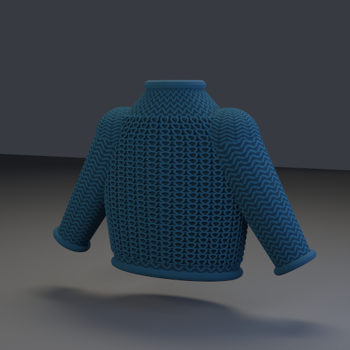
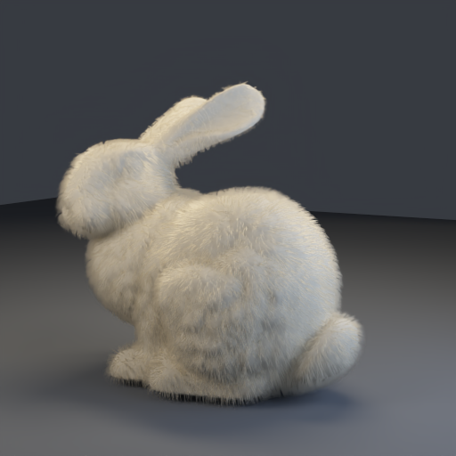
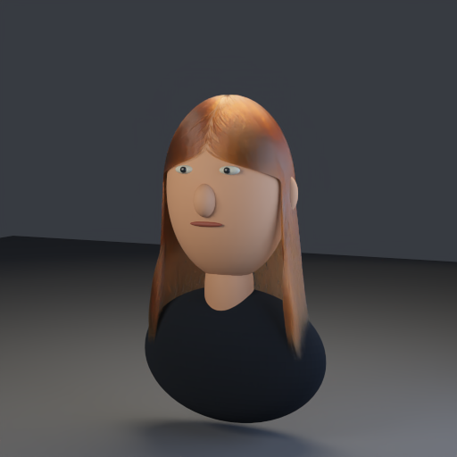
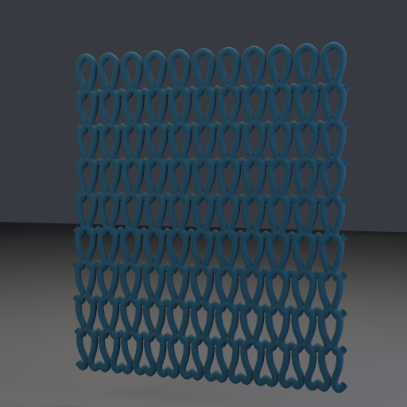

# 针织毛衣、Bunny 绒毛与头发模型

2026-10-09：在 [毛发与布料 PT](path-tracing-fibers.md) 上增加针织材质、可复用静态 groom 生成器及四个可渲染场景。CPU、Metal、Vulkan 使用同一针目图案与方向 sheen 方程；毛发继续使用 R／TT／TRT 与高阶剩余项。

## 针织毛衣材质

后续增加了 [公开纱线控制点、蜂窝针织毛衣与各向异性纱线反光](path-tracing-knitted-yarn.md)。本页保留初版 UV 平针与程序化模型的说明。

场景包新增 `bsdf_model: "knit"`，作为 `cloth` 的针织预设；也可以在 `cloth` 上设置非零 `knit_weight`。不新增不兼容的 BSDF 编号。

```json
{
  "bsdf_model": "knit",
  "base_color": [0.18, 0.42, 0.58],
  "metallic": 0,
  "roughness": 0.8,
  "sheen_weight": 0.35,
  "sheen_roughness": 0.85,
  "sheen_color": [0.35, 0.65, 0.8],
  "cloth_transmission": 0.03,
  "knit_weight": 1,
  "knit_repeats_u": 36,
  "knit_repeats_v": 34,
  "knit_yarn_radius": 0.13,
  "two_sided": true
}
```

| 参数 | 默认／范围 | 作用 |
|---|---|---|
| `knit_weight` | knit 预设 1，其余 0／[0,1] | 0 完全保留既有 cloth；非零只能用于 cloth |
| `knit_repeats_u` | 24／[1,512] | UV 横向针目数 |
| `knit_repeats_v` | 32／[1,512] | UV 纵向针目数 |
| `knit_yarn_radius` | 0.12／[0.04,0.3] | 单个针目格中的纱线半径；不是世界空间长度 |

每个重复 UV 单元用两条弯曲 V 形腿表达平针的外观。纱线截面变化产生有界的底色调制，局部纱线方向用于对称的方向 sheen 衰减；所有调制因子不大于 1，保持已有布料能量上界。反射／薄片透射余弦混合 PDF 不变，并与调制后的求值一起参与 MIS。它是外观近似，没有把灰度图当作位移，也没有实现 yarn-level 输运或通用织物节点图。

`SnapshotDraw.pathTracingKnit` 对应 weight／repeats U／repeats V／radius，进入材质 identity 和 GPU 打包。`PackedMaterial` 在毛发初版的 256 B 基础上增为 **272 B**。CPU 和 GPU 在命中阶段求值针目，保留 UV frame 的 handedness。新增参数不会参与普通 PBR／毛发闭包；旧 JSON 没有这些字段时图案强度为 0。修改密度或半径会清空 PT 累积，shader 二进制需要一起重建。

毛衣场景含衣身、袖子、领口、袖口和下摆，正面另有 **468 个弯曲纱线单元**及 **2,000 根短绒毛**。真实纱线管几何提供遮挡、轮廓和局部高光；单独近景样例有九条连续纱线行，每行十一格。概念参考 [Stitch Meshes](https://www.cs.cornell.edu/projects/stitchmeshes/)，这里没有移植其机械松弛或拓扑求解。肩部为相交曲面原型，纱线尚未做接触松弛／拓扑认证，不能作为可生产的针织结构。

## Bunny 毛发

使用仓库的 `samples/assets/bunny/bun_zipper.ply`，原始数据来源与署名：**Stanford University Computer Graphics Laboratory**，[官方数据页](https://graphics.stanford.edu/data/3Dscanrep/)。原始网格保留 35,947 顶点／69,451 三角形，不主动简化；其底部孔洞沿用原始资产。

- 按三角形面积构建 CDF，使用 sqrt 重心采样分布毛根；避免按顶点撒毛造成密集网格区域偏浓。
- 插值面积加权顶点法线，沿重力／背向的切平面梳理；剔除脚底下方区域。
- 默认 **24,000 根**短绒毛，每根六个控制点；身体长度约 0.052–0.084 世界单位，耳部减半。模型归一化到 2.6 的高度，这不是兔毛实测长度。
- 根部留微小间距，曲线沿表面向外、弯向梳理方向，尖端半径衰减到根部的 4%。

源文件 hash、根部三角形 ID 和重心坐标进入生成结果；固定 seed 可复现同一分布。未实现长度贴图、碰撞、风场、毛囊或真实动物毛发的体积近似。

## 头发模型

默认造型为中分、略有波浪的中长发，配原创的简化头模／肩部展示架。它是自包含的造型验证模型，不是扫描人物或皮肤模型。

默认 **4,500 根**发丝、每根 **29 个控制点**。头皮分布使用椭球帽坐标；导向先沿头部外侧，再将额前发丝梳向两侧，越过侧面后向下垂落，并加入轻微相位差波浪。颜色、纵向／方位宽度和倾角仍由 `hair` 材质控制。没有动力学、发束碰撞或头发内部 dual scattering。

另有 [独立高密度头发 demo](path-tracing-hair-demo.md)：40,000 根发丝、35 个控制点、分层与发束共用波浪导向。旧图集保持原来的 4,500 根配置，独立 demo 有自己的输入与验收记录。

## 静态 groom 与几何表示

`tools/pt_groom.py` 提供 PLY 读取、面积毛根采样、稳定宽度 frame、尖端衰减、纱线管和冻结场景包写出；`tools/create_pt_groom_fixtures.py` 负责各场景造型。

每个有毛发的场景保存 `groom.json`（`SceneRenderer.StaticGroom.v1`），包括控制点、根半径、参考相机及适用的根部绑定信息。当前运行时读取的是同时生成的 `PTMESH01`／`PTTANG01`，还不会直接导入 groom 控制点。它们可用于重新生成或后续接原生曲线。

每根发丝只生成一条参考相机朝向的三角薄带，保留沿长度的 U tangent 和横向 V。没有使用交叉 cards，也不把已有的圆形纤维内部输运再重复叠加到封闭毛发管上。纱线的管几何则使用不透明 cloth 闭包。该表示仍受固定相机／薄带截面近似限制；换相机需重新生成，不能宣称为原生曲线。静态造型没有全局自交／碰撞消除。含毛发场景继续拒绝 BDPT，针织／毛发闭包继续受 photon mapping 的已有范围限制。

## 渲染样例

另有[精修后的日光版本](path-tracing-grooms-sunlight.md)：72,000 根细 Bunny 绒毛、1,280 个奶油色纱线单元与 23,360 根毛衣绒毛，以及纱线近景，均为 768×768、1024 spp；以下摄影棚样例仍保留原始配置。

展示图采用 **Metal、512×512、256 spp、12 次反弹、seed 1**，随后用 **OIDN 2.5.1 CPU** 离线降噪。具体采样、降噪和后端记录见 [验收 JSON](../img/path-tracing/grooms-validation.json)。数值对照始终使用未降噪 PFM，不以展示图判断能量／后端误差；OIDN 可能平滑细发丝。

| 针织毛衣 | Stanford Bunny 绒毛 | 中长发 |
|---|---|---|
|  |  |  |



未降噪展示原图：[毛衣](../img/path-tracing/knit-sweater-raw.png)、[Bunny](../img/path-tracing/bunny-fur-raw.png)、[头发](../img/path-tracing/wavy-hair-raw.png)、[纱线近景](../img/path-tracing/knit-yarn-raw.png)。

2026-10-09 Apple M4 验收：相关 CPU CTest **7/7** 通过，完整 Metal／Vulkan 原生 PT 回归均通过。四个实际场景以 **128×128、64 spp、12 次反弹、seed 1** 对照原始 scene-linear HDR；不拟合曝光。相对 RGB L1 为 `sum(abs(test-reference))/sum(abs(reference))`，是这组固定采样结果的后端一致性指标，不能当作对独立物理参考的误差。

| 场景 | Metal 对 CPU 相对 RGB L1 | Metal 与 Vulkan |
|---|---:|---|
| 毛衣 | 0.00489% | 原始 HDR 完全一致 |
| Bunny | 2.69353% | 原始 HDR 完全一致 |
| 头发 | 1.82081% | 原始 HDR 完全一致 |
| 纱线近景 | 0.00324% | 原始 HDR 完全一致 |

所有对照输出均无非有限样本，全图相对 L1 小于 3%，中心区域小于 5%。Bunny／头发仍有 CPU 与 GPU 的数值差异，未声称逐像素一致。本机 Vulkan 经 MoltenVK 执行，未安装 Khronos validation layer；Metal 回归启用 debug layer 和 shader validation。[完整测试日志及渲染报告](../img/diagnostics/materials/grooms/)与验收 JSON 保留源文件、输入、原始输出及展示图的 SHA256。

## 复现

```sh
cmake --build build -j 6
python3 tools/create_pt_groom_fixtures.py --output build/pt-grooms
# --scene sweater|bunny|hair|yarn 可独立生成。
# --fur-strands / --hair-strands 调整数量；Bunny 默认用仓库 PLY，--bunny 可替换路径。
./build/Scene-Renderer --path-trace-gpu --backend Metal \
  --pt-scene-file build/pt-grooms/bunny/scene.json \
  --pt-size 512x512 --pt-samples 256 --pt-bounces 12 --pt-fixed \
  --pt-output build/pt-grooms/bunny/metal
# 更换子目录选择其他场景；CPU 用 --path-trace，Vulkan 用 --backend Vulkan。
# 配置 OIDN 构建的方法见 path-tracing-denoising.md。
# 本次主构建未启用 OIDN，已有 build/pt 二进制仅用于离线过滤 PFM。
./build/pt/Scene-Renderer --path-trace \
  --pt-denoise-input build/pt-grooms/bunny/metal.pfm \
  --pt-denoise-device cpu --pt-output build/pt-grooms/bunny/metal-filtered
# 展示图为 metal-filtered-denoised.png，metal.png/.pfm 保留原始结果。
ctest --test-dir build \
  -R '^(pt-cpu|pt-groom|pt-scene-package|pt-photon|pt-medium|pt-procedural|engine-environment)$' \
  --output-on-failure
MTL_DEBUG_LAYER=1 MTL_SHADER_VALIDATION=1 ./build/Scene-Renderer --pt-self-test --backend Metal
MTL_DEBUG_LAYER=0 MTL_SHADER_VALIDATION=0 ./build/Scene-Renderer --pt-self-test --backend Vulkan
```

CPU 新增针目周期性、方向 sheen 互易与白炉、字段导入／范围拒绝、272 B ABI 及参数失效检查。独立 Python 测试检查面积分布／重心分布、固定 seed、根部 mask、尖端衰减、frame／切线正交、无效输入、模型包范围及头部上半部分的曲线间距；该局部检查不是全局碰撞证明。GPU 完整 PT 回归增加变化 UV 上的针织材质对照，另外用实际四个场景做 CPU／Metal／Vulkan 原始图对照。

图案仍缺少射线 footprint 过滤，高密度／远景可能走样；完整衣服背面／袖子仍采用表面图案，正面纱线与绒毛为显式几何。后续优先补全原生曲线、groom 输入加载与编辑、UV／半径过滤、发束重要性采样与体积近似，以及连续／无自交的针织结构，再考虑实时共享预览和动力学。
