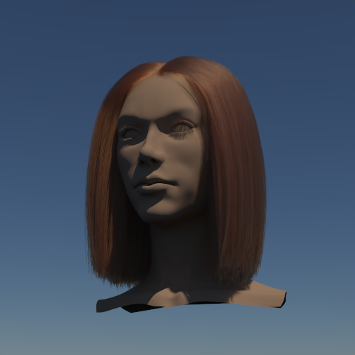
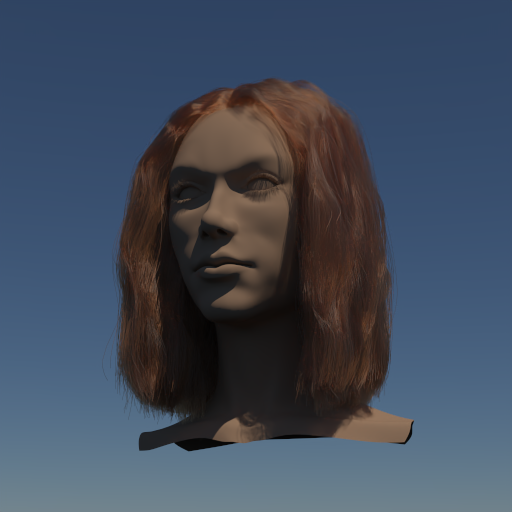
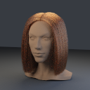
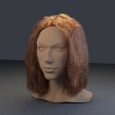

# Yuksel 公开头发基准

2026-10-09：接入 [Cem Yuksel HAIR Models](https://www.cemyuksel.com/research/hairmodels/) 的直发与波浪发，配套头模由 **Murat Afshar** 提供。作者说明这些模型已被多篇论文使用，PBRT 的 [Scattering from Hair](https://pbr-book.org/4ed/Reflection_Models/Scattering_from_Hair) 也使用 Yuksel 几何。这是公共研究资产基准，不附带统一的光学真值或评分协议。

| 本轮模型 | 源文件 | 发丝数 | 原始曲线点 | PT 发丝三角形 |
|---|---|---:|---:|---:|
| 直发 | `wStraight.hair` | 50,000 | 1,250,000 | 2,400,000 |
| 波浪发 | `wWavy.hair` | 50,000 | 2,450,000 | 4,800,000 |

保留全部发丝和原始点，不做抽稀、曲线重采样或人为尖端衰减。源文件 SHA256、归档与配套头模清单见 [资源清单](../samples/hair-benchmarks.json)，下载的二进制资产留在忽略的目录，Git 保存工具、署名、展示图和验收记录。

## 实际渲染

以下为本项目 **Metal PT、512×512、256 spp、12 次反弹、seed 1**，使用 **OIDN 2.5.1 CPU** 离线降噪。头模采用中性漫反射材质；源纹理没有应用，发色是本轮固定的吸收预设。

| Yuksel 直发 | Yuksel 波浪发 |
|---|---|
|  |  |

未降噪图：[直发](../img/path-tracing/yuksel-straight-raw.png)、[波浪发](../img/path-tracing/yuksel-wavy-raw.png)。OIDN 可能抹平细发丝，所有数值比较均使用原始 scene-linear PFM，不拟合曝光、不镜像或移动图像。

## 当前毛发模型与天空渲染

当前采用 **Chiang／PBRT 风格的圆形介质纤维散射 + 固定参考相机的三角形薄带几何**。散射核在 `src/rhi/shaders/pt-fiber.glsl` 中，CPU 通过 `src/PT/FiberScattering.h` 编译同一套方程；Metal／Vulkan 使用 GPU PT。纵向分布描述沿发丝方向的高光展宽，方位分布描述绕横截面的散射，横向 UV 决定入射点在纤维截面上的偏移。

| 散射项 | 模拟的路径 |
|---|---|
| R | 在纤维表面反射 |
| TT | 两次折射，穿过纤维 |
| TRT | 折射进入、一次内部反射、折射离开 |
| 高阶残余项 | 汇总更多次内部反射 |

Fresnel 决定反射能量，RGB Beer 吸收决定透过后的发色；`beta_m`／`beta_n` 控制纵向／方位粗糙度，IOR 和 cuticle tilt 控制折射与高光偏移。普通 PT 会继续追踪不同发丝之间的反弹，配合环境／太阳／灯光 NEE 与 MIS。尚无髓质散射、dual-scattering 近似或毛发动力学。**薄带不是实体圆柱，也没有原生曲线求交**：初级、阴影和间接射线仍命中同一份固定朝向三角形，改变机位应重新生成薄带。

下图移除摄影棚地面和三个面积光源，使用现有实时 `GpuAtmosphere` 的晴空捕获。512×256 线性 HDR 既参与重要性采样照明，也用于可见背景；天空捕获不含太阳盘，太阳通过独立的有限角半径光源加入，避免重复计算。太阳高度约 **57.37°**、半径约 **0.28648°**，经大气透射后的 RGB irradiance 为 `[2.78938, 2.53548, 2.17498]`。捕获观察高度为 10 m，不包含体积云或地面几何。

两套模型各保留 **50,000 根发丝**、原始控制点与宽度，沿用上文的吸收／粗糙度参数和中性 Lambert 头模。相机改为 `[2.4,3.4,6.6]` 看向 `[0,5.42,0]`，头模／发丝整体平移 `[0,4,0]`，重新生成该机位的薄带；约 16° 仰角使画面落在地平线上方。原摄影棚机位朝下，去掉地面后会看到大气环境的黑色下半球，因此没有通过替换背景像素掩盖这一问题。

**Metal PT，512×512、512 spp、12 次反弹、seed 1、exposure 1；OIDN 2.5.1 CPU 离线降噪。** 头模未使用皮肤 BSSRDF 或源头部纹理，不能把其外观当成皮肤材质验证。

| 晴空中的直发 | 晴空中的波浪发 |
|---|---|
|  |  |

未降噪图：[直发](../img/path-tracing/yuksel-straight-sky-raw.png)、[波浪发](../img/path-tracing/yuksel-wavy-sky-raw.png)。64×64、8 spp、深度 12 的原始 HDR 检查中，场景包 RGB32F 与 stb 直接读取同一 HDR 的结果完全一致，Metal 与 Vulkan 结果也完全一致。两个正式场景均无非有限样本；[验收记录](../img/path-tracing/yuksel-hair-sky-validation.json)与[日志、天空 HDR、太阳参数](../img/diagnostics/materials/hair-sky/)单独保存。这不是新的 PBRT 整图对齐验收。

先按后文生成原始 benchmark 包，再执行：

```sh
# 小尺寸渲染仅用于调用现有实时大气捕获；头发包不会包含地形。
MTL_DEBUG_LAYER=0 MTL_SHADER_VALIDATION=0 ./build/Scene-Renderer \
  --path-trace-gpu terrain --backend Metal --pt-size 32x32 --pt-samples 1 \
  --pt-bounces 1 --pt-terrain-grid 17 --pt-texture-size 64 --pt-no-grass \
  --pt-fixed --pt-output build/pt-hair-sky/daylight
PYTHONDONTWRITEBYTECODE=1 python3 tools/create_pt_hair_sky.py

# straight 和 wavy 同样操作；生成包已包含环境 RGB32F 和太阳参数。
MTL_DEBUG_LAYER=0 MTL_SHADER_VALIDATION=0 ./build/Scene-Renderer \
  --path-trace-gpu --backend Metal \
  --pt-scene-file build/pt-hair-sky/wavy/scene.json \
  --pt-size 512x512 --pt-samples 512 --pt-bounces 12 --pt-seed 1 --pt-fixed \
  --pt-output build/pt-hair-sky/wavy/metal
./build/pt/Scene-Renderer --path-trace \
  --pt-denoise-input build/pt-hair-sky/wavy/metal.pfm \
  --pt-denoise-device cpu --pt-output build/pt-hair-sky/wavy/filtered
```

`create_pt_hair_sky.py` 仅支持本项目 stb 写出的 `-Y/+X`、单位 exposure、RGBE RLE 天空，并记录源几何／天空／工具的 SHA256。验收脚本 `tools/validate_pt_hair_sky.py` 使用 NumPy／Pillow，还需要运行前保存的 `source-freeze.json` 和直发小图 `check-package`／`check-hdr`／`check-vulkan`：均为 64×64、8 spp、深度 12、固定采样；`check-hdr` 增加 `--pt-environment build/pt-hair-sky/daylight-environment.hdr`，Vulkan 检查改用 `--backend Vulkan`。降噪只用于展示，数值检查使用原始 PFM。

## 更强太阳与发丝反射高光

在相同的 50,000 根发丝、机位与几何上，增加强日光展示版本。先捕获经典 `sky` 预设的 10° 太阳晴空，再将 **天空和有限太阳一起绕世界竖直轴旋转 160°**、同时乘以 **10**。等效的顶部大气太阳源强度由 3 提高到 30；经透射后的 irradiance 为 `[21.39672,13.78802,6.65373]`，太阳半径保持约 0.28648°。这是低角度的暖色日光；源强度、天空亮度和太阳方向保持一致。

为呈现更窄的发丝反射高光，显式将 `hair_beta_m` 从 0.3 调至 **0.12**、`hair_beta_n` 从 0.3 调至 **0.2**；吸收 `[0.2,0.45,0.8]`、IOR 1.55、tilt 2° 不变。该展示同时改变照明和毛发粗糙度，不能作为只比较灯光的基准。未增加面积灯，未改变几何或发色吸收参数。

**Metal PT，512×512、1024 spp、12 次反弹、seed 1、exposure 0.6，OIDN 2.5.1 CPU。** 曝光降低以保留更强照明下的亮部；暖色发丝与波峰高光来自纤维模型的实际路径积分。头部继续采用中性 Lambert 材质。

| 强日光直发 | 强日光波浪发 |
|---|---|
|  |  |

未降噪图：[直发](../img/path-tracing/yuksel-straight-sunlit-raw.png)、[波浪发](../img/path-tracing/yuksel-wavy-sunlit-raw.png)。[验收记录](../img/path-tracing/yuksel-hair-sunlit-validation.json)和[照明参数、日志](../img/diagnostics/materials/hair-sunlit/)保存本次设置与来源。128×128、256 spp 的波浪发小图检查使用同一套相机／几何／材质／天空，仅关闭有限太阳作为对照；此对照分离的是太阳照明总贡献，包含 R／TT／TRT，不能称为单独 R lobe AOV。

小图的 Metal／Vulkan 原始 HDR 完全一致。首个表面的 albedo 最小 RGB 分量大于 0.99 的像素作为发丝掩码；开启太阳后的该区域平均线性亮度约为关闭时的 **6.14 倍**。该比较未使用 OIDN 或曝光拟合，天空和粗糙度在对照中保持相同。

先生成上一节的 `build/pt-hair-sky`，再执行以下命令。生成器需要 NumPy；降噪仍使用已有 OIDN 可执行文件，仅离线读取 PFM。

```sh
MTL_DEBUG_LAYER=0 MTL_SHADER_VALIDATION=0 ./build/Scene-Renderer \
  --path-trace-gpu sky --backend Metal --pt-size 32x32 --pt-samples 1 \
  --pt-bounces 1 --pt-fixed --pt-output build/pt-hair-sunlit/low-sun
PYTHONDONTWRITEBYTECODE=1 python3 tools/create_pt_hair_sunlit.py \
  --sky-yaw 160 --light-scale 10 --exposure 0.6 \
  --hair-beta-m 0.12 --hair-beta-n 0.2

# straight 和 wavy 同样操作。
MTL_DEBUG_LAYER=0 MTL_SHADER_VALIDATION=0 ./build/Scene-Renderer \
  --path-trace-gpu --backend Metal \
  --pt-scene-file build/pt-hair-sunlit/wavy/scene.json \
  --pt-size 512x512 --pt-samples 1024 --pt-bounces 12 --pt-seed 1 --pt-fixed \
  --pt-output build/pt-hair-sunlit/wavy/metal
./build/pt/Scene-Renderer --path-trace \
  --pt-denoise-input build/pt-hair-sunlit/wavy/metal.pfm \
  --pt-denoise-device cpu --pt-exposure 0.6 \
  --pt-output build/pt-hair-sunlit/wavy/filtered
```

`--sky-yaw` 同步旋转太阳与 HDR；非整 texel 偏移对天空做周期线性插值。`--light-scale` 同时缩放天空 radiance 与太阳 irradiance。两个 `--hair-beta-*` 参数可省略，以保留原来的粗糙度。生成器记录改动前后的材质、相机和输入 SHA256，原天空包保持独立。

本次正式验收实际使用独立目录中的 `pt-package-render`，使执行文件和编译后的 shader 保持成套，避免共享主构建目录更新时发生反射布局不匹配。该入口已修正为读取场景包的曝光。可用现有 CMake 配置在独立目录构建该 target，再执行：

```sh
cmake --build build/pt-hair-sunlit/runtime --target pt-package-render -j 6
MTL_DEBUG_LAYER=0 MTL_SHADER_VALIDATION=0 \
  ./build/pt-hair-sunlit/runtime/pt-package-render --backend Metal \
  --scene build/pt-hair-sunlit/wavy/scene.json --size 512x512 \
  --samples 1024 --bounces 12 --seed 1 --output build/pt-hair-sunlit/wavy/metal
```

此目录配置启用 Metal／Vulkan，OIDN 仍通过上面的独立离线入口执行。验收冻结实际程序、编译 shader 和场景输入的字节；构建期间共享源码曾变动，`runtime-source-audit.json` 明确记录了这一点，不把构建前源码快照宣称为已确认的完整编译源版本。

验收工具 `tools/validate_pt_hair_sunlit.py` 检查几何／相机字节与配置保持原值、天空旋转与能量缩放、太阳经度／仰角，以及原始 HDR。它读取运行前冻结的 `source-freeze.json`，正式图与离线滤波报告，以及 `wavy/check-metal`／`check-vulkan`／`check-no-sun` 的 128×128、256 spp、深度 12、seed 1 小图。关闭太阳的输入另存为 `sun-off-scene.json`，避免与输出报告重名。Metal／Vulkan 比较使用原始 PFM；OIDN 只用于展示。

## 导入与材质约定

`tools/pt_hair_file.py` 读取 little-endian 的 128 B HAIR header、逐根段数、位置及可选 thickness／transparency／color 数组；验证签名、保留位、资源预算、段数与点数一致、截断／尾随数据、有限值和属性范围。数组保持原值，缺省属性取自 header。

头模与头发使用同一个保持朝向的变换：源坐标 `[x,y,z]` 映射到 `[y,z,x]`，Z-up 转为 Y-up，正面转向 +Z；以完整头模高度归一化到 2.6，再平移至地面上方。宽度仅乘同一缩放系数。源 thickness 作为直径，生成薄带的半宽为它的一半；与 PBRT `curve` 的 `width0/width1` 约定一致。每根根部到末端的 U 按原始折线弧长分配，横向 V 为 0／1。

这两份源文件采用缺省宽度 0.1。源透明度约 0.356、颜色及其他属性仍保存在原始 `.hair` 中，本轮不把它们直接当成 opacity 或物理反射率。采用显式毛发参数：

```json
{
  "bsdf_model": "hair",
  "base_color": [1,1,1],
  "absorption": [0.2,0.45,0.8],
  "hair_beta_m": 0.3,
  "hair_beta_n": 0.3,
  "hair_ior": 1.55,
  "hair_tilt": 0.034906585,
  "two_sided": true
}
```

`hair_tilt` 在本项目以弧度输入，PBRT 对应 `alpha=2` 度。直接传 `sigma_a` 避免两套渲染器的反射颜色转吸收约定不同。头部／地面为 `lambert`；PBRT 中将场景包底色按本项目的 `pow(c,2.2)` 转成线性 `Kd`。灯光 emission 与常量 HDR 环境已经是线性值，不再次转换。

当前运行时仍读取生成的 `PTMESH01`／`PTTANG01`。源 HAIR 是保留控制点和属性的权威数据，`import.json` 记录变换、数量、材质替换和 SHA256；还没有原生曲线求交或直接 runtime `.hair` 加载。

## PBRT 独立参考与误差

本轮构建未经修改的官方 **PBRT v3**，commit `13d871faae88233b327d04cda24022b8bb0093ee`，Release／RGBSpectrum。选择 RGB 实现来减少光谱重建差异；不是 PBRT v4 光谱验证。完整子模块版本和二进制 SHA256 见 [验收 JSON](../img/path-tracing/yuksel-hair-validation.json)。毛发模型依据 [Chiang 等，2016](https://www.disneyanimation.com/publications/a-practical-and-controllable-hair-and-fur-model-for-production-path-tracing/)。

独立方程 probe 链接官方 `HairBSDF`，直接比较 `f * abs(wi.z)` 与本项目散射核；排除几何、相机和积分器。使用固定 seed，覆盖 4×4 组纵向／方位粗糙度、5 个横向偏移、3 个倾角，共 **61,440 组方向对**。总体相对 RGB L1 为 **0.07804%**；对于参考分量大于 `1e-6` 的样本，最大分量相对差为 **2.0831%**。probe 不要求两者 PDF 相同：两种实现选择散射阶数的权重约定不同。

整图参考使用 PBRT **128×128、1024 spp、12 次反弹**；本项目对照为 **128×128、256 spp、12 次反弹**。相机、灯光、吸收与粗糙度约定保持一致；PBRT 用逐入射射线朝向的原生 flat curve，本项目仍用固定参考相机薄带。每个原始线段导出为共线的 cubic Bezier，保持折线形状和源宽度，不擅自套用 Catmull–Rom。

| 场景 | Metal 对 CPU L1 | Metal 对 PBRT 全图 L1 | Metal 对 PBRT 4×4 块均值 L1 |
|---|---:|---:|---:|
| 直发 | 3.6004% | 13.8739% | 10.6878% |
| 波浪发 | 4.1227% | 14.8993% | 10.6146% |

L1 定义为 `sum(abs(test-reference))/sum(abs(reference))`。Metal 与 Vulkan 两个场景原始 HDR 完全一致，三后端均无非有限样本。独立导入／宽度／变换／参考导出测试 **4/4** 通过。CPU 对 GPU 仍有数值差异；整图还有约 14%–15% 差异，**外观没有完成对齐**。几何表示、求交／frame 和不同采样噪声都可能贡献误差，这份测量没有把它们分别归因。PBRT 图仍有采样噪声，不能称为解析真值。

| PBRT 直发参考，未降噪 | PBRT 波浪发参考，未降噪 |
|---|---|
|  |  |

PBRT 展示 PNG 对原始 PFM 使用与本项目相同的 `pow(1-exp(-radiance),1/2.2)`，只用于显示。本机 Vulkan 经 MoltenVK 执行，没有 Khronos validation layer。[日志与报告](../img/diagnostics/materials/hair-benchmarks/)保留完整路径、源版本和验证数据；没有把不同几何、不同 spp、GPU／CPU 的耗时当作公平吞吐比较。

## 复现

```sh
python3 tools/fetch_hair_benchmarks.py
python3 tools/create_pt_hair_benchmarks.py --pbrt \
  --reference-size 128 --reference-samples 1024
PYTHONDONTWRITEBYTECODE=1 python3 tests/PT/HairBenchmarkTests.py \
  > build/pt-hair-benchmark-tests.txt 2>&1

# 生成直发展示图，wavy 子目录同样操作。
MTL_DEBUG_LAYER=0 MTL_SHADER_VALIDATION=0 ./build/Scene-Renderer \
  --path-trace-gpu --backend Metal \
  --pt-scene-file build/pt-hair-benchmarks/straight/scene.json \
  --pt-size 512x512 --pt-samples 256 --pt-bounces 12 --pt-fixed \
  --pt-output build/pt-hair-benchmarks/straight/metal
./build/pt/Scene-Renderer --path-trace \
  --pt-denoise-input build/pt-hair-benchmarks/straight/metal.pfm \
  --pt-denoise-device cpu --pt-output build/pt-hair-benchmarks/straight/filtered
```

上述已有 `build/pt` 仅用于离线 OIDN，构建方式见 [降噪说明](path-tracing-denoising.md)。源资产与生成包较大，先确保有足够内存和磁盘空间；发丝数量从两份完整源文件导入，不自动降低。

独立 PBRT 构建不进入主 CMake 工程：

```sh
git clone --recursive https://github.com/mmp/pbrt-v3.git build/deps/pbrt-v3
git -C build/deps/pbrt-v3 checkout 13d871faae88233b327d04cda24022b8bb0093ee
git -C build/deps/pbrt-v3 submodule update --init --recursive
cmake -G "Unix Makefiles" -S build/deps/pbrt-v3 -B build/deps/pbrt-v3-build \
  -DCMAKE_BUILD_TYPE=Release -DCMAKE_POLICY_VERSION_MINIMUM=3.5 \
  -DPBRT_SAMPLED_SPECTRUM=OFF
cmake --build build/deps/pbrt-v3-build --target pbrt_exe -j 6
python3 tools/run_pbrt_hair_probe.py
# 在场景目录内执行，使 reference.pfm 和相对 Include 路径一致。
(cd build/pt-hair-benchmarks/straight && ../../deps/pbrt-v3-build/pbrt --nthreads 4 reference.pbrt)
(cd build/pt-hair-benchmarks/wavy && ../../deps/pbrt-v3-build/pbrt --nthreads 4 reference.pbrt)
```

`run_pbrt_hair_probe.py` 复用该 Makefiles 构建的 compile／link 参数，生成独立 probe，不修改上游源码。整图对照另为两个场景生成 `check-cpu`／`check-metal`／`check-vulkan`，均为 128×128、256 spp、深度 12、固定采样；CPU 用 `--path-trace --pt-threads 4`，GPU 用 `--path-trace-gpu --backend Metal|Vulkan`。保存命令输出到相应的 `*.txt` 后，运行需要 NumPy／Pillow 的 `tools/validate_pt_hair_benchmarks.py` 生成展示图、指标及验收记录。可传 `--source-freeze` 检查运行前保存的源码／二进制 hash；无冻结记录时只记录验收时的源文件 hash，不证明它们是渲染时的版本。

## 后续优先级

1. 原生曲线数据与求交，统一每根曲线的宽度、横向偏移及随射线变化的 frame；减少薄带三角形开销，并重新量化图像差异。
2. 单根／小束毛发、固定直接光与无吸收 white-furnace 的独立图像基准，分离方程、求交和采样误差。
3. 同几何、同材质、同耗时的收敛与内存基准；随后接入 `wCurly.hair` 压力场景，再考虑毛发内部散射近似和实时 LOD。

模型来源与使用条件保留在 [署名说明](../samples/licenses/yuksel-hair.txt)；公开图像及数值结果链接作者页面。源许可不由本项目重新定义。
