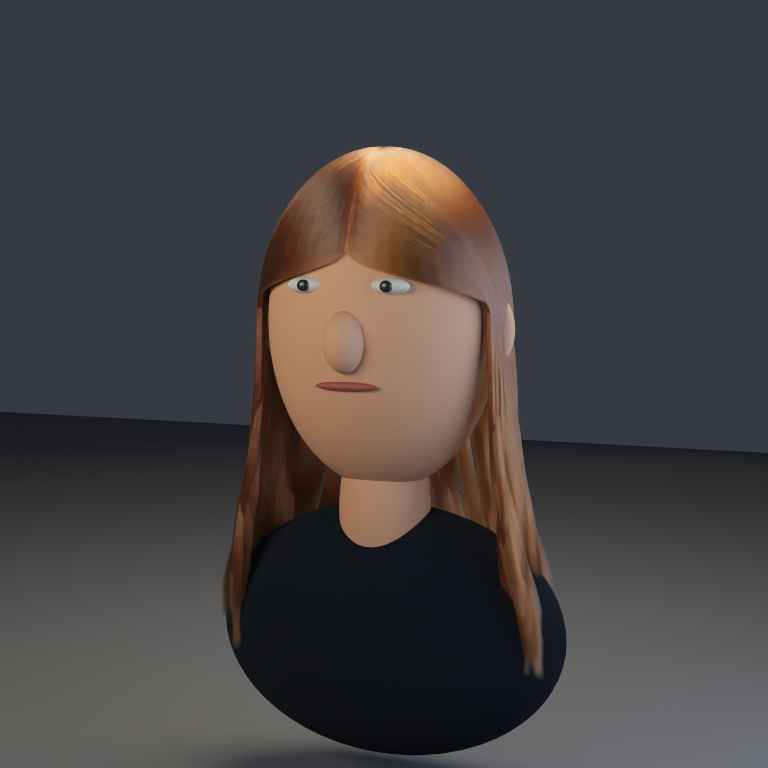

# 独立高密度头发 demo

在原来的 [4,500 根头发样例](path-tracing-grooms.md) 之外提供独立入口 `tools/create_pt_hair_demo.py`。默认 **40,000 根发丝**，约为原来的 **8.9 倍**；每根 **35 个控制点**，发丝部分共 **2,720,000 个三角形**。原创简化头模、灯光、groom 与材质全部由脚本生成，无需下载外部资产。

论文常用的真实公共资产另见 [Yuksel 头发基准](path-tracing-hair-benchmarks.md)，保留两套 50,000 根发丝，并提供独立 PBRT 对照。当前程序化 demo 继续作为造型与参数测试样例。

造型沿用中分微卷中长发，增加头皮外侧层次、48 组共用波浪导向，以及每根发丝的长度、半径与相位变化。根半径默认 0.0015 世界单位，小于原样例的 0.0028，避免只增加数量而把发束堆成粗线。材质仍使用已有 `hair` 的 R／TT／TRT 与高阶剩余项，不修改积分器或 ABI。



上图为 **Metal PT、768×768、256 spp、12 次反弹**，使用 **OIDN 2.5.1 CPU** 离线降噪。[未降噪原图](../img/path-tracing/hair-demo-raw.png)保留发丝与采样噪声，[验收 JSON](../img/path-tracing/hair-demo-validation.json)记录完整输入、输出、日志与 SHA256。

## 生成与渲染

在仓库根目录、已有主程序构建的情况下执行：

```sh
# 一条命令：生成独立包并以 Metal 离线渲染。
MTL_DEBUG_LAYER=0 MTL_SHADER_VALIDATION=0 python3 tools/create_pt_hair_demo.py \
  --output build/pt-hair-demo --strands 40000 --view three-quarter \
  --render Metal --size 768 --samples 256 --bounces 12

# 已有启用 OIDN 的构建时，可以追加 --denoiser build/pt/Scene-Renderer。
# 此二进制只读 PFM 做离线 CPU 降噪，几何渲染始终使用 --renderer 指定的主程序。
# OIDN 构建方法见 path-tracing-denoising.md。
./build/pt/Scene-Renderer --path-trace \
  --pt-denoise-input build/pt-hair-demo/render.pfm --pt-denoise-device cpu \
  --pt-output build/pt-hair-demo/filtered

# 只生成包；之后可重复采样或更换后端，无需重新生成几何。
python3 tools/create_pt_hair_demo.py --output build/pt-hair-demo --strands 40000
./build/Scene-Renderer --path-trace-gpu --backend Vulkan \
  --pt-scene-file build/pt-hair-demo/scene.json \
  --pt-size 768x768 --pt-samples 256 --pt-bounces 12 --pt-fixed \
  --pt-output build/pt-hair-demo/vulkan
```

`--render CPU` 使用 CPU PT，`--renderer PATH` 指定其他构建。CPU／Metal／Vulkan 场景包格式相同。`--seed` 默认 19，仅控制造型；渲染器的采样 seed 保持默认 1。

| 参数 | 默认／范围 | 用途 |
|---|---|---|
| `--strands` | 40,000／1–100,000 | 发丝数；可降低到 10,000 做快速预览 |
| `--radius` | 0.0015／0.0003–0.004 | 根半径，每根有 ±20% 变化，末端由 groom helper 衰减 |
| `--view` | `three-quarter`／`front`、`three-quarter`、`back` | 参考相机，改变视角时重新生成薄带 |
| `--size` | 768 | 正方形 film 分辨率 |
| `--samples` | 256 | 固定 spp |
| `--bounces` | 12 | 路径深度 |
| `--denoiser PATH` | 无 | 独立 OIDN 二进制，仅离线过滤 |

输出 `scene.json`、`geometry.bin`、`tangents.bin`、`environment.bin` 和 `groom.json`。启用 `--render` 时另有原始 `render.png/.pfm/.json`、AOV、日志与 `demo-validation.json`，以及可选的 `filtered-denoised.png/.pfm`。生成文件留在忽略的 `build/`，仓库保存生成器、文档、展示图与验收记录。

## 检查与范围

```sh
PYTHONDONTWRITEBYTECODE=1 python3 tests/PT/HairDemoTests.py
```

检查固定 seed、不同 seed、导向组覆盖、半径范围、35 个控制点、头部上半部分间距、尾端高度，以及三个视角的参考相机和精确发丝三角形数量。检查不是全局碰撞证明。

2026-10-09 Apple M4 验收：独立 Python 测试 **2/2**；实际 CPU CLI 小场景、完整 Metal CLI 生成／渲染／OIDN 流程均通过。另以完整 40,000 根场景、**96×96、64 spp、12 次反弹、seed 1** 检查 CPU／Metal／Vulkan，均无非有限样本。Metal 与 Vulkan 原始 HDR 完全一致；相对 CPU 的 RGB L1 为 **2.8091%**，计算方式为 `sum(abs(test-reference))/sum(abs(reference))`，不拟合曝光，也不代表对独立物理参考的误差。本机 Vulkan 使用 MoltenVK，没有 Khronos validation layer。

实际完整场景约 **276 万个有效三角形**，CPU 几何／BVH payload 约 **469.49 MiB**，此数字不是进程峰值或 GPU 总显存。原始 [报告和日志](../img/diagnostics/materials/hair-demo/)保存以便核对。

这是可复现的独立**离线 PT demo**。发丝仍使用参考相机朝向的三角薄带，当前运行时加载生成的网格，不直接加载 `groom.json` 控制点。尚无原生曲线、动力学、自交消除或多次纤维散射近似。高密度三角薄带增加几何／BVH／显存成本；上限数量用于约束输入，不能保证每台机器都能流畅运行。OIDN 可能抹平细发丝，数值检查使用未降噪 HDR。
