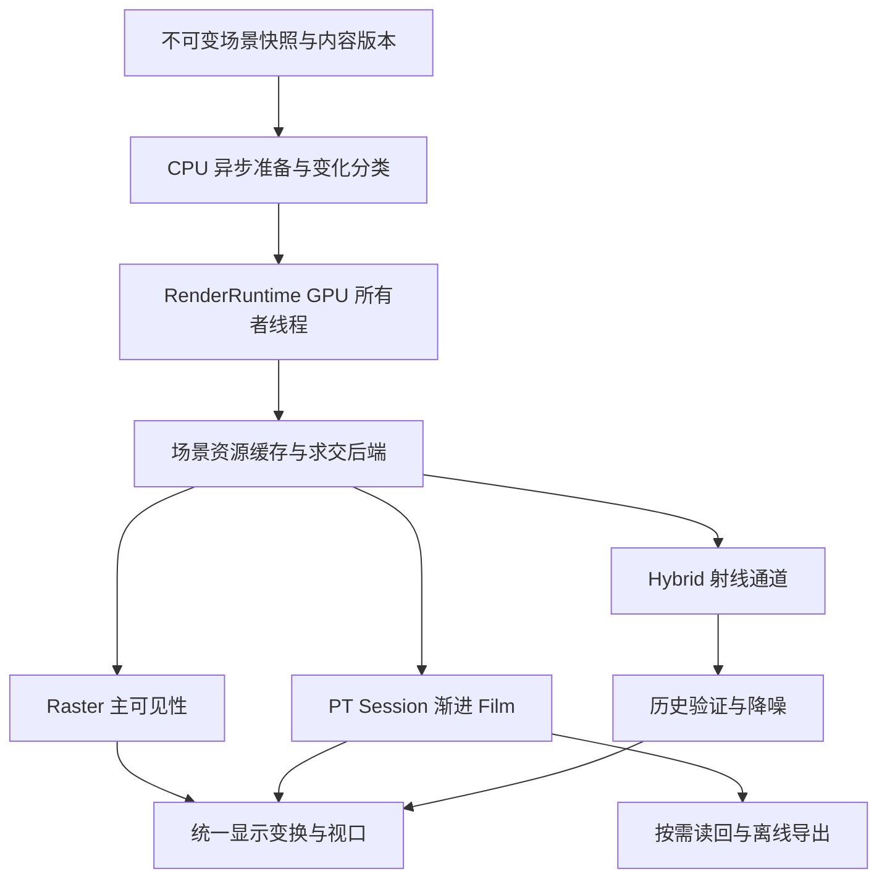

# Path Tracing 后续改进计划

以 Blender Classroom／Barcelona、Sponza／San Miguel、玉龙／FFT 海洋和太阳池底焦散构成测试矩阵。以下先列当前执行路线，再保留 [外观与加速四阶段计划](path-tracing-appearance-plan.md) 的历史进展和专题储备；未完成项目不代表已支持功能。

2026-10-10：新增 [CPU SPPM 渐进光子映射](path-tracing-sppm.md)，完成逐像素半径／通量更新、独立光子批次、解析水体与确定性回归及焦散收敛对照。完整 VCM 统一连接／合并 MIS、GPU SPPM 与直接镜面太阳盘采样仍为后续工作。

## 当前路线：独立 Path Tracer 与实时整合（2026-10-07）

目标是让同一场景既能进行可验证的离线渲染，也能在编辑器内渐进预览，并逐步向实时渲染提供射线阴影、反射和间接光。**先做持续累积的 PT 视口，再做增量场景更新和原生求交，最后按通道接入 Hybrid。** 通用加速与 photon mapping 继续推进；2026-10-08 起按用户的新优先级推进材质外观扩展，USD 不作为前置依赖；先各向异性 GGX，再 coat／sheen 与能量补偿，见 [材质路线](path-tracing-materials.md)。既有 P2 尚未完成的交互验收保留，ReSTIR 不列入本轮路线。

### 当前接入状态

- CPU／Metal／Vulkan 已有相机路径、软件共享 BLAS/TLAS、纹理／介质、NEE/MIS、guiding／cache、自适应采样和 OIDN。各算法仍有独立支持边界，不能任意组合。
- 原生线程[编辑器入口](../src/main.cpp) 已支持捕获固定快照并持续显示 GPU PT，暂停／续采／重新捕获／取消通过面板操作；[旧 CPU 入口](../src/PT/Connector.cpp) 留给 OpenGL／单线程静态文件渲染。
- [GPU 入口](../src/PT/GpuPathTracer.cpp) 已拆出 `GpuRenderSession`：分步提交、GPU 显示和显式读回；离线 `renderGpu()` 驱动同一会话。已接入跨捕获 CPU BLAS／GPU 缓冲缓存；纯相机更新保留场景和静态光子图，材质／变换／灯光更新按变化缓冲上传。
- [RenderRuntime](../include/engine/RenderRuntime.h) 已接入天空／地形／FFT 捕获、相机停下后的自动重启、内容失效、GPU 显示与异步 CPU 构建／数据导出。单一 GPU 所有者线程、不可变快照、有限队列与非阻塞帧提交作为 PT／Raster 的共同调度入口；动态 Hybrid 尚未实现。
- [固定半径 photon mapping](path-tracing-photon-mapping.md) 已覆盖 CPU／Metal／Vulkan 的间接光与焦散 AOV；光子发射在 CPU，支持默认 PBR、固体介电和仅吸收介质，尚未支持受控 Blender closure、散射体积及解析局部灯光端点。
- 2026-10-10 已接入 Metal 原生三角形 BLAS／TLAS 和 intersection query，PT 自动按设备能力选择，保留软件 BVH。Vulkan 原生 RT 尚未实现，MoltenVK 继续软件路径。更新策略、同射线验收、原始图差异及计时见 [原生 RT](path-tracing-gpu.md#metal-原生-rtp3-a2026-10-10)。其他实时 GI／水体改动的计时不作为 PT 加速数据。

### 两条产品路线

| 模式 | 行为与用途 | 与其他模式共用的部分 |
| --- | --- | --- |
| Raster | 保持交互与动态模拟，用于编辑和快速运动 | 场景描述、相机、资源身份、材质参数、光源与显示变换 |
| Progressive PT | 固定相机与模拟时刻，持续累积完整相机路径；导出同一份线性 film | 场景资源和求交设施；独立保存采样状态与介质状态 |
| Hybrid | Raster 提供主可见性，射线通道提供选定的阴影／反射／间接光 | 场景资源、求交、灯光采样；另有运动矢量、历史有效性与降噪 |

默认交互策略：运动时 Raster，停止后捕获固定时刻并渐进 PT；显式开启动态 Hybrid 时继续模拟。PT 的无偏参考模式与 photon／radiance cache 有偏预览模式需显示当前配置，切换估计器后清空累积。冻结 PT 不沿用实时屏幕空间折射或雾气近似。

这里共用描述和资源，不要求 Raster 执行完整离线 BSDF。每个实时近似必须记录其与 PT 参考的差异，避免先引入完整材质图重写而延迟视口接入。

### 分阶段交付

| 阶段 | 具体工作 | 验收出口 |
| --- | --- | --- |
| P1：可持续 PT 视口 | 拆分 `GpuScene` 资源与 `RenderSession` 采样状态；提供 prepare／step／reset／resize／cancel／statistics／输出纹理；既有 `renderGpu()` 驱动同一会话完成离线任务。在线性 GPU film 上生成显示纹理，逐帧显示不读回完整 film | 同场景／seed／样本序列下，离线与分步结果一致；暂停后可续采，调整曝光不重算；UI 可响应，切场景／退出无旧任务覆盖、泄漏或 GPU 所有权错误 |
| P2：共享资源与增量更新 | 沿用 `RenderWorldSnapshot` 增加内容版本／变化集；按 mesh revision 缓存 BLAS，按实例变化更新 TLAS，按纹理／材质／光源变化上传相关数据；CPU 准备异步化；持久 OIDN 设备／filter、阶段测量与资源预算 | 移动相机不重建几何或静态光子图；改变单个实例不重传全部 mesh；连续切换材质／时间／场景无陈旧输出；完整 Barcelona 与 FFT 捕获内存有界 |
| P3：通用求交加速 | 先接 Metal 原生 acceleration structure／求交，再按 Vulkan 实际能力接入；保留软件回退。补齐 GPU 阶段计时；先独立验证后端 ray／hit 接口，再复用 PT 与 Hybrid；Wavefront 仅在测量支持时拆分 | 同射线 hit/miss、世界空间 t、instance／primitive、barycentric 和透明可见性通过；原始线性图无输运回归；同时报告冷启动、热更新、最终误差与耗时 |
| P4：采样与焦散收敛 | light tree／多光源选择与纹理 mip／射线 footprint；从固定图升级到 SPPM，正确维护累计通量／半径／发射路径归一化；再评估 GPU 发射和排序。解析局部灯光端点、受控闭包与体积按独立支持任务扩展 | 真实太阳角半径下，池底／平水／无水对照保留；同耗时误差下降，增加光子迭代可减少固定图偏差和噪声；Classroom／Barcelona 分别验收一般照明收益 |
| P5：Hybrid 分通道整合 | 先 RT 阴影，再反射；之后评估漫反射 GI 和固定场景焦散。增加必要 G-buffer、历史拒绝和时域／空间降噪；每个通道单独开关与 PT 参考 | 阴影、反射各自与冻结 PT 对照；镜头运动、遮挡、灯光变化与水上／水下切换无可见拖影或重复能量；在目标设备上测量帧预算后决定默认配置 |
| P6：独立 PT 深化 | 扩展有限太阳／HDR 的 BDPT，随后补粗糙介电／体积／闭包伴随密度，再评估 VCM／SMS；增加景深、运动模糊、AOV／多层 EXR 和可恢复 checkpoint。分层、非均匀玉石与光谱按实际场景需求另开阶段 | 每个算法先通过数值与小场景测试，再扩大到水体／玉石／大场景；文件包含场景／算法版本与完整采样状态；后端切换不能静默恢复不兼容状态 |

P1→P2→P3 是视口／实时整合主线；2026-10-10 按用户优先级先交付 P3-A Metal 原生求交，P2-E 剩余 GUI 验收继续保留。P4 可在 P1 后独立推进，避免焦散改进被完整 Hybrid 系统阻塞。P5 的射线通道接口可先用软件求交验证，再由 P3 替换加速后端。P6 保留长期 BDPT 目标，但不提前解除当前不支持组合的拒绝检查。

原生 RT 能力必须分开查询 AS 构建、求交与更新支持。Metal 优先实现；Vulkan 检查 `VK_KHR_acceleration_structure`／`VK_KHR_ray_query` 及设备限制，本机 MoltenVK 不假定支持。当前 GLSL→MSL 工具链能处理普通 compute，不代表原生射线指令能直接翻译：先实现最小后端求交原型和共同 ray／hit 数据约定，再决定独立求交队列或窄后端 shader 层。[Metal 文档](https://developer.apple.com/documentation/metal/ray-tracing-with-acceleration-structures)、[Vulkan 文档](https://docs.vulkan.org/guide/latest/extensions/ray_tracing.html)。

Wavefront 会同时增加队列、压缩和同步成本，保留当前 megakernel 作为对照。硬件求交也不能消除 CPU 光子准备或灯光采样方差；按实际瓶颈选择下一步。[PBRT GPU 映射](https://www.pbr-book.org/4ed/Wavefront_Rendering_on_GPUs/Mapping_Path_Tracing_to_the_GPU)。

### 场景更新与累积失效约定

快照 `sequence` 仅用于发布顺序；另外维护 geometry／transform／material／lighting／procedural-time／camera／integrator／display 版本。会话、读回和异步降噪结果携带 epoch，旧 epoch 只能退役资源，不能覆盖新视口。

| 变化 | PT film／历史 | 可保留／需要更新的资源 |
| --- | --- | --- |
| 相机位置、方向、投影 | 清空 film；首版清空历史 | 保留静态几何、灯光分布和光子图；重新判断相机初始介质 |
| 曝光／显示变换 | 保留线性 film | 只更新显示；延续现有色彩约定，迁移色彩管线时单独验收 |
| 降噪设置 | 保留原始 film，重做降噪输出 | 不更改输运资源；必要时重建 filter |
| 输出分辨率 | 重建 film／AOV／历史 | 保留场景、AS 和静态光子图；更新投影／像素采样参数 |
| spp 目标／GPU batch／checkpoint 间隔 | 同一估计器和样本序列可续采 | 只改调度；seed／深度／积分器或有偏模式改变则重置相关状态 |
| 刚体实例变换 | 清空 film；Hybrid 拒绝受影响历史 | 保留 mesh BLAS，更新 TLAS／emitter 面积／介质边界；失效相关光子图和训练缓存 |
| 拓扑／形变 | 清空 film／受影响历史 | 拓扑变化重建相应 BLAS；固定拓扑的 refit 需后端支持及质量阈值；更新 TLAS bounds |
| 材质／纹理／灯光／天空 | 清空 film／相关历史 | 更新 shading／emitter／环境采样数据，失效光子图和训练缓存；alpha 或 AS 分类变化时更新相应结构 |
| FFT 时刻／地形生成／体积边界 | 清空 film／不可靠历史 | 更新真实几何、法线、AS 与介质；重建受影响光子图，禁止复用旧时刻焦散 |
| 普通 UI 操作 | 保留累积 | 与渲染内容无关的操作不增加内容版本 |

光子图与相机无关的前提是几何、材质、光源、模拟时刻和光子配置固定；相机移动后仍需更新初始介质。体积参数或 max-depth 等光子构建参数改变也会失效图。缓存键必须包含算法／导出版本和实际内容，不能只用文件路径。

### GPU 调度、显示与降噪

1. CPU worker 只生成不可变准备数据；GPU 创建、上传、dispatch、退役仍由 RenderRuntime 所有者线程执行。增加 Raster／PT／Hybrid 模式与异步 prepare ticket，避免当前同步 capture／CPU render 阻塞事件循环。
2. 每帧 PT 工作有界，根据实测调节分辨率、tile 与 spp batch。取消在提交边界生效，已提交 kernel 不能假定可中途停止；scene epoch 避免排队旧任务继续积累。正常帧路径避免 `waitIdle()`，用完成标记退役在途资源。
3. GPU film→GPU 显示纹理；仅保存、数值诊断或降噪里程碑触发读回。先复用现有 OIDN 设备／buffer／filter，再评估 GPU 互操作；关闭降噪后仍显示原始累积。OIDN 文档建议复用昂贵的 filter 创建结果。[OIDN API](https://raw.githubusercontent.com/RenderKit/oidn/master/doc/api.md)。
4. 首版 OIDN 用于停止运动后的单帧质量，不承诺运动中时域稳定。异步输出携带 epoch／样本号，避免较旧低采样结果覆盖较新图像；后续 Hybrid 才引入运动矢量、线性深度、世界法线、实例／材质身份与历史拒绝。玻璃／水面另需 PT 特征或 reactive mask，不能只依赖 Raster 第一命中 G-buffer。
5. 记录输入响应、提交等待、取消延迟的 P95／P99，以及 GPU step 最大耗时；先建立目标设备预算，不承诺全场景 30／60 fps。采样预算改善与输运误差分开报告。

### 与实时水体、地形、天空的共同约定

- **坐标和材质：** 共用实例身份、单位、纹理颜色空间、法线帧和透明类别。PT IOR／吸收／散射与实时近似均从同一描述读取；近似关系有文档，不把实时近似结果反馈为 PT 的 BSDF。
- **天空与太阳：** 固定同一时刻的天空与有限太阳。HDR 与独立太阳的能量归属明确，防止圆盘重复计入；光源采样分布随天空版本更新。
- **地形：** PT 使用确定的世界空间几何分辨率／误差标准；不能随观察距离改变拓扑后继续累积。实时屏幕 LOD 与离线几何的差异单独记录。
- **FFT 水体：** 使用同一冻结时刻的位移／法线与真实表面边界，定义水底／封闭范围及嵌套介质规则。水上／水下相机自动识别介质，PT 物理吸收与实时雾气／LUT 不重复施加。现有太阳池底样例使用解析波形，不能代替 FFT 系统验收。
- **动态焦散：** 先支持冻结 FFT 水面和静态光子图，再测量逐时刻重建成本。旧图跨水面时刻复用会改变估计，不作为默认实时方案；需要实时近似时独立标记并验收偏差。
- **Hybrid 能量：** RT 阴影修改直接光可见性；RT 反射替换对应的 SSR／环境项；RT GI 替换相应间接光项。先定义通道的光路范围，再组合输出，避免完整 PT beauty 叠加 Raster、AO 或环境照明导致重复贡献。焦散 AOV 是完整间接光的子集，不能再次叠加已包含它的间接光。

### 近期三个可交付迭代

1. **Session 与 GPU 视口最小闭环。** 重构 `GpuPathTracer`，保留离线入口；增加显示纹理和逐步采样，接 RenderRuntime 的固定快照 PT 模式。验收暂停／继续、曝光、resize、切场景及固定样本一致性。
2. **交互与增量准备。** 加入冻结时间／运动时 Raster／停止后 PT、版本失效和异步场景准备；复用静态 GPU 资源与 OIDN filter，补充实际阶段时间与资源峰值。用完整 Barcelona 和 FFT 水体检查频繁操作与缓存生命周期。
3. **Metal 求交原型与收敛对照。** 在会话上切换软件／原生求交，验证 alpha／thin-sheet／介质和实例 hit ABI；建立相同端到端预算的对照。同时为 SPPM 建立迭代统计和池底参考。通过后再展开 Vulkan 原生 RT 与第一个 Hybrid 阴影通道。

第一迭代的最小闭环已接通：持久 GPU film、一步一个 batch、暂停／续采／取消、保留几何的 reset／resize、GPU 内显示及 RenderRuntime 模式接入。原生线程编辑器 `R` 捕获固定场景，曝光与窗口 resize 保留累积；镜头运动时显示 Raster，停止 250 ms 后自动重启 PT，内容变化自动重置累积。CPU 场景构建／导出异步，旧请求不发布。使用与回归见 [GPU 视口说明](path-tracing-gpu.md#渐进-gpu-视口2026-10-07)。

P2 已完成场景缓存、CPU TLAS 增量准备、分帧 GPU 上传与视口降噪／线性输出；以下按独立验收点交付。P2 尚未全部完成，Hybrid 尚未接入。

| P2 子阶段 | 状态与交付内容 | 验收出口 |
| --- | --- | --- |
| P2-A：缓存与交互 | 已完成：128 MiB CPU BLAS 保留、256 MiB GPU 缓冲保留、精确内容身份、相机更新复用、停止运动后的自动重启 | 更新／取消 epoch 隔离，变化缓冲上传计数，预算淘汰与 lease 有效性，CPU／Metal／Vulkan 原始图一致性 |
| P2-B：TLAS 与派生数据 | 已完成：拓扑不变时 refit，未变时复用；质量／更新次数回退到 SAH；复用未变实例的矩阵／边界、发光体分布、薄玻璃方向表和相机介质身份 | 小范围移动对照全量重建／brute force；拓扑／透明度／光学边界失效；质量与 33 次更新回退；20,000 实例的稀疏更新与两后端原始图一致性 |
| P2-C：分帧 GPU 准备 | 已完成：deferred session；缓存比较、场景／film／训练表初始写入受字节预算约束；时间按协作预算调度；准备期间继续 Raster，完整且 epoch 有效后发布；取消不替换旧缓存；HDR／光子打包移至 worker | 每帧上传计数有界、部分上传不能采样、取消／替换不污染缓存；单独报告管线构建与分配停顿，不把上传预算写成整个准备阶段的严格帧预算 |
| P2-D：视口降噪与输出 | 已完成：专用 CPU worker 的持久 OIDN context／filters；有限检查点读回；旧 identity／epoch 丢弃；派生显示分块上传，raw film 独立保留；预览开关与线性检查点导出 | 缓存 filter 的 resize／线程归属、原始图不变、暂停与取消隔离；读回／降噪／显示耗时及内存峰值 |
| P2-E：完整场景验收 | 进行中：E1 已拆分 GPU BLAS／TLAS，完成完整 Barcelona 冷／热／变换／材质准备测量；E2 已共享 CPU 静态打包、去重 alpha 扫描并增加 GPU 身份命中；E3 已支持稀疏区间上传与 GPU clone；E4 已增加预热和真实 Runtime 的 Barcelona／FFT 连续探针，E5 接入 PT 预览实例合批和准备期间 clean preview；E6a 完成主视图裁剪、独立辅助集合与 Barcelona 720p 导航对照；E6b 完成普通实例材质变体缓存、1080p／16 轮操作内存观察和最终哈希索引复查，继续实例历史／辅助可见性／真实 GUI 验收 | 冷／热准备、上传量、进程峰值、响应延迟、固定 seed 原始图与水上／水下切换；P3-A 原生求交并行推进 |

P2-B 的 TLAS 是软件 BVH：从叶边界向上更新，保留原有 instance order／子节点结构。归一化节点面积成本比上次 SAH 构建增加超过 50%，或已累计 32 次 refit 后再次移动，会重新构建并清零计数。该成本是遍历成本代理，未作为硬件 GPU 耗时。材质／灯光更新复用已有 TLAS 和未变派生表；发光 RGB、变换、薄玻璃成员、透明度纹理与介质边界分别触发相应失效。CPU／GPU 等距离最近命中统一选择最小 primitive ID，避免 refit 与重建因访问顺序不同而改变重叠表面材质。

P2-C 的 byte budget 包含精确缓存比较与 film／训练初始化，默认每帧 4 MiB、单次块最多 256 KiB；时间为 4 ms 协作预算。冷管线创建、单个分配／staging 写入、binding、可选 guiding 训练和相机复用的 film reset 尚不可分；已分别记录阶段墙钟，不能把字节预算解释成严格帧时限。旧 CPU payload／GPU 上传只在当前 epoch 有效时用于视口；未完成缓冲不能采样，取消不发布 pending cache。API 与限制见 [分帧准备](path-tracing-gpu.md#分帧-gpu-准备p2-c)。

P2-D 自动检查点为 16／64／256／1024…与最终／暂停样本，同一 index 不重复自动读回。worker 只持有一个任务或待回收结果；同尺寸配置复用 OIDN device／filters。降噪显示与 raw film 分离，并在相机／场景 reset 时失效。导出保存 worker 捕获的固定 epoch／samples，分别写 raw 和 filtered PFM／PNG；捕获前取消会拒绝，已捕获的显式文件任务可以完成。RHI 读回仍同步等待 GPU，OIDN execute 和 host 打包仍有不可分成本，尚未宣称完整场景交互延迟达标。使用与边界见 [P2-D 说明](path-tracing-gpu.md#视口降噪与线性输出p2-d)。

P2-E1 已分离 GPU BLAS／TLAS 地址空间与 cache lease，完整 Barcelona 变换只上传 TLAS＋instances，节省 45.8% 变化 scene 字节。Metal／Vulkan 的冷／热、refit／fresh rebuild 原始 film 一致。测量显示热 GPU 准备约 9–10 ms，CPU scene 仍约 0.36–0.40 s、全量导出约 60–75 ms，这些重复工作已在 E2 优化，见下。E3 已补齐稀疏 patch，冷管线停顿和完整 FFT 连续交互仍未验收；数据及复现见 [P2-E1](path-tracing-gpu.md#独立-blastlas-与完整-barcelona-测量p2-e1)。

P2-E2 已共享不可变 geometry／textures 的 CPU 打包 lease，按唯一贴图扫描 alpha，并用存活的 weak owner 加速 GPU cache 命中；身份不同／过期时仍做精确比较。完整 Barcelona 热准备中位数为 CPU scene 7.5–9.0 ms、export 1.7–1.9 ms、GPU API 1.8–2.4 ms，cold／transform 原始 PFM 与 E1 及另一后端逐值一致。这些是准备阶段测量；E3 已补齐局部上传，下一交付继续完整实景编辑器响应／峰值、FFT 连续时刻及水上／水下验收，冷管线预热仍未完成。见 [P2-E2](path-tracing-gpu.md#共享-cpu-打包与-gpu-身份缓存p2-e2)。

P2-E3 已实现 copy-on-write 的稀疏区间上传：变化 ≤25% 且 ≤128 个区间时 GPU clone 后 patch，尺寸／密集变化全量上传。完整 Barcelona 的移动／材质主机上传量降为 24／4 B，仍分别复制 3.45／3.87 MiB 并保留旧会话资源，不将字节减少当作帧率收益。回归覆盖复制／patch 中途取消、帧内退休、旧 film 隔离、预算与回退。见 [P2-E3](path-tracing-gpu.md#稀疏区间上传p2-e3)。P2-E4 已增加 trace／display 预热和 Runtime 连续操作测量：完整 Barcelona 的 camera／material／transform、FFT t=2／3／4、水上／水下与取消恢复，对照 fresh raw film。共享每帧准备预算、失效包丢弃与导入资源 ID 修复已接入。完整 Barcelona 仍受昂贵 Raster 帧制约，尤其 Vulkan／MoltenVK；下一阶段优先实例 batching／可见性和 preview 调度，再做 GUI 输入到屏幕、高分辨率与内存验收。P2-E 尚未整体完成；2026-10-10 按用户新优先级并行接入 P3-A。见 [P2-E4](path-tracing-gpu.md#预热与完整-runtime-连续操作p2-e4)。

P2-E5 默认只对 PT 预览开启 opaque 普通实例合批，段内重排、透明／SSS／程序化边界保留，姿态 lease 不可变；Preparing／Uploading 期间呈现旧 clean preview，导航和 streaming 继续 Raster。该策略减少重复 Raster 准备帧，不改变 PT 原始输运。下一阶段补视锥／辅助视图可见性、高分辨率导航、按实例历史和 ordinary material override 的缓存，再做 GUI 输入到屏幕与长期内存验收；P2-E 保持进行中。详见 [P2-E5](path-tracing-gpu.md#pt-预览批绘制与准备调度p2-e5)。

P2-E6a 已在合批前裁剪主相机的普通静态实例，独立保留完整 shadow／RSM／water 集合；TAA 和生成几何保留旧路径。Barcelona 720p 三个位姿裁掉 7,712–9,668 个实例，稳定帧平均范围为 Metal 35–36 ms、Vulkan 39–40 ms（关闭为 66–67／72–73 ms），开关裁剪的全部截图和 raw PFM 一致。该隐藏窗口对照尚未测真实 GUI 输入延迟、逐实例历史、1080p 或长期内存；辅助视图专属可见性与 ordinary material override 缓存仍待后续。详见 [E6a](path-tracing-gpu.md#主视图可见性与-720p-导航p2-e6a)。

P2-E6b 已按完整参数／扩展与不可变图像 payload 复用普通实例材质变体，字段哈希分桶后仍做完整比较，未引用变体逐帧淘汰；同 ID 的多个图像 revision、空间雨水与共享 GGX shape、signed zero、1,024 变体热复用、streaming 与 publication rollback 已验收。Barcelona 1080p 的两后端各 16 轮长测和最终哈希索引版各 3 轮复查，以及 FFT 720p 各 3 轮通过；稳定导航零材质重建，恢复后的 tracked GPU 约 638／394 MiB，原始图和相同机位截图保持一致。有限轮次不替代长期泄漏与 GUI 输入验收；逐实例 TAA 历史和辅助视图专属可见性仍待后续，P2-E 保持进行中。构建范围、版本与精确数据见 [E6b](path-tracing-gpu.md#实例材质变体与连续操作统计p2-e6b)。

### 统一验收与报告

- 数值参考：原始线性 PFM／EXR、固定 seed／spp／深度和真实光源；CPU 与软件 GPU 基线保留。降噪和显示图只能证明最终可用外观，不能代替输运回归。
- 工程回归：任意 batch／暂停分步与离线保持相同样本；检查旧 epoch、资源退役、取消、resize、场景销毁和预算超限。原生求交覆盖镜像／非均匀变换、cutout、thin-sheet 透射阴影、重叠介质和空场景。
- 场景矩阵：Classroom 的多反弹／多 emitter；完整 Barcelona 的实例／薄叶／水体；Sponza／San Miguel 的大资产；玉龙的介质；冻结 FFT 海洋的水上／水下与 TIR；太阳池底／平水／无水的焦散开关对照。大场景缺失时先固定资产版本与捕获参数，不用小 fixture 代替最终验收。
- 性能报告：冷启动／热更新／AS 构建／上传／GPU 采样／读回／降噪／导出、峰值内存与 UI 延迟；比较同耗时误差或达到相同误差的总耗时，分别记录暗部、玻璃、焦散和体积区域。含光子预处理成本，并区分一次冷成本与可复用成本。
- SPPM 需累计通量与一致归一化，不是对当前固定图单独缩小查询半径；每次增加相机 spp 也无法消除固定图噪声。以逐轮光子预算／半径／误差曲线验收。[PBRT SPPM](https://www.pbr-book.org/3ed-2018/Light_Transport_III_Bidirectional_Methods/Stochastic_Progressive_Photon_Mapping)。

## 历史进展与专题储备

以下日期记录保留已完成成果及当时的后续设想；当前优先级包含 2026-10-08 材质路线；下文“暂缓材质”描述当时的历史决定。

## 已完成：第一轮材质改进（2026-10-05）

- [x] CPU／Metal／Vulkan 平滑 thin-sheet dielectric：两界面内部反射、直行透射、RGB 阴影透射，不进入介质栈；保留直穿路径的 NEE/MIS 对照。
- [x] 常见顶层 Transparent／Mix／Add／Principled Alpha 转换为覆盖率图；不透明图集强制 alpha=1，避免 UV 空白制造几何空洞。
- [x] PBR roughness／metallic 使用独立线性 ORM 图集，颜色保持既有 pow(2.2) 编码；增加实际 Blender 烘焙通道回归。
- [x] 两场景重新导出、原始 CPU／Metal／Vulkan 对照、前后同参数预览与导入／能量／白炉测试。

薄玻璃目前只支持平滑、平行双界面；源 Layer Weight 建筑玻璃以 IOR=1.5 近似，未复现完整旧 closure。粗糙薄片、node group 展平、完整层间法线／位移及 mip／footprint 过滤仍待完成。详见 [材质改进与验收](blender-path-tracing.md#薄玻璃与多通道材质改进)。

## 已完成：Barcelona 材质与池水（2026-10-05）

- [x] 顶层 Bump／Normal Map 切线图集与原 corner normals；PNG／UV 方向与出射 normal 修复。
- [x] 粗糙 dielectric 读取线性 ORM；常量吸收／散射系数与封闭介质边界导入。
- [x] 隐藏粒子发射器修复；明确 pool／source 配置，池水反射／折射／吸收。
- [x] 原相机预览、CPU／Metal／Vulkan 原始图对照及实际 Blender 导出回归。[验收](blender-path-tracing.md#barcelona-材质与池水)。

新增原 `.blend` Cycles 1024 spp 参考：关闭 clamp／glossy 过滤、保存线性 EXR；另保留源设置对照。后续优先匹配石材分层反射、叶片透射、完整实例以及水下照明／折射焦散，建立同材质线性比较。

完整旧 Layer Weight closure、多材质共享体积、非均匀水体、rough thin-sheet、池水焦散专项采样仍待实现。

## 已完成：同参数 Cycles 输运基线（2026-10-05）

- [x] 冻结同一包的相机、几何、512 个粒子、纹理、HDR、有限太阳与池水参数；独立 Cycles 重建，不复用原始复杂 shader 图。
- [x] CPU／Metal／Vulkan 显式 Lambert、单次散射相关 Smith GGX 对照模式；平滑薄片与无色固体 Glass 对应，默认 PBR 保留。
- [x] 原始线性 PFM 的 RGB L1／RMSE／能量／固定区域及独立 seed 噪声比较，禁用降噪、截断和自适应。

相同条件的输运基线与原始 Blender 外观参考各自保存。[复现与测量](blender-path-tracing.md#同参数-cycles-线性对照)。后续先启用法线图并解决切线基准，再实现原材质分层、Layer Weight 与叶片透射；焦散收敛是独立的采样改进，不能用总能量一致代替局部图像验收。

## 已完成：corner 切线与薄叶漫透射（2026-10-05）

- [x] revision 5 导出 Blender corner MikkTSpace tangent／handedness；CPU／Metal／Vulkan 插值后处理非均匀缩放、镜像实例、UV 反射及背面，旧包保留 UV frame fallback。
- [x] 独立薄叶 Lambert R／T 闭包、两半球 PDF、背面 NEE；反射／透射分别烘焙，不进入玻璃／水体介质栈。
- [x] 八组切线解析验证、32,768 次白炉／概率检查、实际 Blender 烘焙及完整 Barcelona 原始 CPU／Metal／Vulkan 与开启 normal 的 Cycles 对照。

原 Glossy／Layer Weight 分层、组内节点仍未恢复。薄叶 BDPT 策略密度尚未验收，目前显式拒绝该组合；GPU radiance cache 不处理薄叶尾项。详情见 [切线与透射验收](blender-path-tracing.md#切线基准与薄叶透射)。

## 已完成：掠射法线与闭包遮蔽（2026-10-06）

- [x] CPU／Metal／Vulkan 分离 Diffuse 与 Glossy／Translucent 法线，增加 bump shadowing 与有效镜面反射保护。
- [x] 统一几何余弦测度下的 `f*cos`，保留各 lobe proposal PDF；独立球面积分与 Monte Carlo 检查一致性及能量。
- [x] 原生 GPU fixture 增加三个闭包的强 normal-map 回归；BDPT 对未验收的伴随闭包显式拒绝，GPU cache 禁用该尾项。

图像、独立 Cycles 对照与剩余薄叶差异见 [掠射法线验收](blender-path-tracing.md#掠射法线与闭包遮蔽)。后续优先恢复 Layer Weight／Glossy 分层、解决透射修正的参考定义与纹理过滤；再推进原生 RT 与焦散策略。

## 已完成：太阳反射采样与实例统计缓存（2026-10-06）

- [x] 按像素／sample 重放 Barcelona 高亮，区分池水反射太阳链与薄玻璃镜面链。
- [x] CPU／Metal／Vulkan 在水面上方增加反射 continuation cone，保留 50% 原始 BSDF proposal 与完整混合 PDF；导入池水与 FFT 海洋均覆盖。
- [x] 缓存 scene 的 scattering／dielectric／kind count，避免每条相机路径扫描全部实例。
- [x] 有限太阳圆盘独立积分、采样方差和通用 dielectric 池水测试，完整场景开关对照与后端回归。

结果与适用范围见 [太阳反射验收](blender-path-tracing.md#太阳反射链与实例统计缓存)。多次漫反射后经薄玻璃的镜面链仍未定向采样；下一步考虑有限太阳的镜面链 proposal／SMS，并独立验证策略密度与 MIS，不能直接开放尚未验收的体积／薄叶 BDPT。

## 专题储备：材质对应关系与可验证外观

| 工作 | 本次暴露的问题 | 完成标准 |
| --- | --- | --- |
| 薄表面 dielectric 与 alpha | 平滑薄玻璃、顶层 alpha 与薄叶 Lambert 透射已接入；粗糙薄片及原分层仍缺失 | 独立 thin-sheet BSDF，不进入体积栈；反射／透射与 alpha 图采样一致；法线入射、掠射、TIR 适用范围和能量数值回归 |
| 材质中间表示与转换诊断 | 旧 diffuse/glossy、Fresnel／Layer Weight 混合被简化，组内颜色存在 fallback | 显式支持材质／不支持节点列表；先补 Principled 与常见旧 closure，再展平 group；固定版本导出记录每项近似 |
| 多通道烘焙与纹理过滤 | 底色／alpha／roughness／metallic 已烘焙；顶层 bump／normal 已接入；group、层间 normal 和过滤待补 | 底色、roughness、metallic、alpha、切线 normal 分离；正负缩放及 UV seam 测试；线性／sRGB 约定统一；mip 与射线 footprint 过滤 |
| 灯光和色彩基线 | 旧 light node、blackbody、spread 与显示管线不同 | 保留原功率单位、变换面积、有限太阳立体角；面积灯／点灯独立照度积分；原始线性 HDR 对照，显示变换单独评估 |
| 更准确的场景捕获 | viewport depsgraph 与 render-only 设置、dust／volumeLight 合成不同 | 显式 render modifier／粒子设置与 collection 可见性；完整集合实例测试；未支持的 hair／volume／compositor 明确诊断 |

先用小型合成场景验证闭包、相机、UV 和灯光，再渲染 Classroom／Barcelona。Cycles 参考需使用匹配的材质、灯光、相机和线性色彩条件；保留源 scene 与转换 scene 两组图，避免把外观映射差异当作 PT 错误。

## 专题储备：实例、内存和性能测量

Barcelona 的完整评估图中，独立几何约 28 万三角形，粒子展开后约 5,497 万三角形。2026-10-05 已实现 CPU／Metal／Vulkan 的软件共享 BLAS/TLAS，并渲染全部植被；几何与加速结构按独立 mesh／实例分别计量。实际图片、前后内存和线性对照见 [完整实例验收](blender-path-tracing.md#共享-blastlas-与完整植被)。

1. **阶段测量已部分完成。** 报告记录包解析／纹理解码／独立几何解码、BLAS／TLAS、emitter、相机介质、场景导出、GPU 准备、dispatch／readback、CPU film 更新、checkpoint／最终文件写出与 OIDN，以及唯一／实例三角形、内存负载与读回次数。当前为 CPU 墙钟；求交／材质／介质的硬件 GPU timestamp、upload 独立耗时与进程峰值仍待补齐，不能从现有字段推断 GPU kernel 内部瓶颈。
2. **软件 BLAS／TLAS 已完成。** mesh 的几何和 BLAS 只存一次；TLAS 保存实例变换／世界 bounds，局部射线不归一化以保留 world t。独立展开几何／世界空间 brute force 检查镜像、非均匀缩放、UV alpha、法线和材质；介质 ID 与世界空间 emitter 面积按实例处理。固定 spp checkpoint 默认间隔 256（首轮 4／16 spp），自适应检查保持 32；间隔改变不影响固定样本结果。
3. **接入原生 Metal RT。** RHI 提供能力查询、BLAS／TLAS 生命周期、静态缓存和求交接口；能力不足时回退软件。对照 same ray 的 hit/miss、t、法线和 barycentric，再对照原始 PFM。参考 [Metal acceleration structures](https://developer.apple.com/documentation/metal/ray-tracing-with-acceleration-structures)。
4. **Vulkan 按实际设备能力接入。** 查询 acceleration structure／ray query 与限制；本机 MoltenVK 不假定具备原生 RT。保留软件路径，并在支持 RT 的设备上验收。[Vulkan 官方能力说明](https://docs.vulkan.org/guide/latest/extensions/ray_tracing.html)。
5. **缓存与数据布局。** 场景包使用索引顶点、材质去重、压缩／mip 图集；几何与 BVH 以源内容／导出版本作缓存键，避免每次重建。增加资源预算和阶段内存峰值，缓存必须处理参数及 topology 失效。
6. **实测后决定 Wavefront。** 将求交、材质、阴影、介质分队列可能降低分歧，也会产生 compaction／队列开销。只在相同场景、后端和误差预算下比较；保持固定样本的 megakernel 参考。[PBRT GPU 映射](https://www.pbr-book.org/4ed/Wavefront_Rendering_on_GPUs/Mapping_Path_Tracing_to_the_GPU)。

验收要求：完整实例场景能加载和渲染，不依赖粒子预览预算；几何内存主要随独立 mesh 增长；镜像／非均匀变换和重复 emitter 无能量偏移；记录端到端耗时及线性图误差，禁止只给 rays/s。

## 专题储备：appearance modeling

- **微表面多次散射与分层材质：** 修复高 roughness GGX 的单次散射能量损失；增加 coat／rough transmission／anisotropy，验证白炉和互易关系，再用于建筑材质及半抛光玉石。
- **非均匀玉石：** 物体空间 σa／σs 三维场、色根／云絮／杂质、局部 majorant 和 delta tracking；常量场必须退化到现有均匀随机游走。尺度与系数作为同一预设保存。
- **真实薄叶、织物与毛发：** 先薄表面透射和 rough diffuse，再评估 sheen／织物方向性与曲线 primitive；没有实际场景需求前不增加全套 hair solver。
- **相机与光谱：** 加入 thin-lens 景深、快门时间与 motion blur；光谱 absorption／IOR、色散在 RGB 基线验证后独立推进，不用 RGB 染色冒充色散。

每项都配解析／独立积分测试和开关对照；玉石预设仍为艺术参数，实测矿物标定需要独立数据来源。

## 专题储备：收敛、体积和焦散

1. 在真实有限太阳／HDR、面积光与体积介质上补齐 BDPT 顶点及策略密度、自由程、介质边界、roulette 和连接 MIS。旧表面 BDPT 继续回归；粗糙／体积 BDPT 的拒绝检查只在实现完整策略后解除。
2. 基于这个参考实现 VCM 光子连接／合并；有偏预览明确光子半径和预算，逐级减半半径并增加样本检查偏差。水面／海床、玉龙体积与室内玻璃分别验收。[VCM](https://www.iliyan.com/publications/ImplementingVCM/)。
3. 对难采样的折射镜面链评估 SMS。普通 BDPT 不保证能连接所有 delta 链，需专项失败诊断与 PDF／MIS 验证。[SMS](https://rgl.epfl.ch/publications/Zeltner2020Specular)。
4. 在不含难处理镜面／体积的场景继续完善 guiding 和 light tree。ReSTIR GI／PT 仅保留为未来研究储备，不属于当前通用加速计划；透明、介质及重投影失效需独立处理。保留无复用的固定 spp 参考。

大太阳、radiance cache、自适应停止、光子合并和降噪均不能替代真实光源条件下的线性参考。比较同耗时误差或达到固定误差的耗时，分别统计亮区、暗区、玻璃、焦散和体积区域。

## 验收矩阵与执行顺序

| 场景 | 主要验收点 |
| --- | --- |
| 合成相机／三角形／白炉／照度 fixture | 捕获、尺度、PDF、互易、灯光单位与稳定性 |
| Classroom | 室内多反弹、集合实例、多 emitter、暗部与材质图集 |
| Barcelona 完整粒子包 | BLAS/TLAS、非均匀变换、薄玻璃、水面反射、内存峰值 |
| Sponza／San Miguel | 大模型、alpha 纹理、导入与纹理内存、收敛基线 |
| 玉龙／FFT 海洋 | 粗糙 dielectric、嵌套介质、真实太阳、体积与焦散 |

近期执行上方「当前路线」中的三个可交付迭代。node group／Layer Weight、非均匀玉石等属于暂缓的材质储备；纹理过滤、光源采样与焦散收敛按 P4 验收，体积 BDPT 按 P6 分阶段推进。

## 薄玻璃镜面链（2026-10-06）

已接入外部介质非 delta 顶点的薄片反射太阳 cone：场景构建时缓存最多八个薄玻璃方向，薄玻璃 cone 使用 10% 概率，其余保留原 BSDF／水体混合，重叠 cone 累加完整密度；真实镜面／直通事件继续使用原 Fresnel 和 tint。解析有限太阳、两块有色直通玻璃、重叠 cone、白炉与 catalog 上限已通过。CPU／Metal／Vulkan 共享 catalog，独立冻结包渲染工具支持原生 GPU 验证。数值验收及复杂链限制见 [薄玻璃太阳反射链](blender-path-tracing.md#薄玻璃太阳反射链)。

后续处理池水与薄叶中的剩余稀有路径；对多次镜面反射／折射需要独立求解与完整策略密度验证，继续保留原分层材质、SMS 和 BDPT 的后续计划。

## 2026-10-06 优先项：photon mapping 与通用加速

按当前任务暂缓材质扩展，优先 photon mapping 与通用 PT 优化，不引入 ReSTIR。已接入可复现的池底／平水面／无水体样例、CPU 并行光子发射、CPU／Metal／Vulkan 共享固定半径间接光估计、焦散 AOV、混合透明 any-hit 和独立 GPU spp 批次。支持边界、偏差与验收见 [专项文档](path-tracing-photon-mapping.md)。该阶段不代表 Barcelona 受控 closure／体积 photon gathering 或 BDPT 迁移已经完成。
