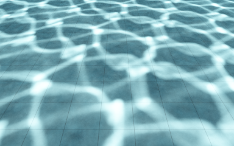
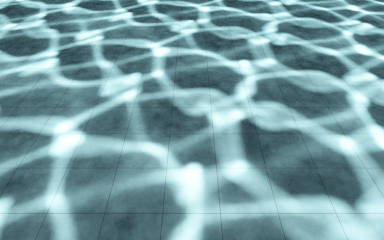

# CPU SPPM：渐进光子映射与焦散

2026-10-10，实现了 SPPM（Stochastic Progressive Photon Mapping）。这是本轮选择的焦散加速方案；完整 VCM 的 vertex connection／merging MIS 尚未实现。已有 CPU BDPT 仅覆盖有限面积光源，当前泳池需要有限太阳、HDR 和水体吸收，SPPM 可以直接复用这些已验证的光子发射与介质输运。

## 使用

```sh
cmake --build build/pt --target pt-package-render pt-photon-tests -j 6

./build/pt/pt-package-render --fixture pool-sunlit-underwater --backend CPU \
  --size 384x240 --samples 256 --bounces 8 --threads 6 --sppm \
  --photon-paths 40000 --photon-radius .08 \
  --output build/path-tracing/pool-sppm

# 主程序也支持，纯 CPU 面积光源／玻璃样例。
./build/pt/Scene-Renderer --path-trace caustics --pt-no-sky \
  --pt-size 160x120 --pt-samples 128 --pt-bounces 8 --pt-sppm \
  --pt-photon-paths 20000 --pt-photon-radius .08 \
  --pt-output build/path-tracing/glass-sppm
```

场景包使用 `--scene scene.json`；主程序对应 `--pt-scene-file`。`--samples`／`--pt-samples` 在此模式表示迭代数，每轮每像素一条随机相机路径。`--photon-paths` 是**每轮**发射路径数，256 × 40000 共发射 1024 万条，包含落空与早停。不能把 SPPM 迭代数当作与普通 PT 同等计算量的 spp。

`--photon-radius` 是初始世界空间半径；默认 0.08。`--sppm-alpha`／`--pt-sppm-alpha` 控制有效光子数增长，默认 2/3，必须在 (0,1)。减小 alpha 会更快缩小核，也会提高方差。主程序启用 `--pt-sppm` 自动关闭 adaptive；与 `--pt-fixed` 的指定顺序无关，但显式重新启用自适应会被拒绝。

| 未降噪 beauty | 焦散 AOV |
| --- | --- |
|  |  |

实际 CPU 渲染，384×240、256 轮、每轮 40000 条光路、初始半径 0.08、深度 8。平均最终半径 0.02795，共 1024 万发射路径；光子构建 3.05 秒，相机与合并 9.35 秒。像素／film 状态约 37.6 MiB，最大驻留单批光子约 1.15 MiB，不含场景与构建临时内存。水面使用冻结的五波解析涟漪，**不是 FFT 捕获**；没有 OIDN、焦散贴图或额外增益。[完整报告](../img/path-tracing/pool-sppm-render.json)。

## 实际积分方式

相机路径通过已有 `CpuScene::trace()` 处理玻璃／水体、介质 winding、Beer 吸收、发射光和直接 NEE。在首个可合并的非介电表面保存随机 visible point、视线和相机吞吐。直接 NEE 此时不再与终止的 BSDF 延续作 MIS；光子只保存至少经过一次散射后的表面命中，避免重复计入直接光。

每轮使用新的、独立于相机的 PCG 光子流。面积光源、有限太阳和 HDR 的发射概率、importance transport、Russian roulette 与原 photon mapper 共用。当前批次按空间单元排序，像素查询最多 27 个相邻单元。合并使用均匀圆盘核，同时保留法线、离面距离和完整路径深度限制。

每个像素长期保存半径 `R`、有效光子数 `N`、通量 `tau`、焦散通量和累计直接光；本轮合并数为 `M`，BSDF 加权光子通量为 `Phi`，相机吞吐为 `beta`：

```text
N_new = N + alpha * M
ratio = N_new / (N + M)
R_new = R * sqrt(ratio)
tau_new = (tau + beta * Phi) * ratio
L = direct_sum / iterations + tau / (pi * R² * total_launched_paths)
```

`M=0` 时保留状态。累计量用 double；相机端点每轮重新采样，焦散 AOV 使用同一半径更新。按全部已发射路径归一化，而非命中数或合并数。实现参照 [PBRT 的 SPPM 推导](https://www.pbr-book.org/3ed-2018/Light_Transport_III_Bidirectional_Methods/Stochastic_Progressive_Photon_Mapping)。

内存随分辨率和单批光子数增长，不随迭代数累积。像素状态、临时端点和 film/AOV 分配前限额 512 MiB；单批最多保存 400 万光子顶点，超过限额报错，避免截断引入未知偏差。这是分配量估算，不是进程 RSS。

## 支持边界与验证

当前为 **CPU 离线积分器**，Metal／Vulkan 请求 SPPM 明确拒绝；原生 Metal RT 的普通 PT 路径继续独立使用。SPPM 可处理默认 PBR、平滑／粗糙固体介电界面、吸收介质、冻结水面与 alpha cutout。支持范围继承 `validatePhotonMapping()`：体积散射／BSSRDF、受控 Blender closure、薄片、混合 alpha、解析点光／聚光／方向光、投影云阴影均明确拒绝。太阳需要有限角半径。SPPM 不与固定 photon mapping、BDPT、guiding、cache 或 adaptive 混用。

有限预算下仍有密度偏差：大半径会平滑亮纹；强光泽表面的方向估计也需要更多光子。直接太阳镜面反射仍由相机采样，可能产生罕见高亮样本；它不随间接光子合并一起加速。水上视角的保留对照确实出现过较高迭代预算反而产生更大 RGB 误差的情况，不能承诺整张图误差单调下降。

`pt-photon-tests` 覆盖均匀核的平水面 Fresnel／Beer 解析照度、完整 SPPM 的水下相机吸收与亮度、首轮能量不随 alpha 改变、半径收缩、独立批次、线程确定性、深度限制、面积光源玻璃焦散、HDR 直接 NEE、film 配置失效、内存限额及不支持选项拒绝。CPU、场景包、介质、程序化几何、视口后处理、photon/SPPM 六组 CTest 全部通过。

Metal GPU 全套 PT self-test 同样通过，包括原生 RT 的 1024 条射线／cutout／镜像／非单位方向及 CPU 参考对照。主程序 `caustics --pt-sppm` 实际出图通过。

## 收敛对照

Apple M4／Release，64×48、水下太阳泳池、深度 8、6 个 CPU worker。各变体串行独立进程，3 次计时取中位数，包含光子发射、索引、相机与合并；seed 1。无降噪，比较曝光之前的线性 RGB。

辅助参考使用 seed 73、400 万条独立光路、128 camera spp、半径 0.025 的固定 photon map；它有有限密度偏差，**不是精确 GT**。另保留独立 seed 73／32768 spp 普通 PT 参考，它仍有明显罕见路径噪声。两组参考的误差均写入 [原始测量 JSON](benchmarks/pt-sppm-2026-10-10.json)。

| 方法 | 累计光路 | 总时间中位数 | NRMSE，相对高密度参考 | 相对 RGB L1，同一参考 |
| --- | --- | --- | --- | --- |
| SPPM，16 轮 | 32 万 | 0.131 s | 35.34% | 31.05% |
| SPPM，64 轮 | 128 万 | 0.520 s | 24.34% | 22.34% |
| SPPM，256 轮 | 512 万 | 2.481 s | 16.72% | 15.42% |
| 固定 photon，64 camera spp、半径 0.08 | 128 万 | 0.718 s | 36.91% | 30.57% |

同为 128 万发射路径和每像素 64 条相机路径，SPPM 本次减少约 28% 时间、34% NRMSE。较小光子批次降低排序与查询负担，逐像素半径收缩提高细节。该对照验证焦散密度估计的改善，不能推广成 GPU 或所有 PT 场景的吞吐提升。SPPM 256 轮相对高密度参考平均能量差约 +0.8%。

相对有噪声的普通 PT 参考，SPPM 16／64／256 的 NRMSE 为 79.05%／76.96%／75.57%，明显高于上述辅助参考误差，说明普通 PT 参考尚未收敛。[水上太阳高光初步对照](benchmarks/pt-sppm-sun-glint-2026-10-10.json) 保留直接镜面项导致误差非单调的结果，不混入此水下表格。

```sh
./build/pt/pt-package-render --fixture pool-sunlit-underwater --backend CPU \
  --size 64x48 --samples 128 --bounces 8 --threads 6 --seed 73 --photons \
  --photon-paths 4000000 --photon-radius .025 \
  --output build/path-tracing/sppm-density-reference

python3 -B tools/benchmark_pt_sppm.py \
  --executable build/pt/pt-package-render \
  --output build/path-tracing/sppm-benchmark \
  --density-reference build/path-tracing/sppm-density-reference
```

默认生成独立普通 PT 参考。已有参考可用 `--reference <prefix>`，额外的有偏高密度诊断参考通过 `--density-reference <prefix>` 提供；工具检查场景、尺寸与独立 seed。测试前完成编译，工具会拒绝执行期间二进制发生变化的结果。

## 后续 VCM 与 GPU

1. GPU SPPM：先让原生 RT 执行光子发射与相机端点生成，再将 visible-point 网格、合并和像素状态搬到 GPU；必须与 CPU 使用相同路径预算、核和归一化。
2. 完整 VCM：为相机／光源端点保存正反向密度，加入 connection 和 merging 的统一 MIS；先验证有限面积光源、delta 玻璃，再增加太阳／HDR 端点。不能简单相加 BDPT 与 photon beauty。
3. 高光与常规 GI：独立改进太阳盘采样、光源选择和高光终止／final gathering；SPPM 的池底收益不代表所有 PT 材质与场景的通用倍数加速。
