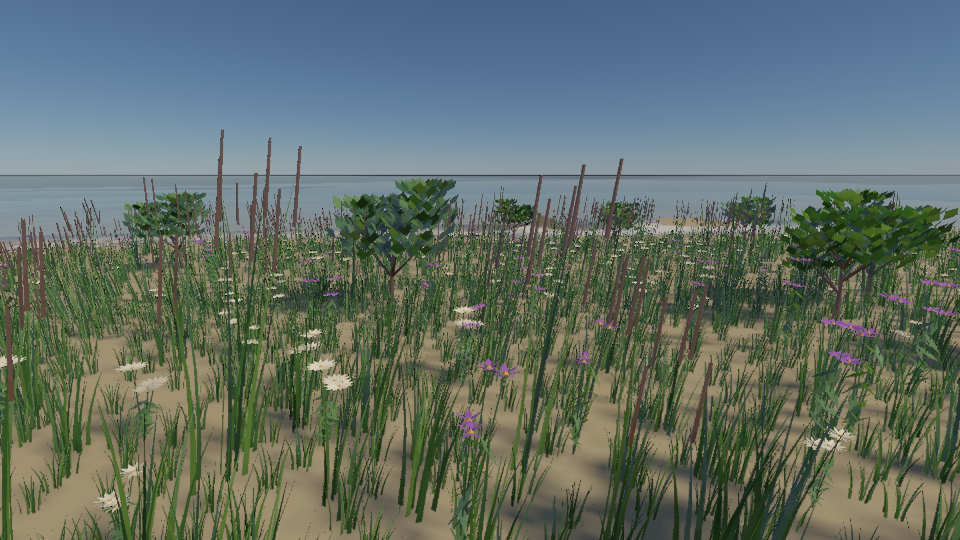
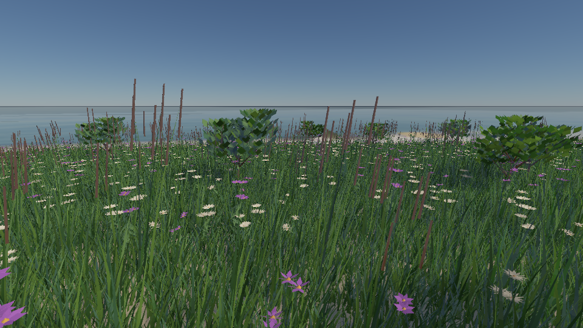
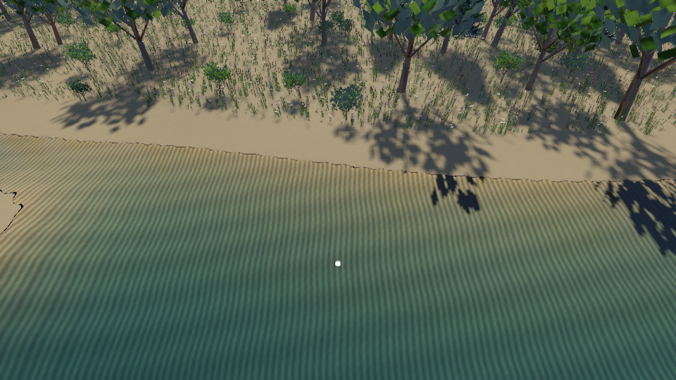
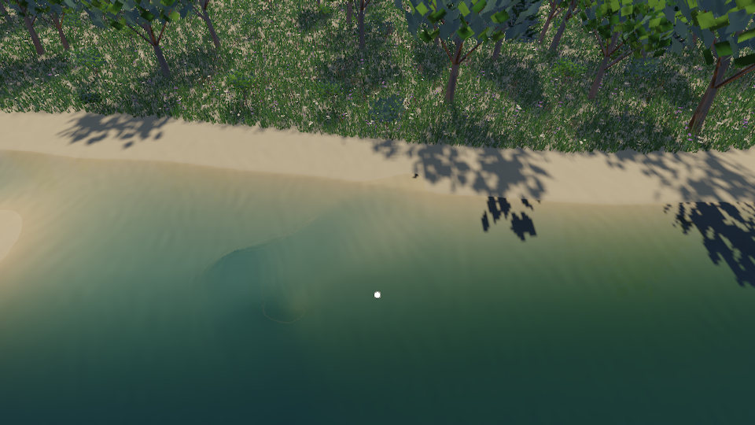

# 程序化沙纹与密集草地：SIGGRAPH 调研和落地

2026-10-11。目标是改善湖岸演示的规则沙纹和稀疏草地，同时保持 Metal / Vulkan 的同一实现。本页将论文提供的方法、工程选择和实测结果分开记录。

## 调研与选择

| 方法与一手来源 | 能解决的问题 | 本仓库的选择 |
| --- | --- | --- |
| [Procedural Noise using Sparse Gabor Convolution，SIGGRAPH 2009](https://graphics.cs.kuleuven.be/publications/LLDD09PNSGC/) | 通过稀疏 Gabor 核控制方向、主频和带宽；论文还支持各向异性过滤和不依赖 UV 的表面噪声 | 本轮借鉴局部波包：不同中心、方向、频率、相位的短波纹叠加。生成有限贴图并走现有 mip/VT；没有实现论文的解析过滤或无 UV 表面噪声 |
| [Procedural Phasor Noise，SIGGRAPH 2019](https://radar.inria.fr/report/2019/mfx/uid34.html) / [作者代码](https://github.com/mfx-inria/phasornoise) | 将 Gabor 噪声的瞬时相位用于可控周期轮廓，改善局部对比度缺失，适合连续脊线、波纹和微结构 | 下一阶段候选：控制非对称沙脊截面及局部波长。恒定对比度仍需足迹过滤，不能直接消除摩尔纹 |
| [Recursive Wang Tiles for Real-Time Blue Noise，SIGGRAPH 2006](https://johanneskopf.de/publications/blue_noise/) | 无限非周期、确定性的蓝噪声点集，允许空间变化密度和渐进加点 | 适合后续植被 clipmap / 分层候选，减少远景候选生成成本。本轮保留稳定抖动格和固定根 ID；它不是 Poisson disk，也不宣称蓝噪声谱 |
| [Realistic Modeling and Rendering of Plant Ecosystems，SIGGRAPH 1998](https://algorithmicbotany.org/papers/ecosys.sig98.html) | 将生态分布、参数化植物、近似实例化组合起来，控制复杂自然场景 | 采用“分布控制和植物几何分开”的方向。后续增加湿度、日照、竞争和生境；目前仍是坡度 / 水域过滤和种子散布，没有生态生长模拟 |
| [One Noise to Rule Them All，SIGGRAPH 2024](https://armanmaesumi.github.io/onenoise/) / [作者代码](https://github.com/ArmanMaesumi/OneNoise) | 条件扩散模型生成和空间混合多类可控噪声，作为逆向程序材质设计的先验 | 适合离线材质创作和参考图拟合。推理、模型资源和再现成本较高，本轮不引入实时渲染依赖 |
| [Interactive Invigoration: Volumetric Modeling of Trees with Strands，SIGGRAPH 2024](https://storage.googleapis.com/pirk.io/projects/invigoration/index.html) | 用体积 strands 和局部活力编辑控制枝干侧向发展与树形细节 | 后续树木几何质量方向；不解决本轮草地覆盖问题，也没有替换现有程序树模型 |

工程判断：当前最先需要的是频率控制、覆盖一致性和稳定的密度调节，而非完整的沙输运或树木生长求解。Gabor 的局部性适合先消除整片相干条纹；Phasor 更适合随后增强清晰、连续的沙脊。

## 沙纹实现

旧沙纹为 `cos(25.1*x + 1.1*sin(1.7*z))`，周期约 0.25 m；128 m 区域用 2048 像素覆盖，每周期约四个 texel。底色波纹对比度很高，水面折射后更容易产生干涉状条带。

`ProceduralSand` 在每个 2 m 格中放置两个固定种子的核，累加邻格内半径 2 m 的局部波包：

```
h(p) = 0.009 * Σ weight * exp(-1.3*r²) * (1-r²/4)²
                        * cos(dot(frequency, delta) + phase), r < 2
```

核方向和相位随机变化，频率为 1.15–1.90 cycles/m，波长约 0.53–0.87 m，对应约 8–14 texel。紧支撑包络在边界处值和一阶导数归零，法线由同一高度函数的解析导数生成。低频斑块和细尺度色差采用周期平滑噪声；细尺度色差使用 0.5 m 格，并非真实沙粒。底色上的波纹系数仅 0.018，起伏主要交给法线表现，更细的颗粒散射仍由粗糙度近似。

该场按 128 m 周期平铺，保证边界连续；它是可平铺的工程近似，不是论文的无限非周期 Poisson 过程。生成在场景创建时进行，运行帧不重复计算全部核。地形几何只保留低频床面起伏，细沙脊没有真实位移。湖岸预设额外按高度将沙地过渡到草地底色，覆盖权重与相机无关；沙滩预设仍使用沙色。

沿用现有材质 mip / 虚拟纹理足迹选择。普通材质已有 mip 和各向异性采样，地形使用 VT 分层采样；本轮没有加入完整的折射足迹积分，掠射角、强折射和极细高光仍需单独检查。

## 草地密度和覆盖

原多物种路径将 `nearSpacing` 和 `farSpacing` 同时设成物种的固定间距，几何 LOD 简化并不改变距离密度。本轮为物种增加 `farSpacing`、`denseRadius`、`sparseRadius`、`farWidthScale`。

```
t = smoothstep(denseRadius, sparseRadius, horizontalCameraDistance)
spacing = mix(nearSpacing, farSpacing, t)
candidateProbability *= (nearSpacing / spacing)²
clumpWidth *= mix(1, farWidthScale, t)
```

根 ID 与抖动位置保持固定，通过同一个随机阈值逐渐接受 / 拒绝候选；近、远几何仍使用互补选择，避免重复绘制。近区优先保留预算，所有 LOD 共用物种容量。距离密度和几何 LOD 是独立参数。

| 默认物种 | 近间距 | 远间距 | 密集 / 稀疏半径 | 远景宽度倍数 | 总实例容量 |
| --- | --- | --- | --- | --- | --- |
| 短草 | 0.16 m | 0.58 m | 8 / 60 m | 2.6 | 98,304 |
| 高草 | 0.45 m | 1.15 m | 10 / 70 m | 1.8 | 16,384 |
| 雏菊 | 0.70 m | 1.70 m | 10 / 70 m | 1.4 | 8,192 |
| 野花 | 0.85 m | 1.90 m | 10 / 70 m | 1.4 | 8,192 |

短草近区理论密度为 `0.96 / 0.16² = 37.5` 丛/m²，稀疏区约 2.85 丛/m²，未计水域、坡度、淡出和容量限制。近景每丛 12 片四段弯叶；远景为六片两段较宽弯叶。地表草色保持远处整体覆盖感。宽度补偿是外观上的有偏 LOD，不是叶面积或光传输守恒；花与树木不能无限加宽替代真实模型。

前帧记录旧相机、密度过渡半径、宽度、淡出距离、形状尺度和风动，以同一根 ID 重建前帧矩阵；相机移动和参数变化不会将当前变形当成旧形状。新增 / 消失植株仍依靠现有深度拒绝和时域重建；稳定阈值抽样不等于连续 alpha 淡出。

## 验证和图像

CPU 检查：种子差异、平铺连续、解析梯度与数值导数、有限坡度 / 色差、距离设置合法性。

GPU 检查：平面近区及远区实测每平方米密度、容量约束、互补 LOD、相机移动后前帧宽度 / 高度 / 风矩阵的根对应关系，以及原地形和局部水波回归。编辑根格间距时拒绝旧历史。

Apple M4：Metal 和 Vulkan / MoltenVK 的自检通过。密度测试使用近间距 0.2 m、远间距 1 m、密度 1，近区圆盘半径 3 m，远区环带 8–12 m，关闭视锥筛选，容量没有饱和。两个后端都测得 **24.9696 丛/m²** 和 **0.986761 丛/m²**，接近理论 25 和 1；这不是默认场景的直接统计。

实际画廊为 960×540、模拟时刻 8 s、TAA 16 帧；前四帧不计时。湖岸 LOD 模式 35,282 株、837,210 个植被三角形；全部完整几何 35,285 株、3,469,348 个三角形。同步采集及渲染中位耗时分别 **159.73 / 161.22 ms**，约只差 0.9%。草甸近景 93,447 株、4,699,880 个三角形、**210.79 ms**。这些是有意等待 GPU 的测量，排除深度反馈和呈现，不等于编辑器 FPS。

覆盖提高仍有成本：初版湖岸测得约 136.85 ms，本轮约 159.73 ms；纹理、床面和几何配置均有变化，不能把这组历史差值归因于某一个通道。下一步优先优化候选生成，再校准近景模型成本。[湖岸统计](../img/nature/refined-lake-metrics.json)、[完整几何统计](../img/nature/refined-lake-full-detail-metrics.json)、[草甸统计](../img/nature/refined-meadow-metrics.json)。

| 初版 | 本轮改进 |
| --- | --- |
|  |  |
|  |  |



两张波关闭图的同一水下 ROI `(80,300)–(880,500)`，8-bit 显示亮度水平梯度 RMS 从 6.43 降至 1.39，表示该视角条纹对比度降低，不是严格的反走样误差度量。新版 Metal / MoltenVK 图像平均绝对 RGB 差约 0.104 / 0.075 / 0.087（8-bit），见 [对照测量](../img/nature/refinement-comparison.json)。两后端运行在同一 M4 上；本机缺少 Khronos validation layer，不代表其他厂商 Vulkan 驱动验收。

```sh
cmake --build build/pt-native-rt/runtime --target Scene-Renderer nature-system-tests -j 5
build/pt-native-rt/runtime/nature-system-tests
build/pt-native-rt/runtime/Scene-Renderer --nature-self-test --backend Metal
build/pt-native-rt/runtime/Scene-Renderer --nature-self-test --backend Vulkan
build/pt-native-rt/runtime/Scene-Renderer --render-gallery build/nature-refined vegetation-lake --backend Metal
build/pt-native-rt/runtime/Scene-Renderer --render-gallery build/nature-refined-wave wave-particles-lake --backend Metal
```

## 后续次序

1. **候选生成成本**：目前仍扫描近间距格，远景虽少绘制，候选计数 / 筛选仍有成本。改为渐进点集或分层 clipmap，按密度生成候选；维持根身份和近区预算。
2. **细节反走样**：增加掠射角 / 移动镜头测试，评估折射足迹、法线方差与远景粗糙度补偿，避免将细节搬到法线后产生高光闪烁。
3. **生境分布**：统一植被和地表覆盖图，加入湿度、坡向、树冠遮蔽及种间竞争；以空间斑块和小规模模型变体打破人工草坪感。
4. **更真实的沙脊**：Phasor 控制连续脊线、波长场和非对称截面，随后才考虑风 / 水驱动沉积、侵蚀及湿沙状态。
5. **植物外观**：远景叶片 BRDF / 透射和覆盖校准，树冠 impostor；更高质量的枝干和叶簇模型，再评估 strand 生长建模。

## 树木专项：现状和交付顺序

专项实施前，沙纹 / 草地改进没有升级树木几何。`VegetationGeometry.cpp` 的阔叶树仍是一根圆柱主干、九根按固定角度排列的侧枝、315 片菱形叶；远景减为四根侧枝和 20 片较大叶，轮廓和遮挡覆盖还没有校准。针叶树近景为分层侧枝 / 针叶簇，远景为分层锥面。同物种复用一个树形，实例主要改变朝向和尺度；材质是调色板加普通双面 PBR。风只对整株实例施加剪切，没有分枝层级和叶片局部摆动。

方法补充：[Self-organizing Tree Models for Image Synthesis，SIGGRAPH 2009](https://algorithmicbotany.org/papers/selforg.sig2009.html) 以芽和枝条对光 / 空间的竞争及内部信号形成树形，支持不同树种和修剪控制，适合未来可生长环境系统。作为先实现静态自然树形的路线，[Space Colonization，Eurographics Natural Phenomena 2007](https://algorithmicbotany.org/papers/colonization.egwnp2007.html) 通过空间吸引点控制枝条扩展，提供直观的树冠形状参数；它不属于 SIGGRAPH 论文。前文的 SIGGRAPH 2024 Invigoration 更适合后续精细枝干体积、分叉形态和交互编辑。

建议交付顺序：

1. **树形与变体**：增加父子枝骨架、递减半径、弯曲主干和不规则冠形。阔叶采用空间吸引点，针叶保留有树种约束的分枝层级；每树种预生成 4–8 个固定种子 / 年龄变体，缓存几何，实时帧只实例化。保留无叶视图验收枝条结构，不能靠树叶掩盖问题。
2. **树皮与叶片**：拆分树皮 / 叶材质，树皮方向纹理和粗糙度；叶片增加弯曲、叶脉、厚度控制的透射和背光。相同资产交给实时与 PT，记录两种管线的近似差别。
3. **覆盖与 LOD**：近景真实枝叶，中景简化枝叶簇，远景多视角 / octahedral impostor；按屏幕投影校准冠幅、叶面积、阴影和深度，再做稳定过渡。先用几何模型共用 PT；impostor 仅作为实时表示，PT 仍冻结对应真实模型。
4. **森林分布**：稳定树根和树形身份，树冠空间占据、树龄与疏密斑块，水位 / 坡度 / 湿度影响物种，树冠遮蔽影响林下草地。远处优先降低单树表示成本，直接删除树木容易改变森林轮廓与阴影。
5. **风与验收**：分枝层级摆动、叶片独立扰动及匹配速度历史；分别渲染近景单树、林缘、密林、逆光与移动相机，统计树冠覆盖、LOD 跳变、阴影一致性和各通道耗时。破坏 / 交互生长与完整 strands 模型后置。

树木专项第一阶段已实施：新增分枝树形与固定种子变体、独立叶片薄表面材质、近远叶簇和 GPU 按级联筛选投影者；单树、无叶骨架、林缘与森林图和测量见 [树木专项实现](procedural-trees.md)。树冠 impostor、分枝局部风、生长竞争及独立 shadow LOD 继续后置。
