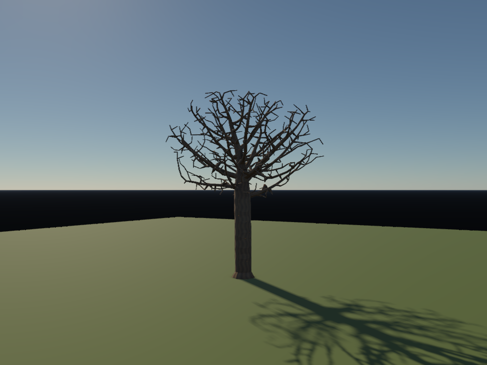
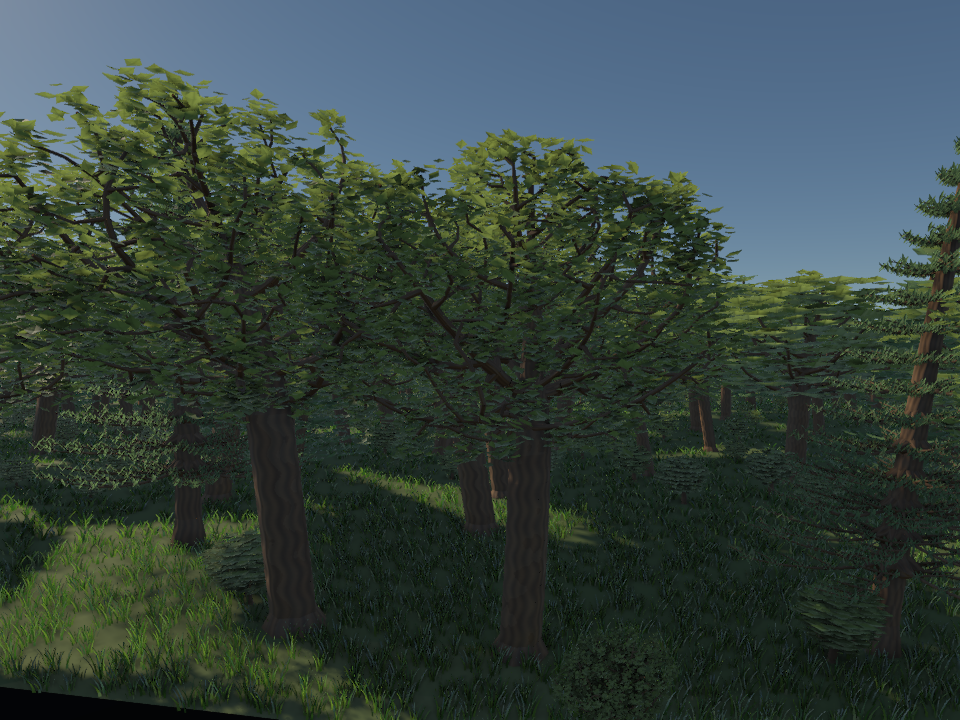
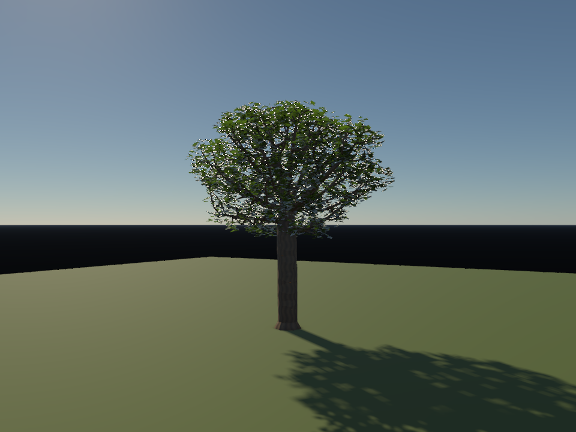

# 程序树木：树形、叶片和实例阴影

树木专项第一阶段已实现。自包含资产支持阔叶树、针叶树和灌木，提供近景单树、无叶骨架、林缘、森林四个实时场景；图片来自原生渲染器。没有外部树木模型依赖。

## 树形和材质

`TreeGeometry` 用同一份父子分枝骨架生成两个 LOD，包含弯曲主干、末端细枝、基部加粗和随枝条负载递减的半径。阔叶树在不规则冠层中放置吸引点，再迭代扩展枝条；针叶树采用分层侧枝、细枝和针叶。灌木降低分枝起点。此实现参考 [Space Colonization，Eurographics Natural Phenomena 2007](https://algorithmicbotany.org/papers/colonization.egwnp2007.html) 的空间吸引点思路，是有预算上限的静态生成器，没有实现光照竞争、树龄生长或完整的生物学模型。

默认阔叶树、针叶树各缓存四种形态，灌木两种。根身份决定形态，变体与 LOD 共同使用一个物种容量，避免重复放置和变体数量放大种群。近景保留完整枝干与折叠叶片，远景裁掉细枝，并按空间单元汇聚叶片成带 alpha 的叶簇。小灌木的完整几何距离为 12 m，大树约 35–40 m；森林样例分别调为 22 / 24 m。两种表示共用骨架、根和归一化尺度；尚未加入 impostor 或屏幕投影驱动的连续 LOD。

树皮和叶片拆成独立绘制、UV 与材质。树皮有纵向凹凸、粗糙度和圆滑的径向法线；叶片有轮廓 alpha、叶脉法线、粗糙度及厚度权重。叶片面对观察者定向，分别评估正面反射与反面漫透射，不把背面简单当作另一面反射。

实时叶片将反射漫射乘以 `1-T`，透射近似为 `0.96 * sqrt(albedo) * T / π`，`T` 由透射参数和厚度贴图共同控制；天空透射采样反向半球的辐照度。原来的普通 PBR / SSS 保持原有语义，材质 feature bit 32 选择叶片模型。

树皮与叶片共享 GPU 生成的当前、上一帧实例矩阵，叶片只复制间接参数中的实例数，不读回 CPU。PT 捕获冻结各部分真实几何和贴图，并映射到已有的 thin diffuse reflection/transmission BSDF。普通静态树的 CPU/PT 上传也使用同一转换；转换不修改实时材质。PT 的这个薄片模型没有实时叶片的 GGX 高光，因此两者不是严格一致的完整 BSDF。

## 植被阴影怎么接入

保留现有五级 CSM、级联重叠与混合、texel snapping 和 PCSS。级联平滑过渡仍由原有接收端实现，新增部分处理投影者。

每个光源面或级联开始绘制前，compute shader 用 **该光源的 VP、实例矩阵和局部几何 AABB** 做保守视锥测试，将幸存实例压缩到 GPU 缓冲，并写入 indirect draw 的实例数。普通实例批次与 GPU 散布植被共用此路径，depth-only 和 RSM 都支持；缓冲重复使用，日常帧不读回计数。

叶片可见性和阴影使用同一张 alpha 贴图与 cutoff。树木种群不按主相机视锥裁掉，因此能保留种群放置范围内、位于画面外但投影进级联的树木。光源矩阵包含既有 PCSS 边界扩展，实例测试另留两像素 XY 余量。种群距离之外尚未生成的植物不会凭空补进阴影。

这条路线沿用光源视图下的级联投影者筛选思路，见 [GPU Gems 3：Parallel-Split Shadow Maps](https://developer.nvidia.com/gpugems/gpugems3/part-ii-light-and-shadows/chapter-10-parallel-split-shadow-maps-programmable-gpus)。本轮没有添加独立 shadow LOD，也没有实现 opacity shadow map 或穿越整冠的彩色透射阴影；主阴影仍是 alpha-tested depth。

开关位于 Shadow 面板的 **Shadow GPU instance culling**。诊断读回只在测试和画廊统计中执行。

## 原生渲染

| 近景单树 | 无叶骨架 |
| --- | --- |
|  |  |

| 林缘 | 林内 |
| --- | --- |
|  |  |

固定时刻 8 s，960×720，TAA 16 帧。地面为自包含的有限测试地面；这些是实时结果，未使用 PT 或图像生成模型替换渲染输出。

下面性能表保留第一阶段测量，采于 2026-10-11、早于下述亮点修复；当前图片已用 2026-10-12 修复后的着色重渲染，表中耗时不代表修复后的管线。

Apple M4，Release 构建。Metal 森林包含 15,729 株（含草、树和灌木）；该次 LOD 提交 6,077,448 个植被三角形，全部使用近景几何的同种群估算为 45,505,404，减量约 86.6%。后者是按实例加权的几何估算，未将其另渲染成质量参照。

| 后端 | 剔除开：阴影三角形 | 剔除关：阴影三角形 | 同步耗时：开 / 关 |
| --- | ---: | ---: | ---: |
| Metal | 23,717,164 | 30,387,240 | 144.45 / 148.77 ms |
| Vulkan / MoltenVK | 23,964,920 | 30,617,040 | 160.96 / 156.71 ms |

Metal 阴影提交规模减少约 22.0%，整帧耗时改善约 2.9%。MoltenVK 这次约慢 2.7%，因此不能把几何减量解释为所有后端的加速；compute 调度和同步成本仍需优化、重复测量。开关可用于该后端的取舍。

两后端开／关的阴影深度图均逐像素一致（最大误差 0，包含实际投影者）。整幅颜色并非逐像素一致：两次独立 TAA 采集的平均 byte 误差为 Metal 3.039、MoltenVK 3.037；该差值未归因于阴影。Metal / Vulkan 参考图也存在细小种群计数和显示差异，平均绝对 RGB 差为 [0.07536024305555555, 0.08312644675925926, 0.0760546875]（8-bit），不作为跨后端严格逐像素匹配证明。

计数按五个级联的每个 draw 累加，树皮与叶片各算一个 draw；三角形表示间接参数下的提交规模，不能当作独立树根数或可见像素数。计时等待 GPU，包含采集／准备和完成的渲染，排除反馈、呈现与诊断读回；这些同步时延不等于编辑器 FPS。

[汇总数据](../img/nature/tree-refinement-metrics.json)、[Metal 原始统计](../img/nature/tree-forest-vegetation.json)、[关闭剔除](../img/nature/tree-forest-unculled-vegetation.json)、[MoltenVK 原始统计](../img/nature/tree-forest-vulkan-vegetation.json)。两个后端都运行于同一 M4；本机没有 Khronos validation layer，也未验收其他厂商 Vulkan GPU。


## 亮点修复（2026-10-12）

此前树冠、细枝周围的白点主要来自天空着色错误。`displayedSky` 在按 G-buffer 覆盖分支后计算太阳圆盘的 `fwidth`；叶片缝隙的 fragment quad 同时包含几何和天空，分支内导数未定义，错误宽度将太阳光泄漏到离圆盘很远的天空像素。TAA 再把这些异常 HDR 值混到边缘。关闭天空镜面反射基本不改变问题，关闭 TAA 仍有天空异常；修复在覆盖分支前完整计算圆盘角度与导数，不通过降曝光或截断高光掩盖问题。

同时修复 `GpuMaterial::updateExtension` 丢失 foliage bit 32 的问题。此前静态树与 GPU 森林的叶片透射权重被当作旧 SSS 参数；现在 G-buffer 正确编码叶片类型与厚度权重，并启用双面薄片模型。

同机位、相同曝光与 16 帧 TAA：单树固定树冠区域内接近纯白的像素（所有 RGB8 分量 >220）从 854 降至 0，无叶骨架从 367 降至 0；单树全图 HDR 峰值从 4.98 降至 0.55。指标定义见 [亮点对照数据](../img/nature/tree-highlights-metrics.json)。这是上述机位的伪影验收，不要求其他场景的真实高光为零。

| 修复前 | 修复后 |
| --- | --- |
|  |  |

Metal 与 Vulkan/MoltenVK 新增原生回归均通过：相同相机下，alpha 叶片缝隙的天空 HDR 与没有前景遮挡的天空逐像素一致（最大误差 0）；610 个叶片像素实际进入 foliage 模型。CPU 的 nature-system、pt-cpu、pt-procedural 三项测试通过。已重新生成单树、骨架、林缘、森林及 Vulkan 森林图。

```sh
build/pt-native-rt/runtime/Scene-Renderer --render-gallery build/tree-highlights tree-lighting --backend Metal
```

此诊断输出正常、关闭 TAA、关闭天空镜面反射、关闭太阳直射四种结果，以及最亮几何像素的 HDR／G-buffer JSON。

## 验证与复现

CPU 检查覆盖固定种子与缓存、有限法线和高度、近远几何减量、叶片 alpha 轮廓、PT 转换不修改源材质与反射／透射能量上界。

Metal 与 Vulkan / MoltenVK 原生自检均通过，覆盖变体／LOD 根不重复、共享种群容量、树皮／叶片共用变换、风动历史、光源视图保留正确实例，以及非空 alpha-tested 阴影深度图在 depth-only / RSM 两种路径的开关一致性。原来的地形、草地距离密度和 Wave Particles 回归同时执行。三个 CPU 测试通过；Metal 多线程编辑器以固定时刻运行森林 12 帧、1600×900，退出正常，未拒绝场景发布。

```sh
cmake --build build/pt-native-rt/runtime --target Scene-Renderer nature-system-tests pt-cpu-tests pt-procedural-tests -j 5
ctest --test-dir build/pt-native-rt/runtime -R '^(nature-system|pt-cpu|pt-procedural)$' --output-on-failure
build/pt-native-rt/runtime/Scene-Renderer --nature-self-test --backend Metal
build/pt-native-rt/runtime/Scene-Renderer --nature-self-test --backend Vulkan
build/pt-native-rt/runtime/Scene-Renderer --render-gallery build/tree-refinement trees --backend Metal
build/pt-native-rt/runtime/Scene-Renderer --render-gallery build/tree-refinement-vulkan tree-forest --backend Vulkan
build/pt-native-rt/runtime/Scene-Renderer --classic tree-single --backend Metal
build/pt-native-rt/runtime/Scene-Renderer --classic tree-forest --backend Metal
```

## 后续次序

1. 校准近远叶簇的冠层覆盖、叶面积和阴影，增加移动镜头的 LOD / alpha 闪烁对照；按投影大小选择 LOD，并评估保持覆盖的 impostor 与独立 shadow LOD。
2. 将阴影压缩改成实例索引重映射，减少每个级联复制矩阵的带宽和缓冲容量；复用树皮、叶片的实例筛选结果时，使用覆盖两部分的共同边界。
3. 增加林下间接光和叶片多层透射。当前漫透射是局部着色模型，不能替代整个冠层的多重散射或透射阴影。
4. 引入树冠空间竞争、物种斑块和林下遮蔽，减少散布中的冠层穿插；加入枝条层级风和叶片局部运动，匹配速度历史。
5. 再考虑 [Self-organizing Tree Models，SIGGRAPH 2009](https://algorithmicbotany.org/papers/selforg.sig2009.html) 的光／空间竞争和生长控制，以及精细枝干体积表示。森林 PT 冻结当前仍展开每批实例，后续复用 BLAS / TLAS，并进一步对齐叶片高光闭包。
