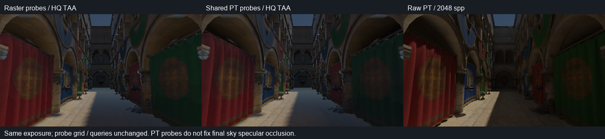
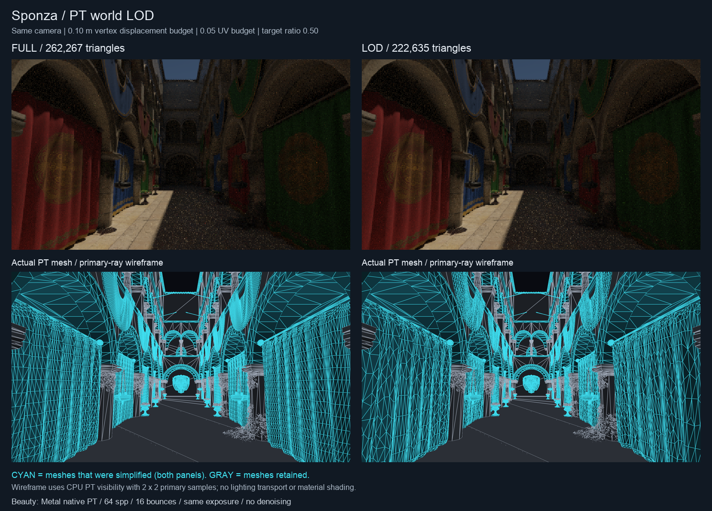
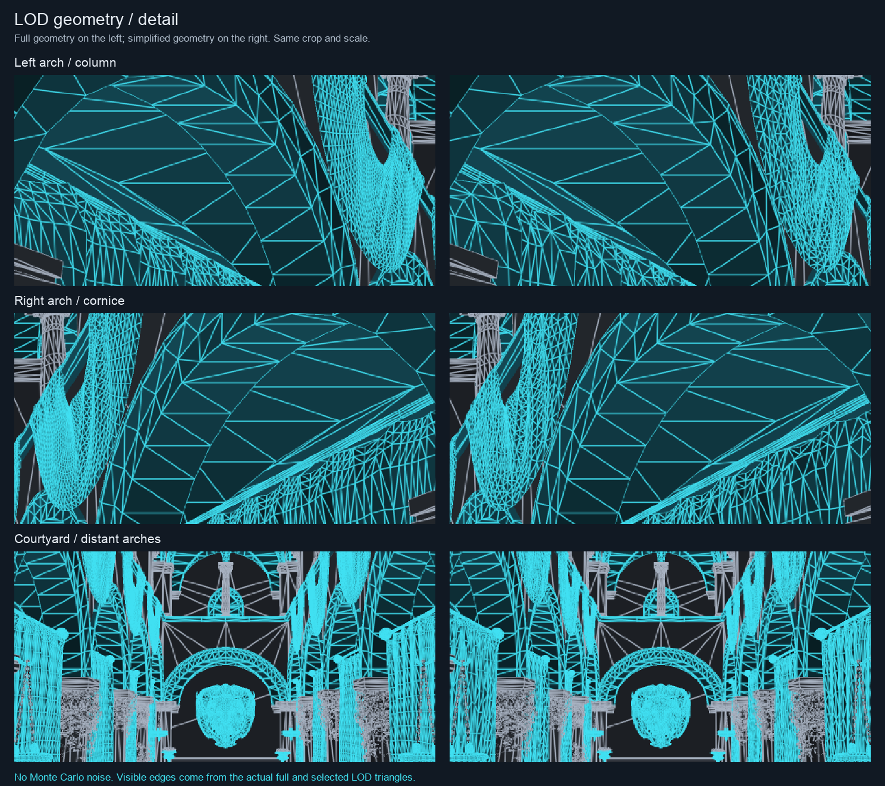

# PT 探针采样与聚类 PT 世界

DDGI 新增一个 PT 参考捕获后端；PT 新增可关闭的自动几何 LOD。两者可单独启用，也可组合：完整场景继续光栅渲染和提供独立表面参考，简化世界只用于生成探针。

## 共享 PT 探针

`GpuProbeTracer` 复用 `GpuPathTracer.cpp` 的 `Kernel`、场景缓冲缓存、Metal 原生 BLAS/TLAS、软件求交、材质求值、NEE/MIS 和多反弹积分。相机与探针入口单独编译，共享 `pt-integrator.glsl`；没有第二套 BSDF 实现，也没有为每个探针创建相机渲染会话。每个采样方向输出 `Pixel.mean = {radiance.rgb, signedFirstDistance}`，DDGI compute 直接读取同一个 GPU 缓冲，生成原来的 8×8 辐照度和 16×16 距离矩。帧循环没有辐亮度读回。

方向沿用现有六面中心采样及立体角权重，因而能固定方向、布局和查询算法对照捕获后端。每方向的样本数增加的是路径积分样本，**不会增加第一段的角分辨率**。面分辨率仍控制遮挡细节；本阶段还没有随机旋转射线或球面随机采样后端。

首次命中的几何正反面决定分类；两面材质不会仅因背面命中被拒绝。距离截到探针最大距离；未命中的距离为零，积分时转换为最大距离。PT 的 miss RGB 已含实际环境光，积分不再加入天空。首次未命中的解析太阳圆盘被排除，命中表面之后的太阳 NEE 与 BSDF 反弹仍保留，避免和实时直接太阳光重复。完整 PT 多反弹不叠加旧 DDGI 场反馈。探针初始介质通过冻结 CPU 场景确定。

场景资源和加速结构在多个探针之间复用。构造、上传和 AS 建设发生在设备所属线程；这是当前的**离线参考捕获入口**，尚未加入编辑器实时 DDGI 后端选择或增量异步探针场景准备。编辑器 DDGI 默认继续使用光栅捕获。默认 PT 路径预算是每方向 4 样本、8 层；严格对照应明确指定深度、样本、更新轮数。

```sh
./build/Scene-Renderer --path-trace-gpu sponza --backend Metal \
  --pt-size 480x270 --pt-samples 64 --pt-fixed --pt-bounces 16 \
  --pt-compare-ddgi --pt-ddgi-frames 480 \
  --pt-ddgi-capture pt --pt-ddgi-path-samples 4 --pt-ddgi-path-depth 16 \
  --pt-output build/path-tracing/sponza-pt-probes
```

`--pt-ddgi-capture raster` 保留原捕获消融。报告记录后端、路径预算、是否原生 RT、简化探针世界，以及包含整帧光栅工作的烘焙墙钟时间；后者不是探针 kernel 的独立 GPU 时间。

## 自动聚类 LOD

算法采用空间顶点聚类，参考 [Garland / Shaffer 的自适应聚类工作](https://mgarland.org/files/papers/massive.pdf)。本实现先提供确定性的均匀网格候选层级和逐次局部安全检查，没有声称实现论文中的完整自适应八叉树或 quadric 优化。

1. 按共享 `MeshPayload` 分组，完整属性相同的顶点合并为拓扑顶点；不同材质的 draw 保持独立，原纹理与材质资源共享。
2. 锁定外边界、孔洞边界、UV／法线／切线接缝。裁剪透明、两面薄片、发光体、介质边界、水体、草和头发保留完整几何；非流形边或退化输入回退。
3. 生成逐级加倍的空间网格。仅在同一单元、相容法线、相邻拓扑顶点之间收缩，互不连接的表面不会因为靠近而焊接。
4. 每次收缩使用源顶点的平均位置与属性，检查 manifold link condition、受影响面的朝向，以及源顶点到代表点的世界空间位移和 UV 位移。失败只拒绝该次收缩。
5. 最后复查边计数、原边界与新边界一致、重复面和翻面。选择达到目标三角形比例的首个有效层级；达不到时选择误差范围内三角形最少的层级，允许完整网格回退。

同一网格的所有实例共享一个 LOD。误差按实例变换矩阵的谱范数上界 `sqrt(norm1(M) * normInf(M))` 换算，包含非均匀缩放、镜像、旋转和剪切。它是**源顶点到聚类代表的位移约束**，不是双向 Hausdorff、纹理颜色误差或光输运误差保证。

```sh
./build/Scene-Renderer --path-trace-gpu sponza --backend Metal \
  --pt-size 480x270 --pt-samples 64 --pt-fixed --pt-bounces 16 \
  --pt-world-lod --pt-lod-error 0.1 --pt-lod-ratio 0.5 --pt-lod-uv-error 0.05 \
  --pt-output build/path-tracing/sponza-low-world
```

默认关闭；默认预算为世界空间位移 0.05 m、UV 位移 0.02、目标比例 0.5，最多 8 个网格候选。编辑器 `Path tracing viewport → PT clustered world LOD` 在下一次 Capture / Restart 时生效，CPU 简化在原有 PT 准备 worker 上执行。原有 worker 还保留一个 128 MiB / 最多 32 个来源网格的 LOD 缓存（按网格数组容量估算）。材质／光照修改在保护规则、变换尺度和误差预算不变时复用同一简化网格身份，供 CPU BLAS 与 GPU AS 缓存继续复用；改变介质／alpha 保护、几何 revision 或 LOD 设置会失效。修改 LOD 设置会使相机专用复用失效并重建 PT 场景。光栅世界保持完整几何。

单独启用 LOD 会让相机、反射、折射和阴影射线全部使用简化 PT 世界；当前没有按射线类型选择不同 AS，也没有每帧随摄像机变化的 LOD 切换。组合 `--pt-compare-ddgi --pt-ddgi-capture pt --pt-world-lod` 时，光栅场景和独立 CPU 表面查询参考保持完整，只有 probe PT 世界被简化。最终另存的 PT beauty 是 LOD PT，不能当作完整几何 GT。

`<prefix>-world-lod.json` 记录唯一／实例展开三角形数、每个网格候选层级、选中误差、保护原因与 CPU 建设耗时。减面不必然提高硬件 RT 吞吐，必须分开比较 AS 大小、建设时间、固定工作量的实际追踪时间和画面误差。

## 验证

```sh
./build/Scene-Renderer --pt-world-lod-self-test
./build/Scene-Renderer --pt-self-test --backend Metal
./build/Scene-Renderer --ddgi-self-test --backend Metal
```

LOD 测试覆盖带孔网格减面、原边界保留、源网格不变、共享实例、缩放误差、256 条独立遮挡射线、确定性以及介质／alpha 保护；还检查材质编辑的缓存身份复用、保护条件失效与缓存字节上限。PT 测试比较独立 CPU 路径积分、首次命中距离和背面拒绝；DDGI 测试验证常量天空 `E/π`、多探针同命令列表积分以及太阳去重。

天空镜面遮挡和距离矩插值漏光仍是独立问题。准确 PT 捕获不等于准确的逐像素 GI；本阶段保留原查询，便于测量两者各自的误差。

## Sponza 实测

Metal / Apple M4，480×270；固定 1,280 个探针、2 m 间距、12×12 六面方向、每帧 8 个探针、960 帧。PT 捕获每方向 4 条路径、16 层，未使用 DDGI 反弹反馈。表面比较沿用原 120,872 像素 AOV 对齐腐蚀掩码与高质量 TAA。PT GT 保持原 2,048 spp / 16 层、不去噪；新捕获的天空 HDR SHA-256 与原参考一致，太阳参数、曝光、相机和种子保持一致。

| 对照 | 当前光栅探针 | 共享 PT，完整世界 | 共享 PT，聚类世界 |
|---|---:|---:|---:|
| 47 个独立表面 `E/π` normalized L1 | 37.25% | **19.79%** | **19.62%** |
| 平均辐照度能量偏差 | +22.43% | **+3.70%** | **+3.86%** |
| 整条实时管线对 GT，内区 normalized L1 | 41.93% | **37.44%** | **37.47%** |
| 诊断性关闭天空镜面，内区 normalized L1 | 25.45% | **20.24%** | — |

最后一行的光栅列也是关闭天空镜面的消融；产品默认镜面强度保持 1。第一／二行比较 incident 辐照度，第三／四行还包含实时 BRDF、直接光、材质和最终镜面误差，不能混为单独的 DDGI 误差。完整与聚类世界都得到 1,038 个活动探针。采样替换显著降低了间接光偏差，但拱门暗处的两个查询仍是参考的 **4.36×／5.69×**，之前为 9.67×／12.34×，可见缓存插值仍不能当作逐像素光追。



| 几何／成本 | 完整 PT 世界 | 聚类 PT 世界 |
|---|---:|---:|
| 输入唯一三角形 | 262,267 | **222,635（减少 15.1%）** |
| RHI 统计的原生 AS 字节 | 28,482,104 | **24,179,768（减少 15.1%）** |
| 64 spp 固定预算墙钟中位数，排除 checkpoint IO | 2.8596 s | **2.7973 s** |
| 三次运行范围 | 2.8320–2.8820 s | 2.7848–2.8710 s |
| 960 帧探针烘焙，包含整帧光栅工作 | 29.7034 s | 27.7084 s |

16 / 25 个网格成功减面。预算 0.1 m / 0.05 UV 下，实际最大代表点位移为 **0.09949 m / 0.04995 UV**；目标三角形比例 0.5 为软目标，边界与误差约束优先，最终全场景保留约 84.9%。本次 LOD CPU 建设耗时 **1.454 s**，需要复用简化结果才能摊薄这部分成本。

三轮完整／聚类 PT 交替执行，中位耗时下降 **2.18%**；范围重叠、样本量小，**尚不能宣称稳定的 RT 吞吐加速**。这是 CPU 墙钟（含提交和读回等待），没有硬件 GPU timestamp，且 LOD 可能改变后续路径数。当前明确收益是几何／AS 内存，减面率不会自动转化为等比例的整条 PT 加速。

另存的完整／LOD PT 都为 64 spp：二者内区图像差异为 **3.72%**；对原 2,048 spp GT 分别为 10.20% / 10.79%。这些数值包含有限样本噪声、几何变化及随之变化的 Monte Carlo 路径，3.72% 不能当作纯几何误差或高采样 GT 偏差。

[图像／辐照度原始分析](../img/diagnostics/ddgi/pt-capture/metal/comparison.json)、[三轮性能记录](../img/diagnostics/ddgi/pt-capture/metal/benchmark.json)、[逐网格 LOD 层级与误差](../img/diagnostics/ddgi/pt-capture/metal/sponza-lod-world-lod.json)。实际 GPU 中间结果、完整／简化缓存、表面查询与 GBuffer 保存在两份 `*-intermediates.npz` 中；PFM 无损压缩为 `.pfm.gz`。原始 BIN 与 NPZ 已逐项核对，图像来自原生渲染，没有生成式补绘。

```sh
python3 tools/benchmark_pt_world_lod.py --iterations 3
python3 tools/analyze_pt_probe_lod.py \
  img/diagnostics/ddgi/metal/gt/sponza \
  img/diagnostics/ddgi/pt-capture/metal/sponza-full \
  img/diagnostics/ddgi/pt-capture/metal/comparison \
  --lod img/diagnostics/ddgi/pt-capture/metal/sponza-lod
```

最终 Metal API Validation 与 Vulkan/MoltenVK DDGI 测试均通过；Vulkan 的 Khronos validation layer 在本机不可用。两套测试包含软件求交变体的首次驱动编译，整轮分别耗时 286.99 s / 208.93 s，不能当作帧时间；本轮独立原生 RT 性能数据已在这些检查之前采集。

## LOD 几何可视化

左侧是完整几何，右侧是选中的聚类 LOD。上排沿用同视角、同曝光的 Metal PT 64 spp 实测图；下排单独用 CPU PT 主射线验证可见性（含 alpha 测试），画出实际三角形边线，使用每像素 2×2 样本。青色表示发生减面的网格，两侧使用相同标色；灰色表示未减面的网格。线框没有光输运和材质着色，便于避开 beauty 噪声检查几何。64 spp beauty 差异还包含变化后的蒙特卡洛路径，不能全部归为几何误差。





[每个网格的减面分布](../img/diagnostics/ddgi/pt-capture/metal/lod-mesh-reduction.png)。16／25 个网格减面，唯一三角形总数 262,267 → 222,635；布幔、拱顶的边线有明显变化，但当前预算下没有达到整体减半的目标。

```sh
# 仅输出确定性的主射线线框与 LOD 报告，不运行 beauty PT。
./build/Scene-Renderer --path-trace sponza --pt-no-sky --pt-size 1280x720 \
  --pt-world-lod --pt-lod-error 0.1 --pt-lod-ratio 0.5 --pt-lod-uv-error 0.05 \
  --pt-lod-visualize --pt-output img/diagnostics/ddgi/pt-capture/metal/sponza-geometry
python3 tools/visualize_pt_world_lod.py img/diagnostics/ddgi/pt-capture/metal \
  img/diagnostics/ddgi/pt-capture/metal/sponza-geometry
```

脚本复用目录内的 `sponza-full.png`、`sponza-lod.png` 和 LOD 报告制作对照，没有合成新的渲染结果。输出的原始 1280×720 线框也保留在同目录，可放大查看。
