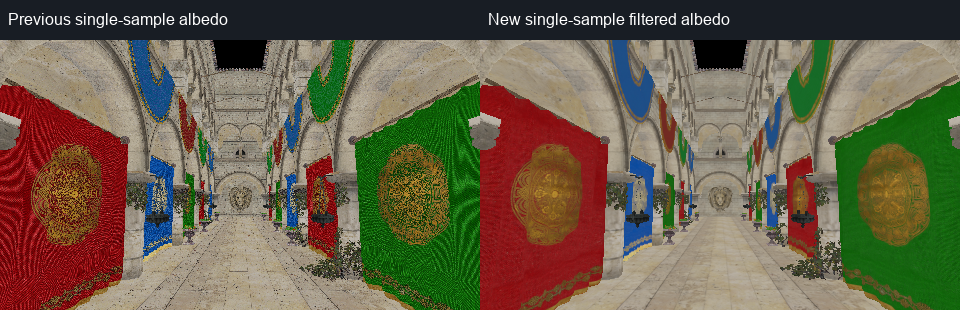
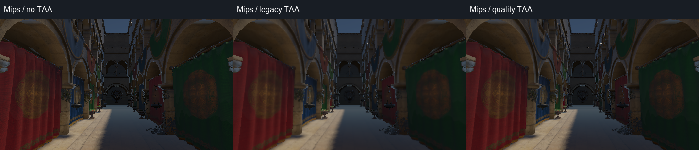
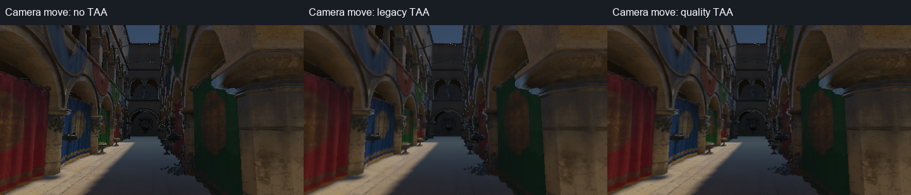

# 实时抗锯齿：材质预过滤与固定网格 TAA

本轮改进原生分辨率 TAA，同时补全普通材质的 mip／各向异性过滤。高质量 TAA 默认打开；原生编辑器在 **Enable TSAA** 下提供 **TAA high quality** 开关，关闭后回到旧历史解析，材质过滤仍保留。没有接入 TSR、DLSS、FSR，也没有更改 GI 强度或曝光来拟合 PT。

## 游戏引擎常见路线

| 方案 | 主要用途与取舍 |
| --- | --- |
| TAA | 抖动采样、运动向量和历史画面共同重建；适合延迟渲染和细小着色细节，需要处理拖影、历史失效和模糊。 |
| TAAU／TSR／时间超分辨率 | 从较低内部分辨率重建输出分辨率，进一步摊薄着色成本；需要完整运动向量、历史管理和反应性处理。 |
| MSAA | 适合前向渲染中的几何覆盖边缘；增加多采样颜色／深度成本，不能替代材质预过滤。 |
| FXAA／SMAA | 单帧空间后处理，成本较低；FXAA 容易变软，SMAA 更注重边缘模式，缺少跨帧积累。 |

UE 提供 TAA／TAAU、TSR、FXAA 和前向 MSAA，并支持第三方时间重建；Unity HDRP 也提供 TAA、FXAA、SMAA 和前向 MSAA。参考：[Epic AA 文档](https://dev.epicgames.com/documentation/en-us/unreal-engine/anti-aliasing-and-upscaling-in-unreal-engine)、[Epic TSR 文档](https://dev.epicgames.com/documentation/en-us/unreal-engine/temporal-super-resolution-in-unreal-engine)、[Unity HDRP AA 文档](https://github.com/Unity-Technologies/Graphics/blob/master/Packages/com.unity.render-pipelines.high-definition/Documentation~/Anti-Aliasing.md)。本项目当前先完善 TAA 和输入过滤，为后续时间重建打基础。

## 修复纹理与着色混叠

此前普通材质的 `GpuImageCache` 只创建 mip 0。像素覆盖许多纹理 texel 时，双线性采样仍会跳过高频细节；TAA 可以平均一部分颗粒，却不能代替正确的缩小过滤。

现在 Metal／Vulkan 的普通 PBR 材质默认生成完整 mip 链，并使用三线性、请求 **8× 各向异性**过滤。Vulkan 在设备创建时检查并启用 `samplerAnisotropy`，按硬件上限限制请求；不支持时保留三线性。OpenGL 兼容路径保留单层纹理。VT／海岸手工 mip atlas 沿用自己的采样方式。

- **颜色**：遵循当前渲染器的 `pow(2.2)` 解码，在解码后过滤、再编码；透明 texel 使用 alpha 加权，避免透明边缘的黑色污染。
- **法线／数据**：在线性空间过滤；法线 mip 保留平均向量长度。着色器将未解析的法线变化近似加入 GGX 粗糙度，减少远处镜面闪烁。
- **粗糙度**：对绿色通道的 `r⁴` 过滤，保留 GGX 坡度二阶量，再转换回粗糙度。
- **透明裁切**：根据材质实际 alpha 阈值缩放 mip alpha，尽量保持覆盖率；非二次幂纹理用面积权重，包含最后一行／列。

缓存键包含内容、过滤语义和 alpha 阈值。同一张图作为颜色与法线／数据时不会错误共享 mip；同语义仍可共享。异步上传按字节预算遍历 mip，每一层上传完成后材质才 ready；GPU 内存记账包含完整链。正方形二次幂纹理的完整 mip 链约增加 **33%** GPU 图像数据，CPU 当前也保留生成的 mip；语义不同的共享源可能需要额外 GPU 副本。



## 修复 TAA 的输出相位与历史解析

原先历史对齐到当帧抖动网格，最终输出也保留该相位；静止画面没有稳定回到固定像素中心。这会影响细节和与无抖动 PT 的逐像素比较。

高质量路径先在当前 UV 加上当帧 raster jitter 来重建固定输出像素，然后从重投影的历史 UV 去掉上一帧 jitter。历史颜色已经位于固定网格，因此运动权重也按去除抖动后的真实像素位移计算。矩阵和物体运动向量继续保留各自 raster jitter；单独调用解析器的测试输入默认为零抖动。

其余改动：

- 当前颜色与历史颜色用 **9 次双线性 fetch 的 Catmull–Rom** 重建，避免反复双线性历史采样造成细节损失。
- 历史深度分别检查相邻 4 个实际 texel；不把前景、背景和天空深度混成一个不存在的深度。
- 保留 HDR 感知压缩和 YCoCg 方差范围，用指向包围盒的裁剪限制历史颜色，减轻逐通道 clamp 的偏色；方差系数为 1.5。
- 静止历史权重上限 0.95，运动时按 0–16 像素／帧降至 0.65；颜色变化继续降低权重。
- opaque motion 的 `w=2` 与光学表面的 `0<w<=1` 置信度区分；水面保留较快响应，`w=-1` 继续拒绝历史。
- 输出限制在 RGBA16F 的安全 HDR 范围，保留相机切换、尺寸变化、场景／质量切换时的历史重置。

思路与成熟 TAA 的历史重采样、邻域裁剪和速度处理一致；本实现独立编写，并非完整移植 Unity／UE。可对照 [Unity HDRP TAA 源码](https://github.com/Unity-Technologies/Graphics/blob/master/Packages/com.unity.render-pipelines.high-definition/Runtime/PostProcessing/Shaders/TemporalAntialiasing.hlsl)。

## Sponza 实测

**Apple M4、Metal、480×270、固定相机／时间／曝光 1.1。** DDGI 初始化 960 帧后冻结，所有新 TAA 变体的探针数据逐值相同；每种解析独立重置历史并积累 64 帧。AO／RSM／额外后处理关闭，截图没有 UI。继续复用原始 **2048 spp、16 bounces、未降噪 PT**；CLI 完成时额外输出的 1 spp PT 不参与比较。


| 相对 raw PT | 上一版无 mip＋TAA | 新过滤＋旧 TAA | 新过滤＋高质量 TAA |
| --- | ---: | ---: | ---: |
| 对齐内区 normalized L1 | 44.55% | 43.83% | **41.93%** |
| 红帘布 normalized L1 | 32.37% | 30.44% | **27.54%** |
| 红帘布高频残差 MAE | 0.014384 | 0.009724 | **0.008424** |

相对上一版开启 TAA 的图片，帘布高频残差下降 **41.43%**。同一份新材质／冻结 GI 下，仅更换 TAA，帘布高频残差再下降 **13.37%**。高频指标是四邻域 Laplacian 的线性 RGB 残差 MAE，包含采样、过滤和着色误差，不是 MTF 或纯噪声估计。

新过滤但关闭 TAA 时，帘布 normalized L1 为 27.35%、高频残差为 0.007218；预过滤已消除了大量材质混叠。此指标使用原来的 AOV 对齐、腐蚀内区掩码，排除了几何边缘，因此不能据此判断关闭 TAA 的轮廓抗锯齿更好。开启 TAA 后仍有重建误差。

旧／新整体对照也包含材质过滤对 DDGI 捕获的影响，**不能将全部改善归因于 TAA**。同一份新字段内的旧／高质量 TAA 才是解析器的受控消融。拱门间接光偏高、天空镜面缺少建筑遮挡仍未解决；AA 不会修复这些光照误差。



运动捕获从 16 帧静止开始，随后相机沿 Z 移动 **0.0125 m／帧、64 帧**，最终位移 0.8 m，各组相机终点相同。下图用于检查轮廓／细节与潜在拖影，没有把单张运动截图当成运动画质或闪烁的全面证明。



### 成本与验证

Apple GPU counters、480×270、关闭 validation，混合静止／运动 Sponza 解析样本，每种模式丢弃前 8 个样本：

| 解析 dispatch | 样本 | median | p95 |
| --- | ---: | ---: | ---: |
| 旧 TAA | 136 | 0.1130 ms | 0.1950 ms |
| 高质量 TAA | 194 | 0.1279 ms | 0.2512 ms |

这是解析器 dispatch 区间，不是成对整帧基准；不包含材质采样额外成本，不能外推到 1080p 或声称达到 60 fps。新解析没有增加历史纹理，只增加 16 字节参数。

构建、RHI 图形合约、Metal API／Shader Validation 下的 AA／mip 和引擎验证通过。新增解析测试验证线性 ramp 的 1/4 像素 jitter 恢复到固定网格；还覆盖 HDR 保持、移动后旧位置清空、反应性／分数光学 motion、尺寸与历史重置。mip 验证覆盖颜色能量、粗糙度、NPOT 边缘、GPU 子资源读回、不同语义缓存和分批上传。Vulkan／MoltenVK 同样通过 AA／mip 测试，但当前环境没有 Khronos validation layer。

[数值报告](../img/diagnostics/aa/metal/sponza-aa-analysis.json) · [GPU 时间摘要](../img/diagnostics/aa/metal/gpu-timing-summary.json) · [Metal AA 验证](../img/diagnostics/aa/metal/temporal-validation.log) · [引擎验证](../img/diagnostics/aa/metal/engine-validation.log) · [Vulkan 验证](../img/diagnostics/aa/vulkan/temporal-validation.log)。原始 PFM 以无损 gzip 保存，压缩前后分析结果逐值一致。

```sh
./build/Scene-Renderer --temporal-self-test
./build/Scene-Renderer --temporal-self-test --backend Vulkan
./build/Scene-Renderer --path-trace-gpu sponza --pt-size 480x270 --pt-fixed \
  --pt-samples 1 --pt-bounces 16 --pt-seed 1 --pt-traversal native \
  --pt-compare-ddgi --pt-ddgi-frames 960 --pt-output img/diagnostics/aa/metal/sponza
python3 tools/analyze_realtime_aa.py img/diagnostics/ddgi/metal/gt/sponza \
  img/diagnostics/ddgi/metal/gt/aa/sponza img/diagnostics/aa/metal/sponza
```

## 后续质量工作

法线方差到 GGX 的转换和 alpha 覆盖保持仍是近似，最小 mip 无法精确保留连续的透明覆盖率。复杂植被／水面闪烁、快速运动和突变光照还需要专门的序列评估。后续可加入速度／深度边缘膨胀、独立历史置信度／反应性图、材质 LOD 控制和受控锐化；确认完整输入稳定之后，再考虑降低内部分辨率的时间重建。
