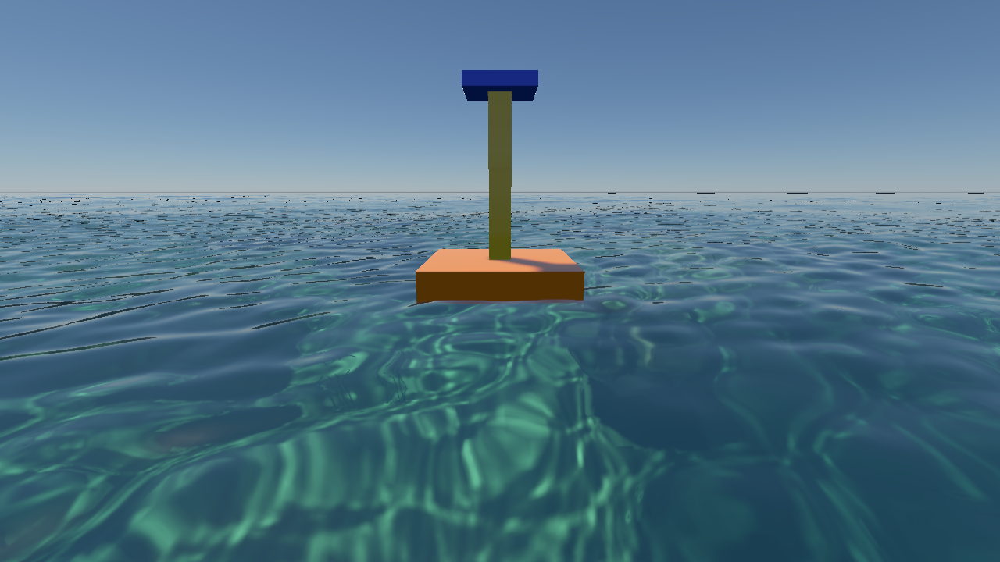
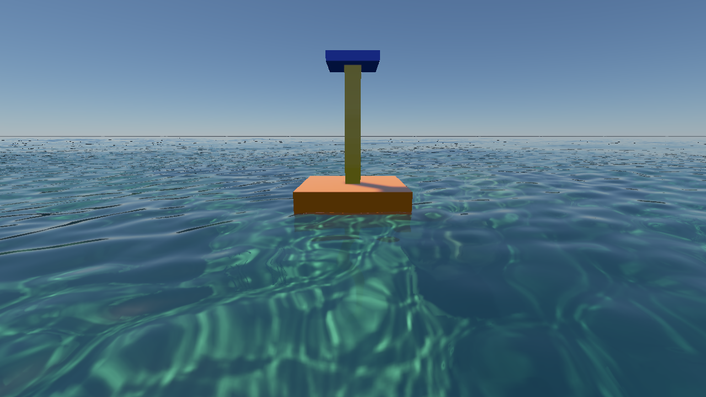
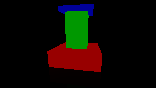

# 实时水体：第二轮修复与性能报告

2026-10-08，Apple M4，macOS 15.3.1，Release，原生 Metal。此次先处理海洋场景中的重复工作、海面场景反射与地形历史复用。没有降低 FFT 分辨率、海面网格预算、输出尺寸或水下体积采样数。

## 实现与操作

- **地形共享顶点计算**：每个 8×8 单元叶块有 81 个不同角点。过去计算 256 次高度和梯度；现在在工作组共享内存中计算 81 次，再复制到原有顶点布局。高度／梯度评估减少约 68%，保持索引、法线、边界导数和 LOD 接缝行为。索引计数改为每叶块一次原子分配。
- **亚像素地形复用**：相机发生微小移动时，对整个高度棱柱计算保守的齐次重投影位移上界。累计位移不超过 0.5 输出像素，且模型、尺寸、高度 VT 版本未变时保留原网格。运动向量因此对应同一份真实几何。始终以最后重建的相机为锚点；累计移动超过阈值、近裁剪附近、模型／分辨率／高度页变化时重新生成。保留的几何也继续用于草根贴地，避免不同表示分离。
- **海面场景反射**：默认开启 **Ocean → Water scene reflection**，需要 **Capture underwater surfaces**。镜像相机以平均海平面为基准，独立捕获空气侧不透明物体，使用镜像观察位置进行 PBR 着色。捕获图放入已有 HDR／位置图集，不增加海面片元采样器。波面法线决定反射射线；射线查询镜像深度层，因此可以命中原镜头屏幕外的物体。边缘渐变回天空，切换开关重置时域历史；水下继续使用原有折射／全反射路径。
- **地形射线去重**：有稳定床面高度场时，水下 DDA 与对应的 min/max 层跳过捕获中的地形，改由高度场射线供应床面；独立网格物体和空气侧地形仍保留在捕获和追踪中。原始颜色捕获保持完整，继续用于海床直接视图。
- **水面时域置信度**：正的分数置信度仍使用真实运动向量，并按置信度减小历史权重；此前低于 0.5 会误用静态深度重投影。水下折射／全反射边界、零置信度水面明确写入 reactive 标记拒绝旧帧，避免旧天空／物体光学图像留在新波面上。普通静态表面的深度重投影继续保留。
- **观察光路只计算一次**：先绘制水面，再合成观察段水雾。已被水面覆盖的像素通过水面深度与原不透明位置判断，提前跳过雾积分；水面着色已经完成它们的观察光路。直接看海床的像素保留原有距离雾、太阳光束和颗粒。

## 性能对照

`coastal-performance`，1280×720，移动镜头，每组 40 帧，前 8 帧预热、后 32 帧统计。两侧为相同预设、模拟时间序列、阴影、TSAA 和采样预算；性能构建隔离于工作区同时进行的 AO／PT 改动。旧版是提交 `2f01d93`，新版本先关闭新增场景反射以比较既有画质，再单独测量默认开启反射。正式测量串行执行，没有本任务的并行构建或其他验收任务；并行构建期间的探索样本没有用于下表。

| 配置 | 完整帧中位延迟 ms | 完整帧 p95 ms | GPU 整次提交中位 ms |
| --- | ---: | ---: | ---: |
| 修复前，天空反射 | 87.10 | 100.31 | 82.71 |
| 修复后，场景反射关闭 | 66.08 | 75.52 | 64.04 |
| 修复后，场景反射开启 | 80.24 | 90.16 | 78.13 |

同采样预算下完整帧中位延迟减少 **24.1%**；增加场景反射后仍比旧版低约 **7.9%**，但相对新版本关闭反射增加约 **14.16 ms**。这些是整帧差值，包含 GPU 竞争与调度变化，不能全部归为镜像捕获自身的净成本。

地形生成阶段区间中位数从 **16.97 ms** 降到 **7.13 ms**；相邻阶段存在重叠，区间包含等待，不能相加得到整帧时间或推导 ALU 占用率。完整帧计时覆盖资产收集、FFT／浅水模拟、阴影、主渲染、呈现与等待 GPU 完成。逐帧主动等待，因此这是同步延迟，不能作为多帧并行编辑器的显示 FPS；本次阶段样本每帧只有一个完成的 Metal command buffer，包含 FFT、地形、阴影、主渲染和呈现；因此上表 GPU 数值是整次提交，不能标为排除 FFT 的主渲染成本。原生 API 的多次逻辑 submit 在 active frame 中可以合入同一个 command buffer。当前仍未达到 60 fps。

潜水画廊在呈现前读取最近完成的 GPU 提交，本轮海床镜头的中位数 **113.18 ms**、抬头窗口 **76.08 ms**。这组画廊没有在本轮机器状态下重测旧版对应镜头，并修正了画廊元数据中过于严格的“排除独立 FFT”描述：active frame 中早先 FFT／浅水工作可能共享该提交，需结合时间戳判断。不能与之前报告的 78.66／55.93 ms 直接推导加速或回退；本轮可比较的性能结论仅来自上表的同配置海岸基准。海床体积与捕获仍是后续优化重点。

[汇总 JSON](../img/diagnostics/water/followup-performance-summary.json) · [修复前逐帧样本](../img/diagnostics/water/followup-performance-before/coastal-performance.json) · [修复后逐帧样本](../img/diagnostics/water/followup-performance-after/coastal-performance.json) · [反射开启逐帧样本](../img/diagnostics/water/followup-performance-reflection/coastal-performance.json)

## 画面与正确性

| 天空反射 | 场景反射，波面法线扭曲浮标倒影 |
| --- | --- |
|  |  |

两图使用相同镜头和模拟时间；近处波纹会打散倒影，保持原有折射与床面焦散。

| 独立 CPU 平面反射光路参考 | 原生 GPU 反射 |
| --- | --- |
|  |  |

三个盒体组成浮标，独立 CPU 射线与盒体求交并计算 Fresnel 能量。排除轮廓邻域后的 **52,777 个内部像素**，超过既定误差阈值的像素 **0**，平均最大通道误差 **0.00006198**。另有单独测试验证屏幕外发光平面、Fresnel 能量、空气侧遮挡、排除水下物体、开关恢复、移动镜头／TSAA、奇数尺寸和空场景去除旧捕获。

水下 Beer、单次观察光程、Snell 窗口、太阳圆盘、屏幕外空气捕获、临界角／全反射、波面跨越、阴影、焦散、悬浮颗粒继续通过。地形完整回归验证法线、边界导数、预算耗尽时的闭合网格，以及强制 LOD 0／5 接缝。新增亚像素移动测试要求复用几何，明显移动则要求重建。独立合成输入另外验证低置信度运动仍能正确拒绝屏幕外历史、按置信度减小历史权重，以及 reactive 光学表面和普通静态表面的不同历史行为。

- 工作区 Metal 水体／TSAA回归：API Validation 和 GPU Shader Validation 开启，通过。
- 独立构建 Metal 完整原生 RHI 回归：通过，包括地形、云、阴影、后处理与 PT 桥接。
- 工作区 Vulkan／MoltenVK 水体／TSAA回归：通过；这是兼容性验证，没有启用 Khronos validation layer。
- CPU engine-concurrency、image-decoder、RHI contract、graphics contract：4／4 通过。

[Metal 水体验证](../img/diagnostics/water/followup/metal-validation.log) · [Metal 完整 RHI 验证](../img/diagnostics/water/followup/metal-rhi-validation.log) · [Vulkan 验证](../img/diagnostics/water/followup/vulkan-validation.log) · [光路参考指标](../img/diagnostics/water/followup/reflection-reference.txt) · [潜水画廊指标](../img/diagnostics/water/followup/underwater-dive-water-metrics.json)

## 复现

```sh
./build/Scene-Renderer --water-self-test
./build/Scene-Renderer --water-self-test --backend Vulkan
./build/Scene-Renderer --render-gallery build/water-followup water-followup-gallery
SCENERENDERER_DISABLE_PIPELINE_DISK_CACHE=1 SCENERENDERER_GPU_PROFILE=1 \
SCENERENDERER_BENCH_MOVE=1 SCENERENDERER_BENCH_REFLECTION=0 \
  ./build/Scene-Renderer --render-gallery build/water-perf coastal-performance
```

将 `SCENERENDERER_BENCH_REFLECTION` 改为 `1` 比较新增反射；使用另一个输出目录保留对照。测量前关闭其他渲染实例并结束编译。单独的 CPU／GPU 浮标参考图可以用 `SCENERENDERER_WATER_REFERENCE_OUTPUT` 指定输出目录。

## 剩余限制

镜像反射仍以平均海平面为基准，波纹通过射线与单深度捕获层交互；它不是完整的多次水面反射或多层几何重建。捕获只包含不透明物体，没有体积云、透明物体或完整粗糙度预滤波。镜像视野外与无法命中的方向退回大气天空，低角度与复杂遮挡仍有边界。资源预算不足时不创建反射列。

水下光学界面目前优先拒绝不可靠历史以减少重影；这会减少细边的时域抗锯齿收益，后续仍需要按实际折射／反射命中点重投影。

地形复用只覆盖可证明的亚像素移动。明显移动导致 LOD 重建时仍拒绝对应历史；草的动态实例还没有稳定的前帧身份与风动画运动向量，不能据此宣称所有动态地形／植被闪烁已经解决。

实时 GI 可见性／漏光、云阴影与环境光联动、透明表面的后处理深度／速度输入尚未由本轮修改。下一轮性能工作应独立比较海床体积积分、捕获分辨率／频率与镜像反射过滤，并以动态画面验收约束质量变化。
