# Detailed rendering showcase and comparisons

**English** · [简体中文](rendering-showcase.zh-CN.md) · [Project overview](../README.md)

This page preserves the expanded showcase, algorithm explanations and measurements moved from the README, organized by topic. The homepage presents selected results; the [full gallery and settings](rendering-gallery.md) records sampling and reproduction. Each measurement belongs to its recorded camera, build and configuration, rather than establishing performance under today's memory-admission defaults. The 2026-10-13 cave changes build and pass memory/RHI tests; new batch rasterization, memory peaks and camera poses still require GPU validation.

Project renders identify their backend, integrator and denoising where applicable. Unreal Nanite, PBRT and Blender Cycles images are labeled as independent reference-engine results.

[Materials and lighting](#materials-and-lighting) · [Atmosphere and nature](#atmosphere-and-nature) · [Water and diving](#water-and-diving) · [Geometry and visibility](#geometry-and-visibility) · [Post processing](#post-processing) · [Path tracing](#path-tracing)

## Materials and lighting

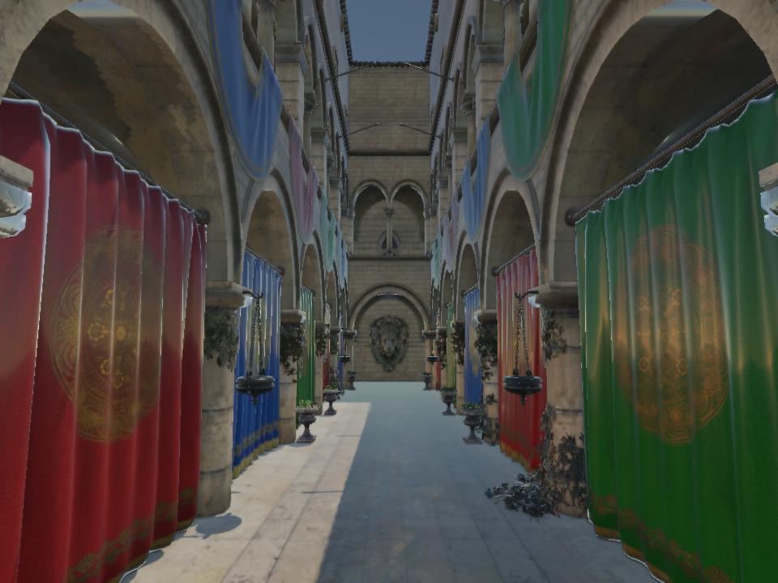

This Sponza capture enables RSM; the feature is currently disabled by default and retained as a historical lighting demo.

### Classic scenes and PBR

Sponza, San Miguel, and Sibenik showcase architectural materials and shadows. Existing sun/sky RSM comparisons remain as [optional lighting demos](rsm.md); RSM is disabled by default and is excluded from future lighting development. Stanford scans and Damaged Helmet demonstrate metallic, nonmetallic, and textured materials.

| San Miguel courtyard | Sibenik Cathedral |
| --- | --- |
| 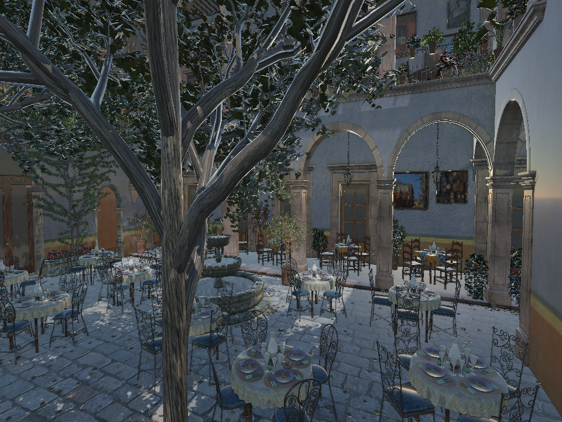 | 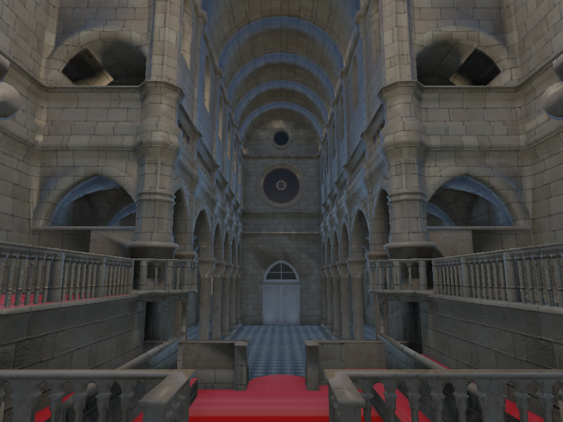 |

| Stanford Bunny: three materials | Damaged Helmet: PBR textures |
| --- | --- |
| 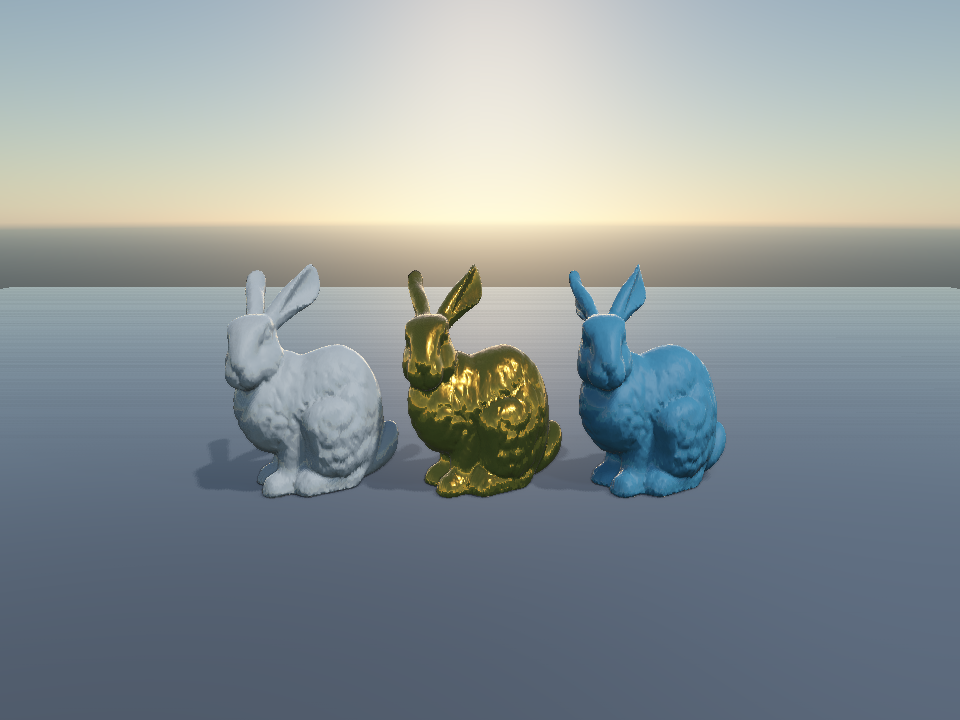 | 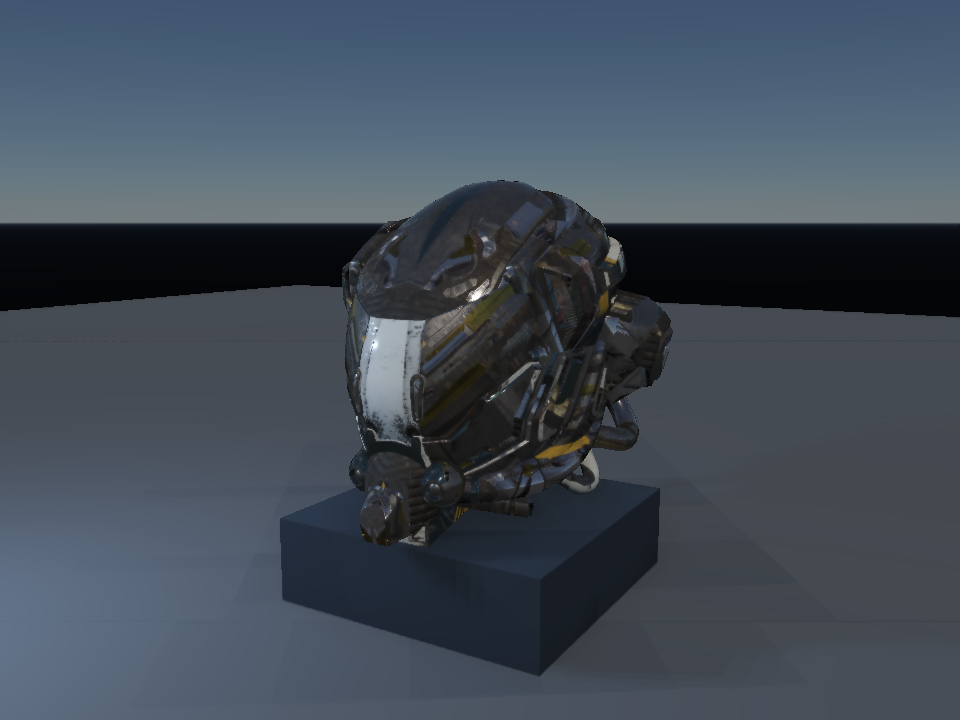 |

### Shared anisotropic materials

Metal/Vulkan Raster now shares the anisotropic GGX reflection parameters with PT across Forward, Deferred and Scene shading. Direct lighting is checked against the CPU BSDF; sky reflection remains a fixed-budget approximation. The Raster fixture below uses directional lighting: isotropic, anisotropic and rotated 90°. See [shared material scope and validation](path-tracing-materials.md#m1-r实时渲染与-pt-共用材质输入).

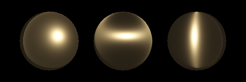

### Ambient occlusion

Horizon-based AO with geometric normal reconstruction and edge-aware filtering reduces sampling bands around pillars and arches. These Sponza captures disable RSM and TSAA to isolate AO, with matching lighting and exposure. See [algorithm notes and more comparisons](ambient-occlusion.md).

| Original 24-sample SSAO: AO buffer | Horizon AO + edge-aware filtering: AO buffer |
| --- | --- |
| 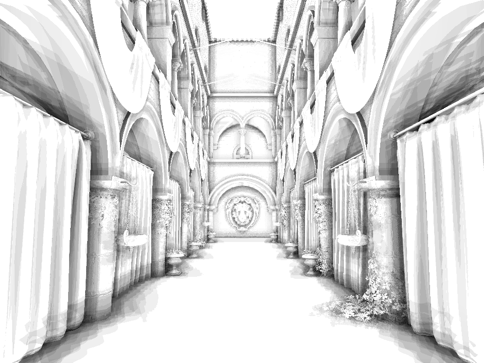 | 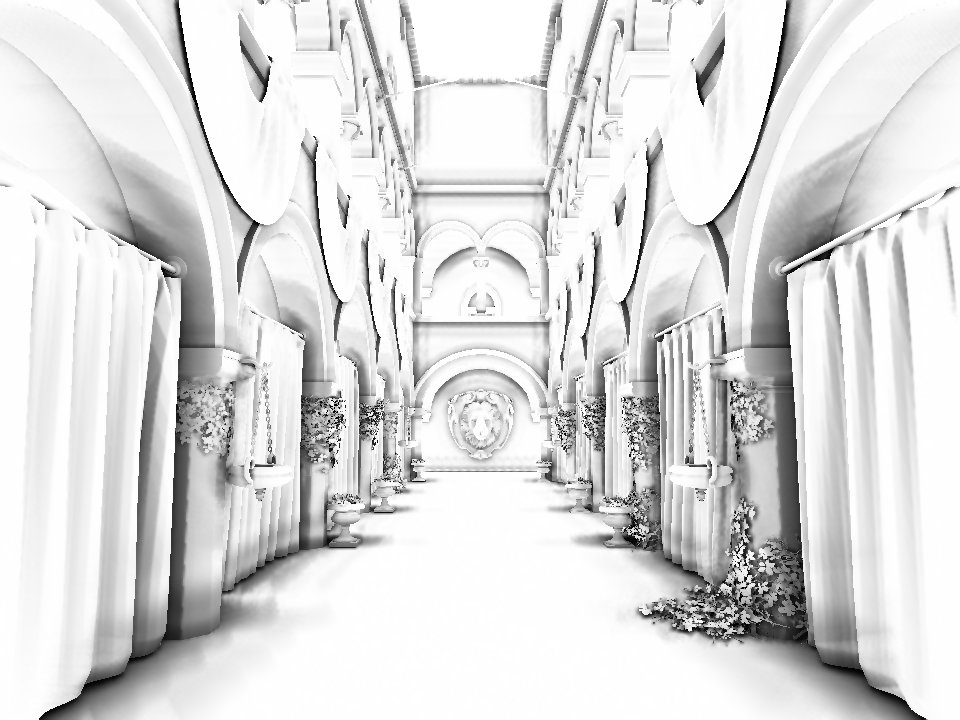 |

| AO disabled: final scene | AO enabled: final scene |
| --- | --- |
| 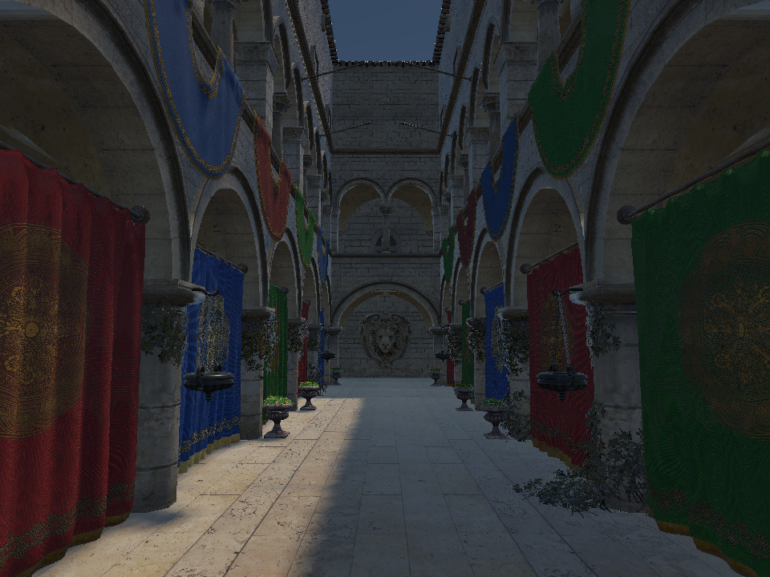 | 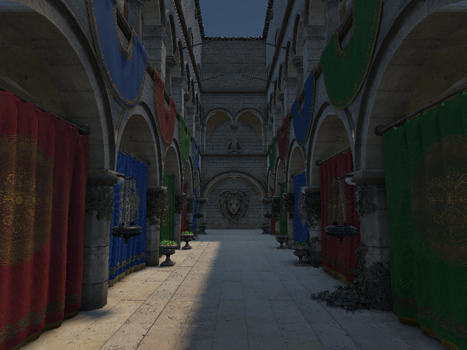 |

### Material filtering and improved TAA

Native Metal/Vulkan PBR materials now use semantic mip chains, trilinear and 8× anisotropic sampling, alpha-coverage preservation, and approximate normal-variance filtering. High-quality TAA reconstructs a fixed output pixel grid with bicubic current/history sampling, depth-edge validation, and motion-dependent history weights; toggle **TAA high quality** under **Enable TSAA**. In Sponza, curtain high-frequency error falls **41.43%** from the previous TAA capture. [Algorithm, engine AA choices, moving-camera comparisons, GPU cost and limits](realtime-anti-aliasing.md).

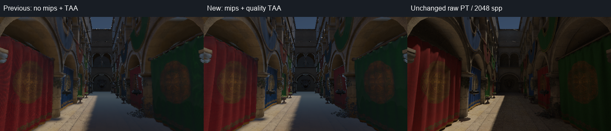

### Dynamic diffuse global illumination (DDGI, stage 1)

An optional offline probe backend now shares the PT integrator, scene buffers and native Metal traversal. A switchable topology-constrained clustering algorithm builds a lower-detail PT world; the viewport exposes its displacement and UV budgets. [PT probes, automatic LOD, controlled comparisons and limits](pt-probes-and-world-lod.md). Editor DDGI capture still defaults to Raster; PT probe capture is currently a reference command-line workflow. On Sponza, isolated irradiance error falls from **37.25% to 19.79%**; clustered geometry reduces triangles and native AS memory by **15.1%**. Three alternating PT runs show a 2.18% median wall-time reduction with overlapping ranges, so stable throughput improvement is not yet established.


Switchable local irradiance probes add scene occlusion, sky indirect light and diffuse colour bleeding. The first backend uses GPU cubemap raster captures, 8×8 irradiance and 16×16 distance moments, with visibility controls, temporal feedback and a per-frame probe budget. The default cache uses 3.135 MiB and has a 64 MiB cap. [Implementation, update latency, validation and limits](ddgi.md). Open `--classic cornell --ddgi` or enable **DDGI diffuse global illumination** in the native editor.

| DDGI off | DDGI on: visibility and diffuse bounce |
| --- | --- |
| 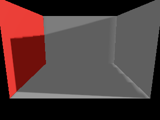 | 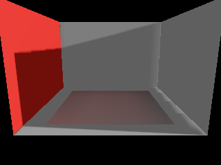 |

Sponza uses a scene preset with 1,280 probes at 2 m spacing, a 12.539 MiB cache and 8 updates per frame. [Native scene validation and measured costs](ddgi.md#sponza-场景测试). Run `--classic sponza --ddgi`; captures hide the editor UI.

Inspect actual GPU probes with `--classic sponza --ddgi-probes state` or `--ddgi-probes irradiance`. The editor supports building occlusion, X-ray and individual Y layers. [Probe principles, placement and layer maps](ddgi.md#原理与-sponza-探针布局); green means active, red means rejected, yellow means unvisited. The overlay is disabled by default and does not enter lighting or TAA history.

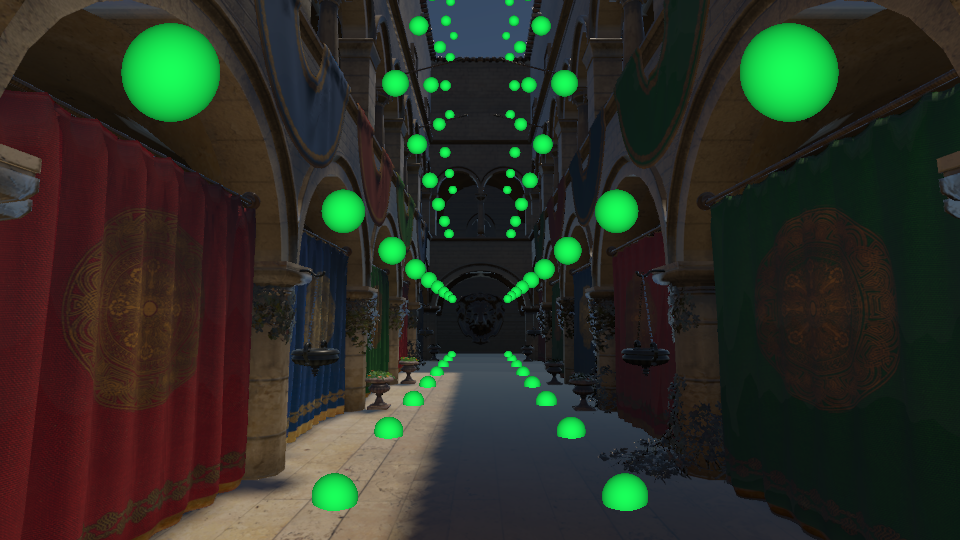

| Sponza: DDGI off | Sponza: DDGI on |
| --- | --- |
| 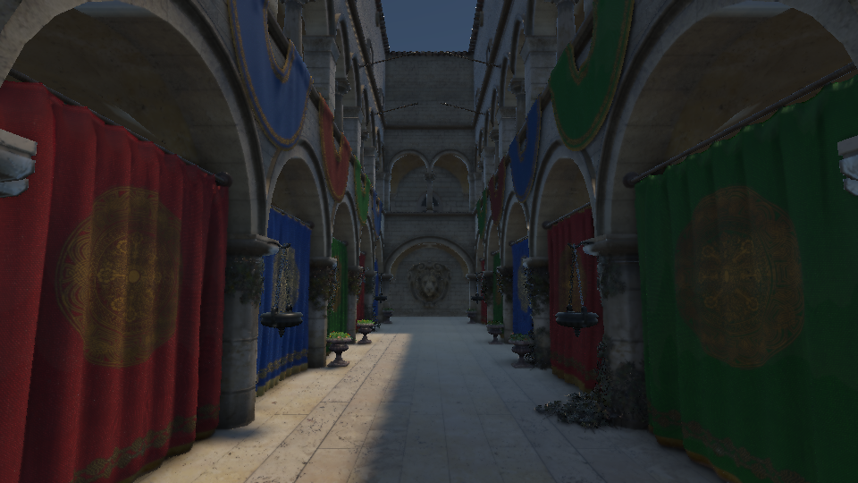 | 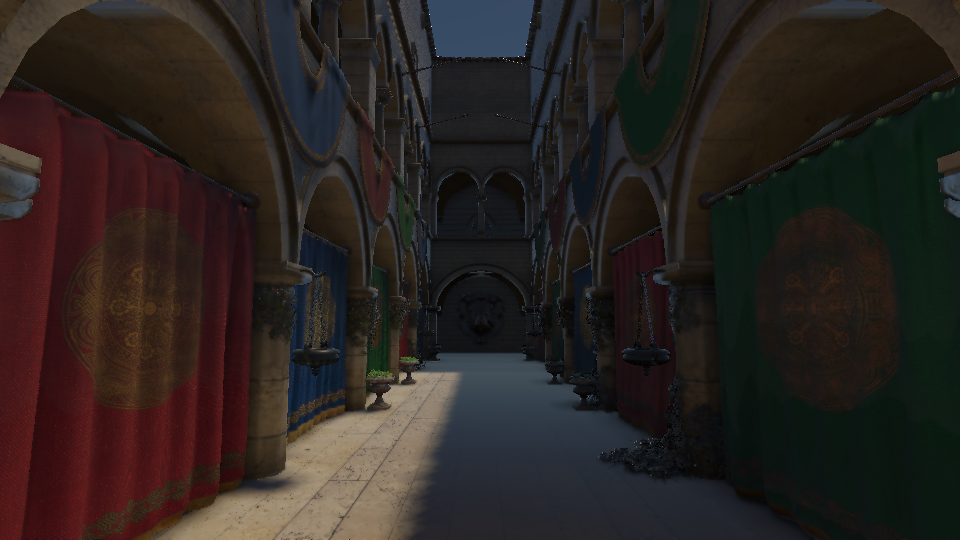 |

[Sponza raw PT reference comparison](ddgi.md#sponza-路径追踪参考对照): matched 480×270 snapshots, 2,048 spp / 16 bounces. DDGI reduces aligned linear-HDR normalized L1 from **80.46% to 49.72%**; 47 isolated irradiance queries still show **34.76%** error. These include the documented approximation and sampling limits; stage-one GI is not yet reference accurate.

The figures above are unfiltered, with TAA off. A frozen-probe comparison with native TAA reduces aligned error to **44.55%** and curtain high-frequency residual by **55.98%**. Arch irradiance and unoccluded sky specular lighting still need correction. Both paths share material assets, but legacy BRDF/normal evaluation differs. [AA and lighting ablations](ddgi.md#抗锯齿材质一致性与拱门偏亮).

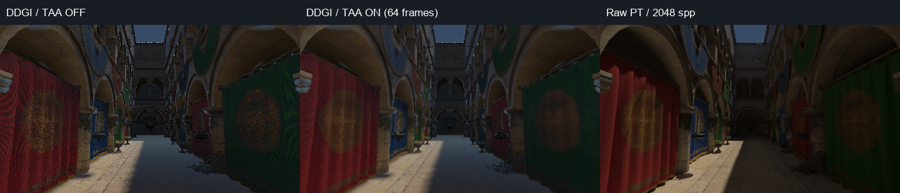

## Atmosphere and nature

### Atmosphere and sun

Atmospheric scattering and an analytic sun disk share lighting parameters with the scene, indirect lighting, and ocean surface. Distant cloud layers support weather distributions and wind changes.

| Daytime sky | Sunset at the horizon | Sunset clouds |
| --- | --- | --- |
| 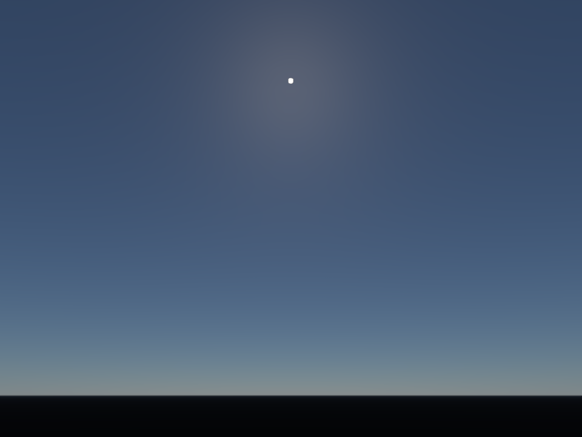 | 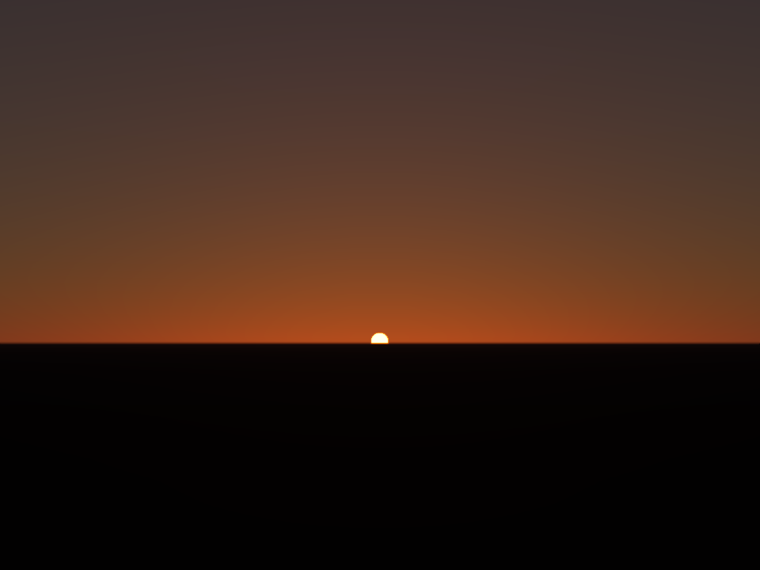 | 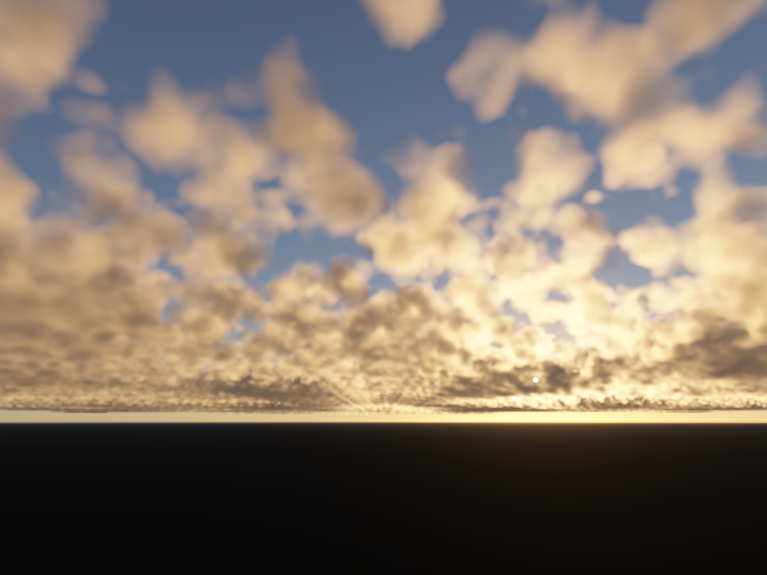 |

### Immersive 3D voxel clouds

A 128³ XYZ density field combines conservative distance fields, GPU indirect ray marching, and cached sunlight to support close views and cameras inside the cloud. These images use full-resolution 1080p rendering with cloud temporal accumulation disabled. The storm preset includes internal volumetric flashes.

| 3D cloud volume | Storm shape and internal flashes |
| --- | --- |
|  | 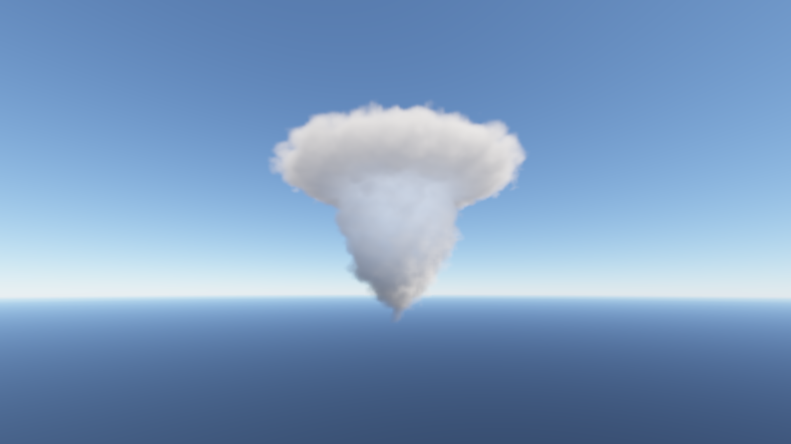 |

### Large terrain, lakes, and vegetation

Mountain Lake demonstrates an 8×8 km landscape with height/material VT paging, terrain LOD, an FFT lake surface, grass density that varies with distance, and wet-sand and beach PBR materials.

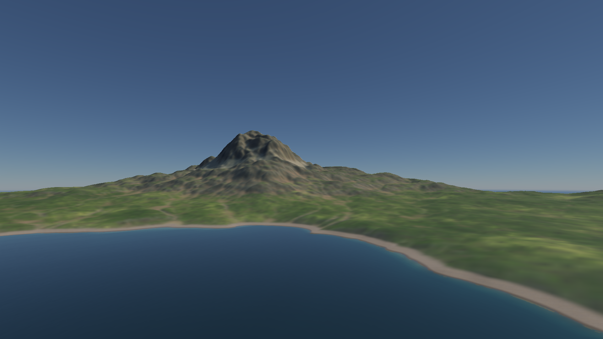

| Lakeside grass | Beach and wet sand |
| --- | --- |
| 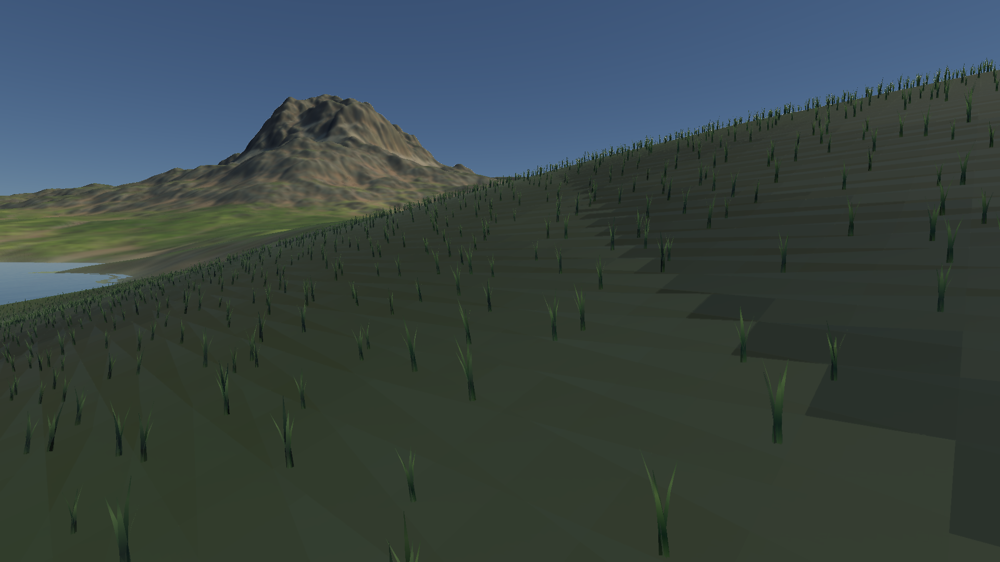 | 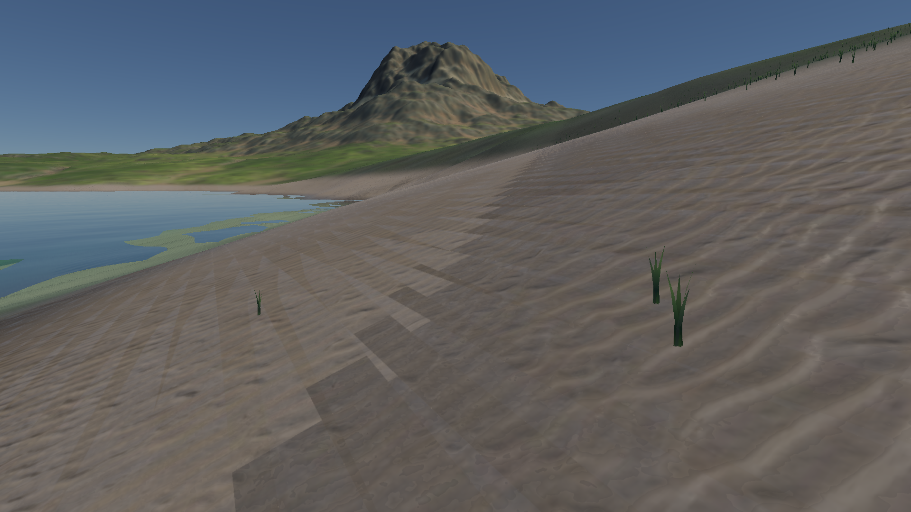 |

The environment controller shares sun, wind, cloud coverage and rain, with conservative surface-water transfer over a 16×16 terrain grid. Spatial wetness reaches real-time geometry, water captures and frozen CPU/GPU PT; fixed-tick checkpoints support pause and exact replay. Switchable ground cloud shadows and analytic air extinction/height fog now reach the terrain and water geometry captures. Atmospheric aerial perspective adds sun-dependent Rayleigh/Mie scattering and RGB transmission through a camera-frustum LUT, with mountain/cloud occlusion of scattered sunlight. Ground cloud shadows have an independent strength control. P1 approximate PT exports a frozen cloud sky and a separate spatial solar-transmission field. Cloud reflections in water, lake-level coupling and rain impacts remain pending. [Weather controls](mountain-lake-environment-spec.md) · [L4 comparisons, validation and limits](weather-lighting.md) · [Atmospheric aerial perspective](atmospheric-aerial-perspective.md).

The current development capture strengthens atmospheric aerial perspective while reducing the fixed-colour ground fog and ground cloud shadows. Ground shadow strength is **30%**, aerial optical distance scale is **2**, and mountain shadow coverage is **8 km**. Mountain/cloud solar occlusion modulates scattered sunlight, including a local sky correction. The view below is **90.0° perpendicular to the sun direction**, with the sun at about **20°** elevation; side lighting produces broad air-shadow bands and softer shafts. **Metal, 960×540, fixed simulation time, RSM off.** [Controls, validation, capture provenance and limitations](mountain-lake-side-light.md).

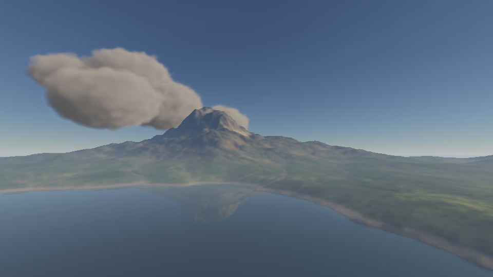

<details>
<summary>Aerial sunlight: occlusion off / on / on with weaker ground fog</summary>

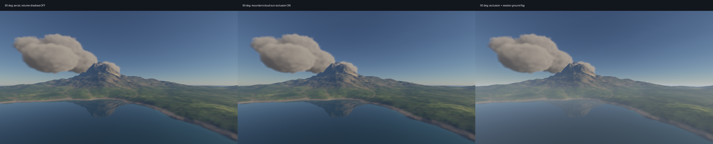

The camera, sun and exposure stay fixed across all three views. The centre view adds atmospheric solar occlusion; the right view also adds the weaker height fog. Narrow shafts, off-screen terrain casters and moving views still need further work; this capture is not a 60 fps claim.

</details>


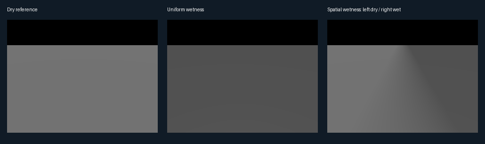

### Procedural trees and forest: corrected renders

Broadleaf trees, conifers, and shrubs use seeded branching geometry, separate bark and leaf materials, and alpha-tested cascade shadows. These **Metal realtime renders, 960×720, fixed time 8 s, 16 TAA frames** were regenerated after the **2026-10-12** fix for solar-disk artifacts in leaf gaps and the missing foliage material flag. The single-tree canopy's near-white pixel count fell from **854 to 0** in the same camera and exposure; Metal and Vulkan regression checks pass. [Implementation, before/after comparison, validation, and limits](procedural-trees.md).

| Corrected single tree | Corrected forest |
| --- | --- |
| 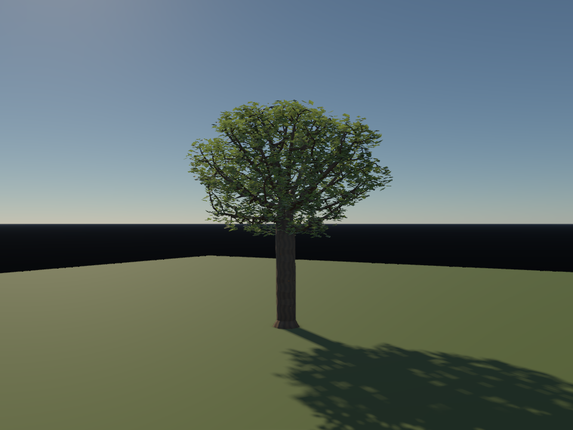 | 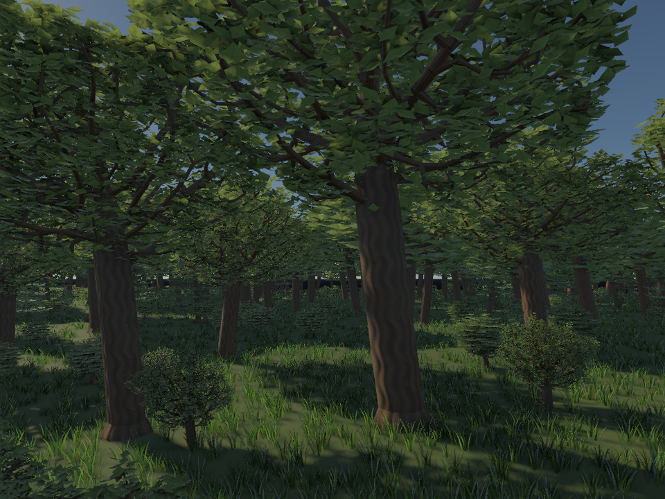 |

### Virtual textures and soft shadows

Height/material VT uses physical page caches, page tables, ancestor fallback, and GPU depth feedback. Five-level CSM allocates shadow precision across viewing distances; PCSS estimates penumbra growth with blocker separation.

| Actual GPU VT cache | CSM shadows and cascade regions |
| --- | --- |
| 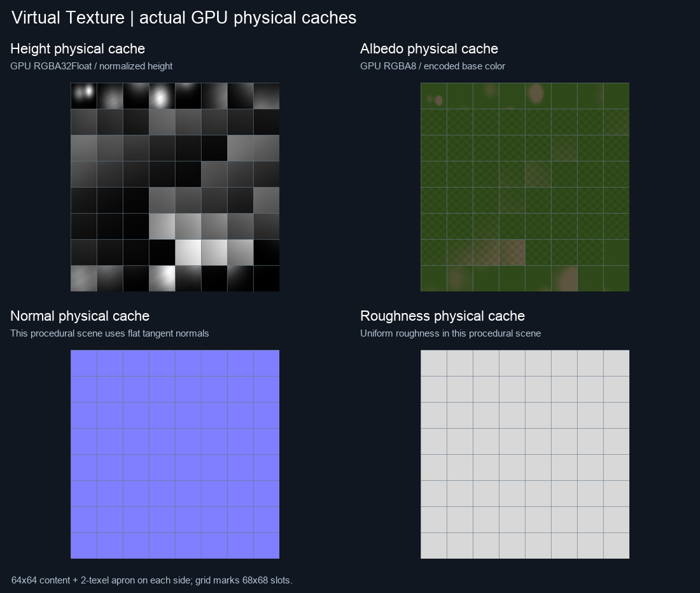 | 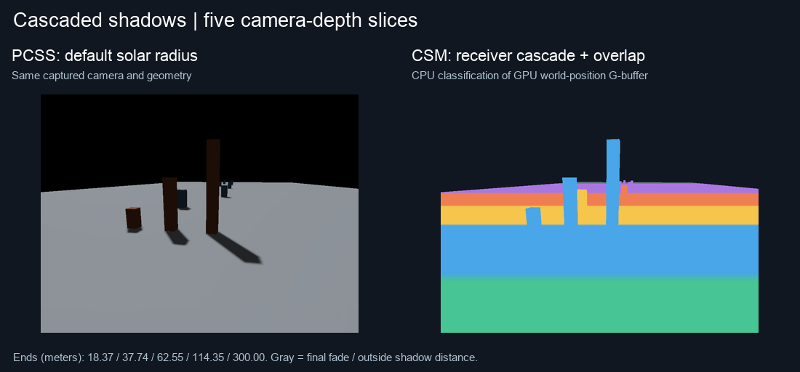 |

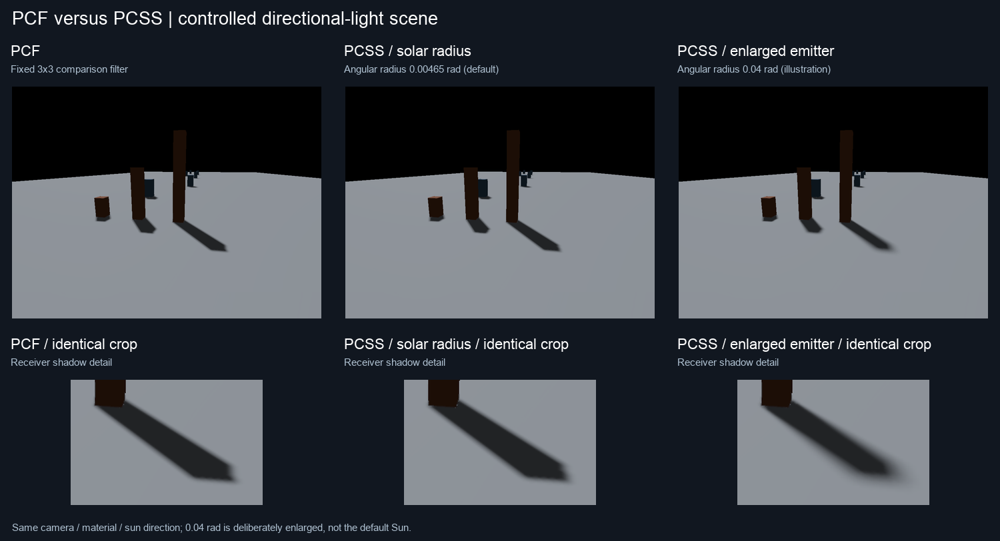

The comparison shows PCF, PCSS with the default sun, and PCSS with a larger light, respectively. The third column illustrates a wider penumbra. See [page tables, shadow atlases, and full diagnostics](render-diagnostics-gallery.md).

## Water and diving

### FFT oceans and transparent water

Primary and short-wave FFT spectra combine to produce wave crests, fine ripples, and foam. Refraction, RGB absorption, and approximate single scattering produce shallow-water transmission and translucent wave crests.

| Rough ocean | Shallow-water refraction and scattering |
| --- | --- |
| 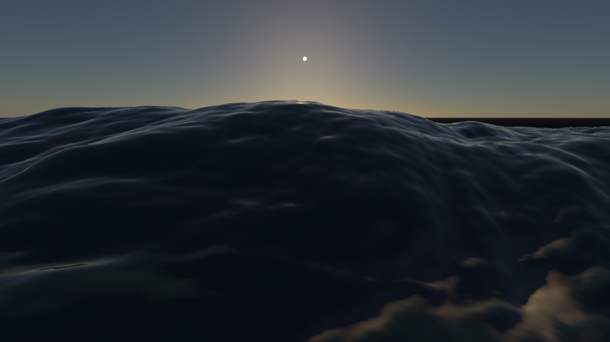 | 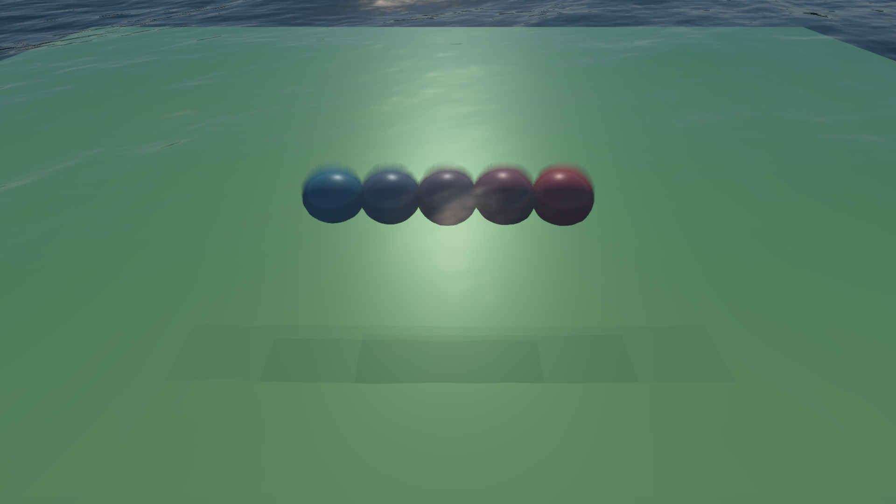 |

Real-time water now uses a grid concentrated near the camera, an independent underwater color/position layer, and single-scattering integration along the water path. [Before/after, validation and GPU cost](water-realtime-upgrade.md).

The coastal presets add optional DDA refraction with terrain fallback, local multiple scattering, shallow waves, persistent foam, and wet sand. Each feature has an editor switch; existing presets keep the new effects disabled. [Controls, comparisons, animations and limitations](water-coastal-features.md). [First performance round: stage timings, submission gaps and boundary fixes](water-coastal-performance.md).

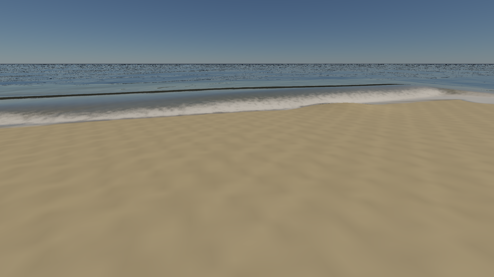

Underwater views add distance-dependent absorption and scattering, water-to-air refraction, and total internal reflection. Open `--classic coastal-underwater`; the Ocean panel exposes view, fog and **Short wave ripples** switches. The underwater preset uses a 0.5–2 m FFT wave band so nearby refraction and the Snell-window boundary move with the waves. [Images, optical paths and validation](water-underwater-rendering.md).

| Underwater surface | Looking down at the seabed |
| --- | --- |
| 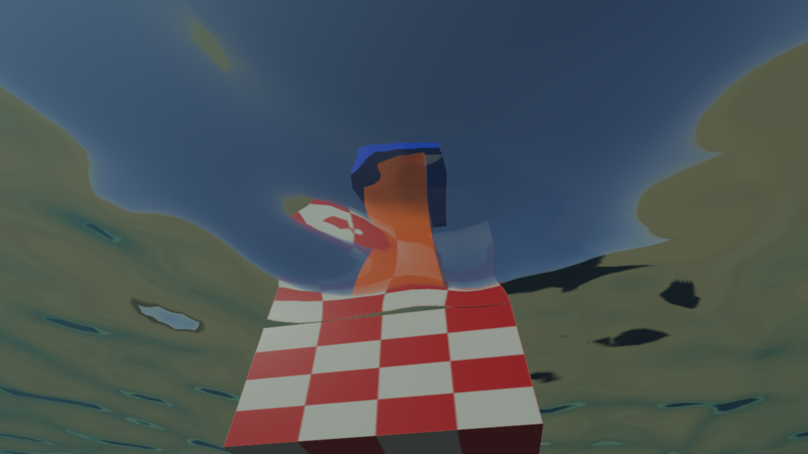 | 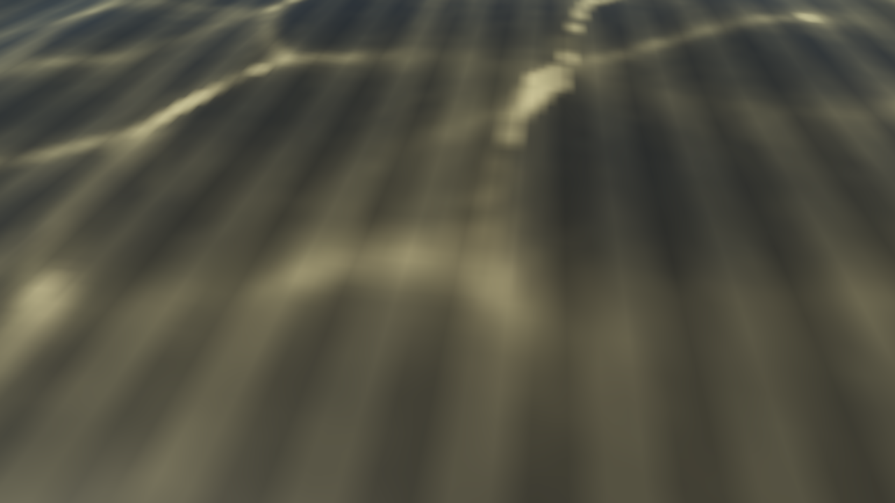 |

The seabed demo adds 25 cm sand ripples, fine normal detail, and optional solar caustics projected through the live FFT surface. Open `--classic coastal-seabed`; toggle **FFT seabed caustics** and adjust **Caustic strength** in the Ocean panel. [Seabed comparisons, implementation and GPU timings](water-seabed-caustics.md).

### Underwater diving, sun shafts, and refraction

The `underwater-dive` preset starts 6 m underwater, looking along a sandy channel between reef outcrops and seagrass. Distance-dependent absorption and single scattering produce blue-green visibility; drifting sediment, 16/48/128 m cascaded caustics on terrain and submerged meshes, and wave-focused sun shafts add depth and moving light. The preset uses 32 samples for shadowed volume lighting.

| Diving view: sun shafts and seabed caustics | Looking up: refracted sky, sun, and floating marker |
| --- | --- |
| 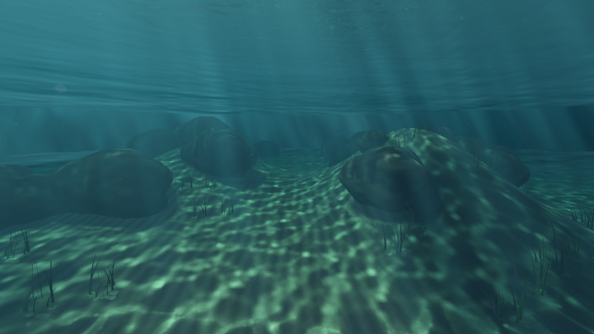 | 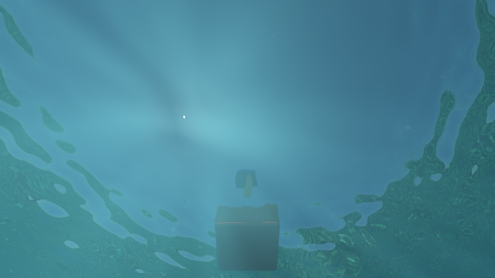 |

```sh
./build/Scene-Renderer --classic underwater-dive --size 1280x720
```

Hold the right mouse button to look around; use **W/A/S/D** to move and **Q/E** to move vertically. Set **Camera → View pitch** to about **68°** to inspect the sky window. Near-horizontal underwater views show total internal reflection; the window boundary follows the wave normals.

The Ocean panel independently controls **Underwater distance fog**, **Underwater sun shafts**, **FFT seabed caustics**, and **Wide air refraction**, with adjustable shaft contrast, particle density, and volume samples. Wide air refraction adds an upward capture to recover surface objects outside the original camera view; a unit scattering gain preserves sky and object contrast. Metal and Vulkan water validation passes. Wide capture remains a screen-space approximation, and this preset prioritizes visual quality over a 60 fps target.

Above-water oceans now reflect opaque scene objects through a mirrored capture, including objects outside the original camera view. Toggle **Water scene reflection** in the Ocean panel; it requires **Capture underwater surfaces**. Shared terrain vertex evaluation, subpixel geometry reuse, and rejection of duplicate underwater eye transport reduce redundant work. [Implementation, reflection comparisons, performance, and remaining limits](realtime-water-followup.md). [Underwater critical path: controlled ablations, dependency waits, and next optimizations](water-critical-path.md). Capture-off queries now keep a conservative depth hierarchy; the editor batches VT feedback and presentation completion into the normal frame submission. The Ocean panel offers optional **Adaptive half-resolution underwater scattering**, with full-resolution fallback for seabed views and optical edges. [Measured results, thread dispatch, and RDG assessment](water-runtime-optimization.md).

[Dive scene and controls](water-underwater-diving.md) · [Caustic coverage](water-caustic-cascades.md) · [Sun-shaft implementation](water-sun-shafts.md) · [Refraction comparisons, validation, and performance](water-air-refraction.md)

## Geometry and visibility

### Visibility, culling and hierarchical geometry

The realtime RenderGraph now supports optional dead-pass culling from exported outputs and explicit history / side effects, with subresource data dependencies and rebuilt lifetimes. Plain scenes with TAA off can skip unused motion recording. [Algorithm and validation](render-graph-culling.md).

Realtime object frustum culling is enabled by default. Optional GPU triangle culling uses stable index compaction, active indirect dispatch, and cached static views. The validation grid reduces objects 3 → 1 and triangles 16,384 → 2,312 with identical pixels; enable triangle culling after profiling the target scene. [Implementation, controls, and validation](geometry-culling.md).

Switchable hierarchical cluster geometry adds 128-triangle meshlets, boundary-preserving endpoint QEM group simplification, GPU screen-error LOD selection and cluster frustum culling, followed by indexed indirect draws. Construction runs on bounded CPU workers. This is a Nanite-inspired geometry prototype; streaming, visibility-buffer shading and hybrid rasterization are still future work. [Algorithm, controls and validation](hierarchical-cluster-geometry.md).

Cross-mesh cluster batching reduces 66 dispatches to 3. Optional two-stage Hi-Z reuses early G-buffer depth and recovers surfaces against current-frame depth. A quarter-resolution base, fused mip reduction and cooperative late append reduce two-stage compute from 16 dispatches / 16 encoders to **9 / 2**. Sponza's static GPU critical window remains **3.2%** slower than no occlusion; pooled and paired moving-frame statistics disagree, so a stable gain is unconfirmed and occlusion stays off in the general defaults; scene presets such as the cave can override this. Overlapping three-copy stress scenes with million-triangle scans show about **21%** lower windows. Display pixels, depth and all six G-buffer attachments pass same-LOD comparisons. [Latest optimization, measured limits, actual cluster partitions and the dynamic LOD flow](cluster-hiz-optimization-and-lod.md).


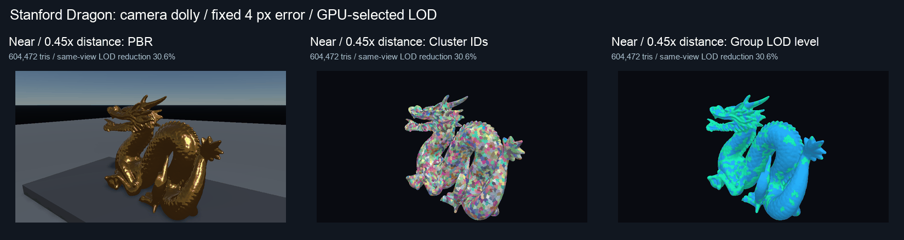

Cluster construction now separates exact position topology from original attribute addresses, combines Morton ordering with bounded spatial fill, and retains parents only when they remove at least 12.5% of their children's triangles. UV / tangent seams remain protected, with a cumulative normal error limit. [Construction methods, native comparisons, raw timings and limitations](cluster-partition-and-hierarchy.md).

**How the meshlets are built.** Attribute BFS treats triangles as graph nodes, connects them through shared edges using complete-attribute vertex addresses, and fills each 128-triangle block with breadth-first traversal. UV / normal / tangent seams can split a geometrically continuous surface into disconnected graph fragments, leaving small blocks. Position topology adds a separate ID for each exact position to recover geometric neighbors while retaining every original attribute address. Morton ordering chooses spatially local seeds; candidate selection favors attribute-vertex reuse, then a compact bounding box. Bounded spatial fill can pack nearby disconnected fragments together. Packing improves utilization; it does not itself remove source triangles.

**What 2 px / 4 px mean.** **Cluster LOD error (pixels)** is the allowed estimate of geometric position error projected into the actual render viewport. For perspective views, the estimate is approximately `position error × instance scale bound × focal length in pixels / nearest coverage-box depth`; the near plane clamps the denominator. If a parent estimates 3.2 px, a 2 px budget keeps more detailed children, while 4 px can accept that parent.

| Pixel budget | Typical LOD behavior |
| --- | --- |
| 0 px | Keep detailed leaves; reject parents with nonzero position error |
| 2 px | Tighter approximation, usually more triangles |
| 4 px | Allow more geometric approximation, usually fewer triangles |

The budget measures geometry, not final RGB error or meshlet width: highlights, shadows and normal maps can amplify small shape changes. At the same camera, doubling both viewport dimensions roughly doubles the projected error, so a fixed pixel budget tends to select more detail. Increasing the budget can only choose parents already built. Current parents group up to eight connected children, simplify with endpoint QEM and retain conservative endpoint error bounds; original boundaries and attribute seams remain protected. [Parent construction, quality tradeoffs and actual GPU cuts](cluster-parent-lod-optimization.md).

The Sponza / Stanford measurements below use the previous pair-parent builder and 0.05 normal ceiling; current Coastal Cliff parent settings and results follow separately.

| Scene | Leaf utilization: before → after | Hierarchy memory: before → after |
| --- | ---: | ---: |
| Sponza | 22.9% → 91.0% | 16.66 → 3.39 MiB |
| Stanford Dragon | 63.9% → 95.7% | 42.64 → 17.34 MiB |
| Happy Buddha | 62.8% → 96.2% | 53.42 → 21.96 MiB |

At 4 px, paired cluster / geometry GPU windows improve by **3.4%, 2.6% and 3.4%** respectively across 72 samples per mode; these are partial GPU timings. The new cuts retain more triangles and match independent CPU cuts; Hi-Z matches the same cuts in depth, HDR, display and all six G-buffer attachments. Dragon still has **21.2%** HDR LOD error against full geometry, and Sponza's 0 px render differs at six display pixels. Hi-Z remains slower than no occlusion on Sponza and stays off in the general defaults.

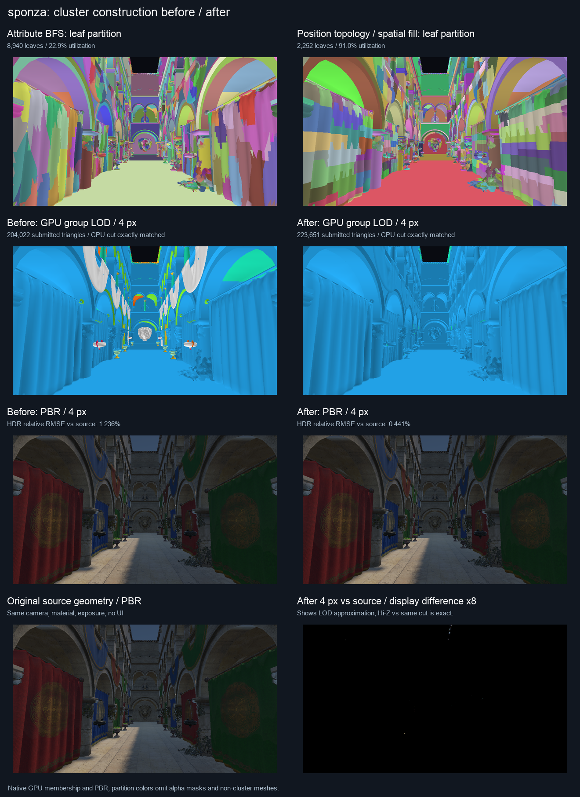

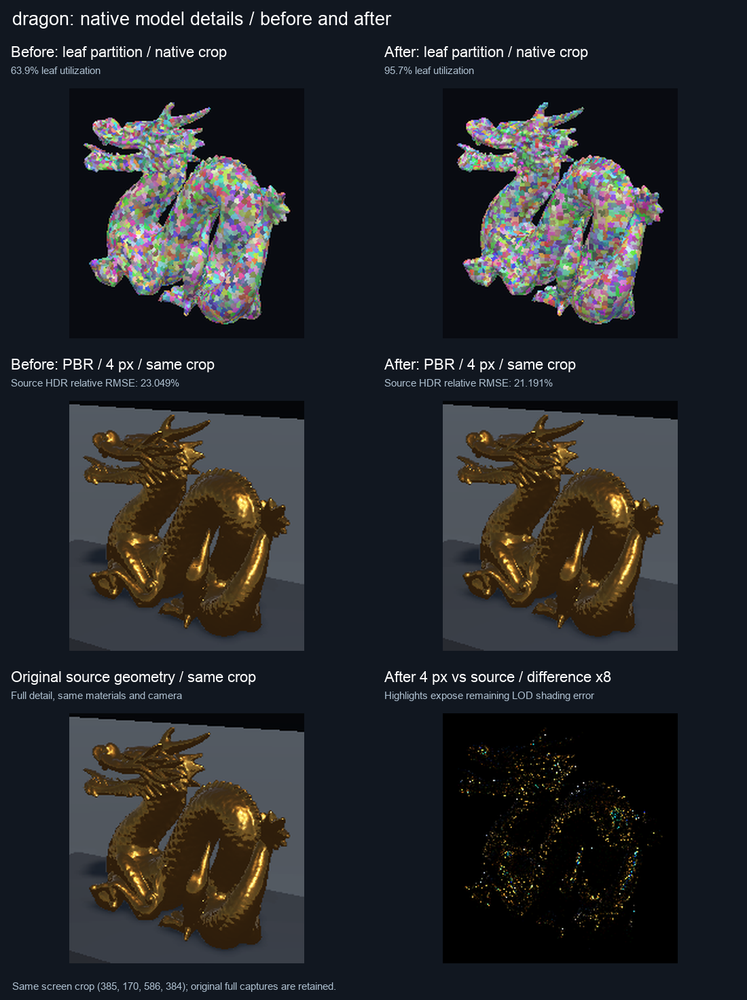

### Dense procedural limestone grotto

A traversable four-chamber rock scene uses fractured walls, stone vaults, bent stalactites, mineral pillars and fallen rocks. Relief is real vertex displacement on shared icosphere topology, with continuous projected UVs. **9 unique meshes / 2,883,584 unique triangles**, instanced into **76 draws / 24,838,144 logical triangles**. Binary PLY geometry plus 1024-pixel procedural textures totals **84.8 MB**, with a checked **10 GB disk cap**; no external model downloads are required.

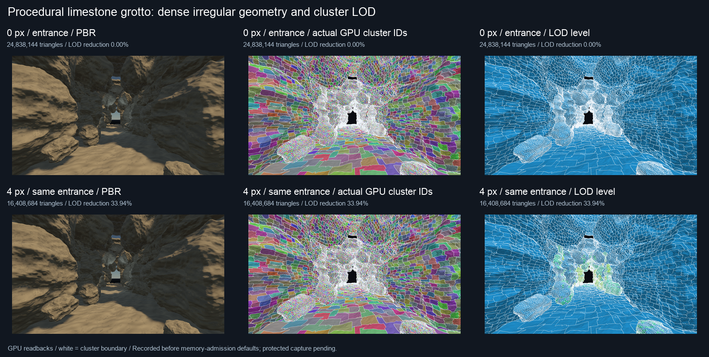

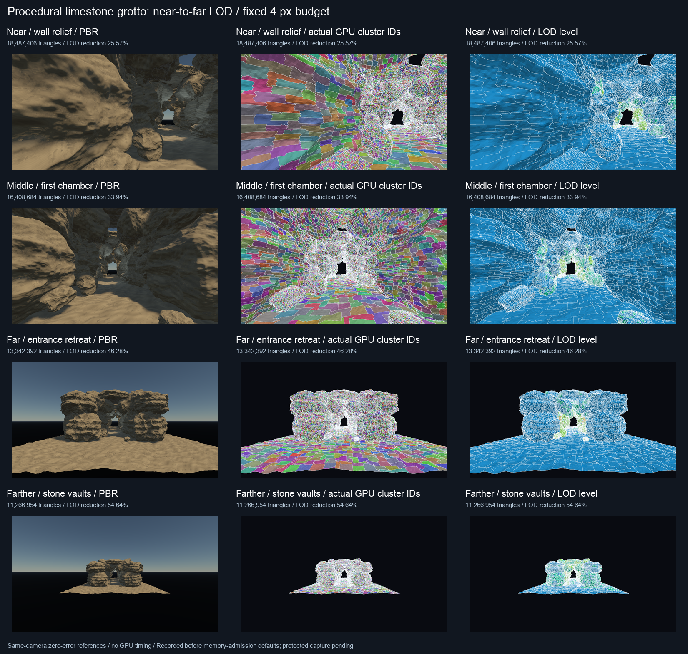

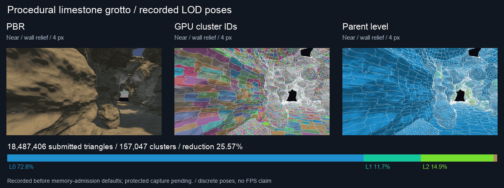

[Enlarged cluster boundaries and native triangle wireframe](../img/diagnostics/cluster-cave/detail.png) distinguish meshlet patches from the smaller triangles inside them. The animation shows discrete captured poses; its playback speed does not represent renderer FPS.

At 1280×720 / Metal, fixed 4 px LOD reduces submitted triangles by **25.57% near / 33.94% middle / 46.28% far / 54.64% farther**, relative to each camera's own 0 px reference. Object and occlusion culling are disabled to isolate LOD; these percentages are not frame-rate gains. The **9 shared hierarchies occupy 67.35 MiB** and do not hit their individual build budgets. GPU indices match the independent CPU cut in all seven views; diagnostic ID/level depth matches selected PBR geometry exactly. Entrance-view HDR relative RMSE is **1.17%**. [Appearance comparison](../img/diagnostics/cluster-cave/quality.png) and [compact capture metadata](../img/diagnostics/cluster-cave/summary.json).

These images and the animation use native captures validated **before the memory-admission defaults**. The new capture path reuses one renderer for reference/LOD, replays at most **65,536 triangles per batch** with **24 MiB scratch reservations** at the default budget, waits for completion before releasing each batch, and streams large membership lists to JSONL. Process **3 GiB / GPU 1.5 GiB** defaults and pressure rejection remain enabled. A new route adds two interior chambers and a same-camera **0 / 2 / 4 / 8 px** comparison. **Protected GPU captures of these changes are pending**; implementation builds and four memory/RHI tests pass. [Capture procedure and validation scope](cluster-cave.md).

```sh
python3 tools/prepare_cluster_cave.py --level 7
./build/Scene-Renderer --classic cluster-cave --size 1280x720
# A separate smaller package preserves the dense source geometry:
python3 tools/prepare_cluster_cave.py --level 6
./build/Scene-Renderer --memory-info
# Run when system memory pressure is normal:
./build/Scene-Renderer --cluster-scene-flow cluster-cave-small build/cluster-cave-small --backend Metal
python3 tools/visualize_cluster_scene_compact.py build/cluster-cave-small img/diagnostics/cluster-cave-small
```

### Bistro: whole-scene cluster and LOD demonstration

The free [ORCA Bistro](https://developer.nvidia.com/orca/amazon-lumberyard-bistro) exterior contains a complete street, buildings, storefronts, lamps and vegetation: **2,832,120 source triangles / 132 material meshes**. Original FBX geometry is retained; these previews use textures capped at 512 pixels and native sun/sky lighting. Amazon Lumberyard, 2017, **CC BY 4.0**; [credits and conversion notes](../samples/licenses/bistro.txt).

At 1280×720 / Metal, **117 mesh hierarchies** finish publication before capture: **25,565 leaf meshlets**, at most 128 triangles each, **86.52% leaf utilization**, and **40.74 MiB** of unique hierarchy data. Rainbow colors identify actual GPU-selected meshlets; LOD colors identify their parent-group level: **blue/cyan = leaf 0, green = 1, lime = 2**. Gray shows small meshes outside the cluster path. Original alpha masks are retained and every capture hides the UI.

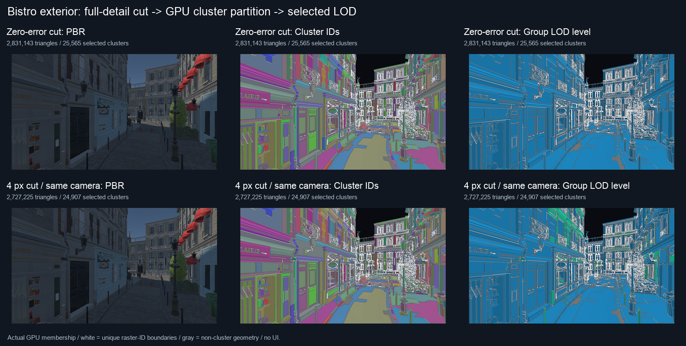

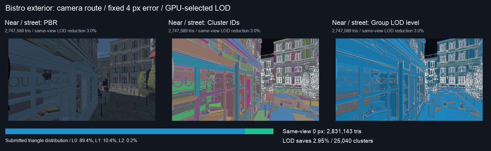


<details>
<summary>Why do these clusters look rectangular?</summary>

Meshlets have a **triangle budget**, rather than a fixed world-space width. Bistro has large planar faces and repeated architectural parts; texture detail does not add source triangles. Construction runs per material mesh, prioritizes shared-edge neighbors and vertex reuse, and uses Morton ordering for seeds. Bounded spatial fill can also combine disconnected pieces into one meshlet. Three actual picked clusters contain **128 triangles / 4 edge-connected pieces**, **26 / 1**, and **128 / 2**. The current partitioner therefore does not guarantee that every meshlet is a single connected surface patch.

The level colors mark **LOD level**, so many distinct meshlets share blue or green. White lines now mark transitions in the **unique GPU raster-ID texture**, including occlusion boundaries; they are decoded from IDs rather than inferred from RGB. Black lines show a native triangle-wireframe pass, depth-tested against the selected filled geometry. The previous `packet * 997 + cluster` visualization key had **1,048 aliases** in the full street cut, including **20** among the **3,135 raster-visible clusters**; global prefix keys remove those aliases. All seven PBR images and 0 px references remain byte-identical to the previous capture.

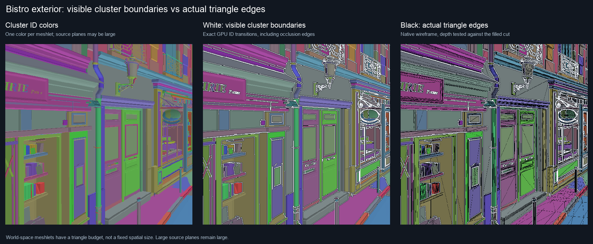

[Selected cluster geometry and connected pieces](../img/diagnostics/bistro/flow/surface-blocks.png) shows principal-plane projections of the picked index ranges, including hidden triangles. [ID validation and connectivity data](../img/diagnostics/bistro/flow/boundary-summary.json).

</details>

The camera route rises above the rooftops for distant views. The table counts cluster-path submissions; **frustum and Hi-Z culling are disabled** to isolate LOD. Each reduction compares against **2,831,143 triangles in that same view's 0 px cut**. Another 958 small-mesh triangles remain unchanged; preprocessing removes 19 degenerate source triangles. The four moving views keep a fixed **4 px** budget.

| View | Selected clusters | Submitted cluster triangles | Same-view LOD reduction |
| --- | ---: | ---: | ---: |
| Full detail / 0 px | 25,565 | 2,831,143 | 0.00% |
| Near / street | 25,040 | 2,747,589 | 2.95% |
| Middle / street | 24,907 | 2,727,225 | 3.67% |
| Far / elevated | 24,682 | 2,697,501 | 4.72% |
| Farther / elevated | 24,628 | 2,688,493 | 5.04% |

Bistro's LOD reduction is modest: only **946 of 20,762** candidate parent groups pass the simplification threshold, and **287,118 triangles** stay at leaf detail under alpha / two-sided material protection. The scene contains many attribute seams and small architectural fragments; no hierarchy hits its memory budget. This is a useful multi-mesh scene test, with fewer simplifiable dense surfaces than the scanned cliff. These triangle counts are not an FPS benchmark.

All seven captures match independent CPU-selected index lists and GPU indirect counts. Cluster-ID and LOD-color depth images match the selected PBR geometry **exactly**. LOD appearance remains approximate: the fixed street view has **3.60% HDR relative RMSE** against its 0 px cut; the pixel budget does not bound final shading error. [Same-view appearance and amplified differences](../img/diagnostics/bistro/flow/quality.png), [whole-block overview](../img/diagnostics/bistro/flow/overview.png), [facade detail](../img/diagnostics/bistro/flow/detail.png), [level legend](../img/diagnostics/bistro/flow/level-legend.png), [capture summary](../img/diagnostics/bistro/flow/summary.json) and [complete GPU membership](../img/diagnostics/bistro/flow/flow.json.gz).

<details>
<summary>Reproduce Bistro cluster captures and inspect interactive LOD</summary>

Download the official Bistro v5.2 archive to `samples/downloads/bistro-v5.2.zip` (**894 MB**, approximately **1.72 GB** extracted, including interiors). Source and converted assets stay outside Git. Python tools require NumPy and Pillow.

```sh
python3 tools/prepare_bistro_scene.py --texture-size 512
cmake --build build --target Scene-Renderer -j2
./build/Scene-Renderer --cluster-scene-flow bistro build/bistro-clusters --backend Metal
python3 tools/visualize_cluster_scene_compact.py build/bistro-clusters build/bistro-clusters/flow --scene 'Bistro exterior'
./build/Scene-Renderer --classic bistro --backend Metal
```

In the application, use **Hierarchical cluster geometry**, **Cluster LOD error (pixels)** and **Cluster triangle wireframe** to inspect the native path. Interactive Bistro defaults to 2 px; the diagnostic captures above use 4 px.

</details>

### Coastal Cliff parent LOD and UE Nanite

The CC0 **Coastal Cliff canyon** uses ten shared original LOD0 instances (**9.43 million logical triangles**). Connected parent groups and conservative endpoint error bounds improve same-view 4 px LOD reduction from **3.24% to 36.56%**: **8.85M → 5.80M submitted triangles**. On Apple M4 / Metal at 960×540, the geometry GPU window falls **8.31 → 6.22 ms**, or **6.86 → 5.31 ms** with two-stage Hi-Z (paired improvements **24.58% / 22.21%**).

The normal ceiling changes from 0.05 to 0.15: source-image HDR relative RMSE rises **0.578% → 1.181%**. Static CPU-cut / Hi-Z outputs match exactly; the moving reverse view has two depth-tie pixels, verified by an independent draw-order replay. Unique hierarchy memory grows **13.32 → 19.95 MiB**, construction **2.88 → 8.19 s**, and 0 px scans are 3.76% slower. These timings exclude shadows, lighting and postprocessing. [Ablations, native image checks, raw timings and limitations](cluster-parent-lod-optimization.md).


The same layout runs in **UE 5.8 Nanite** on Metal, with verified runtime cluster / triangle views and a full 943,284-triangle fallback per instance. UE images are a geometry reference; lighting and GPU timings are not compared across engines. [Asset preparation and UE verification](cluster-cliff-nanite-test.md).

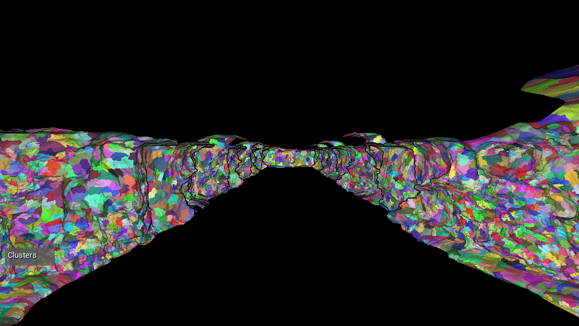

### Object Hi-Z and depth pyramid

Optional current-frame Hi-Z occlusion culling uses selected static occluder depth, a conservative farthest-depth pyramid, and GPU indirect arguments to remove hidden main-view geometry. It composes with triangle culling while preserving source geometry for auxiliary views. [Implementation and controls](hiz-culling.md).

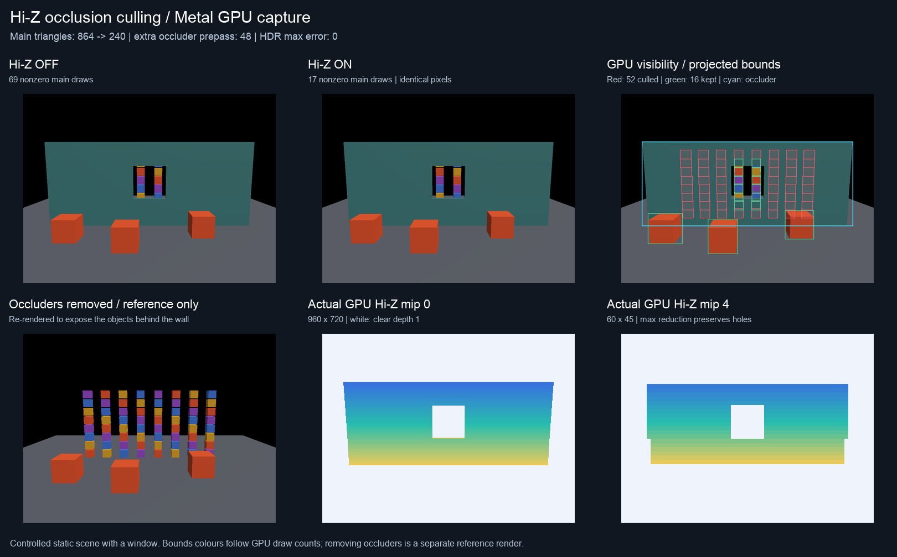

Actual Metal GPU capture of a controlled scene with a window: **red** bounds are culled, **green** are retained, and **cyan** marks the selected occluder. Nonzero main draws decrease **69 → 17**, main triangles **864 → 240**, with **48** extra occluder-prepass triangles and identical output pixels. The occluders-removed view is a separate reference render, not the baseline.

<details>
<summary>Actual GPU Hi-Z pyramid, mip 0–9</summary>


White means clear depth **1**, including the window. All nine GPU mip transitions exactly match independent CPU max reduction. Colours share a stretched depth range for readability. [Capture data and reproduction](hiz-culling.md#visualization).

</details>

## Post processing

A shared native HDR-to-display module adds optional Bloom, depth of field, camera motion blur, color grading, FXAA, sharpening, vignette, chromatic aberration, and film grain. The **Post processing** panel offers independent controls, exponential / ACES fitted / Reinhard / linear tone mapping, and a soft cinematic preset; extra effects default to off. [Controls, pipeline, comparisons, and limitations](post-processing.md).

| Default display | ACES and combined post effects |
| --- | --- |
|  |  |

| HDR Bloom | Depth of field: foreground focus |
| --- | --- |
|  |  |

```sh
./build/Scene-Renderer --classic cornell --size 1280x720
```

Open **Post processing** to enable individual effects or **Soft cinematic preset**. Metal and Vulkan validation passes; depth of field uses opaque depth, and motion blur currently covers camera motion.

## Path tracing

CPU/Metal/Vulkan path tracing supports multiple bounces, textured materials, refraction, and random walks in homogeneous media. CPU BDPT renders smooth-glass caustics. Procedural terrain, vegetation, and FFT water can be frozen into offline scenes. Unless marked as raw photon mapping, the images below use Open Image Denoise (OIDN).

Anisotropic GGX reflection is supported on CPU/Metal/Vulkan. Below, the same metal uses isotropic roughness, anisotropy 0.8, and anisotropy 0.8 rotated by 90°, from left to right. **Metal PT, raw 256 spp, 480×160, 8 bounces.** [Material parameters and validation](path-tracing-materials.md).


CPU/Metal/Vulkan PT also supports circular-fiber hair scattering and cloth rough diffuse, bounded grazing sheen, and thin transmission. This static fixture contains 3,500 tapered hair ribbons and a draped cloth mesh. **Metal PT, raw 256 spp, 640×360, 8 bounces.** Native curves and dynamics remain future work. [Parameters, limits, and validation](path-tracing-fibers.md).


Refined fur and cloth examples use the captured realtime sunset sky with clouds and a 5° finite sun. Stanford Bunny now has **72,000 finer short fur strands**; the cream knit sweater has **1,280 explicit front yarn loops and 23,360 fine nap strands**, with a separate cloth-yarn near view. **Metal PT, 768×768, 1024 spp, 12 bounces, OIDN display.** [Lighting, material refinements, raw images and validation](path-tracing-grooms-sunlight.md#夕阳展示). Bunny data: [Stanford University Computer Graphics Laboratory](https://graphics.stanford.edu/data/3Dscanrep/).

| Stanford Bunny fur at sunset | Knit sweater at sunset | Cloth yarn near view |
| --- | --- | --- |
|  |  |  |

The [YarnSim knitted-cloth examples](path-tracing-knitted-yarn.md) import public relaxed yarn control points, connect periodic spline spans, and add **anisotropic dielectric yarn reflection** shared by CPU/Metal/Vulkan. The prototype sweater has **280 honeycomb repeats on its front**; the separate swatch has **three geometric plies and open stitch holes**. **Metal PT, 768×768, 1024 spp, 12 bounces, OIDN display, sunset lighting.** Sleeves and garment seams remain procedural. Data: [Leaf et al., 2018](https://graphics.stanford.edu/projects/yarnsim/); original assets are not redistributed.

| Honeycomb sweater front | Three-ply knitted cloth |
| --- | --- |
|  |  |

The [standalone hair demo](path-tracing-hair-demo.md) generates **40,000 strands** with layered scalp coverage and shared wavy lock guides, about **8.9×** the original hairstyle's strand count. It has a dedicated generator/render entry point and three reference views. **Metal PT, 768×768, 256 spp, 12 bounces, OIDN display.**


[Yuksel public hair benchmarks](path-tracing-hair-benchmarks.md) retain all **50,000 strands** in each straight/wavy asset and the matching head. **Metal PT, 512×512, 256 spp, OIDN display.** Hair geometry: [Cem Yuksel](https://www.cemyuksel.com/research/hairmodels/); head courtesy of **Murat Afshar**. An independent PBRT equation probe and native-curve reference images are available; full appearance alignment remains incomplete.

| Yuksel straight hair | Yuksel wavy hair |
|---|---|
|  |  |

This hair showcase uses circular-fiber scattering under a clear sky captured from the realtime atmosphere pipeline. The low-angle sky and finite sun are rotated together, their source illumination is scaled by 10, and narrower hair highlights reveal the warm solar reflections. Each asset retains **50,000 strands: Metal PT, 512×512, 1024 spp, 12 bounces, OIDN display**. The head remains neutral diffuse. Hair geometry: [Cem Yuksel](https://www.cemyuksel.com/research/hairmodels/); head courtesy of **Murat Afshar**. See [lighting, material settings, raw images and validation](path-tracing-hair-sunlight.md).

| Straight hair in stronger sunlight | Wavy hair in stronger sunlight |
|---|---|
|  |  |

The architectural and natural scenes shown above also have path-traced results. Sponza and San Miguel use Metal PT at 320×240, 64 spp, and 16 bounces; terrain, lake, and ocean captures use Metal PT at 640×480 with procedural animation frozen at 8 seconds. Sampling settings and raw images are available in the [path-tracing gallery](rendering-gallery.md#路径追踪).

| Sponza: Metal PT + OIDN, 64 spp | San Miguel: Metal PT + OIDN, 64 spp |
| --- | --- |
|  |  |

| Stanford Dragon: CPU BDPT glass caustics + OIDN | Jade Dragon: Metal PT subsurface scattering + OIDN |
| --- | --- |
|  |  |

| Sunlit pool floor: Metal photon mapping + OIDN | Swimming pool above water: Metal photon mapping + OIDN |
| --- | --- |
|  |  |

Short ripples and a 0.266° sun radius produce clear caustic lines on pale blue tiles: 4M light paths, 64 spp, radius 0.025. The water uses a frozen analytic ripple mesh. [Raw closeup](../img/path-tracing/pool-sunlit-underwater-raw.png) · [Flat-water control](../img/path-tracing/pool-sunlit-flat.png) · [Reproduction and validation](path-tracing-photon-mapping.md#晴天泳池更明显的网状亮纹).

| Pool: Metal photon mapping, 1M light paths + 32 spp, raw | Refractive caustic contribution, raw |
| --- | --- |
|  |  |

The pool uses a frozen analytic wave mesh. The fixed-radius photon map is biased; CPU/Metal/Vulkan share the same photon data. [Reproduction, validation, and PT acceleration](path-tracing-photon-mapping.md).

CPU [SPPM](path-tracing-sppm.md) now resamples camera and photon paths each iteration and shrinks per-pixel gather radii. The sunlit pool test improves convergence with bounded batch memory; this finite-budget density estimate remains biased.

| Terrain and grass: Metal PT + OIDN, 128 spp | Mountain Lake: Metal PT + OIDN, 128 spp |
| --- | --- |
|  |  |

| Lakeside beach: Metal PT + OIDN, 1024 spp | Shallow-water refraction: Metal PT + OIDN, 4096 spp |
| --- | --- |
|  |  |

Beach textures are sampled at world scale; underwater solar paths use a BSDF/phase mixture proposal without changing the sun or exposure. [Raw beach](../img/path-tracing/pt-mountain-lake-beach-raw.png) · [Raw shallow water](../img/path-tracing/pt-ocean-clear-raw.png) · [Fix and validation](path-tracing-procedural.md#水下太阳路径采样).

### Ocean sea states and real-time/PT alignment

Recent development captures cover calibrated JONSWAP/TMA wind waves, independently directed swell, shared water optics, and successive glint/reflection corrections. Raster and PT share the FFT fields and detail band; a camera-focused PT grid extends water coverage to 2 km.

| Update | Result and validation |
| --- | --- |
| [Sea state and shared optics](ocean-sea-state-and-pt.md) | Calibrated wave height/period, independent swell, IOR 1.333, exact Fresnel and finite-sun reflection. [Shared-surface comparisons](ocean-physical-surface.md). |
| [Glint spatial filtering and TAA](ocean-glint-antialiasing.md) | Subpixel solar integration, slope-moment mips and linear HDR water history. Near single-frame error improves against raster SSAA; distant/TAA errors remain. |
| [Native float FFT normals and reconstruction](ocean-float-normals-and-glints.md) | Independent wind/ripple periods on CPU/GPU PT, tent glint reconstruction and direct frozen-water accumulation. Tent smooths edges at extra cost and increases pixel L1 against raw PT. |
| [Distant sun and sky reflection integration](ocean-reflection-integration.md) | Exact reflection Jacobian in slope space and pixel integration of Fresnel times sky radiance; additive body/reflection/sun/foam/border diagnostics. Metal/Vulkan water regression passes. |


| Current real-time TAA | Matched Metal native RT + OIDN, 512 spp |
| --- | --- |
|  |  |

Same snapshot, camera, sea state, time, 640×360 resolution and image exporter. Numerical comparisons use raw PT before OIDN. The latest before/after ablation uses one binary and identical compiled shaders; both raw PT films are bitwise identical. These are development-build results, with capture commands, source/build hashes and validation logs in the linked records.

| Latest TAA comparison against raw 512 spp PT | Previous reflection model | Current reflection model |
| --- | ---: | ---: |
| All-water relative RGB L1 | 129.66% | 113.49% |
| Distant-water relative RGB L1 | 171.88% | 134.01% |
| Side-water relative RGB L1 | 54.73% | 43.56% |

Near glints are largely unchanged. Water self-reflection, non-Gaussian distant slopes, rough sky reflection and volume transport remain different. One synchronized 20-frame capture measures about 3 ms extra single-frame cost; it is not a stable FPS benchmark. [Full images, component statistics, costs and limits](ocean-reflection-integration.md) · [Latest validation record](../img/path-tracing/ocean-reflection-validation.json) · [Raw PT](../img/path-tracing/ocean-reflection-pt.png).

<details>
<summary>Earlier glint reconstruction and latest sky-reflection components</summary>

| Earlier box reconstruction | Earlier tent reconstruction |
| --- | --- |
|  |  |

These historical float-normal captures use the same PT input. Tent lowers the glint ROI neighbour gradient by about 12.5%, but increases raw-PT pixel L1 and costs about 5–8 ms. Gradient reduction alone does not establish alias-free rendering. [Reconstruction ablation](ocean-float-normals-and-glints.md).

| Centre-normal sky reflection | Pixel-integrated sky reflection |
| --- | --- |
|  |  |

The sky-reflection images are weighted additive radiance components, not complete renders. Earlier 8-bit-normal PT references and raster SSAA are kept in their stage records; their errors are not compared across reference changes. [Initial comparison and spectrum-cache benchmark](ocean-realtime-pt-comparison.md).

</details>


### Blender test scenes

Blender's official Classroom and Barcelona Pavilion scenes are imported offline, rendered with this project's Metal path tracer, and denoised with OIDN. See [assets, material conversion, and validation](blender-path-tracing.md).

| Classroom | Barcelona Pavilion |
| --- | --- |
|  |  |

Barcelona now imports Bump/Normal Map atlases and dielectric roughness textures, with bounded pool reflection, refraction, and RGB absorption. Hidden particle emitters and reflected texture UVs are fixed. The pool uses an explicit artistic profile (IOR 1.333, depth 0.5 world units); the original water parameters remain available. [Raw preview](../img/path-tracing/blender-barcelona-water-raw.png) · [Reproduction and limits](blender-path-tracing.md#barcelona-材质与池水) · [Validation](../img/path-tracing/blender-water-validation.json).

CPU, Metal and Vulkan use **shared geometry BLAS/TLAS**. The latest Barcelona export retains all **20,622 vegetation particles**, representing roughly **55 million instance triangles**. Revision 5 adds Blender corner MikkTSpace frames and separately baked thin-leaf diffuse reflection/transmission. Its CPU geometry/acceleration payload is **54.4 MiB**. This 640×360, 256 spp Metal preview uses OIDN. [Raw image](../img/path-tracing/blender-barcelona-thin-raw.png) · [Material validation and reproduction](blender-path-tracing.md#薄玻璃太阳反射链).


Blender Cycles source-scene GT uses 1024 spp, the original materials and full vegetation, with denoising, intensity clamping, and glossy filtering disabled. The older engine previews use a reduced particle budget; the full-instance preview above still uses a different pool/material profile; see [the comparison and linear reference](blender-path-tracing.md#blender-cycles-gt).


A separate **matched Cycles comparison** reconstructs the same frozen geometry, 512 particles, camera, textures, lights, GGX closures, thin glass and bounded pool. At 320×180, 4096 spp and depth 24, raw Metal/Cycles total RGB energy differs by **0.067%**; pixel differences still contain reflection noise. Original Blender shader graphs and normal maps are outside this controlled baseline. [Measurements, independent-seed noise and reproduction](blender-path-tracing.md#同参数-cycles-线性对照).

Per-lobe normals and bump shadowing reduce small-scene raw Metal/Cycles RGB L1 from **0.838% to 0.290%** for Lambert/leaves and **2.662% to 0.582%** for GGX/leaves (192×96, 4096 spp). Solar proposals reduce full-instance Barcelona L1 from **4.67% → 3.53% → 2.98%** (water, then thin-sheet reflection; 160×90 / 512 spp, seed 1). The thin-glass outlier drops from **29.06 to 0.0656** (Cycles **0.0462**), with RGB RMSE **0.156 → 0.049**. Seed 2 L1 rises slightly from **3.07% to 3.19%**; pool/leaf rare paths and original layered materials remain. Cached scene counts give **1.58×** in a separate single-thread trace microbenchmark. [Latest validation and limits](../img/path-tracing/blender-thin-validation.json).


