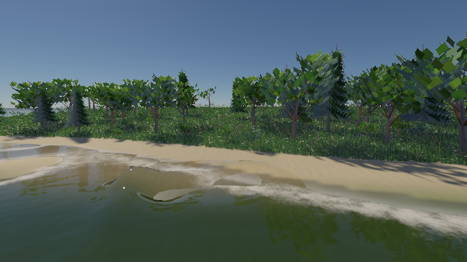

# 植被与 Wave Particles

原生 Metal／Vulkan 渲染路径支持八种自包含的程序植物，以及叠加 FFT／浅水的局部交互波。无需下载植物资产。

2026-10-11 后续改进：局部 Gabor 沙纹和近密远疏的草地覆盖，详见 [SIGGRAPH 调研与对照](procedural-nature-review.md)。下方预览为新版；文末初版统计保留其原始配置。

## 运行与预览

```sh
build/pt-native-rt/runtime/Scene-Renderer --classic vegetation-lake --backend Metal
build/pt-native-rt/runtime/Scene-Renderer --classic wave-particles-lake --backend Metal
build/pt-native-rt/runtime/Scene-Renderer --render-gallery build/nature-gallery vegetation-lake --backend Metal
build/pt-native-rt/runtime/Scene-Renderer --render-gallery build/nature-wave-gallery wave-particles-lake --backend Metal
```

`--backend Vulkan` 使用同一场景和实现。Gallery 在 8 s 捕获主图，另输出完整几何、关闭粒子波、8.5 s 扰动和草甸近景，及 JSON 统计。交互窗口的 **Vegetation** 面板调密度、物种高度和 LOD；**Ocean → Wave particles → Disturb water ahead** 按相机视线与水面的交点发布扰动。事件使用模拟时间，暂停时等待模拟恢复。




| 8 s 粒子波与尾流 | 关闭粒子波 |
|---|---|
|  |  |

独立波演示将湖底加深，避免尾流负波超过浅水深度；新版沙底采用低对比度局部波纹，保留 [初版 8.5 s 波前推进](../img/nature/wave-particles-later.png) 作为历史诊断图。

## 植被实现与优化

| 类型 | 近景几何 | 远景几何 |
|---|---|---|
| 短草／长草 | 12 片四段弯曲草叶 | 六片两段较宽弯叶 |
| 芦苇 | 草叶、圆柱穗 | 简化叶簇 |
| 雏菊／野花 | 花茎、叶、花心、白／紫色花瓣 | 单茎、少量花瓣 |
| 阔叶树 | 树干、分枝、叶簇 | 简化树干和大片叶 |
| 针叶树 | 分枝与针叶簇 | 分层锥形树冠 |
| 灌木 | 矮树干、多分枝叶簇 | 少量枝叶 |

`VegetationSpecies` 定义种子、实例上限、米制间距／尺寸、坡度和远近切换距离，另支持距离密度过渡和远景覆盖宽度。`farSpacing=0` 保留固定间距。`Grass::setSettings()` 的 `species` 为空时保留旧草地；`meadowSpecies()` 提供完整默认群落。近间距改变时旧根格历史失效；距离覆盖变化按旧相机和旧参数重建前帧。

GPU 在地形叶队列上生成实例，复用地形当前三角形插值、坡度、水位、水域贴图和沙滩排除。采用独立于地形叶层级的地形局部随机格点，降低 LOD 或 VT 页变化引起的根位置跳变。旋转／等比例缩放地形可使用米制间距；非等比例缩放按较长水平轴确定格距。

每个物种最多两个间接实例批次，远近 LOD 在过渡带采用互补随机选择，同一格点只进入一个批次。两个批次共用候选计数、容量与接纳计数，优先保留近处实例，避免预算翻倍；八物种只做八次候选计数。几何叶片减少 alpha overdraw；间接绘制无需每帧读取 GPU 实例数。统计回读只在显式诊断和 Gallery 中使用。

生成阶段同时重建每株植物的上一帧风动矩阵，按当前根位置对应历史，避免原子生成排序改变导致姿态错配。稳定地形与尺寸允许 TAA 累积；地形形状、VT 版本或尺寸变化时拒绝不可靠历史。辅助阴影／反射共享生成批次，不额外按主视锥删除实例；生成范围仍受地形当前叶队列限制，并非整个世界的常驻植被。

PT 冻结捕获也支持各物种的几何、调色贴图、LOD 与风动姿态。`grassLimit` 是所有物种的总捕获预算，按物种容量比例分配。

## 局部水波实现

实现基于 [Yuksel、House、Keyser 的 Wave Particles，SIGGRAPH 2007](https://www.cemyuksel.com/research/waveparticles/)，采用有限支持的余弦径向高度核：

\[
D_i(x)=\tfrac12 a_i\left(1+\cos(\pi\|x-x_i\|/r_i)\right),\quad \|x-x_i\|<r_i.
\]

CPU 以绝对 60 Hz 时间推进有界的世界空间波粒子。扩散角使波前展开；邻距超过半径的一半时三分裂，子粒子的振幅和扩散角各为原来的三分之一，半径保持不变。支持指数衰减、寿命、弱波清理和矩形边界反射。达到容量时保留父粒子、延迟细分；新波源不足容量时整组拒绝，并记录诊断计数。

`WaveImpulse` 提供唯一 ID、模拟时刻、世界 XZ 位置、方向、振幅、半径和扩散角；`WaveEmitter` 定义起点、速度、时间区间和发射间隔，生成正负位移对作为运动源尾流。反射范围外的波源被拒绝。事件列表最多 256 项，运动源最多 16 个，默认粒子容量 8,192。

CPU 根据波核支持范围建立 16×16 像素瓦片的紧凑索引，GPU 每像素只访问与所在瓦片相交的粒子。重建 RGBA32F 高度场，不做全屏遍历全部粒子。纯粒子场在同一模拟 tick、相同相机 patch 下复用重建结果；仍更新历史副本。相机移动只重建采样窗口，不搬移／重置世界空间波粒子。

与浅水启用时使用同一 patch 和分辨率。合成纹理保留浅水 H 与 bed，将渲染层的 Y 通道用于粒子扰动，浅水原始 H/Hu/Hv/bed 与泡沫状态继续独立保存。合成只添加局部扰动，浅水仍按原来的权重替换 FFT 基面。patch 边缘以八个格子平滑衰减；同一场驱动顶点高度、光学法线、折射裁剪、水下判定、焦散／太阳光柱及当前／上一帧水面。

## 验证与范围（初版测量记录）

```sh
ctest --test-dir build/pt-native-rt/runtime -R '^nature-system$' --output-on-failure
build/pt-native-rt/runtime/Scene-Renderer --nature-self-test --backend Metal
build/pt-native-rt/runtime/Scene-Renderer --nature-self-test --backend Vulkan
build/pt-native-rt/runtime/Scene-Renderer --water-self-test --backend Metal
```

本机 Apple M4 的 Metal 和 MoltenVK 已通过旧草地过滤／地形绑定、八物种间接绘制、LOD 根唯一性、饱和容量、风动历史、PT 冻结和水波验证。水波 GPU 与 CPU 核的最大误差约 `2.98e-8 m`；验证包含相机滚动历史、组合场 H/bed 保持、非整瓦片分辨率。原有 FFT、浅水、折射与时域回归通过。MoltenVK 测试不代表独立厂商 Vulkan 驱动验收；本机未安装 Khronos validation layers。

这是程序几何和局部线性波的可运行基础：尚无植物资产导入／billboard、叶片专用透射或树枝分层风动；尚无自动岸线曲线反射、破浪、喷溅和双向刚体流体耦合。使用垂直波核，未复刻论文的完整水平偏移模型。粒子更新／细分在 CPU，GPU 负责场重建。新植被支持 PT 捕获；Wave Particles 与浅水局部场尚未接入 PT 水面冻结，当前 PT 水面仍使用 FFT。旧 OpenGL 渲染路径明确拒绝新物种与粒子波配置。

## 实测植被预算

Apple M4、Metal、960×540、湖岸固定 8 s，关闭 RSM、开启水体与阴影；每项 16 帧，排除前四帧。以下为一次顺序消融，适合验证预算与量级，不能推导动画场景的稳定 FPS。

| 模式 | 实例 | 生成三角形 | 同步采集＋渲染中位耗时 |
|---|---:|---:|---:|
| 距离 LOD | 29,148 | 417,164 | 136.85 ms |
| 全部完整几何 | 29,156 | 3,178,242 | 143.22 ms |

几何减少约 86.9%，整帧只减少约 4.4%：现有水体与阴影通道仍占较大成本；两种模式也会有少量原子容量接纳差异。同步计时包含场景采集／实例准备及渲染完成，排除深度反馈与呈现；单个 GPU buffer 的时间不当作孤立植被通道耗时。[LOD 原始数据](../img/nature/vegetation-lake-metrics.json)、[完整几何原始数据](../img/nature/vegetation-lake-full-detail-metrics.json)。

初版独立 GPU 验证场景为 5,808 株：790,344 个 LOD 三角形，对应完整几何 3,651,578 个，约减少 78.4%。容量饱和用例另验证每物种近／远实例数之和不超过上限。新版的密度、覆盖历史、图像和耗时见 [后续改进记录](procedural-nature-review.md#验证和图像)。
