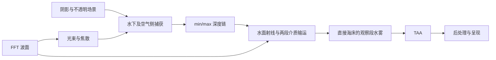
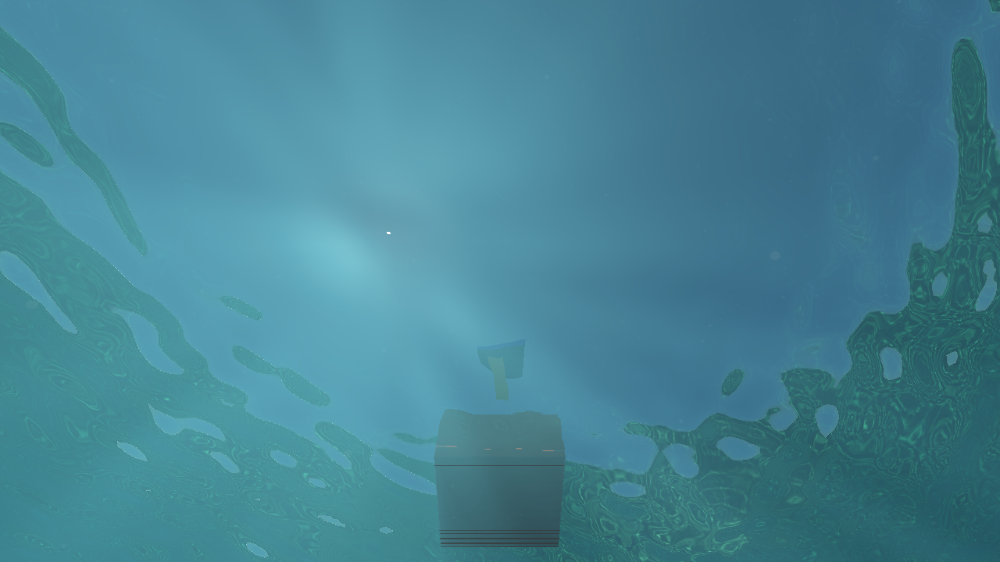
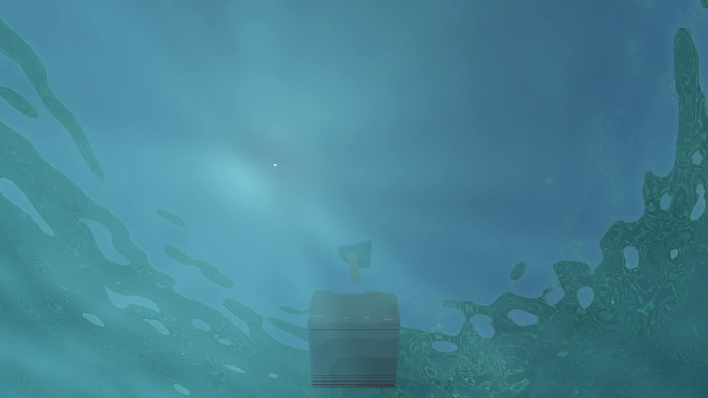

# 水下渲染关键路径分析

2026-10-08，Apple M4，macOS 15.3.1，原生 Metal，Release，1280×720。结论：优先处理**水下水面的两段体积输运**和**捕获关闭时的射线退化**，其次优化海床捕获与焦散。仅把全屏水雾改成半分辨率，覆盖不到主要成本。当前样本没有显示 CPU 提交或频繁 CPU/GPU 往返是主瓶颈。

此次添加诊断基准和统计脚本；没有改变生产渲染算法、默认质量或开关行为。后续实施结果、双线程编辑器提交与等待、RDG 决策见 [水体运行时优化与线程调度](water-runtime-optimization.md)。

## 测量范围

使用上一轮已验证的隔离水体构建，基础提交 `2f01d93` 加水体第二轮修复；没有包含工作区同时进行的 AO、PT 或实例批处理修改。[构建与源文件指纹](../img/diagnostics/water/critical-path-manifest.json)。这些数值用于识别该水体路径的瓶颈，不代表包含其他未提交改动的最新编辑器吞吐量。

同一潜水场景、固定相机，两种视角分别测试。每个配置 40 帧，前 8 帧预热，后 32 帧统计；每组重复相同的模拟时间 `8 + i/15`，32 步为原始质量。阴影、TAA、天空保持开启，SSAO／RSM 关闭，后处理使用场景设置。FFT 512＋256、海面网格 513×513 保持一致。计时覆盖 drawable 获取、场景收集、GPU 工作录制、FFT、阴影、水体、时域、呈现和 GPU 完成；图片读回、JSON 写入在计时之外。没有插入分项 GPU 等待，也没有拆开原生提交。

每种视角在首尾重测完整配置。第一轮海床首尾为 **102.75／96.69 ms**，约 6% 漂移；抬头为 **65.54／66.19 ms**。因此小于几毫秒的单次差值不能作为确定收益，更不能将所有关闭功能的差值相加。第二轮专门复测捕获退化。总计 34 组、1,360 帧，1,088 个计时样本；native timestamp 采样开启，Metal 调试验证关闭。

## A/B 结果

下表为第一轮完整帧同步延迟，p95 使用 nearest-rank。它不是编辑器多帧并行 FPS，也不能直接与旧画廊的呈现前 113 ms 比较。

| 配置 | 海床 p50／p95 ms | 抬头 p50／p95 ms | 解释 |
| --- | ---: | ---: | --- |
| 完整配置，首测 | 102.75／108.88 | 65.54／69.01 | 32 步、光束、颗粒、捕获、焦散 |
| 完整配置，末测 | 96.69／104.38 | 66.19／69.76 | 用于观察测量漂移 |
| 体积积分关闭 | 76.49／80.17 | 41.46／43.81 | 保留 Beer 衰减；同时跳过体积散射、颗粒及光束场生成 |
| 体积 8 步 | 79.53／87.22 | 53.42／56.76 | 所有功能保留，降低两段积分的采样数 |
| 体积 16 步 | 85.05／89.63 | 57.95／62.73 | 所有功能保留 |
| 太阳光束关闭 | 100.51／111.68 | 61.22／69.00 | 去掉光束场生成与散射中的通量采样 |
| 颗粒关闭 | 101.81／108.60 | 63.38／70.22 | 去掉最多 48 个世界空间单元的颗粒遍历 |
| 焦散关闭 | 91.47／96.72 | 53.65／57.68 | 去掉三级接收捕获、光子追踪、投射与过滤 |
| 宽空气捕获关闭 | 92.96／97.74 | 62.76／66.79 | 捕获图集 3 列变成 2 列，同时改变深度链和查询路径 |
| 水雾开关关闭 | 67.08／73.71 | 43.81／48.52 | 同时关闭水面两段介质输运、全屏水雾与光束生成，不能归为单个 fog pass 的成本 |
| 场景捕获关闭 | **175.19／185.73** | **100.98／108.38** | 触发昂贵的无层级射线退化路径 |
| 整个水体关闭 | 19.91／23.59 | 15.91／18.35 | 连 FFT、焦散、水面都移除，只表示诊断下界 |

[逐帧原始时间戳（gzip）](../img/diagnostics/water/critical-path/water-critical-path.json.gz) · [统计汇总与代表帧](../img/diagnostics/water/critical-path-summary.json)。汇总同时保留完整帧 GPU 提交时间、CPU 分项和顶点／片元时间窗口。

## 实际依赖链与“bubble”



这是消费资源形成的依赖关系，不表示所有工作完全串行。Apple GPU 已把部分 compute、顶点和片元工作重叠。海床完整配置末测的典型帧 GPU 时长 **91.52 ms**：

| 时间窗口，相对原生提交起点 | ms | 含义 |
| --- | ---: | --- |
| 水下捕获片元 | 33.00 → 49.02 | 捕获海床、礁石、海草并着色 |
| 深度层级 compute | 50.05 → 52.70 | 为后续光学查询准备 min/max |
| 水面顶点 | 41.49 → 43.55 | 已与捕获片元重叠 |
| 水面片元 | **52.71 → 84.83** | 等层级可用后执行射线与体积输运 |
| 观察段水雾顶点 | 43.55 → 43.55 | 全屏三角形很便宜 |
| 观察段水雾片元 | 84.87 → 90.74 | 等水面颜色／深度完成 |
| TAA compute | 90.74 → 91.36 | 等最终 HDR |
| 呈现片元 | 91.47 → 91.52 | 最后消费输出 |

因此 fog 的整个 encoder 区间约 47 ms，实际片元窗口只有约 **5.9 ms**；呈现区间看起来约 48 ms，片元窗口只有 **0.05 ms**。长区间主要包含前序资源依赖，不能据此宣称 fog 或呈现有几十毫秒的实际执行成本。片元窗口自身也可能包含硬件停顿，不能当作纯 ALU 时间。

每个稳定计时帧只有 **1 个 Metal command buffer**。FFT／地形等逻辑 `submit` 在 active frame 内合并；`Resources` 按完成时刻延迟释放，未发现稳定帧中途的 CPU 等待。海床完整配置末测的 CPU 收集约 **0.15 ms**、录制约 **3.04 ms**；提交到 GPU 开始的队列延迟中位 **0.87 ms**。`waitIdle` 是基准为了测完成延迟主动插入的同步，不能当作编辑器存在同等等待的证据。

各阶段时间戳窗口取并集后，海床完整配置末测仍有中位 **3.19 ms** 未覆盖；抬头为 **1.95 ms**。这是计数器未覆盖的区间，不是可证明的 GPU idle；还包含编码器间调度、命令缓冲首尾和未标记工作。当前无法用它证明 shader occupancy、寄存器压力或缓存命中率，需要 Xcode GPU Counters／GPU Capture 才能进一步归因。现有证据优先指向长片元依赖链，而不是频繁提交造成的大量空泡。

## 为什么水面比全屏水雾更贵

完整配置末测，海床的水面片元窗口中位 **31.23 ms**，独立水雾 **5.91 ms**；抬头分别为 **25.00／0.71 ms**。抬头镜头几乎全部是水面，单独优化全屏水雾收益尤其有限。

`underwaterInterface` 先追踪空气侧折射，必要时再查询宽空气视角，然后查询水下反射。水下反射包含最长 64 步海床高度场遍历、8 次细化、床面法线／照明，以及独立网格 DDA。DDA 上限 2,048 次，使用 mip 5 的 min/max 跳跃加速。

同一个水面片元随后会做两段介质输运：**水面到反射命中点**和**相机到水面**。两段各最多 32 步，每步查询波面高度、天空衰减、太阳衰减、四点阴影和两层光束通量；颗粒也按两段独立遍历。反射段在源码中不依赖 Fresnel 权重提前退出，因此低反射权重方向仍承担其计算。物理光路合理，但目前计算预算没有按贡献分配。

可写为 `C = T_eye × [(1−F)L_air + F(T_ref L_bed + S_ref)] + S_eye`。其中 `T` 是透射率，`S` 是散射，`F` 是 Fresnel。优化时应保留全分辨率背景和 `T`，分别降低 `S_eye` 与 `S_ref` 的计算成本，而不是模糊最终颜色。两段的采样坐标和光程不同，不能直接共用一张普通屏幕空间水雾图。

32 → 8 步后，海床水面片元从约 31–33 ms 变成 **17.95 ms**，抬头从约 25 ms 变成 **13.59 ms**。这比删除光束图生成的单次收益更明确。当前太阳光束 8 个投射 pass 的顶点窗口总和约 2.5–3.9 ms，并与其他阶段重叠；优先保留光束效果，优化消费它的积分。

## 捕获关闭为何反而变慢

第二轮独立复测：

| 配置 | 海床完整帧 p50 ms | 抬头完整帧 p50 ms |
| --- | ---: | ---: |
| 完整配置首／末 | 95.66／98.98 | 68.25／68.75 |
| 捕获关闭 | **155.08** | **104.98** |
| 捕获和体积积分都关闭 | **135.35** | **85.16** |
| 只关闭空气侧折射 | 100.12 | 66.71 |

去掉体积积分后，关闭捕获仍然很慢；海床水面片元窗口达到 **92.20 ms**。捕获开关关闭后，`coastBedInfo.w` 禁用深度层级，但 `camera.w` 仍说明场景存在不透明几何，DDA 继续扫描原始 G-buffer。它还失去捕获中的地形标签，无法利用已有海床高度场来排除重复查询。源码与复测共同支持“无层级、逐像素候选查询是退化主因”的判断，但本轮没有逐射线迭代计数器，不能声称所有射线都走满 2,048 步。

关闭空气侧折射没有稳定的大收益，说明只减少传输方向查询不能解决反射段、海床和两段介质积分的主要成本。**不应把关闭 Capture 当作当前低性能档。**

[退化复测原始时间戳（gzip）](../img/diagnostics/water/critical-path-fallback/water-critical-path.json.gz)。

## 实施优先级与验收

1. **先修捕获关闭的退化查询。** 为原始 G-buffer 也供应保守层级，或切换到明确有界的粗到细查询；稳定海床与独立网格采用明确分类，限制候选光程。验证开关不会引起性能反转，并保留遮挡、屏幕边缘、空场景和奇数尺寸行为。
2. **降低两段散射成本。** 先提供 8／16／32 步质量档位和贡献／光程驱动的采样。保留全分辨率 Beer 透射及背景；将 `S_eye` 和 `S_ref` 分别做半分辨率计算，按水面法线、对应光程、命中类别和临界角引导重建。不连续位置全分辨率回退；颗粒维持足够清晰的独立处理。只优化海床 fog pass 的理论上限约是它的 6 ms，无法解释水面路径中的二十多毫秒散射成本。
3. **优化水下捕获及焦散。** 海床水下捕获片元约 **16–17 ms**，抬头约 **1 ms**；应按覆盖、材质和捕获视角做裁剪及分辨率分配。空气近物体保留轮廓精度。焦散当前每帧重复三层 receiver capture，可按几何／光向变化复用接收图，仍逐帧用 FFT 更新光子与通量。光束通量已有世界空间场，也可研究降低更新频率并重投影，必须验证移动与波面变化。
4. **再收缩依赖和无用深度 mip。** 当前为 3 列图集生成完整 12 层，但查询最多用 mip 5；移除未消费的高层可减少小 dispatch 和资源边界，但它们实际很短，不能预期几十毫秒收益。完整深度链 compute 区间总和中位约 **1.94／2.65 ms**；大头是前几层，分辨率／格式优化比单纯删末级更值得测。

验收同时记录完整帧 p50／p95、顶点／片元窗口和代表帧依赖链；不能只报告局部 pass 的下降。画面覆盖移动潜水、薄浮标、礁石轮廓、海草、Snell 窗口／TIR 边界、波面跨越和明暗光束。还要保持 Beer 能量、光程只计算一次、物体遮挡和低置信度历史回归。8 步与 32 步截图仅为静态诊断比较，尚未证明快速波纹与镜头运动中的画质等价。

| 32 步完整配置 | 8 步，所有功能保留 |
| --- | --- |
|  |  |

## 复现

```sh
SCENERENDERER_DISABLE_PIPELINE_DISK_CACHE=1 SCENERENDERER_GPU_PROFILE=1 \
  ./build/Scene-Renderer --render-gallery build/water-critical-path water-critical-path

# 只测捕获退化，包含首尾完整配置；可加 VIEW=seabed 或 window。
SCENERENDERER_DISABLE_PIPELINE_DISK_CACHE=1 SCENERENDERER_GPU_PROFILE=1 \
SCENERENDERER_WATER_BENCH_MODES=full-start,capture-off,capture-off-no-volume,air-refraction-off,full-end \
  ./build/Scene-Renderer --render-gallery build/water-critical-fallback water-critical-path

python3 tools/analyze_water_critical_path.py \
  build/water-critical-path/water-critical-path.json \
  build/water-critical-fallback/water-critical-path.json --output build/water-critical-summary.json
```

`SCENERENDERER_WATER_BENCH_VIEW` 选择视角；`SCENERENDERER_WATER_BENCH_MODE` 选择单项。保存到仓库的原始 JSON 采用 gzip 压缩，脚本也能直接读取 `.json.gz`。本轮隔离 Release 构建成功，两轮基准全部完成，时间戳没有截断，全部稳定计时帧为单次原生提交。此次只有诊断入口和报告变更，没有因分析重新声称渲染正确性测试覆盖了工作区其他并行改动。
