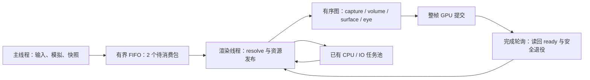

# 水体优化、线程分工与运行时提交分析

2026-10-08，Apple M4／macOS 15.3.1／Metal Release，1280×720。已修复捕获关闭时的深度查询退化，合并编辑器的反馈读回和呈现完成回调；新增可关闭的自适应半分辨率水面散射。**当前主要限制仍是 GPU 水体片元工作，现有数据不支持立即增加 GPU 录制线程。**

这是 [水下关键路径分析](water-critical-path.md) 的实施与运行时补充。性能数据使用隔离水体构建，避免将工作区同时进行的 AO、PT、实例批处理改动混入因果比较；最后另验证工作区构建。默认散射质量仍为全分辨率、32 步；本次未改变海面网格与 FFT 分辨率。

## 已落地的修改

- **无捕获查询也有 min/max 深度层级。** 使用当前原始 G-buffer position 建立保守深度链，沿用 mip/layer 验证；不把原始 G-buffer 的物体标成捕获中的海床。反射射线的独立物体搜索限制在已知海床命中点之前，保留小容差。
- **深度链止于 mip 5。** 查询不使用更高 mip，因此不再生成图集原来的全部 12 级。体积积分通过逐步乘透射率更新前缀透射，减少重复指数计算，保持积分位置和单次光程。
- **水面散射可自适应降为半分辨率。** Ocean 面板新增 `Adaptive half-resolution underwater scattering`，配置 `underwaterVolumeDownsample=2`；默认 `1`。抬头方向明确时预计算，海床／近水平视角保留完整路径。全分辨率背景折射、Beer 透射、射线交点、泡沫光和颗粒保留。
- **完成回调附着于正常 present/endFrame。** 编辑器不再仅为了输入延迟统计，在呈现前强制 checkpoint。
- **VT 反馈随当前帧完成。** 高度和材质反馈仍分别执行 GPU dispatch／staging copy，但通过 `FrameReadbackTicket` 在正常整帧完成后发布 ready，不各自拆出一个 command buffer。非 active-frame 调用保留 checkpoint，owner thread 可以非阻塞轮询完成；同步验证读回仍保留原来的 token API。
- **增加 opt-in 有界时间线。** `SCENERENDERER_RUNTIME_TRACE_OUTPUT` 导出主线程、任务排队／执行、帧包等待、渲染录制、GPU 分项与完成确认。未设置时不记录。水体从单个图节点拆为 capture、volume、surface、eye 四个节点，当前仍按同一设备线程和队列执行。

## 完整帧 A/B

与上一轮相同的双视角、40 帧／配置、8 帧预热、后 32 帧统计，重复模拟时间 `8+i/15`；阴影、TAA、光束、焦散和颗粒保留。表中为包含 GPU 完成等待的同步延迟，**不是编辑器并行吞吐 FPS**。首尾完整配置展示测量漂移。

| 配置 | 海床 p50／p95 ms | 抬头 p50／p95 ms |
| --- | ---: | ---: |
| 最终完整配置，首测 | 96.27／113.65 | 69.70／75.40 |
| 关闭捕获，保留体积积分 | **84.46／90.50** | **61.36／67.40** |
| 关闭捕获和体积积分 | 59.38／62.45 | 37.39／41.20 |
| 自适应半分辨率散射 | 103.06／111.65，实际走全分辨率 | **66.46／69.91** |
| 最终完整配置，末测 | 101.85／108.08 | 69.39／73.75 |

上一轮捕获关闭复测为 **155.08／104.98 ms**，同时关闭体积积分为 **135.35／85.16 ms**。最终捕获关闭已经低于同轮完整配置，性能反转消除；跨轮数值不能全部归因于某个小优化。

抬头的水面片元窗口从末测 **25.24 ms** 降到 **13.64 ms**，但新增预计算片元约 9 ms，还有重复水面顶点及资源依赖，所以整帧只有约 **4%** 收益；另一次复测为 64.91 → 61.41 ms，约 5%。海床首次强制半分辨率测得 96.02 → 107.16 ms， guide 拒绝与额外预计算抵消了局部下降；最终策略对此视角跳过预计算，时间戳中没有 half pass。该策略依据本场景测量保守设置，不是对任意场景的性能保证。

[最终统计与代表帧](../img/diagnostics/water/runtime-final-summary.json) · [最终原始时间戳](../img/diagnostics/water/runtime-final/water-critical-path.json.gz) · [强制半分辨率复测](../img/diagnostics/water/runtime-scattering-summary.json)。

## 半分辨率计算的内容与边界

水面界面的两段散射组合为 `S_eye + T_eye × F × (1−foam) × S_ref`，预计算的背景置零。全分辨率最终路径仍计算 `T_eye × [(1−F)L_air + F T_ref L_bed]`，并按原来的位置混合泡沫与两段颗粒。

预计算输出散射 RGB、观察光程；另一层存 oct-normal、反射光程、命中类别和 Fresnel。重建使用四个邻点，检查法线、两段光程、反射类别、Fresnel 与 TIR 侧别；有效权重不足则调用原来的完整积分。低分辨率预计算不查询空气背景，按主捕获剔除前方不透明物体，并匹配全分辨率波面法线的过滤尺度。

复用原来的 transport-LUT sampler 为三层 RGBA32Float 数组，第三层仍保存原 LUT，避免扩大已经接近上限的 sampler/binding 数量。RHI 增加多层 sampled view，attachment/storage image 仍要求单层，Metal／Vulkan 各自创建真实 array view。720p 预计算颜色、guide、LUT 及深度约额外 11.4 MiB；实际 native 分配另有对齐和 staging。

独立平面透射／TIR HDR 比较的最大误差约 **0.00037**。匹配波面静帧的显示 RGB 差异平均约 0.023／255、最大 3／255；海床自适应回退逐像素相同。[静帧差异数据](../img/diagnostics/water/runtime-final/image-difference.json)。这些证据不能证明任意移动光束、快速波纹和遮挡变化都与全分辨率等价。功能默认关闭，直接海床的全屏观察段 fog 本轮仍为全分辨率。

| 全分辨率 | 自适应半分辨率，抬头视角 |
| --- | --- |
|  |  |

## 现有 engine／render thread 的分工

| 执行位置 | 当前职责 | 边界 |
| --- | --- | --- |
| 主线程 | GLFW、输入、ImGui、场景值命令、固定步长模拟、相机、不可变快照 | 活 Scene／Component 的修改与访问遵守逻辑线程所有权 |
| 渲染线程 | 解析快照、资源上传／发布、效果调度、RenderGraph、RHI 录制／提交、GUI backend、读回完成、呈现和安全释放 | `Device::checkThread()`；设备只在启动／join 的静止边界移交 |
| CPU JobSystem | 解码、加载与 CPU 资产准备；默认最多 8 workers | 有界队列；不能在同一 worker pool 中嵌套阻塞提交 |
| IO pool | VT 页与图片 IO，2 workers／64 jobs | 渲染线程使用 `tryEnqueue`，不等待磁盘；完成 payload 在 owner thread 发布 |
| GPU | FFT、地形、阴影、捕获、光学、时域、后处理 | 当前单 native queue，逻辑 dispatch 可在 active frame 中合并 |



普通快照队列容量 2。主线程 `trySubmitFrame` 遇满跳过**新快照**，继续事件和模拟；已经接收的帧保持 FIFO。没有多个 RHI 录制线程争用同一 command encoder。现有日志的 `peak queue wait` 是阻塞 submit 的生产者等待，因此普通路径显示 0 并不代表快照未等待；本轮 trace 的 input-to-consume 显示实际排队年龄。

加载候选场景有意执行 GPU trial draw 并等待完成，再允许主线程发布。这是资产事务的冷路径；不能与稳定渲染循环混为一谈。PT 的独立 CPU 准备／后处理任务不是本轮水体 A/B 的测量对象。

## 编辑器的实际提交与等待

实际双线程编辑器运行 `underwater-dive`、固定 time=8、720p、64 帧，排除前 8 帧。旧方式通过两个诊断环境开关复现；不是用离线画廊代替线程测量。原始 native 计数与 CPU trace 有各自时钟原点，不未经校准叠在一起。

| 指标 | 旧拆分，复测 | 合并，首测 | 合并，复测 | 合并，1 帧在途 |
| --- | ---: | ---: | ---: | ---: |
| 每两个相邻水面完成之间的 native 提交数 | **4** | **1** | **1** | **1** |
| 稳定 CPU 帧周期，ms | 97.64 | 92.48 | 99.51 | 118.88 |
| GPU 水面完成间隔 p50，ms | 96.74 | 89.44 | 98.20 | 118.48 |
| render 录制 p50，ms | 2.42 | 2.69 | 7.01 | 7.79 |
| present scope p50，ms | **93.66** | **0.016** | **0.042** | **0.042** |
| 帧开始 retirement＋flight 等待 p50，ms | 0.29 | **85.25** | **89.71** | **105.98** |
| native drawable 获取 p50，ms | 0.011 | 0.020 | 0.046 | 0.043 |
| 输入采样→开始消费 p50，ms | 193.36 | 180.37 | 196.85 | 236.65 |
| 输入采样→完成确认 p50，ms | 289.94 | 544.32 | 587.79 | 463.59 |

这消除了两个反馈 checkpoint 加一个统计 checkpoint，让默认 3 的额度重新对应实际整帧。**没有证明确定的 FPS 提升**：重复样本有明显漂移，后两次 CPU 录制也更慢。水体 GPU 占用仍然很长；此前约 94 ms 的 present scope 主要是 checkpoint／额度等待，合并后等待转移到 beginFrame 的正常背压，而不是这 94 ms GPU 工作凭空消失。

3 帧在途会允许更深的 GPU 排队，提高重叠机会，也使 FIFO 快照的完成确认更晚。1 帧样本的完成确认更早，但 GPU 提交间隔出现 p50 **18.27 ms** 的空档，吞吐较差；不能把它作为统一最优设置。完成确认包含 owner-thread 轮询延迟，**不是扫描输出或输入到屏幕的延迟**。

旧方式 native command-buffer 间隙 p95 约 **8.70 ms**；合并 3 帧样本 p95 为 **0**，部分 native 时间区间有重叠。这只描述本应用提交队列的时间窗口，不能推出整块 GPU 的利用率或 shader 内部 occupancy。水面→眼段 fog→TAA 的资源依赖仍然存在；长 encoder 区间也仍包含等待，不能把它们相加当成 GPU 总耗时。

另尝试本机 Instruments 的 Metal System Trace，记录器报 `Rules engine appears to be stuck` 并以错误退出，未获得可用于归因的完整系统 trace。本轮不据此宣称测到了硬件 occupancy、寄存器压力或 cache miss；这些仍需成功的 GPU Capture／Counters。

[运行时统计](../img/diagnostics/water/runtime-dispatch-summary.json) 保留五次完整对照（含首次旧方式）。CPU 主线程 UI／snapshot 的首组中位约 0.01／0.014 ms；worker 也已记录排队和执行，但该静态潜水运行不能代表大场景加载和大量动态对象的任务负载。

## 与 UE RDG 的关系和下一步决策

Epic 的 RDG 采用 setup/execute 分离，根据 pass 资源依赖管理执行与生命周期；并行渲染将命令录制拆给任务，之后仍保持正确的 GPU 提交顺序。线程数量、依赖图和 async compute 是不同能力。[Epic RDG 文档](https://dev.epicgames.com/documentation/en-us/unreal-engine/render-dependency-graph-in-unreal-engine)、[Parallel Rendering Overview](https://dev.epicgames.com/documentation/en-us/unreal-engine/parallel-rendering-overview-for-unreal-engine)。

| 能力 | 本引擎现状 | 建议 |
| --- | --- | --- |
| engine 与 rendering 分离 | 已有不可变快照、有界队列与设备所有权 | 保留；监控快照年龄、背压、完成确认 |
| CPU 任务处理 | 已有 bounded JobSystem／IO；本轮增加时间线 | 优先复用，先看真正重的 visibility／排序／材质准备任务 |
| pass 依赖与子资源验证 | RenderGraph 已验证 RAW/WAR/WAW、未初始化读、mip/layer；水体拆为四节点 | 继续将内部真实 texture/buffer 与持久历史资源注册到图 |
| transient 生命周期与 alias | 有生命周期及 alias-slot 规划 | 尚未据此绑定 native heap，不宣称已节省物理显存 |
| 自动 culling／拓扑调度 | 后续 2026-10-09 已接入显式输出／副作用根及 mip/layer pass culling；仍按插入顺序录制 | [算法与回归](render-graph-culling.md)；继续拆分效果内部真实资源，暂不并行录制 |
| 多线程 GPU command recording | 当前 RHI 单 owner；已有 callback 不能直接扔进 worker | **本轮不引入**。CPU 录制相对 GPU 工作很短，风险大于已证明收益 |
| async compute | 当前单队列；无自动异步跨队列调度 | 先证明无依赖的 overlap 窗口及带宽余量，再增加显式队列／fence |

建议下一阶段以“更完整的 RDG 资源模型＋已有 CPU 任务池”推进：先把 FFT／光束／焦散／捕获的真实资源与历史写回纳入图，显式表达副作用、输出和生命周期，再实现死 pass 剔除及可复用计划。CPU 可见性、排序等输入使用封存快照，带 revision／取消／世界代际，不从 worker 读取活组件。

只有当大场景实测出现明显 CPU 录制临界路径时，才增加独立录制上下文、每线程 transient allocator、thread-safe immutable pipeline lookup，以及按依赖顺序汇合的 command-list batch。`Device::adoptCurrentThread()` 不是并发录制锁；直接并行调用现有 pass 会破坏 encoder、resource registry、retirement 与历史状态。当前优先继续优化捕获／焦散复用和散射的 guide 接受率，而不是追加线程掩盖长 GPU 片元链。

## 复现与验证

```sh
# 水体同步延迟；每组 40 帧，8 帧预热。
SCENERENDERER_DISABLE_PIPELINE_DISK_CACHE=1 SCENERENDERER_GPU_PROFILE=1 \
SCENERENDERER_WATER_BENCH_MODES=full-start,capture-off,capture-off-no-volume,volume-half,full-end \
  ./build/Scene-Renderer --render-gallery build/water-runtime water-critical-path

# 双线程运行时间线；完成退出后写 JSON。
SCENERENDERER_GPU_PROFILE=1 SCENERENDERER_RUNTIME_TRACE_OUTPUT=build/runtime.json \
  ./build/Scene-Renderer --classic underwater-dive --hidden --size 1280x720 \
  --frames 64 --time 8 --frames-in-flight 3
# 复现旧方式时同时增加 SPLIT_PRESENT=1 和 SPLIT_READBACK=1（完整前缀见下文）。

python3 tools/analyze_water_critical_path.py build/water-runtime/water-critical-path.json \
  --output build/water-runtime-summary.json
python3 tools/analyze_runtime_trace.py build/runtime.json --output build/runtime-summary.json
ctest --test-dir build -R 'engine-concurrency|rhi-contract|rhi-graphics-contract' --output-on-failure
./build/Scene-Renderer --rhi-self-test
./build/Scene-Renderer --water-self-test --backend Vulkan
```

旧方式开关的完整名称为 `SCENERENDERER_RUNTIME_SPLIT_PRESENT` 与 `SCENERENDERER_RUNTIME_SPLIT_READBACK`，只用于诊断。Trace 最多保留 32,768 条事件，超限记 dropped；统计脚本拒绝截断时间线。CPU thread ID 与 native GPU 时间线分别保存；不能将 worker 的排队区间算成 worker 活跃 CPU 时间。

工作区整合回归另发现无切线占位 SSBO 仅 16 字节，Metal 反射要求 header 加一个数组元素共 32 字节；已扩大占位及绑定下限，不改变切线生成或材质算法。

验证记录与源文件指纹见 [诊断 manifest](../img/diagnostics/water/runtime-optimization-manifest.json)；单元测试覆盖 present/endFrame 单次完成回调、数组 view 范围和单层 attachment 限制。原生水体回归覆盖 Beer／散射独立参考、Snell／TIR、浮标折射及反射几何、捕获／零散射开关、海床自适应回退、波面跨越、奇数尺寸、移动 TAA；frame lifecycle 同时比较整帧延后读回和立即 token 读回的逐帧像素，防止 staging 被在途帧覆盖。

验证状态：隔离 Metal 完整 RHI、最终工作区 Metal 完整 RHI（API／Shader validation 开启）、工作区 Vulkan 水体／完整 RHI 及三项 CPU 契约测试均通过。日志保存在 manifest 链接目录；性能采集关闭了调试验证。
