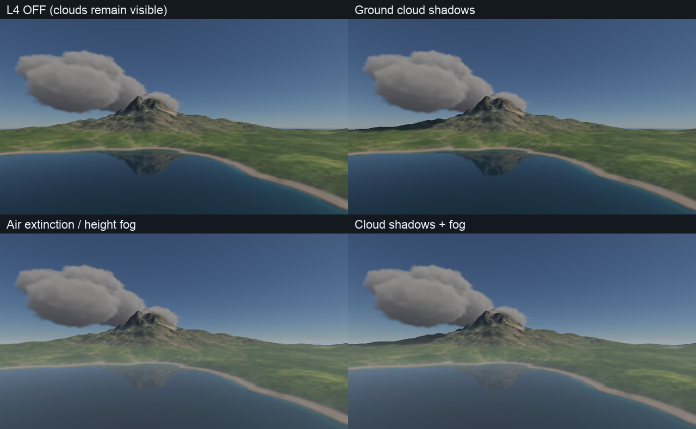
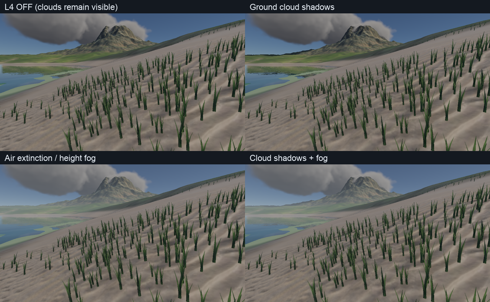
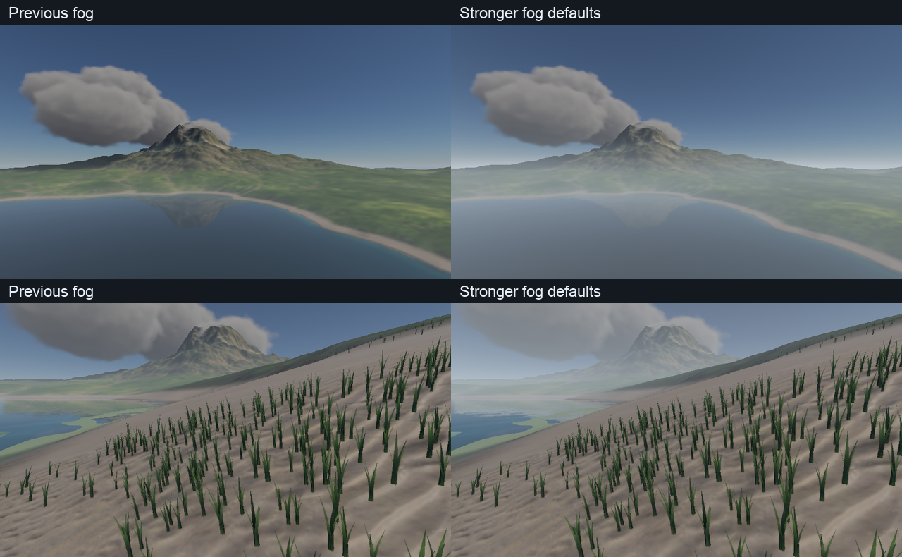
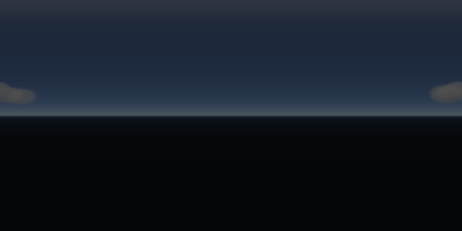

# L4：天气光照与 PT 参考

2026-10-09。地面云影、空气段消光／近地雾、云影限频更新和 **P1 approximate** PT 捕获已实现。Metal／Vulkan 数值验证与山湖静态对照通过；晴雨过渡、移动相机跨水面、长时间运行和完整帧预算仍待联合验收。RSM 默认关闭，仅保留手动 demo。

新增 [大气空中透视](atmospheric-aerial-perspective.md)：复用 Rayleigh／Mie、太阳透射与多次散射 LUT，独立于本文固定源颜色高度雾。水体空气段雾现统一在捕获后的 compute pass 计算，避免扩大材质绑定 ABI；本文原始图与数值仍保留为首批 L4 记录。

## 实景对照

以下为 Apple M4／Metal，960×540，固定时间 8 秒、云量 .85、降雨率 50 mm/h；雨丝隐藏，四组均保留主视图体积云。左上关闭 L4 云影／雾，右上仅云影，左下仅雾，右下联合效果。没有将雨丝变化或曝光变化混入对照。





[Metal 原始图与样本](../img/diagnostics/environment/l4/gallery-metal/mountain-lake-weather-metrics.json)／[Vulkan 原始样本](../img/diagnostics/environment/l4/gallery-vulkan/mountain-lake-weather-metrics.json)／[汇总与跨后端图像差异](../img/diagnostics/environment/l4/summary.json)。太阳场诊断图白色表示 `1−T`，越白遮蔽越强；[远景](../img/diagnostics/environment/l4/gallery-metal/mountain-lake-cloud-shadow-map.png)／[湖岸](../img/diagnostics/environment/l4/gallery-metal/mountain-lake-beach-cloud-shadow-map.png)。

## 操作与复现

开启 Environment 驱动后，面板提供 `Ground cloud shadows`、`Air extinction and ground fog` 两个独立开关，以及干空气／雨天消光系数、雾高度、雾源颜色和云影更新间隔。当前默认消光系数分别为 .000015／.00005 m⁻¹（此前雾增强对照使用 .00006／.00030），高度 180 m，云影间隔 .1 s。常规场景未开启 Environment 时不自动附加 L4。

默认雾强度已调高：干空气消光为原来的 6 倍，降雨附加消光为 2.5 倍，高度从 120 m 增至 180 m，让较高的远山与湖岸都能产生更明显的层次。本文首批四组图及耗时仍对应旧默认值 .00001／.00012 m⁻¹、120 m，保留为原始 L4 验证记录。



新默认已重编译并完成 Metal 山湖／湖岸实景检查；对照使用相同时间、云量和降雨率，见 [调整后捕获参数与 hash](../img/diagnostics/environment/l4/fog-tuning/manifest.json)。已经运行的应用需重启以加载新默认值，也可直接在 Environment 面板填入这些系数。

```sh
./build/Scene-Renderer --classic mountain-lake --backend Metal \
  --environment-clouds --environment-cloud-coverage .85 \
  --environment-rain 50 --environment-ticks 180

# 可分别追加 --environment-no-cloud-shadows 或 --environment-no-fog
./build/Scene-Renderer --render-gallery build/environment/l4/gallery-metal weather-gallery --backend Metal
./build/Scene-Renderer --render-gallery build/environment/l4/gallery-vulkan weather-gallery --backend Vulkan
./build/Scene-Renderer --weather-lighting-self-test --backend Metal
./build/Scene-Renderer --weather-lighting-self-test --backend Vulkan
```

天气视觉参数属于 RenderSettings；CPU schema 5 检查点仍只保存环境／地表状态，不保存这组视觉旋钮或 GPU 历史。恢复后历史重建。编辑器隐藏窗口烟测验证了两个关闭参数、tick 180 和 schema 5 保存，见 [日志](../img/diagnostics/environment/l4/editor-smoke.log)与[检查点](../img/diagnostics/environment/l4/editor-smoke.json)。

## 云影与更新策略

`GpuClouds::prepare` 为主视图与太阳场共用当前噪声、密度和太阳参数。128×128 太阳场沿太阳方向执行 64 次中点密度采样，求 `T=exp(−∫σt ds)`，支持现有球壳和体素表示。体素区域投影到世界水平参考面；接收点沿太阳方向投影并双线性采样。区域外和接收高度上界之外返回 1；太阳高度低于约 1.72° 时关闭地面场。

缓存使用 RGBA16F，共 **128 KiB**。每帧将透射率写到共享阴影 atlas 的预留 tile，现有 deferred／forward／透明几何、水体捕获、水面与水下太阳照明共用方向光可见性入口，无需增加各材质的纹理槽位。局部灯和 IBL 不被该太阳场衰减。环境场景使用单一权威太阳；当前共用场不区分多个独立方向光。

默认 .1 s 限制的是**太阳场重建**。结构变化、回退时间、明显太阳／云量变化和覆盖率 0／1 端点会强制更新。暂停可复用缓存；成功提交后才发布 bake 计数，失败记录不会留下可复用的未提交数据。atlas 发布仍逐帧执行；此间隔不限制大气 LUT、其他云缓存或水体捕获更新。实时路径没有 CPU 云影读回，读回只用于测试／导出。

这是完整云柱的 **2.5D 投影近似**。云层下方的太阳遮蔽适用；云体内部接收点没有沿剩余云段独立积分。体素模式高度上界使用云盒顶部，避免山湖海拔高于盒底后整场失去云影；不能由此声称山体穿云时局部遮蔽准确。

## 空气段和水体组合

空气密度采用 `exp(−max(y−base,0)/H)`，沿视线解析积分，得到 `T=exp(−τ)`，再在 HDR 中合成 `C=T·Cscene+(1−T)·Cfog`。跨越密度基准高度的线段分段积分，接近水平时使用稳定极限形式。有效消光为 `dry + rain·clamp(rainfall / 50 mm/h,0,1)`。这是可控的固定源颜色模型，尚无物理散射相函数、体积阴影或局部光照求解。

主视图在水／透明合成后、雨丝与 TAA 前运行，使用当前深度重建端点；天空使用有限 far-plane 距离。雾基准取首个水面的水位，无水时取大气海平面。山湖实际水位约 **432.237 m**，不能将它当作零海拔近地雾。

水体的 air-layer 捕获对空气几何线段应用同一积分，并在水位处裁剪；水下捕获几何不叠加空气雾。水上主视图处理相机至界面的段；水下相机跳过主空气 pass，透过水面看到的空气几何由捕获处理。相机分类检查水域范围和 CPU 水域 mask，避免仅按高度把干地误当水下。它仍采用平均水位和源 mask，位移波面／岸线穿越的运动质量待序列验收。

现有水下水介质仍独立工作；水体天空 fallback 仍是清空天气的大气，未包含体积云倒影或完整空间空气介质。主 RT IBL 同样尚未随云遮蔽更新。

## P1 approximate 捕获

冻结时刻下烘焙 512×256 云天空 HDR，同时导出独立世界空间太阳透射场。天空中的云辐亮度与太阳直射分别处理：太阳 emitter 保留大气透射后的辐照度，在着色点乘局部云透射率，避免对直射太阳重复衰减。CPU／GPU PT 共用投影、双线性采样和接收高度规则；GPU 将场数据附加到现有环境 CDF buffer，无新增 binding。相机移动会使云捕获 identity 失效并重新烘焙。

```sh
# 已执行的低成本端到端烟测；64×36／8 spp 不是展示质量参考
./build/Scene-Renderer --path-trace mountain-lake --pt-clouds --pt-no-grass \
  --pt-size 64x36 --pt-samples 8 --pt-bounces 2 \
  --pt-terrain-grid 65 --pt-ocean-grid 65 --pt-texture-size 128 --pt-time 8 \
  --pt-output build/environment/l4/pt-lake --backend Metal

# 从导出的 HDR 与同名 .hdr.json sidecar 恢复云太阳场
./build/Scene-Renderer --path-trace mountain-lake --pt-no-grass \
  --pt-environment build/environment/l4/pt-lake-environment.hdr \
  --pt-size 64x36 --pt-samples 8 --pt-bounces 2 \
  --pt-terrain-grid 65 --pt-ocean-grid 65 --pt-texture-size 128 --pt-time 8 \
  --pt-output build/environment/l4/pt-lake-roundtrip --backend Metal
```

输出报告含 `weather_reference` 等级、epoch／tick、支持项、遗漏项及太阳场路径；另写 `-cloud-shadow.json`，HDR sidecar 内也保存该场。重导入检查太阳场逐值一致。反序列化校验 schema、尺寸、有限坐标、透射率范围与接收高度；BDPT／photon mapping 因未接入对应发射／反向策略而明确拒绝该太阳场。`--pt-clouds` 需要原生场景天空，不能与自定义 HDR／package 或关闭天空组合。

这不是空间云介质：全景固定在捕获相机，不表达视差、云中散射或多个观察点的天空差异；完整云柱场不解决云体内部接收点。PT 不包含本包空气雾／降雨介质（P2）、运行时浅水／浪花历史。已有冻结地表湿度／草形变能力沿用原捕获范围。



[线性 HDR](../img/diagnostics/environment/l4/metal/cloud-panorama.hdr)／[太阳场](../img/diagnostics/environment/l4/metal/cloud-solar-field.json)／[山湖 PT 烟测报告](../img/diagnostics/environment/l4/pt-lake.json)／[导入报告](../img/diagnostics/environment/l4/pt-lake-roundtrip.json)。云场固定诊断和山湖烟测为不同配置。

## 验证与耗时样本

CPU／RHI 契约回归 **5/5**。两后端天气自测通过太阳场变暗／清空端点、暂停与限频、独立 Beer 积分参考、空气积分、水下捕获不重复空气消光、空气捕获、云全景与 CPU／GPU PT 对照；已有云／水体回归也通过。Metal 云／水体回归启用 API 和 shader validation；最终天气数字诊断关闭这两层。Vulkan 使用 MoltenVK，同一台 M4，未配置 Khronos validation layer。

| 固定诊断项 | Metal／Vulkan 结果 |
| --- | --- |
| 云透射率范围 | .377930–1；7960 个地面像素变暗 |
| 云影独立 Beer 参考最大绝对误差 | .00043546 |
| 空气雾最大 RGB 绝对误差 | .00051239，50386 像素 |
| 水体空气捕获最大 RGB 绝对误差 | .00011992，1120 像素 |
| 固定太阳场 CPU／GPU PT 相对 L1 | 1.01×10⁻⁷ |

[Metal 数字与日志](../img/diagnostics/environment/l4/metal/validation.json)／[Vulkan 数字](../img/diagnostics/environment/l4/vulkan/validation.json)／[Metal 日志](../img/diagnostics/environment/l4/metal-validation.log)／[Vulkan 日志](../img/diagnostics/environment/l4/vulkan-validation.log)／[CPU 回归](../img/diagnostics/environment/l4/cpu-validation.log)。这是固定构造场景的算法检查，不替代真实山湖路径追踪收敛参考。

静态实景 Metal 主渲染提交的 p50／p95，单位 ms；每组 16 帧，前 4 帧剔除，12 个样本，百分位线性插值：

| L4 开关 | 山湖远景 | 湖岸 |
| --- | --- | --- |
| 关闭 | 42.11／48.75 | 35.28／46.08 |
| 仅云影 | 43.34／47.07 | 35.15／37.83 |
| 仅雾 | 39.30／41.54 | 35.15／36.56 |
| 联合 | 37.80／39.92 | 33.95／35.64 |

**以上只覆盖主 renderer submission**，不含单独提交的大气／阴影／FFT、CPU collect 或呈现；不能当整帧 FPS。独立组之间的热态／提交波动较大，联合值更低不代表功能提升性能。固定时间中热样本复用云影，未覆盖动态重建峰值。原始 encoder 时间区间可能包含等待并彼此重叠，不是独占 shader 耗时，不应相加归因。Vulkan 此路径不提供 GPU 时间戳，只用于图像／算法验证。

Metal／Vulkan 山湖和湖岸四组原始 LDR 图像的平均 RGB 差约 .009–.020 个 8-bit 色阶，未宣称逐位相同。源码／产物 hash、捕获构建和命令见 [manifest](../img/diagnostics/environment/l4/manifest.json)。共享阴影 UBO 为 16096 bytes（低于 16 KiB），PT 参数块为 512 bytes；CPU 太阳场 64 KiB、GPU vec4 场数据 256 KiB，另有主实时缓存 128 KiB。

L4 功能基础已落地；完整 720p／33.3 ms 验收、连续晴雨与逆光、相机跨水面序列及长期资源稳定性仍需后续联合包。云倒影／RT IBL 天气更新和 P2 空间介质属于独立后续工作。
